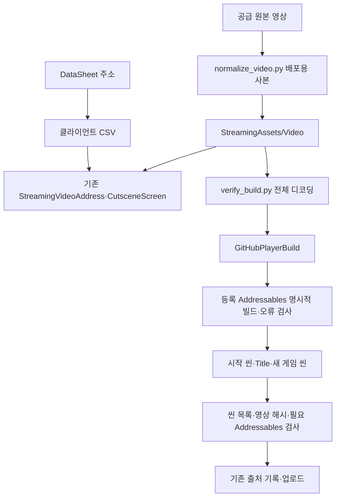

# 빌드 리소스 포함과 실행 검증 설계

2026-11-16 후속 담당: B09 인트로·엔딩의 뿌연 출력 조사·새 실행파일 수용은 사용자(본인) 담당입니다. 현재 두 영상은 StreamingAssets 주소지만 출력·UI 겹침·Windows 재생의 원인이 확인된 것은 아닙니다. [확정 담당·남은 조건](1115%20유저테스트%20기획%20반영%20현황과%20사용자%20작업%20목록.md)을 우선하며 파일 검사와 실제 화면 통과를 구분합니다.

기준일: 2026-11-15. 기존 Windows 빌드의 리소스 누락·복귀 씬 누락·영상 경고를 보완합니다. 자동 검사와 실제 실행파일 수용을 구분합니다. [조작·교체 안내](../기획자용%20안내문서/GitHub%20빌드와%20디스코드%20공지%20사용%20안내.md#영상과-씬-포함-검사--2026-11-15)를 따릅니다.

## 목차

1. [문제와 변경 이유](#1-문제와-변경-이유)
2. [책임과 연결](#2-책임과-연결)
3. [영상 공급값과 원본](#3-영상-공급값과-원본)
4. [시작 씬과 복귀](#4-시작-씬과-복귀)
5. [검증과 한계](#5-검증과-한계)

## 1. 문제와 변경 이유

내려받은 release 로그에서 `aa/settings.json` 누락과 `Cutscene_Intro_Video`의 `InvalidKeyException`을 확인했습니다. 키 선택 이후 인트로 준비 실패로 타이틀에 반환됐습니다. 이후 GitHub 검사에서도 런타임 설정 누락이 확인돼, 프로젝트 옵션만으로 성공을 간주하던 대응을 보완합니다.

Linux 에디터는 MP4 VideoClip 가져오기에 제약이 있으므로 기존 타이틀·엔딩의 StreamingAssets 직접 재생을 인트로에도 적용합니다. [Unity 파일 호환성](https://docs.unity.cn/6000.2/Documentation/Manual/VideoSources-FileCompatibility.html)

전투/preview 빌드는 시작 씬 하나만 포함했지만 일시정지·엔딩은 Title 복귀를 호출했습니다. 시작 순서는 보존하고 복귀·새 게임 씬을 함께 포함합니다. 타이틀의 첫 프레임·색상 경고에 대응해 공급 영상 3개의 배포용 사본을 정규화했습니다.

## 2. 책임과 연결

런타임 규칙·실패 시 진행 중단 계약·공용 주소 로더는 유지합니다. `Assets/Editor/Build/GitHubPlayerBuild.cs`는 등록 에셋이 있으면 `BuildPlayerContent` 결과의 오류를 검사하고 빌드 실패로 전달합니다. 중복 생성을 막는 임시 정책은 `finally`에서 원복합니다. [Unity 커스텀 콘텐츠 빌드](https://docs.unity3d.com/Packages/com.unity.addressables@2.7/manual/build-scripting-start-build.html)

`Tools/Build/verify_build.py`는 입력과 결과물 검사를 공유합니다. 등록 주소가 없으면 빈 Addressables 설정·번들을 강제하지 않습니다. 등록이 있으면 설정·카탈로그·번들 누락을 실패로 처리합니다. 개별 주소의 실제 로딩 성공까지 보장하는 검사는 아닙니다.

## 3. 영상 공급값과 원본

| 공급값 | 연결 |
| --- | --- |
| CutsceneStep 22103 / Cutscene 22001 | `streaming:Video/Intro.mp4` |
| CutsceneStep 22101 / Cutscene 22003 | `streaming:Video/Ending.mp4` |
| TitleScreen._videoFile | `Video/HG_BackGround.mp4` |

인트로는 `Assets/2.Model/Test/intro_test.mp4`에서 `Assets/StreamingAssets/Video/Intro.mp4`로 이동했습니다. GUID는 유지하고 importer는 원본 파일용으로 맞췄으며 이전 주소 등록은 제거했습니다. `DataSheet/tables/Cutscene.xlsx`의 `CutsceneStep!E8`과 CSV를 같이 수정해 재배포 때 되돌아가지 않게 합니다. 스키마·다른 공급 수치는 유지합니다.

**아트 원본 제작·공급은 기존 아트 기여이며, 이번 개발 작업은 배포용 인코딩·연결·검사입니다.** `normalize_video.py`는 존재하지 않는 별도 출력만 허용해 원본 덮어쓰기를 막습니다. HD 영상의 BT.709를 명시하고 H.264/yuv420p·B 프레임 없음·첫 시각 0·MP4 faststart로 출력합니다. 해상도·프레임률은 유지하며 오디오가 있으면 AAC로 출력합니다. 원본 사본은 작업 시 임시 백업에 보관했고 Git 이력에도 남습니다. 재인코딩이므로 무손실 변환이 아닙니다.

## 4. 시작 씬과 복귀

| 선택 | 첫 씬 | 함께 포함하는 필수 씬 |
| --- | --- | --- |
| build-settings | 기존 활성 Build Settings 첫 씬 | Title·MapDohwagolTest |
| dohwagol | MapDohwagolTest | Title |
| preview | GameplayPreview | Title·MapDohwagolTest |

중복 씬은 최초 순서를 유지해 제거합니다. Title 복귀 후 새 게임도 가능해야 하므로 preview에도 MapDohwagolTest를 넣습니다. `BuildScenes.txt`는 실제 빌드에 전달한 경로 목록이며 결과물 검사에서 시작 순서·필수 씬을 확인합니다. 실제 씬 이동 완료를 뜻하지 않습니다.

## 5. 검증과 한계

회귀 검사: `python -B -m unittest discover -s Tools/Build -p "test_*.py"`. 영상 누락·변조·경로 이탈·잘못된 시작 씬·필수 씬 누락·등록 주소 유무·색상/코덱/시각 오류를 검사하며 기존 CI 검사에 연결합니다.

입력 검사: `python -B Tools/Build/verify_build.py`. 결과물 검사: `python -B Tools/Build/verify_build.py --build-dir build/StandaloneWindows64 --scene build-settings`. FFmpeg·ffprobe가 필요하며 `--ffmpeg`·`--ffprobe`로 경로를 지정합니다. 입력 영상·오디오를 끝까지 디코딩하고 출력은 입력과 SHA-256이 같은지 확인합니다. 실패 시 Unity 빌드 또는 업로드 전에 중단합니다.

실행 결과는 [현재 구현과 검증 현황](현재%20구현과%20검증%20현황.md)에 기록합니다. GitHub Linux 실제 빌드, Windows의 인트로 자연 종료/스킵 후 맵 진입, 각 시작 모드의 일시정지·엔딩 복귀는 별도 수용 대상입니다. FFmpeg 통과를 Windows Media Foundation·Unity 재생 성공으로 간주하지 않습니다.
