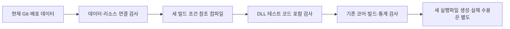
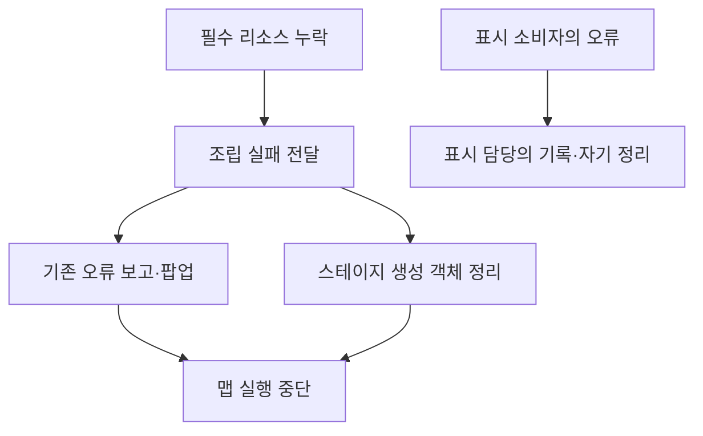
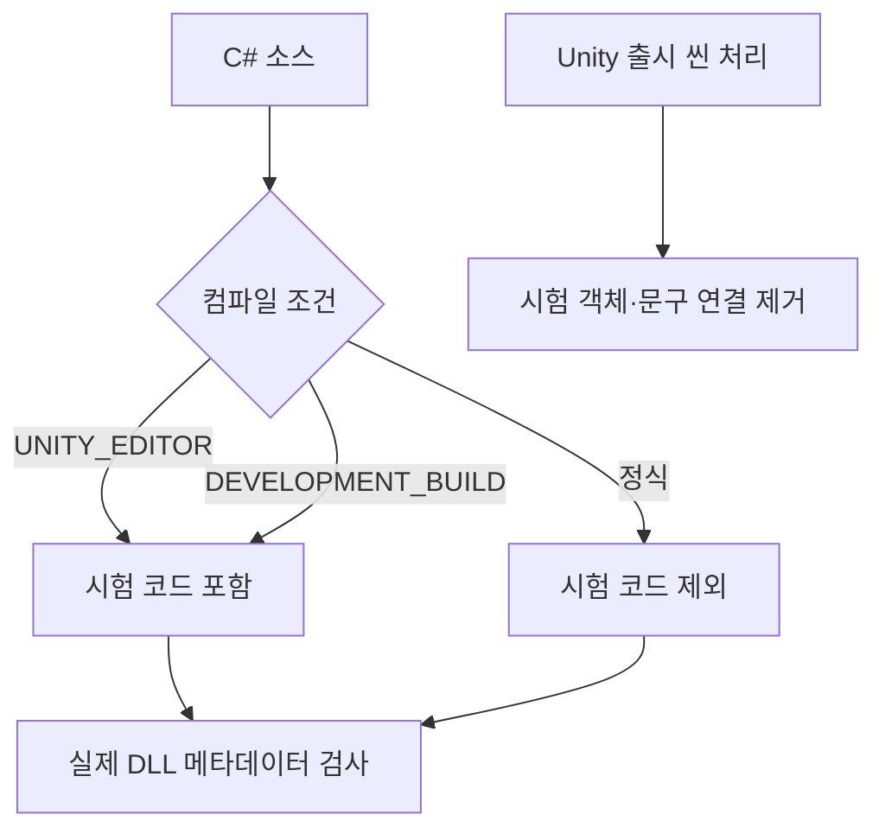
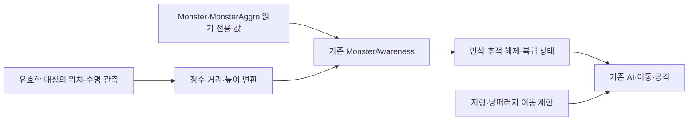

# 빌드 전 정합성과 테스트 기능 점검

기준일: 2026-11-16. 기준 커밋 `4274c187`과 이번 로컬 수정입니다. 새 실행파일을 생성하거나 Git에 커밋·푸시하지 않았습니다. 자동 검사·편집기 상태 확인·실제 게임 완주를 구분합니다.

## 목차

1. [점검 범위와 현재 판단](#1-점검-범위와-현재-판단)
2. [문제와 수정 이유](#2-문제와-수정-이유)
3. [테스트 기능의 빌드 경계](#3-테스트-기능의-빌드-경계)
4. [어그로의 데이터 기준 재구성안](#4-어그로의-데이터-기준-재구성안)
5. [검증 결과와 남은 확인](#5-검증-결과와-남은-확인)
6. [담당과 사용 시 주의](#6-담당과-사용-시-주의)

## 1. 점검 범위와 현재 판단

최근 통합 코드, 스폰·몬스터 참조, 생성·정리, 명부 대화 요청 결과, 테스트 기능의 포함 조건, 빌드 영상 검사 도구와 통계 조회 도구를 점검했습니다. 전 파일의 모든 실행 경로에서 오류가 없음을 보장하는 전수 동작 검사는 아닙니다.

기존에 누락됐던 옹귀 3005의 프리팹은 최신 병합에 등록돼 있습니다. 옹귀 연결을 다시 만들지 않았습니다. 갈림길 문구 연결도 최신 WorldGuideLabels에 있으므로 과거 미구현 목록과 구분합니다. 아트·최종 배치 수용은 별도입니다.

## 2. 문제와 수정 이유

| 문제·이전 동작 | 수정 | 이유·보존 범위 |
| --- | --- | --- |
| MonsterThrowRigView의 직렬화 필드 초기값이 명시되지 않아 경고를 오류로 취급하는 검사 실패 | `_sourceFeet = 0f` 명시 | 기존 기본값·프리팹 공급값·투척 동작 보존 |
| Python 3.10에서 `hashlib.file_digest`가 없어 영상 해시 검사 실패 | 공통 FileDigest에서 일정 크기 블록으로 SHA-256 계산 | 로컬·CI 검사 의미를 통일. 영상 전체를 메모리에 읽지 않음 |
| 플랫폼·몬스터 프리팹 누락을 경고 후 건너뜀 | 기존 맵 조립자에게 예외 전달 | 일부만 생성된 맵을 정상 실행하지 않음. 생성자 실패 정리 재사용 |
| 맵 초기화 실패를 로그만 기록 | 기존 오류 팝업 연결로 보고하고 finally에서 비활성·정리 | 정식 빌드에서 자동 오류 팝업 수집에 의존하지 않음 |
| Title 카메라의 URP 추가 설정 누락 | 기존 카메라에 UniversalAdditionalCameraData 추가 | 카메라 경고 원인 보완. UI 배율·크기 변경은 보존하지 않음 |
| F9 검사 화면이 정식 코드에 포함된 뒤 Awake에서 제거됨 | 다른 시험 기능처럼 조건부 컴파일. 출시 씬 사본에서도 해당 컴포넌트 제거 | 정식 빌드에 테스트 화면 코드·컴포넌트를 남기지 않음 |

새 전송기·이벤트 버스·팝업 관리자는 만들지 않았습니다. 기존 ErrorPopupSceneBinding과 로그 수집 경계를 재사용합니다. Firebase 서버 수신 여부는 네트워크·인증·전송 상태에 따라 달라지며 이번 로컬 검사만으로 보장하지 않습니다.

## 3. 테스트 기능의 빌드 경계

| 기능 | 에디터·개발 빌드 | 정식 빌드 |
| --- | --- | --- |
| F5 수동 저장·슬롯 화면 | 코드 포함, 기존 저장 정책·입력 허용 조건 적용 | 전용 코드 제외·출시 씬에서 제거 |
| F8 보스 이동·처치·노출·패턴·QA 진단 | 코드 포함, 진행 중 화면·사망·로딩 등 실행 조건 적용 | 전용 메서드 제외 |
| F9 데이터 원문 검사 | 코드 포함 | 코드 제외·출시 씬에서 컴포넌트 제거 |
| F12 초기화 확인·최신 슬롯 삭제 | 코드 포함, 확인 팝업 뒤 실행 | 전용 코드 제외·출시 씬에서 제거 |
| 타이틀 테스트 저장 불러오기 | 코드 포함·기존 노출 설정 적용 | 전용 코드·표시 제거 |
| 플레이어 판정 표시 | 표시 허용 | 기존 forceRenderingOff로 표시만 차단, 판정 기능 유지 |

추가한 DLL 검사는 Verify-Data.ps1의 엔진 참조 컴파일 뒤에 수행합니다. 어셈블리를 게임으로 실행하지 않고 PE 메타데이터만 읽습니다. ManualSaveHost·DemoResetHost·TitleSaveSelection·SaveSlotScreen·DataLoadViewer 타입 5개와 GameplayPreview의 보스·어그로 시험 메서드 6개가 조건에 맞게 포함됐는지 확인합니다.

이는 참조 컴파일 결과의 코드 경계 검증입니다. 실제 Unity 플레이어의 씬 처리·다운로드한 실행파일의 버튼 조작까지 시험한 것으로 해석하지 않습니다. 정식에서도 필요한 저장 규칙·자동 저장·공용 오류 기능은 제거하지 않습니다.

## 4. 어그로의 데이터 기준 재구성안

후속 원본 5c3bef3은 SightHeight를 삭제하고 8방향을 공급했습니다. 이번에 사용자 승인으로 SameLevelHeight까지 추가해 연결·배포했습니다. **현재 설계는 [8방향 인식과 추적 설계](몬스터%208방향%20인식과%20추적%20설계.md)**가 기준이며, 아래 SightRange·SightHeight 설명은 그 직전 단계의 변경 이력입니다. 더 이상 해당 두 값을 운영 인식에 사용하지 않습니다.

MonsterRuntime은 MonsterID로 MonsterAggro 행을 찾아 MonsterAwareness에 주입합니다. 가로 인식은 Monster.SightRange, 높이·해제·복귀·재인식은 MonsterAggro 값입니다. 이전 PreviewMonsterDriver는 그 앞에서 같은 보행 구간·화면·매달림·사다리 조건으로 대상을 제외해 데이터가 충족돼도 인식하지 않을 수 있었습니다.

**사용자가 코드의 추가 인식 조건 제거를 승인해 반영했습니다.** 기획자가 원본 표를 수정해 올릴 예정이므로 시트·수치·스키마는 이번에 변경하지 않았습니다. 아직 공급되지 않은 컬럼은 추측하지 않습니다.

| 이전 | 현재 | 이유 |
| --- | --- | --- |
| 표 범위 앞에 화면·발판·플레이어 이동 상태 조건 | 객체 수명 확인 뒤 표 범위로 판정 | 기획자가 표를 바꿔도 코드 조건에서 막히는 문제 제거 |
| 인식에 카메라 연결 필요 | 카메라 의존과 호출 제거 | 표시와 게임 규칙 분리 |
| 인식 거리·높이를 Transform 실수에서 환산 | SpatialRuntime 정수 좌표 차이를 기존 ToData로 변환 | 런타임 단위 계약 통일 |
| F8에 화면·같은 바닥 여부 표시 | 대상 유효·가로 거리·높이·인식 거리 표시 | 새 판정에서 실제로 사용하는 관측값 확인 |

공격 패턴·패링·접촉 판정의 기존 동작은 유지했습니다. MonsterAwareness·MonsterActor의 유효하지 않은 대상 처리도 유지하되, 그것을 화면이나 발판 정책으로 해석하던 설명·검사 이름을 정정했습니다. 공급 수치에 고정된 기대값을 추가하지 않고 서로 다른 시험 정의의 거리·높이·시간 경계를 검증합니다. 기획자 절차는 [몬스터 인식과 추적 데이터 사용 안내](../기획자용%20안내문서/몬스터%20인식과%20추적%20데이터%20사용%20안내.md)를 봅니다.

대상 인식과 몬스터가 실제로 갈 수 있는 경로는 별개입니다. 어그로를 얻어도 낭떠러지·벽을 넘어 추적하는 길 찾기를 새로 제공하는 것은 아닙니다. 현재 거리 값은 tile_x100, 시간은 정수 ms 계약을 유지합니다. 보스 방 전체 인식은 별도 정책이며 일반몹 규칙으로 덮어쓰지 않습니다.

## 5. 검증 결과와 남은 확인

| 검사 | 이번 확인 결과 |
| --- | --- |
| 데이터 | 어그로 시험 사본 검사를 포함해 10,142개 통과 |
| 코어 | 8방향 변경 후 2,282개 통과 |
| 정식·개발·에디터 참조 컴파일 | 각각 경고·오류 0 |
| DLL 시험 코드 포함 | 세 조건 모두 통과. 정식 제외·개발/에디터 포함 |
| 빌드 공지 | 9개 통과 |
| 영상·씬 포함 검사 회귀 | 8개 통과 |
| PNG 압축 계약 | 2개 통과. 이번에 원본 이미지 압축·교체는 하지 않음 |
| 통계 집계·엑셀 | 8개 통과 |
| 통계 조회 화면 빌드 | 통과. 지연 로딩되는 엑셀 라이브러리 청크 크기 경고 존재 |

로컬에 ffmpeg·ffprobe가 없어 영상 전체 디코딩을 이번에 재수행하지 않았습니다. GitHub 빌드에는 원본 및 결과물 검사 단계가 있습니다. 이번에는 새 플레이어 빌드·실제 전체 완주·Firestore 에뮬레이터 규칙 검사를 수행하지 않았습니다.

### 편집기 리로드와 실제 어그로 확인

사용자가 Play하는 중 코드 변경이 반영돼 런타임 상태가 사라졌습니다. 관측 시 GameplayPreview의 구독이 해제되고 PlayerRuntime.Actor가 비어 있었습니다. 이 상태의 어그로·검은 화면을 정상 게임 판정 결과로 사용하지 않습니다. Play를 중지한 뒤 반영을 끝내고 다시 시작해야 합니다. Title 외부 변경 확인창이 편집기 응답을 막는 것도 확인했습니다. 이후 실시간 확인 중에는 Assets 코드를 수정하지 않습니다.

## 6. 담당과 사용 시 주의

이번 수정은 사용자 요청의 빌드 전 감사이며 아직 커밋 전입니다. 기반 커밋 37b1bb62의 Git 작성자는 NYM, 병합 기준은 4274c187입니다. 기존 옹귀·맵·연출 기여와 이번 검사·안전 경계 수정을 구분합니다. 원본 아트 제작·외부 공급은 아트 담당자의 공동 기여이며 이번에 새 아트를 제작하지 않았습니다.

기획자는 수치·문구를 원본 시트에서 수정하고 검사·배포합니다. 개발자는 코드 변경을 Play 중에 반영하지 않고, 공통 계약 변경은 사용처·구독·생성과 정리를 함께 확인합니다. 실제 저장 삭제·덮어쓰기·보스 처치는 시험 저장을 사용해야 하며 이번 감사에서 사용자 저장을 삭제하지 않았습니다.

기획자 조작 절차는 [빌드 안내](../기획자용%20안내문서/GitHub%20빌드와%20디스코드%20공지%20사용%20안내.md), 상세 연결은 [명부 설계](명부%20대화와%20조사%20완료%20연결%20설계.md)를 봅니다.
