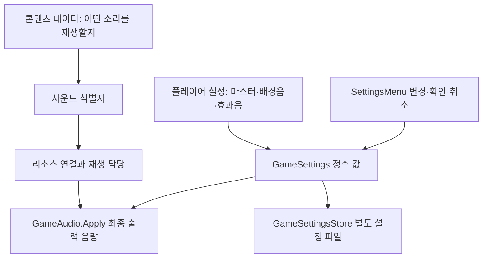
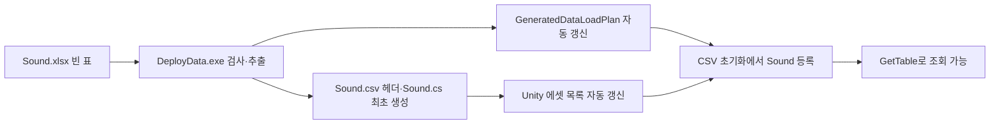
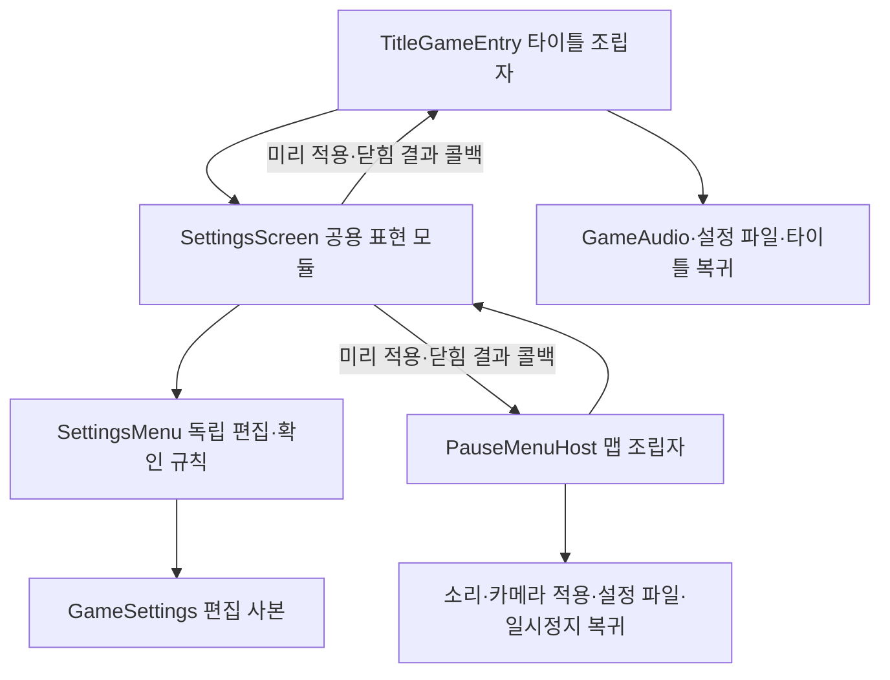

# 사운드 설정 설계

## 1. 필요한 이유

마스터 음량으로 배경음·효과음을 함께 조절하면서 각 개별 음량은 보존해야 합니다. 콘텐츠 제작자가 정하는 소리와 플레이어가 정하는 음량은 수명·소유자가 달라 분리합니다. 기준일은 2026-11-05이며 이번 구현은 마스터 설정의 기반입니다.

## 2. 책임과 데이터 구분



| 계층·파일 | 책임 | 현재 상태 |
| --- | --- | --- |
| Core/Settings/GameSettings | 0~10 음량, 합성 백분율, 복제·비교 | 마스터 추가 완료 |
| Core/Settings/SettingsMenu | 설정 사본, 변경 이벤트, 적용·취소 | SetMaster 진입점 추가 완료 |
| Adapters/GameSettingsStore | settings.json 저장·읽기 | Master 저장, 이전 파일 기본값 유지 |
| Adapters/GameAudio | Unity AudioSource 출력·페이드 | 마스터를 배경음·효과음에 반영 |
| Presentation/SettingsScreen | 화면·조작·미리 듣기 요청 | 마스터 포함 공용 4항목·입력 차단·미확정 편집 취소 |
| Stage 데이터 | 맵의 일반·전투 배경음 키 | BGM_Normal·BGM_Battle 기존 사용 |
| 사운드 콘텐츠 정의 | 소리별 리소스·종류·재생 설정 | Sound 빈 표·CSV·자동 로딩 준비, 리소스 자동 해석은 미구현 |

설정 값과 저장은 기존 파일을 확장합니다. 별도 마스터 관리자나 전역 이벤트 버스를 만들지 않습니다. 소리는 GameAudio를 통해 적용하며 AudioListener 전역 음량까지 함께 바꿔 이중으로 감쇠하지 않습니다.

## 3. 음량 규칙과 호환성

- Master 기본값은 10입니다. 기존 Music·Effects 기본값 8을 유지합니다.
- 각 설정은 0~10 정수로 제한합니다. MusicPercent=Master×Music, EffectsPercent=Master×Effects이며 출력 경계에서만 100으로 나눠 실수로 변환합니다.
- 마스터5·배경음8이면 최종40%, 마스터0이면 전체 무음입니다. 개별 값은 지우지 않습니다.
- 배경음에는 기존 일시정지50%와 크로스페이드 비율이 추가로 곱해집니다. 효과음에는 배경음 페이드를 적용하지 않습니다.
- 기존 3인자 생성자는 마스터10을 사용합니다. Clone·SameAs가 마스터를 포함하므로 마스터만 변경해도 저장 확인 대상입니다.
- JsonUtility.FromJsonOverwrite를 기본 Payload에 적용해 Master가 없는 이전 settings.json은 마스터10을 유지합니다. 이는 플레이어 설정 호환 처리이며 배포 데이터 검사기를 클라이언트에 추가하는 작업이 아닙니다.

## 4. 개발자 연결 순서

```csharp
var menu = new SettingsMenu(GameSettingsStore.Load());
menu.SetMaster(5);
// 화면 담당은 변경 결과를 표시하고 미리 듣기를 요청합니다.
audio.Apply(menu.Current);
// 기존 RequestClose·Answer 흐름으로 저장 여부를 확인한 후 처리합니다.
GameSettings result = menu.Answer(apply);
audio.Apply(result);
GameSettingsStore.Save(result);
```

예시는 호출 책임을 보여줍니다. 실제 확인 화면에서는 RequestClose 후 사용자가 선택한 apply를 전달해야 합니다. 취소 결과도 다시 Apply해야 미리 듣기 음량이 원래대로 돌아갑니다. SettingsScreen에 마스터 조작부를 연결했습니다. 기존 SettingsRow의 숫자는 유지하고 Master=3을 추가했으며 최초 선택을 Master로 지정해 화면 순서대로 마스터→배경음→효과음→카메라 흔들림을 순환합니다.

## 5. 콘텐츠 사운드도 데이터 기반으로 확장

사용자 확정 방향은 효과음과 배경음을 모두 데이터로 설정하는 것입니다. 현재는 Stage에서 배경음 키만 선택하고, GameAudio Inspector 목록에서 클립을 찾습니다. 타이틀 배경음 키는 Inspector, 전투 효과음 키는 PreviewCombatFeedback 코드에 있어 전체 데이터 기반 전환이 완료된 상태가 아닙니다.

추후 콘텐츠 정의는 안정적인 사운드 ID·리소스 주소·종류·소리별 기본 음량·반복/페이드 같은 재생 설정을 소유하고, 콘텐츠의 이벤트/상태 설정은 해당 ID를 참조하도록 연결합니다. 정확한 컬럼과 단위는 기획 데이터 담당과 확정한 뒤 기존 추출·배포 경로에 추가합니다. 사용자 승인으로 Sound.xlsx의 빈 Sound 탭을 추가하고 기존 자동 생성·배포로 연결했습니다. 기존 재생 키와 Stage 스키마는 변경하지 않았습니다.

데이터 검사와 참조 검사는 DataSheet가 맡고, 클라이언트는 준비된 정의를 읽고 명시적인 리소스 담당을 통해 재생합니다. 리소스 준비 전 재생 요청의 처리와 씬 종료 시 해제 계약도 그 단계에서 구현해야 합니다. 기획자가 데이터만 바꿔 소리를 교체하는 것은 이 연결까지 끝난 뒤 가능합니다.

## 6. 검증·주의점

마스터 기본값·출력 합성·무음 후 개별 값 보존·상하한·변경 이벤트·사본 격리·확인 중 변경 차단·적용/취소·복제를 코어 검사에 추가했습니다. 실제 Unity 설정 파일 호환·오디오 출력·크로스페이드·새 UI 조작은 별도 확인 대상입니다. 플레이어 로컬 음량은 전투 규칙·난수·게임 명령 순서와 분리하며 네트워크 동기화 상태로 사용하지 않습니다.


## 7. Sound 테이블 껍데기와 로딩 연결

2026-11-05 기준 DataSheet의 tables/Sound.xlsx에 Sound·README 탭을 추가했습니다. 실제 ID와 사운드 행은 비워 두었습니다. 데이터 탭의 B1에 타입·범위·허용값 규칙, B2에 CSV 지정, B5에 Note 제외, 6행에 헤더를 둡니다. 기존 파일 자동 탐색·검사·생성기를 재사용하며 별도 사운드 추출기를 만들지 않습니다.

| 컬럼 | 생성 타입 | 지정 검사 |
| --- | --- | --- |
| ID | int | 기본 규칙: 양의 정수, 중복 금지 |
| Address | string | 필수 문자열, 기존 문자열 정책 적용 |
| Category | int | 1=배경음, 2=효과음 |
| Volume | int | 0~10000 |
| Loop | bool | 엑셀 Y/N |
| FadeInMs·FadeOutMs | int | 0 이상, 밀리세컨드 |
| Note | 생성 제외 | 기획 설명 |



```csharp
// 기존 데이터 준비 완료 콜백에서 전달받은 catalog를 사용합니다.
IReadOnlyDataTable<Sound> sounds = catalog.GetTable<Sound>();
// 현재 Count는 0입니다. ID가 확정되고 행이 공급된 뒤에 Get 또는 TryGet을 사용합니다.
```

정의 파일은 Assets/3.Script/Data/Sound.cs, 데이터는 Assets/Data/Csv/Sound.csv입니다. GeneratedDataLoadPlan은 도구가 갱신했으며 직접 수정하지 않습니다. Unity 코드 반영 뒤 GameDataAssetBuilder가 CSV 참조를 자동 갱신하고 빌드 전에도 갱신합니다. 일반 실행 검증은 데이터913·코어614·기존 CS0414 제외 참조 컴파일 통과입니다. Unity 임포트·실제 재생은 별도이며 사운드 파일 로드·해제·재생 연결은 이번에 구현하지 않았습니다.

기획자 작성 순서는 [테이블 작성·배포 안내](../기획자용%20안내문서/기획자용%20사운드%20테이블%20작성과%20배포%20안내.md)를 따릅니다. 새 행을 입력하면 ID·범위·Category·Y/N은 기존 시트 검사기로 검사합니다. Addressables의 실제 주소·AudioClip 타입 확인은 아직 구현되지 않았으므로 현재 배포 검사 통과를 실제 파일 존재 확인으로 해석하면 안 됩니다. 다른 테이블이 SoundID를 참조하는 변경도 아직 하지 않았습니다.


## 8. 공용 설정 화면의 조립과 수명

2026-11-05 현재 코드를 확인했을 때 TitleGameEntry에는 공용 설정 연결이 이미 반영돼 있어 이를 유지했습니다. 이번에는 마스터 행·공통 음량 조작/표시·열기 프레임 입력 차단·화면 비활성화 취소를 보완했습니다.



SettingsScreen은 씬 탐색·음원 선택·직접 설정 저장·타이틀 이동·게임 시간 변경을 하지 않습니다. 데이터를 받아 열고 결과를 반환하므로 독립적인 화면입니다. 조립자가 입력과 실제 소리·카메라 적용 대상을 전달합니다. 배경음·효과음·마스터의 화살표 연결은 ConnectVolume, 표시와 선택 색은 RenderVolume으로 재사용하며 매 프레임 조회를 추가하지 않습니다.

SettingsMenu·SettingsScreen은 상속을 막지 않습니다. 구조를 단순하게 유지하기 위해 의미 없는 공통 부모를 추가하지 않았습니다. 비활성 프리팹에서 열 때만 편집 사본을 만들고, 이미 열린 화면의 재진입은 실패로 알립니다. 여는 프레임은 입력을 무시합니다. 닫을 때 구독·편집·콜백 참조를 정리하고 타이틀 조립자가 다음 프레임에 부모 입력을 복구합니다. 화면 외부 비활성화도 Cancel로 원래 값을 반환하며, 정상 Finish는 편집 참조를 먼저 비워 중복 취소를 방지합니다.

오류 모달은 기존 IModalInputTarget→조립자→설정 화면/입력 경로를 사용합니다. SettingsScreen의 모든 사용자 입력은 차단 상태를 확인하므로 다른 팝업을 닫아도 편집 사본과 기존 일시정지를 보존합니다. 마스터의 Language ID가 없어 Inspector 임시 문구를 사용하며 유효 ID가 공급되면 마스터 문구 ID로 연결합니다. 새 Language ID를 임의 추가하지 않았습니다.

데이터913·코어624 검사와 기존 CS0414 제외 일반 참조 컴파일, 프리팹 내부 참조·식별자 중복 검사가 통과했습니다. 이는 실제 Unity 마우스/패드·소리·파일 호환·화면 배치 검증을 대신하지 않습니다. 기획자 안내의 Play 절차로 확인해야 합니다. 네트워크 명령·게임 저장 상태·전투 규칙은 변경하지 않았습니다.


## 9. 현재 공통 어댑터

설정 적용·저장·실패 복구는 SettingsApplication을 타이틀과 일시정지가 재사용합니다. 전달값은 복사해 원본을 보호합니다. 표시 계약은 ScreenVisibility, 마우스 연결은 MenuText로 통합했습니다. TitleSceneActions는 제거했고 TitleSceneHost에 실행 함수를 직접 등록합니다. 화면 수명과 재정의 구조의 기준은 [공통 모듈과 객체 수명 설계](공통%20모듈과%20객체%20수명%20설계.md)를 따릅니다.
