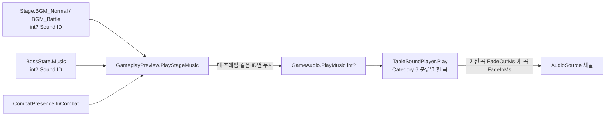
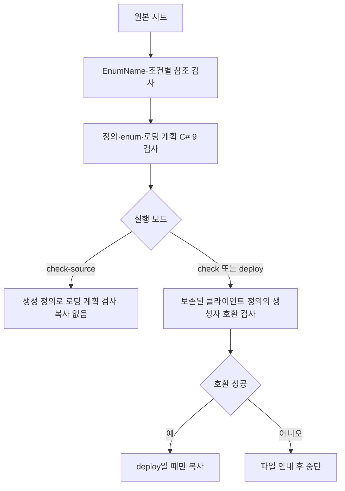
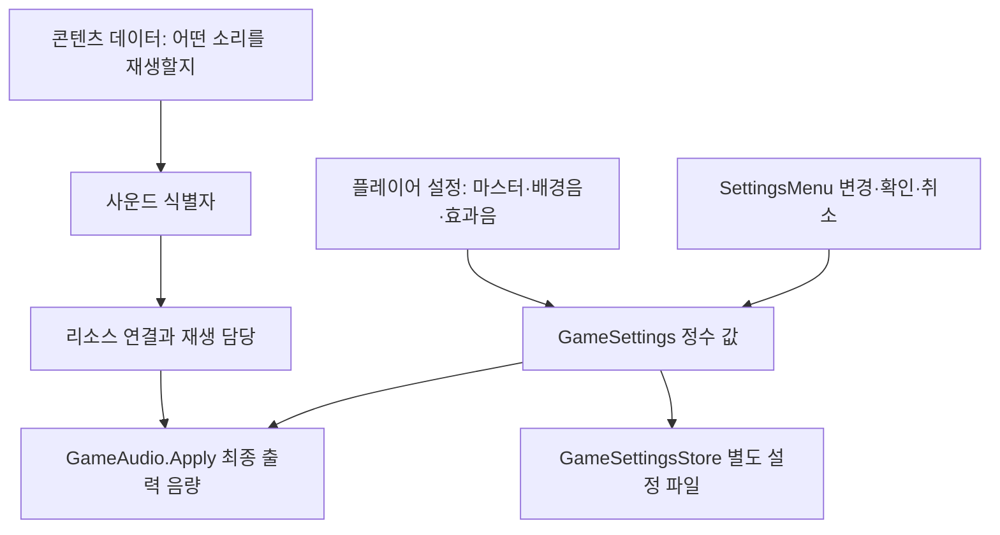
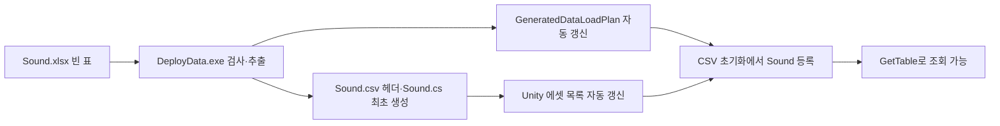
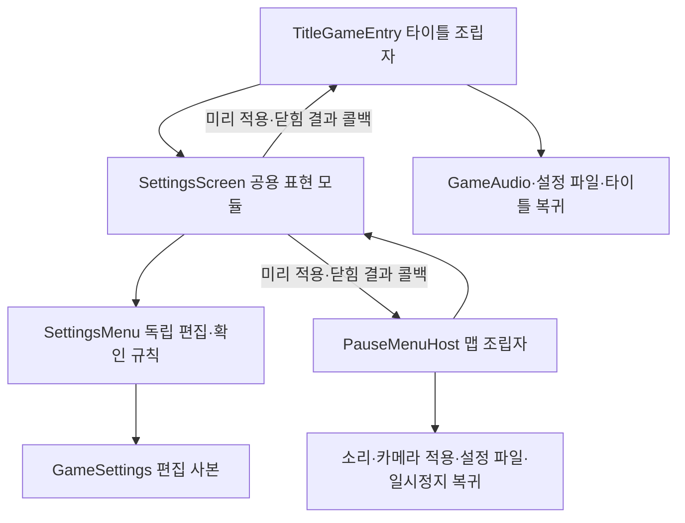
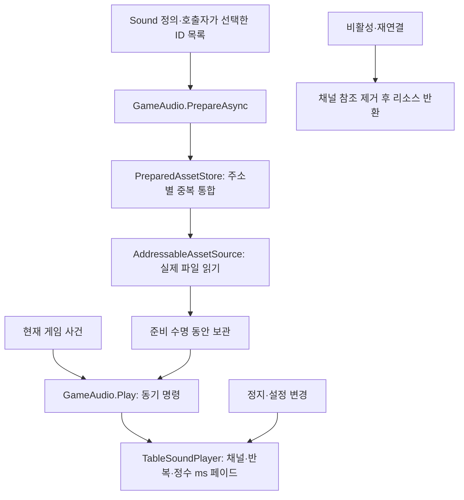

# 사운드 설정 설계

## 2026-11-20 배경음악 Sound ID 전환과 보스 페이즈 전환

사용자 확정:

- 배경음악도 Sound 표 ID로 정합니다. Stage에서 맵 BGM을 설정하고, 보스 페이즈가 바뀌면 BossState.Music으로 전환합니다.
- `BGM_Battle`이 빈칸이면 평상 곡을 유지합니다.
- 보스↔스테이지 연결은 음악만 합니다. 보스 개체 선택은 기존 `BossRuntime._bossId` Inspector 값을 유지합니다.

기획자 사용법은 [배경음악(BGM) 설정 안내](../기획자용%20안내문서/기획자용%20배경음악(BGM)%20설정%20안내.md)에 있습니다.



| 위치 | 변경 |
| --- | --- |
| DataSheet `Enum.xlsx` | `SoundCategory.Bgm = 6`(SheetKey `BGM`) 추가. 생성 enum은 배포로 갱신 |
| DataSheet `Sound.xlsx` | 3082 HG_Lobby_BGM, 3083 HG_Boss_Phase1, 3084 HG_Boss_Phase2, 3085 HG_TitleSound(Category 6, RefIndex 빈칸 규칙 `ConditionalValue WhenValue=6`) |
| DataSheet `Stage.xlsx` | `BGM_Normal`·`BGM_Battle`을 `Integer;Optional;ReferenceTable=Sound`로 바꾸고 `ReferenceValue ... TargetColumn=Category;Value=6` 검사 추가. 필드는 Normal 3082·Battle 빈칸, 보스방 8004는 Normal 3083 |
| DataSheet `UnitState.xlsx` BossState | `Music`을 Sound ID로 변경(같은 Category 6 검사). 4001 빈칸, 4002 3084 |
| [Stage.cs](../../Assets/3.Script/Data/Stage.cs)·[BossState.cs](../../Assets/3.Script/Data/BossState.cs) | 시트 스키마에 맞춰 `int?`로 변경 |
| [TableSoundPlayer.cs](../../Assets/3.Script/Adapters/TableSoundPlayer.cs) | `Category == 1` 하드코딩을 `SoundCategory`로 교체. 환경음·배경음악은 **같은 분류끼리만** 교체(환경음이 BGM 때문에 끊기지 않음). 둘 다 배경음 음량·일시정지 50% 적용. `IsStopping(SoundCategory)` 추가 |
| [GameAudio.cs](../../Assets/3.Script/Adapters/GameAudio.cs) | 문자열 BGM 경로, AudioSource A/B, `MusicFade`, 코드 크로스페이드 상수, `FadeOutMusic`를 삭제하고 `PlayMusic(int?)`만 남김. 표 연결 전 요청은 기억했다가 `ConnectTable`에서 시작. `IsMusicFadingOut`은 Bgm 분류 페이드아웃 여부 |
| [GameplayPreview.cs](../../Assets/3.Script/Preview/GameplayPreview.cs) `PlayStageMusic()` | 곡 선택 한 곳: 전투 중이고 Battle이 있으면 Battle, 아니면 Normal. 보스방이면 살아 있는 보스의 `Phase.Music ?? 위 값`, 보스 사망·처치 완료 방은 `null`. `StepBossMusic`·`_bossMusicPhase`·보스 페이드 상수(2000/3000ms) 삭제 |
| [TitleGameEntry.cs](../../Assets/3.Script/Adapters/TitleGameEntry.cs) | `_musicKey`(문자열)를 `_musicSoundId = 3085`로 변경. TitleScreen.prefab 직렬화 값 갱신 |
| GameAudio.prefab | BGM 문자열 항목 7개(BGM_VILLAGE·FIELD·BATTLE·BOSS·BOSS_PHASE1·2·TITLE_BACKGROUND)를 Sound ID 항목 4개로 교체하고, 쓰지 않는 음악 AudioSource 2개 삭제 |
| `ResourceConnectionChecks`·`StageMappingChecks` | Stage·BossState·타이틀 BGM이 Category 6이고 GameAudio에 같은 Sound ID 클립이 있는지 검사 |

동작 계약:

- 보스 페이즈 값은 HP 기준을 넘는 순간(`BossPoise` 전환 시작) 바뀌므로, 곡도 전환 연출이 시작될 때 크로스페이드됩니다. 이전 구현은 전환 중 3초 페이드아웃 뒤 2초 페이드인이었습니다.
- 보스 사망 시 `PlayMusic(null)`로 해당 곡의 FadeOutMs(3000)만큼 줄어들고, 엔딩은 `IsMusicFadingOut`이 끝난 뒤 시작합니다(기존 계약 유지).
- 처치 완료 보스방 재방문은 기존처럼 무음입니다(이전에는 Normal 빈칸으로 무음).
- 맵 이동 시 BGM은 새 씬 GameAudio에서 처음부터 FadeInMs로 다시 시작합니다(기존과 같음). 환경음의 이어 재생 기록은 BGM에 적용하지 않았습니다.
- 참조가 없어진 `Test_Boss_BGM.mp3`(이전 전투·보스 곡)는 사용자 확인 후 삭제했습니다.

검증: `DeployData.exe --check-source`·`--check`·`--deploy` 통과(39탭·JSON 18개). 배포 후 실제 내용 변경은 EnumDefinition·Sound·Stage CSV, BossState.json, SoundCategory.cs뿐이고, 줄바꿈만 바뀐 파일은 원복했습니다. `Tools/Verify-Project.ps1 -CompileUnity` 통과(검사 13707개·코어 2380개). **Unity 플레이 청취는 하지 않았습니다.**

## 2026-11-18 원본과 도구 개정 경계

사용자 확정: Sound.Category는 SoundCategory enum(환경음 1·플레이어 2·몬스터 3·보스 4·공용 5), RefIndex는 각각 Stage·Player·Monster·Boss 타입 UnitStat의 ID이며 공용은 빈칸입니다. 같은 환경음의 여러 맵 사용은 맵별 Sound 행으로 분리했습니다. 기존 재생 컬럼은 유지합니다. **현재 클라이언트 정의·재생 코드는 변경하지 않았습니다.**

기존 EnumDefinition→EnumGenerator→매 배포 갱신 경로를 재사용합니다. 일반 정의 C#은 최초 생성 뒤 보존하는 규칙을 유지합니다. 생성 enum을 임의로 작성하거나 배포하지 않았습니다.

DataSheet 공통 스키마에 `@column ...;EnumName=SoundCategory`를 추가했습니다. DataValidator는 enum별 허용 정수 집합을 한 번 만들고 조회하며 숫자 AllowedValues를 복제하지 않습니다. `ConditionalReference`는 WhenColumn/WhenValue에 따라 RefIndex를 다른 테이블에 연결하고 대상 ID 집합을 검사합니다. TargetColumn/Value를 함께 지정하면 보스의 UnitStat.Type=Boss 같은 조건을 검사합니다. 기존 ConditionalValue는 명시적 `Value=` 빈값을 지원해 공용 참조가 비어 있는지도 확인합니다. 기존 규칙 동작은 유지합니다.



`UnityCodeOutput.Create`·`ClientLoadPlanCompiler.Compile`은 기존 기본 경로의 정의 보존을 유지합니다. 원본 전용 검사에서만 생성 정의로 검사하며 CLI는 옵션을 하나만 받아 `--check-source`와 `--deploy`를 함께 실행할 수 없습니다. 원본 검사 통과는 배포 가능 판정이 아닙니다. `Publish-DataExport.ps1 -SourceOnly`는 이 원본 검사로 EXE만 갱신하고, 기본 실행의 엄격 검사는 유지합니다.

검증은 SoundSchemaChecks의 유효/잘못된 enum, 필수 참조 누락·0·없는 ID, 분류별 ID, 보스 Type, 공용 빈값, 잘못된 규칙과 기존 enum 생성·갱신 정책을 포함합니다. 원본 전용 회귀 31개와 실제 EXE의 37탭·JSON 18개 검사가 통과했습니다. 기존 정의 불일치가 엄격 경로에서 차단되는 것도 확인했습니다. 클라이언트 정의를 임시로 맞춘 중간 전체 회귀는 262개였지만, 사용자의 도구 전용 지시 후 원복한 현재 상태의 전체 호환 검사 성공으로 보고하지 않습니다.

후속은 Sound.RefIndex·Stage.AmbienceSoundID의 정의 계약과 실제 재생 코드의 Category 의미·환경음 선택 경로를 맞추는 작업입니다. 자동 덮어쓰기나 검사 우회로 해결하지 않습니다. [기획자 작성·직접 검사/배포 안내](../기획자용%20안내문서/기획자용%20사운드%20테이블%20작성과%20배포%20안내.md#12-소리-대상-분류와-refindex--2026-11-18)를 따릅니다. 아래 내용은 이전 재생 구조와 기록입니다.

2026-11-13: 공용 옵션에 KO/EN 언어 선택·저장·취소를 추가했습니다. [언어 선택 안내](언어%20선택%20설정%20설계.md)를 함께 읽습니다. 소리 적용·저장 경로는 기존 기능을 재사용합니다.


## 목차

0. [2026-11-20 배경음악 Sound ID 전환과 보스 페이즈 전환](#2026-11-20-배경음악-sound-id-전환과-보스-페이즈-전환)
1. [2026-11-09 공급 Sound 표 소비 연결](#2026-11-09-공급-sound-표-소비-연결)
2. [필요한 이유](#1-필요한-이유)
3. [책임과 데이터 구분](#2-책임과-데이터-구분)
4. [음량 규칙과 호환성](#3-음량-규칙과-호환성)
5. [개발자 연결 순서](#4-개발자-연결-순서)
6. [콘텐츠 사운드도 데이터 기반으로 확장](#5-콘텐츠-사운드도-데이터-기반으로-확장)
7. [검증·주의점](#6-검증주의점)
8. [Sound 테이블 껍데기와 로딩 연결](#7-sound-테이블-껍데기와-로딩-연결)
9. [공용 설정 화면의 조립과 수명](#8-공용-설정-화면의-조립과-수명)
10. [현재 공통 어댑터](#9-현재-공통-어댑터)
11. [주소 준비와 동기 재생의 현재 구조](#9-주소-준비와-동기-재생의-현재-구조)
12. [플레이어 동작과 임시 환경음 (2026-11-09)](#플레이어-동작과-임시-환경음-2026-11-09)
13. [옵션 UI와 아틀라스 (2026-11-13 최종)](#옵션-ui와-아틀라스-2026-11-13-최종)

## 2026-11-09 공급 Sound 표 소비 연결

`GameAudio.Entry.SoundId`로 기존 호출 키·프리팹 클립을 Sound 3001~3023에 연결했습니다. 키의 무작위 ID를 고른 뒤 `TableSoundPlayer`가 Category·Volume·Loop·FadeInMs/FadeOutMs를 소비합니다. 프리팹 소유 클립은 Sound.Address로 조회하는 명시적 공급자를 통해 즉시 준비하고 해제하지 않으며, 그 외 주소는 기존 주소 공급자를 사용합니다. 3011의 공급 주소 `player_evada`는 같은 ID에 연결한 실제 `player_Evade` 클립으로 해결합니다. CSV/JSON/원본·배포 정의는 수정하지 않았습니다.

현재 23행은 모두 Category=2이므로 불 환경음도 마스터·효과음 옵션을 따릅니다. Category=1의 일시정지 50% 정책은 Category=2에 강제하지 않습니다. 반복 불 소리는 같은 배경 키 재요청으로 중복 생성하지 않습니다. 데이터 재연결·GameAudio 재활성 때 준비 목록과 배경 재생을 복원합니다.

~~(11/20 변경: 아래 AudioSource 두 개 방식은 삭제됐습니다. 최신은 문서 맨 위 2026-11-20 절)~~ 보스전의 배경음은 GameplayPreview가 현재 페이즈를 기준으로 GameAudio에 전달합니다. GameAudio 프리팹에서 각 WAV를 직접 연결하고 두 AudioSource의 음량을 실시간 기준으로 각각 계산합니다. 페이즈 진입은 2초 페이드인, 전환 시작과 보스 처치는 3초 페이드아웃입니다. 전환이 일찍 끝나면 두 페이드가 겹치며, 엔딩 영상은 처치 후 페이드가 끝난 뒤 시작합니다.

단발 음원의 두 페이드 합계가 실제 길이를 넘으면 두 비율을 유지해 길이 안으로 줄입니다. 공급된 1초 페이드로 짧은 발소리가 무음 종료되던 문제를 소비자에서 보완했습니다. 루프의 페이드는 공급값을 유지합니다. 타이틀 전용 음원은 아직 표에 없어 `TITLE_BACKGROUND`의 기존 음악 채널을 사용합니다. 기존 키 호환과 다른 상황 조립은 유지됩니다.

## 1. 필요한 이유

마스터 음량으로 배경음·효과음을 함께 조절하면서 각 개별 음량은 보존해야 합니다. 콘텐츠 제작자가 정하는 소리와 플레이어가 정하는 음량은 수명·소유자가 달라 분리합니다. 기준일은 2026-11-05입니다. 마스터 설정과 주소 사운드 재생 기반까지 구현했으며 실제 음원·상황 조건 연결은 사용자 요청으로 보류했습니다.

## 2. 책임과 데이터 구분



| 계층·파일 | 책임 | 현재 상태 |
| --- | --- | --- |
| Core/Settings/GameSettings | 0~10 음량, 합성 백분율, 복제·비교 | 마스터 추가 완료 |
| Core/Settings/SettingsMenu | 설정 사본, 변경 이벤트, 적용·취소 | SetMaster 진입점 추가 완료 |
| Adapters/GameSettingsStore | settings.json 저장·읽기 | Master·키보드 배치 저장, 이전 파일 기본값 유지·AtomicTextFile 임시 교체 |
| Adapters/GameAudio | Unity AudioSource 출력·페이드 | 마스터를 배경음·효과음에 반영 |
| Presentation/SettingsScreen | 화면·조작·미리 듣기 요청 | 마스터·배경음·효과음·카메라 흔들림·키보드 A/B 공용 5항목·입력 차단·미확정 편집 취소 |
| Stage 데이터 | 맵의 일반·전투 배경음악 Sound ID | BGM_Normal·BGM_Battle(11/20 문자열 키 → Sound ID) |
| 사운드 콘텐츠 정의 | 소리별 리소스·종류·재생 설정 | Sound 빈 표·CSV·자동 로딩과 주소 AudioClip 준비·재생 기반 구현 |

설정 값과 저장은 기존 파일을 확장합니다. 별도 마스터 관리자나 전역 이벤트 버스를 만들지 않습니다. 소리는 GameAudio를 통해 적용하며 AudioListener 전역 음량까지 함께 바꿔 이중으로 감쇠하지 않습니다.

## 3. 음량 규칙과 호환성

- Master 기본값은 10입니다. 기존 Music·Effects 기본값 8을 유지합니다.
- 각 설정은 0~10 정수로 제한합니다. MusicPercent=Master×Music, EffectsPercent=Master×Effects이며 출력 경계에서만 100으로 나눠 실수로 변환합니다.
- 마스터5·배경음8이면 최종40%, 마스터0이면 전체 무음입니다. 개별 값은 지우지 않습니다.
- 배경음에는 기존 일시정지50%와 크로스페이드 비율이 추가로 곱해집니다. 효과음에는 배경음 페이드를 적용하지 않습니다.
- 기존 3인자 생성자는 마스터10을 사용합니다. Clone·SameAs가 마스터를 포함하므로 마스터만 변경해도 저장 확인 대상입니다.
- JsonUtility.FromJsonOverwrite를 기본 Payload에 적용해 Master가 없는 이전 settings.json은 마스터10을 유지합니다. 이는 플레이어 설정 호환 처리이며 배포 데이터 검사기를 클라이언트에 추가하는 작업이 아닙니다.

## 4. 개발자 연결 순서

```csharp
var menu = new SettingsMenu(GameSettingsStore.Load());
menu.SetMaster(5);
// 화면 담당은 변경 결과를 표시하고 미리 듣기를 요청합니다.
audio.Apply(menu.Current);
// 기존 RequestClose·Answer 흐름으로 저장 여부를 확인한 후 처리합니다.
GameSettings result = menu.Answer(apply);
audio.Apply(result);
GameSettingsStore.Save(result);
```

예시는 호출 책임을 보여줍니다. 실제 확인 화면에서는 RequestClose 후 사용자가 선택한 apply를 전달해야 합니다. 취소 결과도 다시 Apply해야 미리 듣기 음량이 원래대로 돌아갑니다. SettingsScreen에 마스터 조작부를 연결했습니다. 기존 SettingsRow의 숫자는 유지하고 Master=3을 추가했으며 최초 선택을 Master로 지정해 화면 순서대로 마스터→배경음→효과음→카메라 흔들림을 순환합니다.

## 5. 콘텐츠 사운드도 데이터 기반으로 확장

사용자 확정 방향은 효과음과 배경음을 모두 데이터로 설정하는 것입니다. 현재는 Stage에서 배경음 키만 선택하고, GameAudio Inspector 목록에서 클립을 찾습니다. 타이틀 배경음 키는 Inspector, 전투 효과음 키는 PreviewCombatFeedback 코드에 있어 전체 데이터 기반 전환이 완료된 상태가 아닙니다.

추후 콘텐츠 정의는 안정적인 사운드 ID·리소스 주소·종류·소리별 기본 음량·반복/페이드 같은 재생 설정을 소유하고, 콘텐츠의 이벤트/상태 설정은 해당 ID를 참조하도록 연결합니다. 정확한 컬럼과 단위는 기획 데이터 담당과 확정한 뒤 기존 추출·배포 경로에 추가합니다. 사용자 승인으로 Sound.xlsx의 빈 Sound 탭을 추가하고 기존 자동 생성·배포로 연결했습니다. 기존 재생 키와 Stage 스키마는 변경하지 않았습니다.

데이터 검사와 참조 검사는 DataSheet가 맡고, 클라이언트는 준비된 정의를 읽고 명시적인 리소스 담당을 통해 재생합니다. 리소스 준비와 해제는 현재 공용 준비 저장소가 담당하며 미준비 Play는 호출자에게 실패로 전달합니다. 기획자가 데이터만 바꿔 소리를 교체하는 것은 이 연결까지 끝난 뒤 가능합니다.

## 6. 검증·주의점

마스터 기본값·출력 합성·무음 후 개별 값 보존·상하한·변경 이벤트·사본 격리·확인 중 변경 차단·적용/취소·복제를 코어 검사에 추가했습니다. 실제 Unity 설정 파일 호환·오디오 출력·크로스페이드·새 UI 조작은 별도 확인 대상입니다. 플레이어 로컬 음량은 전투 규칙·난수·게임 명령 순서와 분리하며 네트워크 동기화 상태로 사용하지 않습니다.


## 7. Sound 테이블 껍데기와 로딩 연결

2026-11-05 기준 DataSheet의 tables/Sound.xlsx에 Sound·README 탭을 추가했습니다. 실제 ID와 사운드 행은 비워 두었습니다. 데이터 탭의 B1에 타입·범위·허용값 규칙, B2에 CSV 지정, B5에 Note 제외, 6행에 헤더를 둡니다. 기존 파일 자동 탐색·검사·생성기를 재사용하며 별도 사운드 추출기를 만들지 않습니다.

| 컬럼 | 생성 타입 | 지정 검사 |
| --- | --- | --- |
| ID | int | 기본 규칙: 양의 정수, 중복 금지 |
| Address | string | 필수 문자열, 기존 문자열 정책 적용 |
| Category | int | 1=배경음, 2=효과음 |
| Volume | int | 0~10000 |
| Loop | bool | 엑셀 Y/N |
| FadeInMs·FadeOutMs | int | 0 이상, 밀리세컨드 |
| Note | 생성 제외 | 기획 설명 |



```csharp
// 기존 데이터 준비 완료 콜백에서 전달받은 catalog를 사용합니다.
IReadOnlyDataTable<Sound> sounds = catalog.GetTable<Sound>();
// 현재 Count는 0입니다. ID가 확정되고 행이 공급된 뒤에 Get 또는 TryGet을 사용합니다.
```

정의 파일은 Assets/3.Script/Data/Sound.cs, 데이터는 Assets/Data/Csv/Sound.csv입니다. GeneratedDataLoadPlan은 도구가 갱신했으며 직접 수정하지 않습니다. Unity 코드 반영 뒤 GameDataAssetBuilder가 CSV 참조를 자동 갱신하고 빌드 전에도 갱신합니다. 일반 실행 검증은 데이터913·코어614·기존 CS0414 제외 참조 컴파일 통과입니다. 이후 주소 로드·해제·재생을 구현했습니다. 이 절의 초기 검사 숫자는 빈 표 단계의 과거 이력이며 최신 결과는 현재 구현과 검증 현황을 따릅니다.

기획자 작성 순서는 [테이블 작성·배포 안내](../기획자용%20안내문서/기획자용%20사운드%20테이블%20작성과%20배포%20안내.md)를 따릅니다. 새 행을 입력하면 ID·범위·Category·Y/N은 기존 시트 검사기로 검사합니다. 배포 전 주소 리소스 검사는 아직 없습니다. 실행 준비 단계에서 Addressables가 주소의 AudioClip 로드를 확인하므로 배포 검사 통과를 실제 파일 존재 확인으로 해석하면 안 됩니다. 다른 테이블이 SoundID를 참조하는 변경도 아직 하지 않았습니다.


## 8. 공용 설정 화면의 조립과 수명

2026-11-05 현재 코드를 확인했을 때 TitleGameEntry에는 공용 설정 연결이 이미 반영돼 있어 이를 유지했습니다. 이번에는 마스터 행·공통 음량 조작/표시·열기 프레임 입력 차단·화면 비활성화 취소를 보완했습니다.



SettingsScreen은 씬 탐색·음원 선택·직접 설정 저장·타이틀 이동·게임 시간 변경을 하지 않습니다. 데이터를 받아 열고 결과를 반환하므로 독립적인 화면입니다. 조립자가 입력과 실제 소리·카메라 적용 대상을 전달합니다. 배경음·효과음·마스터의 화살표 연결은 ConnectVolume, 표시와 선택 색은 RenderVolume으로 재사용하며 매 프레임 조회를 추가하지 않습니다.

SettingsMenu·SettingsScreen은 상속을 막지 않습니다. 구조를 단순하게 유지하기 위해 의미 없는 공통 부모를 추가하지 않았습니다. 비활성 프리팹에서 열 때만 편집 사본을 만들고, 이미 열린 화면의 재진입은 실패로 알립니다. 여는 프레임은 입력을 무시합니다. 닫을 때 구독·편집·콜백 참조를 정리하고 타이틀 조립자가 다음 프레임에 부모 입력을 복구합니다. 화면 외부 비활성화도 Cancel로 원래 값을 반환하며, 정상 Finish는 편집 참조를 먼저 비워 중복 취소를 방지합니다.

오류 모달은 기존 IModalInputTarget→조립자→설정 화면/입력 경로를 사용합니다. SettingsScreen의 모든 사용자 입력은 차단 상태를 확인하므로 다른 팝업을 닫아도 편집 사본과 기존 일시정지를 보존합니다. 마스터의 Language ID가 없어 Inspector 임시 문구를 사용하며 유효 ID가 공급되면 마스터 문구 ID로 연결합니다. 새 Language ID를 임의 추가하지 않았습니다.

데이터913·코어624 검사와 기존 CS0414 제외 일반 참조 컴파일, 프리팹 내부 참조·식별자 중복 검사가 통과했습니다. 이는 실제 Unity 마우스/패드·소리·파일 호환·화면 배치 검증을 대신하지 않습니다. 기획자 안내의 Play 절차로 확인해야 합니다. 네트워크 명령·게임 저장 상태·전투 규칙은 변경하지 않았습니다.


## 9. 현재 공통 어댑터

설정 적용·저장·실패 복구는 SettingsApplication을 타이틀과 일시정지가 재사용합니다. 전달값은 복사해 원본을 보호합니다. 표시 계약은 ScreenVisibility, 마우스 연결은 MenuText로 통합했습니다. TitleSceneActions는 제거했고 TitleSceneHost에 실행 함수를 직접 등록합니다. 화면 수명과 재정의 구조의 기준은 [공통 모듈과 객체 수명 설계](공통%20모듈과%20객체%20수명%20설계.md)를 따릅니다.


## 9. 주소 준비와 동기 재생의 현재 구조

사운드 정의와 재생 규칙을 매번 복제하지 않도록 GameAudio는 진입점, TableSoundPlayer는 채널·재생 수명, PreparedAssetStore는 준비 리소스, AddressableAssetSource는 엔진 로딩/핸들 반환을 담당합니다. 준비 저장소와 공급자는 컷씬에서도 재사용합니다. 새 전역 사운드 관리자나 조건별 재생기를 추가하지 않았습니다.



준비가 끝나도 자동 재생하지 않습니다. 재생·정지·음량 적용에 비동기를 사용하지 않습니다. 같은 주소의 중복 준비는 공유하고 실패한 주소는 재시도할 수 있습니다. 비활성/재연결 뒤 늦은 완료는 이전 준비 저장소에서 반환하며 새 재생기로 전달하지 않습니다. 호출 취소는 다음 주소 준비를 중단하지만 이미 진행된 공유 파일 읽기를 즉시 취소하지는 않습니다.

현재 배경음은 새 재생이 기존 배경음을 페이드아웃하고 효과음은 겹칠 수 있습니다. Stop(ID)는 같은 ID의 재생들을 정지합니다. 거리 감쇠·개체별 채널·우선순위·상황별 1회·구역 조건은 구현하지 않았습니다. 기존 문자열 BGM과 전투 효과음은 남아 있으며 새 Sound ID로 자동 변환하지 않습니다. 전 채널은 현재 2D입니다.

기획자가 실제 음원과 조건을 준비할 때까지 후속은 보류합니다. 주소 설정 에셋은 아직 없으며 시험 창에서 생성·등록해야 합니다. [사용 안내](../기획자용%20안내문서/기획자용%20사운드%20테이블%20작성과%20배포%20안내.md)와 [상황별 조건 요청서](../기획자용%20안내문서/기획자용%20사운드%20상황별%20재생%20조건%20요청서.md)를 따릅니다. 검사 결과는 [현재 구현과 검증 현황](현재%20구현과%20검증%20현황.md)에 모아 관리합니다.

## 플레이어 동작과 임시 환경음 (2026-11-09)

GameAudio의 기존 문자열 목록에서 같은 키에 여러 클립을 연결하면 효과음 요청마다 해당 묶음에서 하나를 고릅니다. 난수는 재생기 인스턴스가 소유하며 전투 판정 난수와 공유하지 않습니다. 배경 반복은 단일 클립을 사용합니다. Sound 표나 새 데이터 형식은 만들지 않습니다.

PlayerAnimationAudio는 초기화·복원이 끝난 플레이어의 공격/상태/HP 결과를 구독하며, 표현 재생 콜백만 받습니다. 재연결 전에 이전 구독을 해제하고 Disable·게임 조립 해제 시에도 정리합니다. 재생 오류는 표현 경계에서 기록하고 코어 명령을 다시 호출하지 않습니다. 이동 조정자는 성공한 점프·착지·올라가기만 알리고, 저장 조립자는 성공한 E 휴식 저장만 알립니다. 회피 결과는 기존 보스/일반몹 판정 결과에서 전달합니다.

기존 임시 SFX_HIT·SFX_HURT·SFX_EXECUTE 재생 호출을 새 동작 연결로 옮겨 같은 동작의 이중 재생을 막았습니다. 히트스톱·진동·피해 판정은 유지합니다. 사용 키·원본 파일·자동/애니 이벤트 경계는 [연결 안내](../기획자용%20안내문서/플레이어%20동작%20사운드%20연결%20안내.md)를 따릅니다.

**2026-11-20 재변경:** 아래 문자열 키·`FadeOutMusic()`·빈 칸 무음 규칙은 Sound ID 방식으로 바뀌었습니다(맨 위 2026-11-20 절). ~~인게임은 일반/전투 음악 키 대신 AMBIANCE_FIRE를 임시 사용합니다.~~ **2026-11-19 변경:** 사용자 결정(데이터 우선)으로 코드 고정값을 지웠습니다. 인게임 일반·전투 음악은 다시 `Stage.BGM_Normal`·`BGM_Battle`을 따릅니다. 현재 값은 마을·필드 `HG_Lobby_BGM`, 전투 `Test_Boss_BGM`입니다. 빈 칸은 음악 없음이며 재생 중인 곡을 기본 교차 시간(1000ms)으로 끕니다(`GameAudio.FadeOutMusic()`). 키가 GameAudio에 없으면 `ResourceConnectionChecks`가 실패합니다. 근거는 [조건 규칙 감사 3.13](조건%20규칙%20교차%20감사와%20흐름%20단절%20위험%20분석.md#313-높음--맵-배경음-데이터가-무시되고-코드-값이-이김-2차-신규)입니다. 보스방 페이즈 음악은 별도 경로로 유지합니다. 타이틀 BGM·기존 배경음 음량/일시정지/컷씬 소유 정책은 유지합니다. HG_OJ_Fire는 연결하지 않았습니다. 검사 결과와 실제 청취·최종 애니 수용을 구분합니다.

## 옵션 UI와 아틀라스 (2026-11-13 최종)

SettingsScreen.prefab은 타이틀/일시정지 공용입니다. Slider3개는 마스터·배경음·효과음 순서의 정수0~10이며 기존 Select/Adjust로 전달하고 SetValueWithoutNotify로 동기화합니다. 확인창/모달 차단 때 입력을 끄며 Selectable 방향 탐색은 기존 MenuInput에 맡깁니다. _rowHighlights는 SettingsRow enum 순서이고 실제 연결을 기준으로 그림과 문구의 Y를 일치시킵니다. _layout/_windowMode 미연결 구형 프리팹의 복제 경로와 기존 화면모드 규칙은 유지합니다.

배경98471·행917·확인123/04_ink_number_3·선택95877·마커/손잡이8195·선/막대811·닫기8771의 임포트 Sprite8종을 직접 사용합니다. 이전 OptionsSlices 파생4개는 현재 이미지 참조와 패킹 대상에서 제외했습니다. 원본 PNG/meta를 보존하고 추가 텍스처 복제는 하지 않았습니다.

OptionsUI.spriteatlasv2는 실제 Image8종만 등록합니다. V2·padding4·rotation/tight/mipmap/readable 끔·sRGB/Bilinear·최대2048 RGBA32 비압축 설정을 유지합니다. Include in Build는 true로 바꿨습니다. 별도 지연 로드 없이 기본 바인딩하므로 준비 단계의 false로 되돌리지 않습니다. 기존 원본2종의 압축 정책은 이번에도 변경하지 않았습니다.

실제 Play에서 자동 로드/GetSprite8종/packed=true/Image.mainTexture 동일1024페이지/8종픽셀/실제설정열기/닫기55항목을 확인했습니다. Edit297(실제PauseHost전환·4해상도·대사/레이어/선택위치)와 기존설정60도 통과했습니다. 입력 처리/저장/오디오/게임 규칙 코드는 수정하지 않았고, 설정 기록 콜백은 검사 중 메모리로 대체했습니다. 상세한 참고 화면·좌표·아틀라스 누락 원인·검증 한계는 [UI 배치 기준](UI%20메뉴%20레퍼런스%20비교와%20배치%20기준.md)을 따릅니다.
