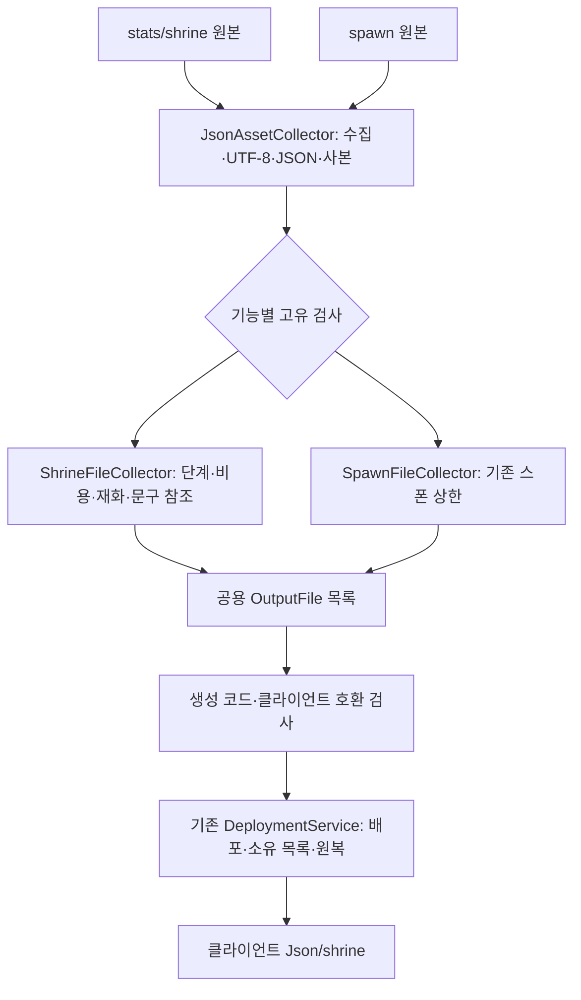
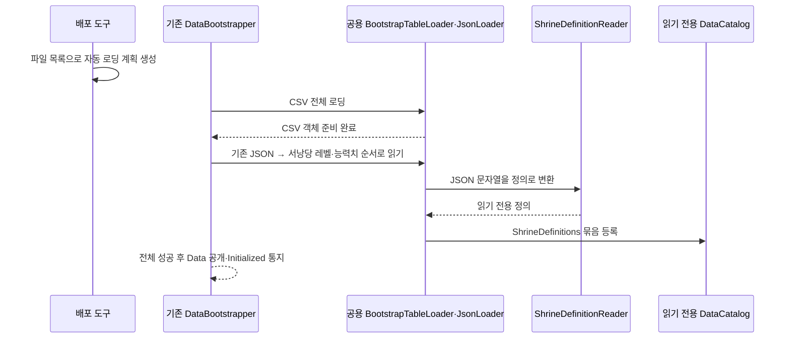

# 서낭당 강화 데이터 배포 설계

기준일: 2026-11-10. 원본 JSON 검사·자동 배포와 CSV 이후의 읽기 전용 정의 로딩을 연결했습니다. 독립적인 재화·구매·비용 코어는 [별도 설계](재화와%20강화%20구매%20설계.md)로 준비했고 세션·효과·저장·화면 연결은 후속입니다. [기획자 사용 안내](../기획자용%20안내문서/서낭당%20강화%20데이터%20배포%20안내.md)를 함께 봅니다.

## 1. 목적과 담당 범위

현재 작업 범위는 서낭당 JSON 공급, 재화·강화, 관문 정리, 갈림길 보상입니다. 패링·무기·플레이어 레벨 등 나머지는 다른 개발자 작업입니다. 최신 DataSheet 00bb288까지 확인했으며 재화 ID는 혼 1·엽전 2로 변경됐고 관문 800201·800202·800301은 기획자가 이미 삭제했습니다. 동일한 정리를 다시 수행하지 않습니다. 갈림길 보상은 실제 몬스터 구성 확정 후 계산합니다.

서낭당 JSON은 엑셀 표와 다른 원본이므로 수집 경계만 추가합니다. 파일 읽기·문법 검사·배포·실패 원복은 기존 흐름을 재사용하고 별도 실행 어댑터나 MonoBehaviour를 만들지 않습니다.

## 2. 책임과 처리 순서



| DataSheet 코드 | 책임 |
| --- | --- |
| Tools/DataExporter/Infrastructure/JsonAssetCollector.cs | 파일 수집·문법 검사·배포용 사본 생성 공용화 |
| ShrineFileCollector.cs | 서낭당에만 필요한 필드·단계·참조 검사 |
| SpawnFileCollector.cs | 기존 최대 수 검사는 유지하고 공통 파일 작업만 위임 |
| OutputCatalog.cs | 허용 배포 경로·상위 경로 이탈 방지 |
| DeploymentService.cs | 기존 신규·덮어쓰기·삭제와 실패 원복 재사용. 구현 변경 없음 |
| Program.cs | 모든 검사 성공 후 하나의 목록으로 배포. --check는 검사만 수행 |

## 3. 데이터 계약

stats/shrine/shrine_level.json은 Assets/Data/Json/shrine/shrine_level.json으로, stat/*.json은 같은 하위 경로로 배포합니다. 파일 내용과 설명을 유지하고 UTF-8로 기록합니다. stat 파일 이름은 statType과 같은 영문 식별자입니다. 원본에 없는 과거 생성 JSON은 기존 소유 목록 범위에서 제거하며 Unity meta는 보존합니다. 생성 C#의 최초 생성·보존 정책은 유지합니다.

정수·필수 값·레벨과 단계의 수량/순서·중복·Currency/Language 참조를 배포 전에 검사합니다. 확률 분모는 10000이며 패링 소모 감소의 음수 증감은 허용합니다. 제안 수치의 채택 여부·밸런스·게임 효과 지원 여부까지 검사기가 결정하지 않습니다.

## 4. 공용 로딩 흐름과 독립적인 정의

별도 서낭당 로더 어댑터는 추가하지 않았습니다. 기존 GameDataAssetBuilder가 TextAsset을 수집하고, DataBootstrapper의 CSV → JSON 순서를 유지합니다. 능력치 파일 목록은 DataSheet가 수집한 결과로 자동 생성하므로 코드에 5개 이름을 직접 등록하지 않습니다. 생성 파일은 수동 수정하지 않습니다.



| 코드 | 책임·배치 이유 |
| --- | --- |
| Data/ShrineDefinitions.cs | JSON 정의 묶음·레벨 비용·능력치별 증감. Unity·구매·UI·저장 의존 없음 |
| Data/Mapping/ShrineDefinitionReader.cs | JSON 모양 변환만 수행. 정수 변환은 기존 JsonValue 재사용 |
| BootstrapTableLoader.ReadJsonAsync | 기존 JsonLoader·입력 소스·경로·취소 토큰을 재사용하는 공용 진입점 |
| DataCatalog.GetDefinition | 정수 ID 표가 아닌 정의도 조회. 기존 GetTable은 같은 저장소를 재사용 |
| DataSheet의 LoadPlanGenerator | 실제 stat 파일 추가·삭제를 읽기 목록과 묶음 등록에 반영 |

능력치 식별자는 원본 statType입니다. 번역 문구 ID를 능력치 ID로 대신 쓰거나 임의의 정수 ID를 만들지 않습니다. 정수 ID가 있는 기존 표는 GetTable을 유지합니다. 테이블과 구조화 정의는 같은 형식별 저장소에서 제공하며 추가 전역 서비스는 없습니다. 기존 카탈로그 인터페이스를 구현한 편집기 검사 대역 두 곳도 새 조회 계약에 맞췄습니다.

TextAssetCollectionSource의 Json/파일명.json 키를 유지하므로 파일을 읽는 새 어댑터가 필요 없습니다. 폴더가 달라도 이름이 같으면 배포 단계에서 충돌 오류로 막습니다. `_note`는 변환하지 않으며 target은 설명 문자열입니다. 문자열의 설명을 실행 코드로 해석하지 않습니다.

## 5. 다른 기능에서 사용하는 방법

초기화 완료 후 기존 카탈로그를 주입받아 다음처럼 조회합니다. 파일을 다시 읽거나 별도 관리자를 만들지 않습니다.

```csharp
ShrineDefinitions definitions = data.GetDefinition<ShrineDefinitions>();
int maxLevel = definitions.Level.MaxLevel;
int soulId = definitions.Level.SoulCurrencyId;
IReadOnlyDictionary<string, ShrineStatDefinition> stats = definitions.Stats;
```

Level.SoulCostBase·SoulCostRate가 최신 비용식의 입력입니다. Level.SoulCosts는 원본에 남은 검사 호환용 표를 읽은 값이며 현재 구매 가격으로 사용하지 않습니다. Stats는 statType → 능력치 정의, Steps는 단계 → 증감값입니다. 생성 시 입력 목록·사전을 복사하고 읽기 전용으로 노출합니다. 구매 가능 여부·누적 합계 계산·재화·강화 단계는 정의에 포함하지 않습니다. enabled가 false인 정의도 읽어 두며 노출·실행은 별도 기능의 책임입니다.

후속 재화·강화는 변경 가능한 보유량과 단계를 별도 상태로 소유하고 완료된 변경만 이벤트로 알립니다. UI·저장·기존 서낭당 상호작용에 필요한 계약으로 연결합니다. 같은 역할의 어댑터가 있으면 확장하며 패링·무기·성장 담당 코드를 대신 변경하지 않습니다.

## 6. 실패·수명·검증 경계

전체 초기화는 하나의 기존 취소 토큰과 완료 작업을 공유합니다. 서낭당 파일 누락·읽기 실패·취소 때 일부 카탈로그를 공개하거나 Initialized를 통지하지 않습니다. 소비자는 초기화 완료 후에만 정의를 조회합니다. 새 Update·구독·코루틴·비동기 관리자를 추가하지 않았습니다. 정의는 직렬화 가능한 문자열·정수로 구성되며 게임 시간·난수·네트워크 권한을 변경하지 않습니다.

## 7. 검사 이력과 남은 작업

DataSheet 전체 98개 검사, 새 EXE의 24탭·정의28·자동계획1·스폰4·서낭당6 검사·배포를 통과했습니다. 신규·수정·삭제, 잘못된 UTF-8/JSON/참조/단계/확률/정수, UTF-8 BOM 허용·UTF-16 거부, 음수 증감·경로 이탈·기존 배포값 보존과 스폰 회귀를 확인했습니다. 배포 후 클라이언트 데이터 993개·코어 718개와 Unity 참조 컴파일도 통과했습니다. 실제 강화 구매·저장·화면·효과 검증은 포함하지 않습니다.

위 수치는 배포 단계의 이력입니다. 이번 로딩 검사는 새 능력치 목록 생성·이름 충돌·실제 정의 조회·읽기 전용 사본·CSV 선행·취소·서낭당 준비 실패 시 완료 통지 차단을 확인합니다. 구매·스탯 적용·화면·파일 저장의 실제 플레이는 아직 확인 대상이 아닙니다. 관문 저장 호환은 별도 저장 기능에 반영했으며 맵 표식 정리는 기획자 담당입니다. 갈림길 보상은 기획자가 공급한 최신 계산식에 맞춰 별도 검토합니다.

로딩 단계 최종 검사: DataSheet 107개, 클라이언트 데이터 1007개·코어 762개, 일반·편집기 전용 Unity 참조 컴파일 경고/오류 0개입니다. 새 DeployData.exe의 24탭·정의28·자동계획1·스폰4·서낭당6 검사와 배포를 완료했습니다. 실제 Unity Play의 준비 완료와 구매 기능 연결은 별도 확인합니다.
