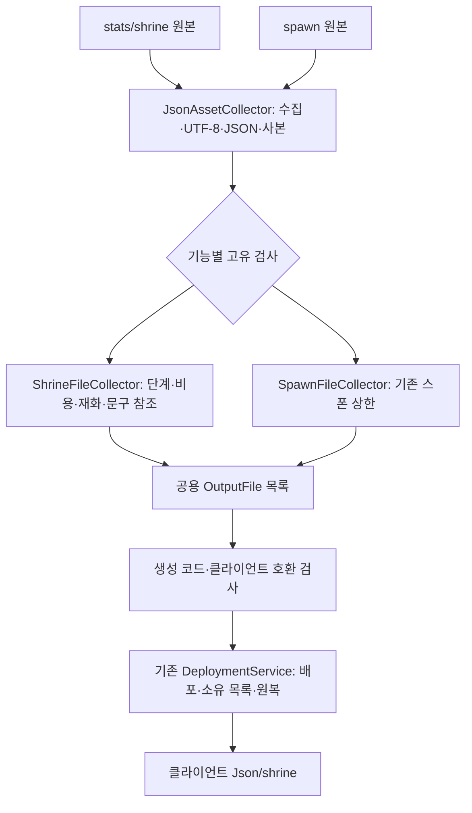

# 서낭당 강화 데이터 배포 설계

기준일: 2026-11-10. 이번 기능 단위는 원본 JSON의 검사·자동 배포까지입니다. 강화 정의 로딩·구매·저장·화면 연결까지 완료된 것은 아닙니다. [기획자 사용 안내](../기획자용%20안내문서/서낭당%20강화%20데이터%20배포%20안내.md)를 함께 봅니다.

## 1. 목적과 담당 범위

현재 작업 범위는 서낭당 JSON 공급, 재화·강화, 관문 정리, 갈림길 보상입니다. 패링·무기·플레이어 레벨 등 나머지는 다른 개발자 작업입니다. 최신 DataSheet 00bb288까지 확인했으며 재화 ID는 혼 1·엽전 2로 변경됐고 관문 800201·800202·800301은 기획자가 이미 삭제했습니다. 동일한 정리를 다시 수행하지 않습니다. 갈림길 보상은 실제 몬스터 구성 확정 후 계산합니다.

서낭당 JSON은 엑셀 표와 다른 원본이므로 수집 경계만 추가합니다. 파일 읽기·문법 검사·배포·실패 원복은 기존 흐름을 재사용하고 별도 실행 어댑터나 MonoBehaviour를 만들지 않습니다.

## 2. 책임과 처리 순서

| DataSheet 코드 | 책임 |
| --- | --- |
| Tools/DataExporter/Infrastructure/JsonAssetCollector.cs | 파일 수집·문법 검사·배포용 사본 생성 공용화 |
| ShrineFileCollector.cs | 서낭당에만 필요한 필드·단계·참조 검사 |
| SpawnFileCollector.cs | 기존 최대 수 검사는 유지하고 공통 파일 작업만 위임 |
| OutputCatalog.cs | 허용 배포 경로·상위 경로 이탈 방지 |
| DeploymentService.cs | 기존 신규·덮어쓰기·삭제와 실패 원복 재사용. 구현 변경 없음 |
| Program.cs | 모든 검사 성공 후 하나의 목록으로 배포. --check는 검사만 수행 |

## 3. 데이터 계약

stats/shrine/shrine_level.json은 Assets/Data/Json/shrine/shrine_level.json으로, stat/*.json은 같은 하위 경로로 배포합니다. 파일 내용과 설명을 유지하고 UTF-8로 기록합니다. stat 파일 이름은 statType과 같은 영문 식별자입니다. 원본에 없는 과거 생성 JSON은 기존 소유 목록 범위에서 제거하며 Unity meta는 보존합니다. 생성 C#의 최초 생성·보존 정책은 유지합니다.

정수·필수 값·레벨과 단계의 수량/순서·중복·Currency/Language 참조를 배포 전에 검사합니다. 확률 분모는 10000이며 패링 소모 감소의 음수 증감은 허용합니다. 제안 수치의 채택 여부·밸런스·게임 효과 지원 여부까지 검사기가 결정하지 않습니다.

## 4. 로딩과 기능 연결은 다음 단계

기존 GameDataAssetBuilder가 Json 아래 TextAsset을 수집합니다. 현재 TextAssetCollectionSource는 하위 폴더가 아니라 Json/파일명.json으로 등록하므로 후속 로더는 이름 충돌과 이 계약을 확인해야 합니다. 기존 JsonLoader·초기화·취소 수명을 우선 재사용하며 별도 입력 어댑터를 복제하지 않습니다. 이번에는 강화 모델을 자동 로딩 계획에 등록하지 않았습니다.

후속 재화·강화에서는 읽기 전용 정의와 변경 가능한 보유량·강화 단계를 분리합니다. 구매 명령은 비용·상한·잔액을 처리하고 완료된 변경만 이벤트로 알립니다. UI·저장·기존 서낭당 상호작용은 필요한 계약으로 연결하고, 다른 담당자의 패링·무기·성장 구현과 원본 스탯을 대신 변경하지 않습니다.

## 5. 검증

DataSheet 전체 98개 검사, 새 EXE의 24탭·정의28·자동계획1·스폰4·서낭당6 검사·배포를 통과했습니다. 신규·수정·삭제, 잘못된 UTF-8/JSON/참조/단계/확률/정수, UTF-8 BOM 허용·UTF-16 거부, 음수 증감·경로 이탈·기존 배포값 보존과 스폰 회귀를 확인했습니다. 배포 후 클라이언트 데이터 993개·코어 718개와 Unity 참조 컴파일도 통과했습니다. 실제 강화 구매·저장·화면·효과 검증은 포함하지 않습니다.

관문 원본 행 삭제와 맵·코드·기존 저장의 관문 ID 정리는 별개입니다. 삭제된 관문을 가진 저장 기록의 처리와 남은 맵 참조는 후속 관문 정리 단계에서 확인해야 하며 이번 공급 검사만으로 완료 처리하지 않습니다.
