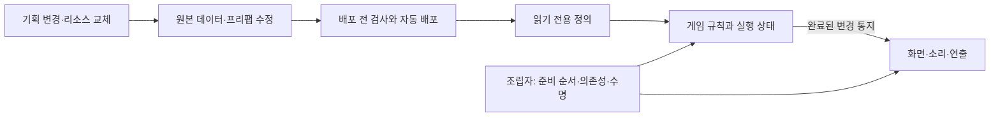
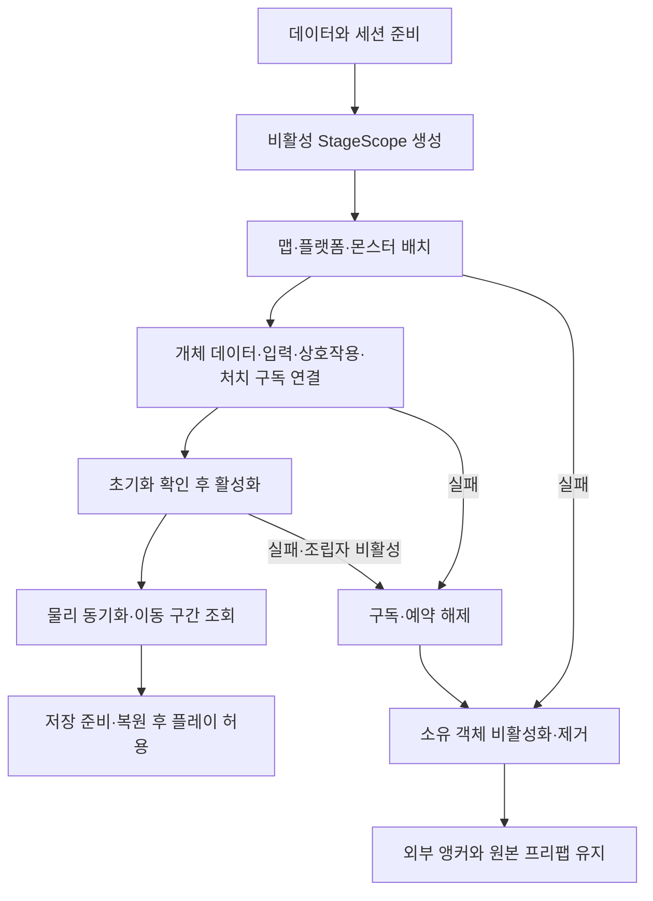
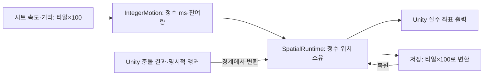
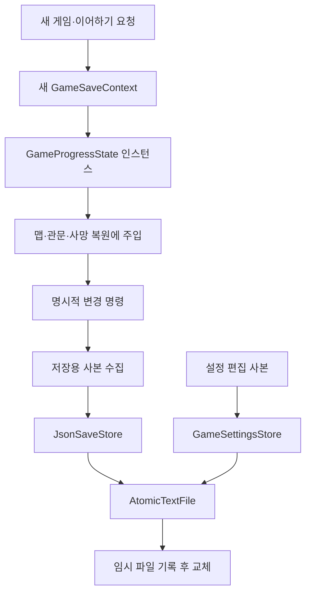
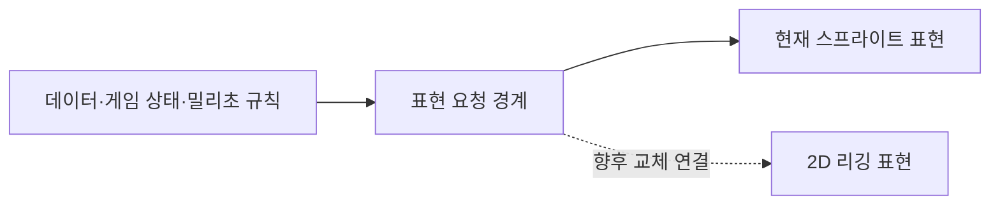
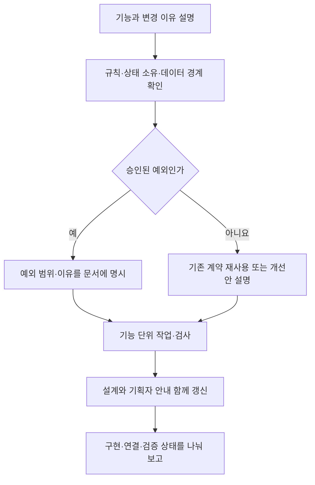

# 설계 기준 점검과 개선 방향

기준일: 2026-11-07. `fa81168`에서 찾고 `e2f6cb9`에 반영한 7개 개선 사항을 내용을 현재 `769e205`에서 다시 대조했습니다. 코드 변경·자동 검사와 실제 Unity 플레이 확인을 구분합니다. 데이터 940개·코어 710개 검사 및 일반/에디터 전용 Unity 참조 컴파일은 통과했습니다. 실제 Unity 플레이·실행파일 성능·완주 확인은 아직 수행하지 않았습니다.

## 1. 왜 이 규칙을 정했는가

기획자 두 명·아트 한 명·개발자 두 명이 데이터를 자주 수정하고, 준비되는 리소스를 순차적으로 연결하는 프로젝트입니다. 모든 변경마다 개발자가 여러 스크립트와 씬을 찾아 수정하면 공급 속도가 개발자 작업량에 묶입니다. 반대로 모든 작은 행동을 별도 모듈이나 테이블로 만들면 조립 비용과 학습 부담이 커집니다. 따라서 반복되는 콘텐츠 변경은 데이터로, 공통 규칙은 재사용 코드로, Unity 표현은 교체 가능한 연결부로 관리합니다.

규칙을 지키는 목적은 패턴의 수를 늘리는 것이 아니라 변경 범위·상태 소유자·실패 경계를 분명하게 만드는 것입니다. 기획자가 값을 수정했을 때 어디까지 자동 반영되고 무엇이 개발 작업인지 예측할 수 있어야 합니다.

## 2. 규칙별 목적·현재 근거·준수 수준

판정은 **근거 확인**, **부분 준수**, **실행 검증 대기**를 사용합니다. 일부 파일의 구현을 프로젝트 전체의 보장으로 확대하지 않습니다. 규칙마다 범위와 영향이 달라 임의의 준수 백분율을 만들지 않습니다. 간트 완료율도 설계 준수율과 다릅니다.

| 규칙 | 지키는 이유 | 현재 근거와 판정 |
| --- | --- | --- |
| 자동화 | 반복 등록·배포 실수와 개발자 의존 감소 | **부분 준수.** DataSheet 도구·자동 로딩 계획은 준비됨. 새 공간 조립·리소스 공급까지 전부 자동화된 것은 아님. |
| 데이터 기반 | 기획 변경을 여러 코드 수정으로 번지지 않게 함 | **부분 준수.** Cutscene 역할 Key·ContentAccess·스폰 JSON 재사용. 일부 기능은 고정 ID·직접 에셋 연결·코드 조건에 남음. |
| 책임 분리와 주입 | 화면 교체가 전투·저장 규칙을 바꾸지 않도록 함 | **부분 준수.** Data/Core/Adapters/Presentation 분리. GameplayPreview는 조립을 담당하고 진행 상태는 GameSaveContext가 소유한 GameProgressState를 주입함. 운영 공간 조립은 후속. |
| 추상화·상속 | 공통 스탯·행동 계약을 한 번 정의하고 고유 기능만 확장 | **근거 확인.** CharacterStat→Player/Monster/Boss, ActorState, InteractableBehaviour. 모든 타입을 상속 가능하게 점검 완료한 뜻은 아님. 자동 생성 정의는 임의 수정하지 않음. |
| 공통화와 재사용 | 같은 규칙을 여러 기능에서 다르게 고치는 문제 방지 | **부분 준수.** SaveGameFlow·공용 화면·MenuInput·준비 저장소·SubscriptionScope 재사용. PreviewStage 정리 계약, SpatialRuntime 상속, IntegerMotion, AtomicTextFile을 재사용함. 배경 이동 대상 참조도 해제하며 실제 씬 종료·재활성 검증은 남음. |
| 목적에 맞는 패턴 | 구체적인 책임을 풀되 불필요한 구조 확대 방지 | **근거 확인.** 상태머신·완료 이벤트·퍼사드·저장 계약 사용. 복합 상태·상태 팩토리는 실제 요구가 있는 범위에 적용하며 구현 완료로 부풀리지 않음. 캐릭터 자체 팩토리는 도입하지 않음. |
| 요청과 완료 이벤트 구분 | 실행 순서·오류 책임·구독 수명을 알 수 있게 함 | **근거 확인.** PlayerActor 변경 통지, 컷씬 결과 예약 후 별도 흐름에서 진행. 로컬 호출까지 전역 이벤트 버스로 바꾸지 않음. |
| 원본 보호·사본 사용 | 공유 정의를 한 개체가 변경해 다른 개체에 영향을 주는 문제 방지 | **근거 확인.** 스탯은 읽기 전용, SaveSnapshot은 목록 복사, GameSettings는 사본 편집. Inspector에 공개된 참조 자체가 원본 변경이라는 뜻은 아님. |
| 생성·활성·종료 수명 | 준비 전 호출·파괴된 객체·늦은 결과 접근 방지 | **부분 준수.** 구독 범위·준비 취소·가드 있음. 맵·플랫폼·몬스터는 비활성 StageScope 아래 준비하고, 실패·비활성 시 생성 범위를 정리함. 실제 실행 확인 대기. |
| 이벤트 갱신·필요한 비동기만 사용 | 무변경 반복 처리와 불필요한 지연 상태 감소 | **부분 준수.** HUD 변경 예약·상호작용 등록/해제·리소스 준비 비동기. 이동과 애니 시간 진행은 프레임 처리 필요. 모든 Update 제거 또는 성능 개선 수치로 해석하지 않음. |
| 정수·밀리초·확률 분모 10000 | 단위 혼동을 줄이고 데이터·저장·검사를 일치시킴 | **부분 준수.** 스탯·저장 좌표·코어 시간·HitRoll은 적용. 플레이어·일반몹·보스 이동 및 투척 위치를 정수로 계산하고 엔진 경계에서 변환함. 일부 임시 연출 타이머의 초 단위 설정은 기존 경계에 남음. 정수만으로 결정성은 보장되지 않음. |
| 범위가 명확한 프리팹 배치 | 전역 탐색·잘못된 부모·원점 배치를 막음 | **부분 준수.** SpawnAnchors는 전달 루트만 조회. 명시한 도착 앵커 실패는 진입 실패로 전달함. 새 게임의 미지정 키에는 정의된 기본점만 사용. |
| 검사 위치·초기화 순서 | 중복 검사와 준비되지 않은 데이터 소비 방지 | **근거 확인.** DataSheet 배포 전 검사, DataLoadSequence의 CSV 완료 후 JSON. 클라이언트의 리소스 연결·파일 오류 처리는 데이터 검사기 중복과 구분함. |
| 한국어 안내·문서·기능 단위 협업 | 초보 기획자와 다음 개발자가 같은 의미로 작업하게 함 | **부분 준수.** 설계/사용 안내 분류와 도식은 있음. 예전 상태 문구가 남을 수 있어 코드 근거·기준 커밋·예외를 함께 관리해야 함. 설명·주석·로그·권한 요청은 한국어, 코드 식별자는 기존 영문 규칙 적용. |

핵심 판단: **데이터 계층·게임 코어에는 설계 기반이 있고, 운영 조립·상태 소유·정수 이동·실행 수용에는 간격이 있습니다.** 아래 7개 항목은 코드에 반영했으며 실제 Unity 플레이 수용은 남아 있습니다. 프로젝트 전체가 완성됐다는 뜻은 아닙니다.

## 3. 승인된 방식과 개선 대상을 구분하기

| 제외하는 항목 | 제외 이유 |
| --- | --- |
| 타이틀의 씬 직접 편집 | 기획자가 외형을 씬에서 편집하기로 승인한 방식. 위치 테이블·앵커 구조를 추가하지 않음. |
| 플랫폼 JSON 기준 몬스터 좌표 | 일반 UI 앵커 규칙과 별도로 승인한 배치 방식. 좌표가 있다는 이유로 위반이 아님. |
| Unity 객체를 최초 연결하는 참조 | Image·입력 액션·프리팹과 데이터의 연결 경계는 필요. 콘텐츠 번호·수치를 중복 입력하는 것과 구분. |
| Unity 물리·화면 출력에서의 실수 변환 | 엔진 출력 경계는 허용. 게임의 실제 위치 상태까지 실수 누적에 맡기는 부분은 별도 개선 대상. |
| 필요한 이동·충돌·영상 시간 처리 | 매 프레임 필요한 처리까지 이벤트로 바꾸지 않음. 무변경 데이터 재조회·재탐색이 대상. |
| 모든 맵·몬스터의 무조건적인 풀링 | 정적인 맵은 배치 후 회수하지 않기로 한 정책을 유지. 재사용 수요·반환 계약 없이 풀부터 추가하지 않음. |
| 기획에서 허용한 경고 후 일부 항목 제외 | 이를 모두 강제 실패로 바꾸지 않음. 필수 연결 실패와 허용된 선택 항목 실패를 구분해 합의해야 함. |

네트워크는 이번 구현 범위에 넣지 않습니다. ID·시간·난수·명령 순서를 경계에 남기는 것은 확장 준비이며 네트워크 구현 승인이나 결정성 보장이 아닙니다.

## 4. 무엇을 왜 바꿨는가

| 항목 | 기존 문제 | 현재 방식과 효과 | 확인 범위 |
| --- | --- | --- | --- |
| 생성 순서 | 맵·플랫폼은 활성 생성, 몬스터는 활성 후 데이터 연결 | 비활성 StageScope 아래 생성·설정·데이터 초기화·소비자 연결 후 Activate. 준비 전 실행 위험 축소 | 참조 컴파일, 실제 콜백 순서는 Play 확인 필요 |
| 객체 소유 | 맵에서 분리한 몬스터와 부분 생성 객체의 정리 책임이 분산 | PreviewStage.Dispose가 자기 생성 범위 정리. 관문은 자기 표시·충돌체·생성 Sprite 정리. 구독은 먼저 해제 | 실패·재활성 Play 확인 필요 |
| 정수 이동 | 실수 이동을 누적하고 저장할 때만 반올림 | SpatialRuntime의 정수 위치가 기준. IntegerMotion은 밀리초·잔여량으로 이동. 저장은 같은 위치의 단위 변환 | 프레임 분할·저속·음수·점프·구르기 자동 검사 |
| 스킬 잠금 | 진입과 장부 조사 경로의 판단 불일치 | EnableSkill 내부에서 ContentAccess 재사용. 기획 잠금·미해금이면 연결하지 않고 해금 알림도 표시하지 않음 | 기존 콘텐츠 판단 검사, 실제 장부 흐름 확인 필요 |
| 도착 실패 | 잘못된 명시 앵커를 시작점으로 대체 | 범위 내 조회 실패를 진입 실패로 전달. 성공한 뒤 도착 요청 소비 | 누락·중복·정상 도착 Play 확인 필요 |
| 진행 소유 | 공개 정적 집합을 여러 기능이 직접 변경 | GameSaveContext마다 GameProgressState 소유. 맵·관문·사망 복원에 주입. 목록 조회는 사본 반환 | 세션 분리·사본 보호·처치 복원 자동 검사 |
| 파일 보존 | 설정은 기존 파일에 직접 기록 | 설정과 슬롯이 AtomicTextFile 공유. UTF-8 임시 기록·Flush·교체, 실패 시 기존 파일 보존 | 정상 교체·잘못된 인코딩·파일 잠금 실패 자동 검사 |

### 4-1. 생성과 정리 수명

PreviewStage는 맵 하나를 생성하므로 해당 생성 범위를 정리하는 책임도 가집니다. 새 전역 관리자·프리팹별 정리 서비스를 만들지 않았습니다. 생성자 중 실패하면 내부 정리 후 예외를 전달하고, 조립 완료 후에는 GameplayPreview.OnDisable이 구독과 드라이버를 먼저 해제한 뒤 관문과 스테이지를 정리합니다. 매복 개체는 초기화를 마쳐도 발동 전까지 비활성으로 남습니다. 씬에 있는 보스도 연결 준비 후 활성화합니다. 입력은 데이터 준비 전부터 잠그고, 종료 후에도 잠긴 상태로 남깁니다. 배경 이동 모듈은 대상 목록을 Disconnect로 비웁니다. Unity의 모든 Awake 동작을 일반화하지 않으며 프리팹 콜백은 데이터 초기화 전에 실행돼도 위험한 작업을 하지 않아야 합니다.

### 4-2. 정수 기준과 Unity 경계

| 구분 | 계약 |
| --- | --- |
| 내부 위치 | long, 1타일=1,000,000단위. 정수 타일만 쓰면 저속 이동이 사라지므로 세부 정수 단위를 둠 |
| 시트·저장 단위 | 기존 타일×100 유지. 테이블·저장 버전 변경 없음 |
| 시간 | MillisecondClock이 프레임 초를 ms로 변환하고 1ms 미만 잔여량 보존 |
| 이동 | 수평 나눗셈 잔여량 보존. 구르기는 누적 진행량 차이로 총거리 보장 |
| 점프 | 기존 목표 높이·왕복 시간을 정수로 계산. 1ms 산술 적분, 물리 조회는 프레임당 수행 |
| 충돌 | 엔진 조회는 실수 허용. 막힌 축은 정수 위치로 보정하고 해당 적분 잔여량 정리 |
| 저장 반올림 | 타일×100로 중간값 짝수 반올림. 음수에도 동일 적용 |
| 외부 위치 변경 | SetPosition 사용. 부모 이동·외부 물리로 Transform을 직접 바꿨다면 완료 후 NotifySpatialChanged 호출 |

SpatialRuntime은 세 캐릭터 런타임이 실제로 공유하는 위치 책임만 상속합니다. IntegerMotion은 Unity를 참조하지 않아 계산을 독립 검사할 수 있습니다. PreviewPlayerMotion은 접지·충돌·매달리기를, 몬스터/보스 드라이버는 각 전투 관측을 유지합니다. 투척도 정수 시작·끝·경과 시간으로 계산합니다. 스프라이트·리깅 표현이 게임 루트의 위치를 직접 변경하면 이 계약을 깨므로 하위 표시 객체에서만 표현합니다.

기존 점프는 프레임마다 중력을 먼저 적용해 프레임 시간에 따라 높이가 달라졌습니다. 현재는 1ms 적분으로 목표 높이와 시간을 맞춥니다. 기본 300 높이·800ms의 최고점 400ms를 자동 검사했지만 실제 벽·천장·발판 접촉감은 Play에서 비교해야 합니다. 정수 산술 검사의 일치는 Unity 물리·명령 순서·난수까지 포함한 결정성이나 성능 향상 보장이 아닙니다. 리플레이·네트워크는 구현하지 않았습니다.

### 4-3. 세션 소유와 파일 기록

GameSaveContext.Current는 씬 사이 인스턴스를 전달하는 기존 진입점으로 남습니다. 공개 정적 진행 집합은 제거했습니다. 각 기능은 주입받은 동일 세션의 진행 상태를 사용하고, 새 게임은 새 인스턴스를 만듭니다. Restore는 초기 조립 시 소비자 연결 전에만 호출합니다. 관문·처치·컷씬·서낭당 목록 조회는 사본이며 Progress의 클리어 변경은 기존 명시적 명령과 Changed 이벤트를 재사용합니다. 모든 집합 변경에 사용처 없는 새 이벤트를 추가하지 않았습니다.

AtomicTextFile은 파일 기록 절차만 공유합니다. 설정과 게임 슬롯의 경로·데이터·슬롯 정책은 합치지 않습니다. 교체를 지원하지 않거나 잠긴 파일이면 실패를 상위 경계로 전달합니다. 강제 프로세스 종료가 임시 파일까지 모두 정리한다거나 전원 장애를 완전히 보장한다는 의미는 아닙니다. 사용자 저장 파일을 대상으로 파괴 시험하지 않습니다.

### 4-4. 리깅 확장 방침 — 시험본과 게임 연결 구분

기존 스프라이트 표시 기반은 유지합니다. 향후 리깅은 하위 표현 모듈로 연결하고, 회전·변형의 실수 계산은 해당 경계 안에 둡니다. 공격 피해·판정 시작/끝·상태 종료는 애니메이션 완료 이벤트만으로 결정하지 않습니다. 쇄문아비 2페이즈의 별도 리그·뼈/웨이트·Idle/Walk/공격 시험 클립과 씬은 이미 존재합니다. 기존 스프라이트 코드를 모두 교체했거나 공용 리깅 어댑터가 실제 전투에 연결된 상태는 아닙니다. 실제 리소스와 요구가 확정될 때 필요한 계약만 추가합니다.

### 4-5. 이번 문서 대조에서 확인한 후속 정합 작업

| 항목 | 현재 근거 | 필요한 작업과 이유 |
| --- | --- | --- |
| 체력 표시 앵커 이름 | 11/9 PlayerHealthAnchor로 원본 셀·배포값을 수정, 기존 프리팹/검사 이름과 일치 | 구현·배포 완료. 실제 화면 확인 필요 |
| 스폰 원본과 실행 참조 | 11/9 4개 원본·배포·실행 참조 통합. JSON별 MaxMonsterCount 검사 | 구현·배포 완료. 현재 전투 맵은 각 30마리이며 실제 배치·처치 저장 확인 필요 |
| 표현 교체 | 독립 쇄문아비 리깅 시험본 존재, 실제 전투는 기존 표현 | 공통 상태·판정·시간을 유지한 표현 연결과 실제 전투 수용을 추후 진행. 시험본을 운영 적용으로 표시하지 않음 |

11/7 문서 점검에서 찾은 앞의 두 정합 문제는 11/9 구현·배포로 반영했습니다. 새 게임 키 선택도 연결했으며 실제 Unity 수용과 리깅 연결은 별도입니다.

## 5. 무엇을 다시 만들지 않는가

데이터 로딩 계획·CSV 후 JSON 순서·ContentAccess·SubscriptionScope·공용 컷씬·저장 실행 계약은 재사용합니다. 화면 한 개마다 동일한 비동기 준비·모달 잠금·해제 코드를 복제하지 않습니다. 상속은 실제 공통 책임에 적용하고 원본은 사본 편집합니다. 상태 팩토리나 복합 상태는 필요한 책임이 생길 때 기능 단위로 설명하고 추가합니다.

사용자가 승인한 7개 개선은 현재 코드에 반영했습니다. 다음 단계는 실제 Unity에서 생성 실패·재활성·앵커 누락·스킬 잠금·이동·저장 복원을 확인하는 것입니다. 실제 검증 전에는 운영 완료로 표시하지 않습니다.

## 6. 다른 개발자와 기획자가 지킬 작업 절차

개발자는 생성/정리 소유자·변경 명령·완료 이벤트·실패 시 상태를 먼저 적습니다. 기획자는 표에서 바꿀 값과 최초 Unity 연결을 구분하고 안정적인 ID·앵커 이름·배치 순번을 임의로 재사용하지 않습니다. 규칙을 바꾸는 예외가 더 적합하면 이유·영향·대안을 설명하고 사용자 승인을 받습니다. 작업 설명·주석·로그·권한 요청은 한국어로 작성합니다. 필드는 _camelCase, 메서드는 PascalCase, 지역 변수는 camelCase, 오브젝트 이름과 호출 키는 영문 ASCII를 유지합니다.

규칙 요약은 [프로젝트 기본설계](../../프로젝트%20기본설계.md), 구체적인 수명 계약은 [공통 모듈과 객체 수명 설계](공통%20모듈과%20객체%20수명%20설계.md), 작업 순서는 [남은 작업](남은%20구현과%20검증%20작업.md), 기획자 절차는 [공통 모듈 연결 안내](../기획자용%20안내문서/기획자용%20공통%20모듈%20연결과%20확인%20안내.md)를 참고합니다.

## 7. 코드 근거

- [순차 로딩](../../Assets/3.Script/Data/Infrastructure/DataLoadSequence.cs), [상속 정의](../../Assets/3.Script/Data/CharacterStat.cs), [상태 전환](../../Assets/3.Script/Core/States/ActorStateMachine.cs)
- [변경 통지](../../Assets/3.Script/Core/Characters/PlayerActor.cs), [구독 수명](../../Assets/3.Script/Core/SubscriptionScope.cs), [공용 화면 갱신](../../Assets/3.Script/Presentation/HudScreen.cs)
- [원본과 사본](../../Assets/3.Script/Core/Saves/SaveRecord.cs), [잠금 판단](../../Assets/3.Script/Core/Content/ContentAccess.cs), [스킬 호출](../../Assets/3.Script/Adapters/Interaction/LedgerInteract.cs), [스킬 연결 계약](../../Assets/3.Script/Adapters/PlayerRuntime.cs)
- [맵 생성](../../Assets/3.Script/Preview/PreviewStage.cs), [조립·정리·도착](../../Assets/3.Script/Preview/GameplayPreview.cs), [이동 상태](../../Assets/3.Script/Preview/PreviewPlayerMotion.cs), [세션 진행 상태](../../Assets/3.Script/Core/Interaction/GameProgressState.cs)
- [앵커 조회](../../Assets/3.Script/Adapters/SpawnAnchors.cs), [개인 설정 기록](../../Assets/3.Script/Adapters/GameSettingsStore.cs), [슬롯 파일 교체](../../Assets/3.Script/Adapters/JsonSaveStore.cs)
