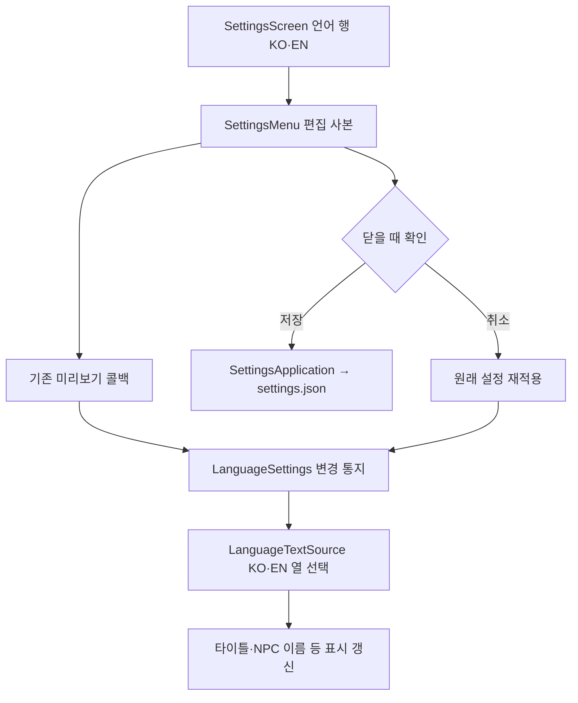

# 언어 선택 설정 설계

기준일: 2026-11-13. 한국어·영어 선택, 기존 설정 저장·취소, 공통 Language 조회 연결을 구현했습니다. 실제 Unity 화면과 재실행 검증은 별도입니다.

## 목차

1. [문제와 설계 이유](#1-문제와-설계-이유)
2. [책임과 적용 흐름](#2-책임과-적용-흐름)
3. [수명과 호환 계약](#3-수명과-호환-계약)
4. [연결 범위와 남은 일](#4-연결-범위와-남은-일)
5. [작업자 역할과 검증](#5-작업자-역할과-검증)

## 1. 문제와 설계 이유

기존에는 KO·EN 데이터와 LanguageCode가 있어도 옵션에 선택 항목이 없고 화면에서 KO 열을 직접 읽었습니다. 언어를 선택해도 실제 문구가 바뀌지 않는 원인입니다. 언어별 조회 분기를 기존 LanguageTextSource로 모으고 기존 GameSettings·SettingsMenu의 편집 사본과 SettingsApplication의 적용·저장·복구 순서를 재사용했습니다.

| 기존 | 변경 | 이유 |
| --- | --- | --- |
| 화면마다 KO 직접 조회 | 공통 공급자가 선택 언어의 열 조회 | 새 화면에서 열 선택 중복 방지 |
| 언어 설정 없음 | LanguageCode를 settings.json에 저장 | 게임 저장 슬롯과 분리하고 재실행 유지 |
| 언어 변경을 각 화면에서 감시해야 함 | 실제 변경 때만 통지 | 매 프레임 탐색·문구 재할당 방지 |
| 한국어 메뉴 글자 이미지 | 영어 선택 시 번역 텍스트 사용 | 이미지를 번역 텍스트 위에 남기지 않음 |

새 전역 게임 이벤트 버스나 번역 관리 오브젝트는 만들지 않았습니다. LanguageSettings는 앱 전체가 공유해야 하는 선택값과 변경 통지만 가진 작은 어댑터입니다. 콘텐츠·저장 슬롯·게임 규칙을 소유하지 않습니다. 게임 규칙은 이를 조회하지 않고 화면과 입력 조립 경계에서 사용합니다.

## 2. 책임과 적용 흐름



| 계층·위치 | 역할 |
| --- | --- |
| Core/Settings/GameSettings | 언어 값·유효 범위·복사·설정 비교 |
| Core/Settings/SettingsMenu | 언어 행 이동·선택·미리보기·취소 결과 |
| Adapters/GameSettingsStore | 기존 설정 파일 직렬화와 시작 시 언어 복원 |
| Adapters/LanguageSettings | 현재 선택값·동일 값 통지 생략 |
| Adapters/LanguageTextSource | ID 조회·KO/EN 선택. 명시적 언어 인수를 받는 기존 Read도 보존 |
| Presentation/SettingsScreen | 기존 옵션 행·입력·팝업을 재사용한 언어 표시 |
| TitleGameEntry·PauseMenuHost | 기존 적용·저장·실패 복구 경로에서 언어 적용 |

언어 선택용 제목은 Language 30043입니다. KO·EN은 번역 문구가 아닌 선택 코드입니다. 마스터·화면 모드·키보드 제목도 공급된 30234~30241을 재사용합니다. 새로운 표나 언어 ID를 임의로 추가하지 않았습니다.

```csharp
var text = new LanguageTextSource(catalog);
string current = text.Read(textId); // 앱의 선택 언어
string preview = text.Read(textId, LanguageCode.English); // 명시적 언어
```

## 3. 수명과 호환 계약

- 언어 값은 Korean=0, English=1을 유지합니다. 기존 설정 파일에 Language가 없으면 0으로 시작하고 잘못된 저장값도 한국어로 복구합니다.
- 시작 시 GameSettingsStore가 저장된 언어를 복원합니다. 에디터의 도메인 재사용 시 이전 정적 구독도 초기화합니다.
- 타이틀은 Connect/Disconnect에서 구독을 등록·해제합니다. NPC 이름은 기존 SubscriptionScope에 언어 구독을 함께 넣고 비활성 시 해제합니다.
- 표시 소비자는 자신의 표시 오류를 기록합니다. 게임 진행·전투 명령을 언어 변경 콜백에서 호출하지 않습니다.
- 대사 본문은 재생 시작 때 언어를 확정합니다. 대화·컷씬 중 옵션 진입이 막힌 기존 흐름을 유지하며 재생 도중 임의로 줄을 재시작하지 않습니다.
- 선택 취소와 설정 저장 실패 복구는 기존 원래 설정 사본을 적용합니다. 원본 Language 데이터는 수정하지 않습니다.
- 네트워크·리플레이의 게임 상태나 난수·틱에 영향이 없는 로컬 표시 설정입니다.

## 4. 연결 범위와 남은 일

타이틀·옵션·일시정지의 Language 문구, 서낭당 문구, 수동 저장의 표 기반 문구, 리셋·오류 팝업, 로딩 팁, 상호작용 Language 조회, 다음 대사·컷씬·엔딩, HUD 이름과 회피 표시의 공급 경로를 연결했습니다. NPC 이름과 타이틀은 변경 통지로, HUD·일시정지·스킵 안내는 기존 설정 적용 콜백으로 갱신합니다. 나머지는 다음 표시 시 선택값을 조회합니다.

이는 모든 콘텐츠의 번역 완료 선언이 아닙니다. 임시 대사·코드에 남은 고정 안내·그림 안의 글자·표에 없는 문구는 별도 ID 공급과 번역이 필요합니다. UI_Lang은 원격 배포분을 보존했지만 이번 변경에서 모든 UI를 UI_Lang Key 조회로 전환하지 않았습니다. EN 누락을 코드가 임의 번역하거나 다른 문구로 대체하지 않습니다.

## 5. 작업자 역할과 검증

이번 미커밋 변경은 사용자 요청에 따른 언어 선택·공통 조회·표시 연결입니다. 기존 기획 공급 Language와 다른 개발자가 만든 옵션·메뉴·대사 기능을 재사용했습니다. 신규 커밋 작성자나 개인 기여율은 확정하지 않습니다. 메뉴 이미지 등 기존 원본 아트는 Git 외부 공급을 포함한 아트 담당자의 공동 기여이며 이번에는 원본 이미지를 수정하지 않았습니다.

검사는 원본과 편집 사본 분리, 언어 저장 확인·취소, 미지원 값 거부, 언어 행 탐색, 동일 언어의 중복 통지 방지, 구독 해제 후 호출 차단, 실제 Language 열 연결을 확인합니다. 실제 절차는 [기획자 안내](../기획자용%20안내문서/기획자용%20언어%20선택과%20문구%20작성%20안내.md)를 봅니다.
