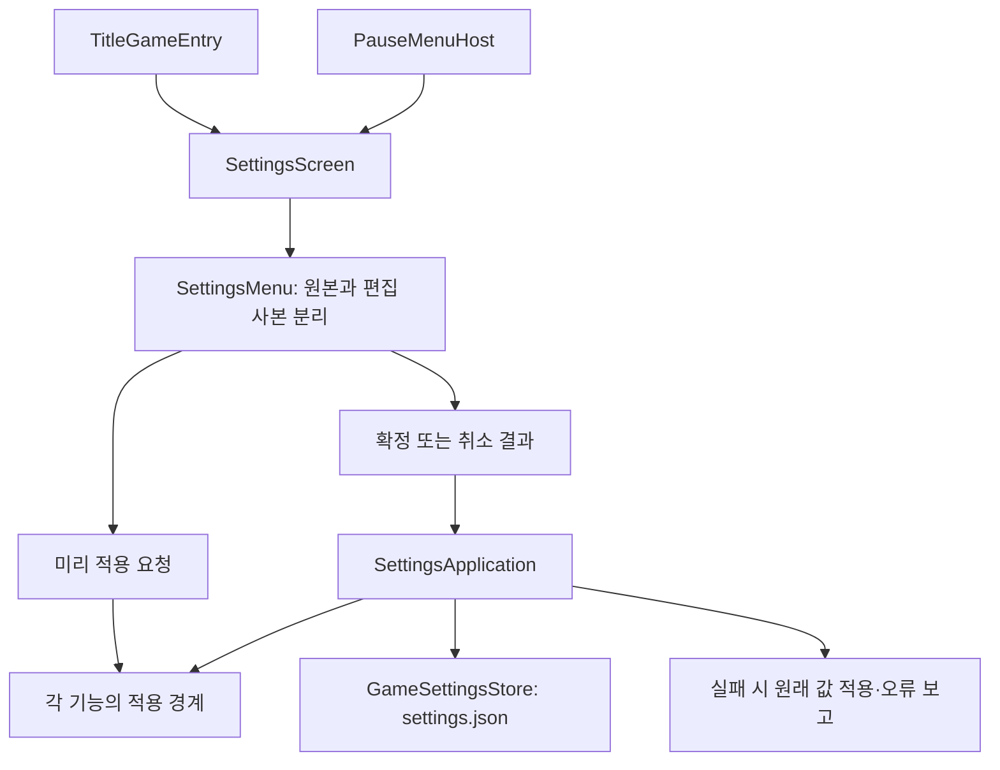
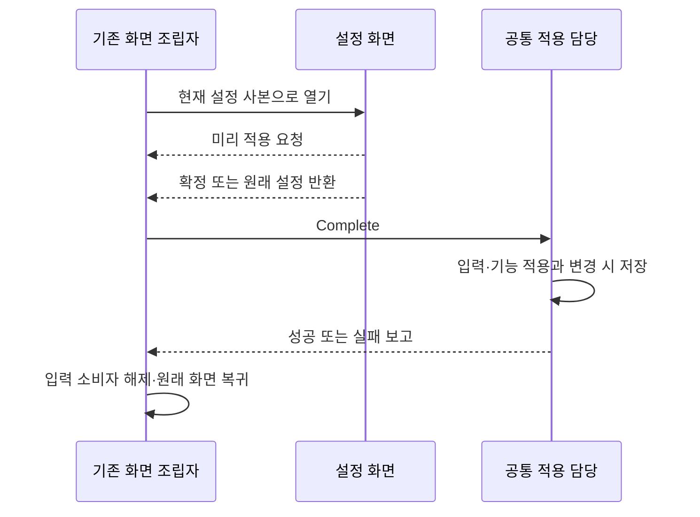

# 옵션 연결과 실행파일 검증 설계

기준일: 2026-11-16. 현재 소스와 기존 검사에 대한 점검입니다. 실행파일의 물리 입력·화면 모드 전환은 아직 확인하지 않았습니다. 이번 점검에서 제품 코드는 변경하지 않았습니다.

## 목차

1. [목적과 현재 구조](#1-목적과-현재-구조)
2. [설정 항목과 적용 경계](#2-설정-항목과-적용-경계)
3. [수명과 실패 처리](#3-수명과-실패-처리)
4. [다른 개발자의 연결 방법](#4-다른-개발자의-연결-방법)
5. [검사 결과와 남은 확인](#5-검사-결과와-남은-확인)

## 1. 목적과 현재 구조

타이틀과 일시정지가 서로 다른 설정 파일이나 취소 처리를 만들지 않도록 기존 공통 기능을 재사용합니다. 새 옵션 시스템·별도 저장기·별도 전역 이벤트 버스는 추가하지 않습니다.

GameSettings는 개인 설정 상태, SettingsMenu는 편집·확인 규칙, SettingsScreen은 표시·입력, SettingsApplication은 최종 적용·저장·실패 복구를 맡습니다. 저장 슬롯의 게임 진행과 settings.json은 별개입니다. 음원 선택·문구는 기존 Sound·Language·UI_Lang 데이터이고 개인 음량·언어 선택값과 구분합니다.

## 2. 설정 항목과 적용 경계

| 항목 | 현재 연결 | 확인 기준 |
| --- | --- | --- |
| 마스터·배경음·효과음 | GameSettings의 정수 0~10과 GameAudio | 마스터 0에서도 개별 값 보존, 재설정 시 복귀 |
| 카메라 흔들림 | 게임 내 설정 변경 소비자와 카메라 | 시험 가능한 전투 피드백에서 켜기·끄기 |
| 입력 방식 | KeyboardControls·기존 입력 사본 | 두 방식 선택·확정·취소·재실행 |
| 한국어·영어 | LanguageSettings·LanguageTextSource·UI_Lang | 활성 화면 갱신, 닫힌 화면 재진입, 취소 복원 |
| 창 모드 | 타이틀만 노출, WindowModeApplication | 현재 창 1280×720, 전체 화면 1920×1080 FullScreenWindow |

화면 크기는 최신 1114 B7 기록과 현재 코드값입니다. 과거 1208×720 계획과 구분합니다. 편집기는 WindowModeApplication에서 실제 창 전환을 하지 않으므로 에디터 성공으로 실행파일 전환을 확정하지 않습니다.

### 미리 적용과 확정 적용의 구분

현재 타이틀의 PreviewSettings는 언어·소리·화면 모드를 적용합니다. 입력 방식은 공통 SettingsApplication의 확정/취소 처리에서 적용합니다. 게임 내 미리 적용은 기존 OnSettingsChanged를 통해 입력 방식도 반영합니다. 미리 적용 시점에 차이가 있지만 최종 적용·취소·저장은 같은 공통 기능을 사용합니다. 이번 점검에서는 이 동작을 임의 통일하지 않았습니다. 타이틀에서 입력 방식 선택 즉시 새 키를 사용해야 한다는 요구가 확정되면 영향과 취소 복구를 확인한 뒤 보완합니다.

## 3. 수명과 실패 처리

- SettingsScreen은 닫힐 때 Changed 구독과 콜백을 해제하고, 비활성 시 편집을 취소합니다.
- 타이틀은 별도 MenuInput 사본을 소유하며 설정 닫힘 시 입력을 해제합니다. 부모 UI는 비활성 생성·영역 설정 뒤 활성화합니다.
- 게임 내 설정을 닫아도 일시정지 자체는 유지됩니다. 일시정지를 끝낼 때 닫은 입력이 게임으로 새지 않도록 다음 프레임에 게임 입력을 풉니다.
- SettingsApplication은 전달 상태를 복사해 소비자의 변경이 원본을 오염시키지 않도록 하고, 적용·저장 실패 시 원래 설정 복구를 시도합니다.
- GameSettingsStore는 기존 AtomicTextFile을 사용합니다. 이전 파일에 없는 항목은 기본값, 읽기 실패는 경고와 기본값입니다. 이 복구를 실제 파일 쓰기 성공으로 보고하지 않습니다.
- 타이틀 오류는 기존 호스트 보고, 게임 내 설정 오류는 현재 PauseMenuHost의 로그 보고 경계입니다. 두 보고 경로를 임의 변경하지 않았습니다.

설정은 매 프레임 파일을 읽지 않고 사용자 명령·화면 수명·언어/입력 변경 통지에 연결합니다. 음량·상태는 정수, Screen·Audio 등 엔진 출력만 해당 API 단위로 변환합니다. 네트워크 게임 규칙이나 플레이어 권한은 변경하지 않습니다.

## 4. 다른 개발자의 연결 방법

1. 화면 외형은 기존 SettingsScreen 프리팹을 사용합니다. 텍스트·행 참조·볼륨 슬라이더·확인창·표시 영역을 맞춥니다. 표시 영역 누락을 빈 화면 성공으로 처리하지 않습니다.
2. 새 진입점은 현재 GameSettings의 사본으로 Open을 호출하고 preview와 closed를 연결합니다. 타이틀에서만 allowWindowMode를 켭니다.
3. 최종 처리는 기존 SettingsApplication과 GameSettingsStore를 사용합니다. 파일 직접 쓰기나 화면별 별도 취소 복구를 만들지 않습니다.
4. 새 항목 추가는 GameSettings의 복사·비교·검증, SettingsMenu, 화면, 실제 적용 소비자, 설정 파일 이전 버전 호환을 함께 맞춥니다. 공통 계약 변경은 사용자 확인 후 진행합니다.
5. 문구는 기존 UI_Lang·Language를 사용합니다. 옵션에 새 문장을 코드 문자열로 추가하지 않습니다. 새 데이터 값·새 옵션 종류는 아직 확정되지 않았습니다.

기존 아트 프리팹의 원본 제작·공급에는 아트 담당자가 함께 참여했습니다. 이 문서는 연결·검증 안내이며 원본 아트를 새로 제작했다는 기록이 아닙니다. 이번 담당은 사용자 확정 기준이며 기존 Git 작성자 기여를 바꾸지 않습니다.

## 5. 검사 결과와 남은 확인

2026-11-16 이번 실행: 데이터 9373개·코어 2222개 통과, 에디터 조건 엔진 참조 컴파일 경고·오류 0개. 기존 검사는 설정 복사·변경 판단·취소·음량 계산·입력/화면 모드 저장 실패 복구·소비자 원본 오염 방지를 포함합니다. 문서 추가 후 별도 제품 코드를 바꾸지 않았습니다.

실제 화면 도구에서 Unity 접근이 정상 연결되지 않았고 최신 시험 실행파일 경로가 아직 없어 실행파일 수용은 미완료입니다. 개인 저장·설정을 덮어쓰지 않고 시험 환경을 먼저 준비해야 합니다. 에디터 코드 검사를 실제 창 전환·청취·키보드/패드 실행 결과로 바꾸지 않습니다.

다음 실기 순서와 기록표는 [기획자 옵션 확인 안내](../기획자용%20안내문서/기획자용%20옵션%20설정과%20실행파일%20확인%20안내.md)를 사용합니다. 전체 검증 완료는 아래 절차의 실제 결과가 채워진 뒤 판단합니다.
