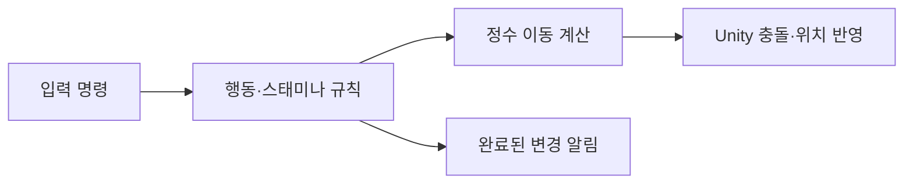

# 이동·스태미나 코어

> 2026-11-07 `769e205` 문서 대조: 캐릭터 이동은 SpatialRuntime의 정수 위치·IntegerMotion의 정수 ms와 잔여량을 사용합니다. Unity 물리·화면 경계에서만 변환합니다. 세부 계약과 실제 Play 확인 범위는 [설계 기준 점검](설계%20기준%20점검과%20개선%20방향.md)을 따릅니다.

기존 이동/상태/스태미나 구현을 `Assets/3.Script`에 복원하고 전투·입력·보스 체세로 확장했습니다. 현재 API·설정·프리팹·수명·검증은 [게임플레이 코어 가이드](%EA%B2%8C%EC%9E%84%ED%94%8C%EB%A0%88%EC%9D%B4%20%EC%BD%94%EC%96%B4%EC%99%80%20%ED%94%84%EB%A6%AC%ED%8C%B9%20%EC%97%B0%EA%B2%B0.md)를 따릅니다.

## 목차

1. [역할과 진행](#역할과-진행)
2. [단위와 확인](#단위와-확인)

## 역할과 진행

순수 계산과 엔진 관측을 분리합니다. 이동에 필요한 시간 진행은 유지하며 변하지 않은 표시를 매 프레임 다시 만들지 않습니다. 자세한 계약을 이 문서에 복제하지 않고 위 코어 가이드에서 관리합니다.

## 단위와 확인

데이터 거리·속도 단위, 정수 위치 단위, ms 나머지 처리를 구분합니다. 필드의 넉백 보정은 이동 시작 시 거리만 확정하고 실제 이동은 기존 정수 계산을 재사용합니다. 현재 연결·수용 상태는 [현황](현재%20구현과%20검증%20현황.md), 이 변경의 이유는 [필드 설계](필드%20효과%20상태와%20enum%20배포%20설계.md)를 봅니다.
