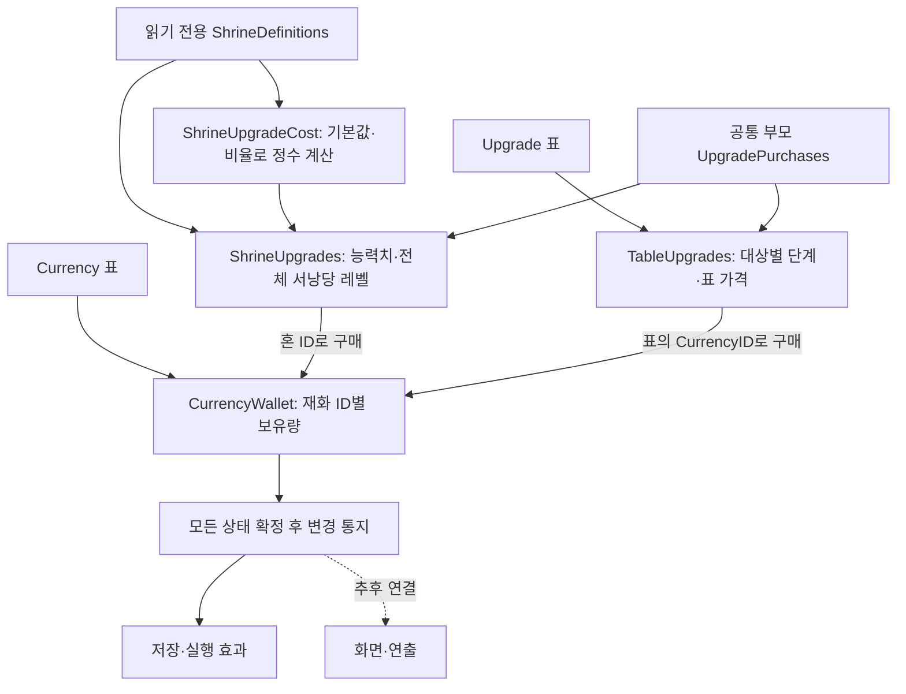
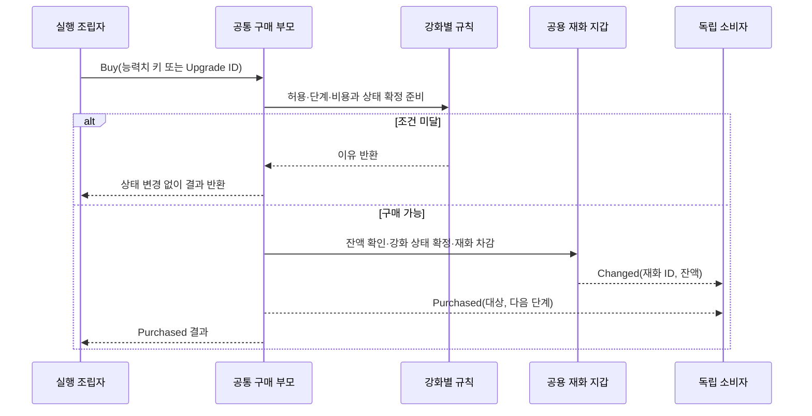
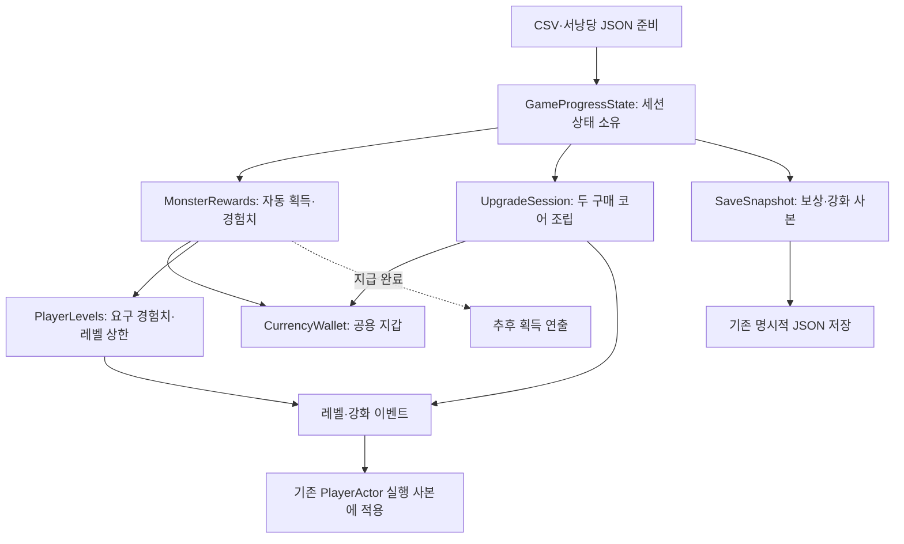
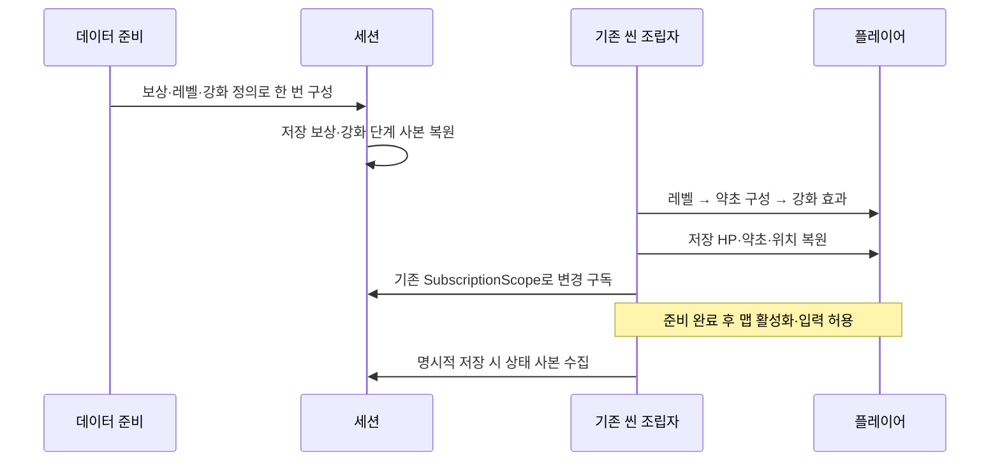
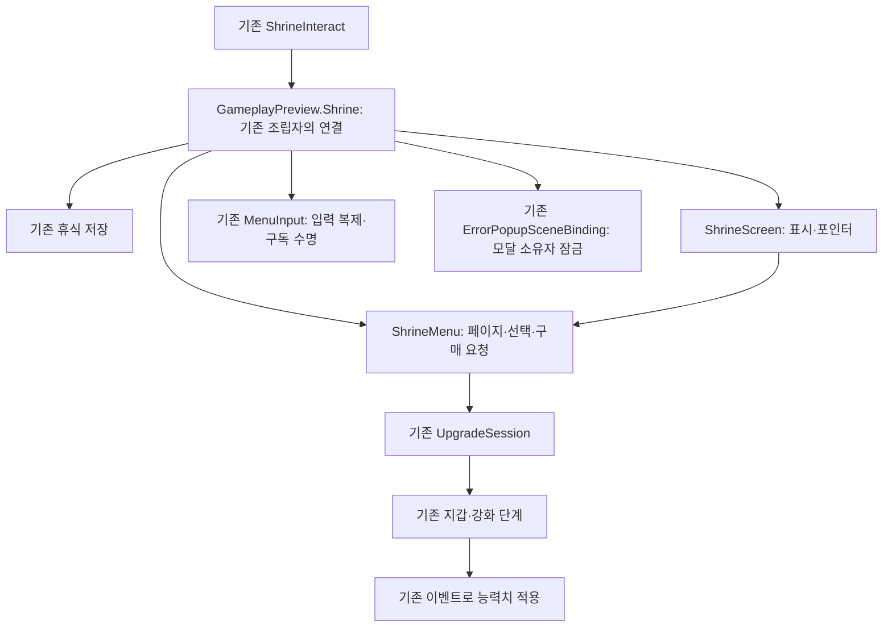

# 재화와 강화 구매 설계

기준일: 2026-11-10. 독립 구매 코어에 처치 자동 보상·플레이어 레벨·강화 효과·세션·저장 복원·사망 재화 손실을 연결했습니다. 임시 서낭당 UI는 8절처럼 연결했습니다. 최종 UI·획득 연출·랜덤박스·갈림길 실제 도착 배치는 후속입니다. [기획자 안내](../기획자용%20안내문서/기획자용%20재화와%20강화%20준비%20안내.md)를 함께 봅니다.

## 목차

1. [왜 이 구조인가](#1-왜-이-구조인가)
2. [코드 위치와 재사용 계약](#2-코드-위치와-재사용-계약)
3. [구매의 한 번 처리](#3-구매의-한-번-처리)
4. [비용과 단계 규칙](#4-비용과-단계-규칙)
5. [조립·상태·수명](#5-조립상태수명)
6. [앞 단계의 검사 기록](#6-앞-단계의-검사-기록)
7. [자동 보상·레벨·강화의 실행 연결](#7-자동-보상레벨강화의-실행-연결)
8. [임시 서낭당 화면의 조립](#8-임시-서낭당-화면의-조립)
9. [2026-11-10 통합 검수 반영](#2026-11-10-통합-검수-반영)
10. [서낭당 표시 리소스 복구 — 2026-11-10](#서낭당-표시-리소스-복구--2026-11-10)

## 1. 왜 이 구조인가

혼과 엽전은 같은 재화 보유량 규칙을 사용하지만 서로 다른 ID와 잔액입니다. 서낭당 능력치 강화는 전체 서낭당 레벨에 따라 비용이 바뀌고, 약초 강화는 Upgrade 표의 대상·단계·가격을 사용합니다. 재화 처리를 두 번 만들거나 서로 다른 비용 정책을 한쪽 규칙에 묶지 않도록 책임을 나눴습니다.



## 2. 코드 위치와 재사용 계약

모든 새 코드는 Core/Progression에 있습니다. Unity·씬·파일·입력·프리팹을 참조하지 않아 게임 씬 없이 검사하고 사용할 수 있습니다.

| 코드 | 책임 |
| --- | --- |
| CurrencyWallet.cs | 정의를 참조하고 보유량 사본을 소유. 획득·차감·상한·잠금·변경 통지를 공용 처리 |
| UpgradePurchases.cs | 공통 구매 명령과 재화 차감·상태 확정·완료 통지 순서를 가진 추상 부모 |
| ShrineUpgrades.cs | 전체 서낭당 레벨·능력치별 단계·상한. 비용 정책은 함수로 주입 |
| ShrineUpgradeCost.cs | 기획의 비율식을 읽기 전용 정의로 계산. 다른 정책으로 교체 가능 |
| TableUpgrades.cs | Upgrade.ID로 구매하고 Target별 다음 단계만 허용. 엽전 약초 외 같은 표 구조에도 재사용 |

두 강화는 같은 구매 책임을 가지므로 공통 부모를 상속해 고유 조건만 재정의합니다. 새로운 실행 어댑터는 만들지 않았습니다. 후속 연결도 기존 서낭당 상호작용·저장 소유자·구독 수명 도구를 우선 재사용합니다.

## 3. 구매의 한 번 처리



완료 통지 때에는 잔액·능력치 단계·서낭당 레벨이 함께 확정돼 있습니다. 통지 중 같은 지갑에 대한 재화 변경이나 다른 강화의 구매도 차단합니다. 동기 이벤트의 소비자 예외는 기존 규칙대로 전파하며 이미 확정한 구매를 되돌리지 않습니다. 소비자 오류를 구매 실패로 해석해 자동 재시도하면 안 됩니다. 표시 소비자는 자기 Unity 오류를 자기 경계에서 처리하고 콜백에서 코어 명령을 다시 실행하지 않습니다.

## 4. 비용과 단계 규칙

최신 기획은 다음입니다.

`비용 = 버림(soulCostBase × soulCostRate^(서낭당 레벨−1) ÷ 10000^(서낭당 레벨−1))`

현재 70·11500·최대 레벨5이면 비용은 70·80·92·106입니다. 이전 레벨에서 버린 결과에 다시 비율을 곱하지 않습니다. BigInteger 정수 연산으로 계산한 뒤 마지막에 나누므로 105로 잘못 내려가는 누적 버림을 피합니다. 보유량 int 범위를 넘는 결과·상한 레벨에는 비용을 제공하지 않습니다. 기본값·비율·상한은 데이터에서 읽으며 숫자 70을 규칙에 고정하지 않습니다.

능력치를 하나 사면 선택 능력치 단계와 전체 서낭당 레벨이 각각 1 오릅니다. 다른 능력치로 바꿔도 비용은 전체 레벨을 기준으로 합니다. 초기화·복원 시 구매 단계 합계는 서낭당 레벨−1과 일치해야 합니다. 정책 함수가 연결되지 않았거나 유효한 비용을 반환하지 않으면 CostUnavailable이며 무료·임시 표 가격으로 대신 구매하지 않습니다.

Upgrade 표 강화는 CurrencyID·Target·Step·Price를 그대로 사용합니다. 현재 약초 개수·회복량 강화는 엽전 ID2를 차감합니다. 혼과 엽전의 잔액은 독립적입니다. Value를 구매 단계까지 합산해 실행 약초 상태에 적용합니다. 구매로 현재 약초를 충전하지 않으며 서낭당 휴식 때 강화된 최대 수까지 채웁니다.

## 5. 조립·상태·수명

세션 소유자는 초기화 완료 후 한 번 구성합니다. 메뉴를 열 때마다 새 지갑을 만들면 안 됩니다.

```csharp
var wallet = new CurrencyWallet(data.GetTable<Currency>().All);
var definitions = data.GetDefinition<ShrineDefinitions>();
var costs = new ShrineUpgradeCost(definitions.Level);
var shrine = new ShrineUpgrades(definitions, wallet, costs.GetCost);
var herbs = new TableUpgrades(data.GetTable<Upgrade>().All, wallet);
```

위 코드는 독립 코어의 수동 조립 예시입니다. 실제 게임에서는 GameSaveContext가 전달하는 GameProgressState에 MonsterRewards·UpgradeSession을 한 번 연결합니다. 같은 지갑으로 처치 획득과 두 강화 구매를 처리합니다. CaptureBalances·CaptureSteps는 읽기 전용 사본을 반환하며 SaveSnapshot의 Rewards·Upgrades에 함께 기록합니다. 원본 정의는 수정하지 않습니다.

UpgradeSession은 자신이 소유한 구매 코어의 완료 통지를 EffectsChanged로 모읍니다. 씬 연결자는 기존 SubscriptionScope로 레벨·강화 이벤트를 구독하고 씬 종료 때 해제합니다. 모든 명령은 호출자 실행 흐름에서 동기로 처리하며 Update·코루틴·추가 비동기 작업·전역 이벤트 버스는 없습니다. 네트워크 권한·통신은 구현하지 않았으며 멀티스레드 안전성을 보장하는 API도 아닙니다. ID·단계·수량은 정수, 순서는 조립자가 결정합니다.

## 6. 앞 단계의 검사 기록

독립 코어 단계에서는 재화별 잔액·상한·잠금·사본 보존, 비용식 마지막 버림, 구매 단계·중복 진입·소비자 오류 후 확정 상태와 잠금 해제를 검사했습니다. 아래는 당시 기록이며 최신 연결 범위는 7절을 따릅니다.

최종 결과: 생성기 109개·데이터 1007개·코어 810개 검사와 일반/편집기 Unity 참조 컴파일 경고·오류 0개. 최신 EXE의 24탭·정의28·계획1·스폰4·서낭당6 검사·배포도 통과했습니다. 실제 Play·Windows 빌드는 이번 단계에서 실행하지 않았습니다.

## 7. 자동 보상·레벨·강화의 실행 연결

### 왜 기존 세션에 연결했는가

씬에 지갑이나 레벨 컴포넌트를 추가하면 맵 이동마다 보유량이 초기화되거나 같은 보상을 두 번 받을 수 있습니다. 기존 GameSaveContext → GameProgressState가 실행 상태를 계속 소유하고, 씬은 필요한 구독과 플레이어 적용만 담당하게 했습니다. UI가 없어도 지급·구매 명령·저장·복원은 동작합니다.



### 데이터와 명령·결과의 의미

MonsterReward는 MonsterID로 찾습니다. Exp·SoulDrop·CoinDrop은 각각 실제 경험치·혼·엽전 수량이며 랜덤박스 가중치가 아닙니다. 현 스키마에서 혼 ID1·엽전 ID2 연결은 MonsterRewards 한곳에 둡니다. 추후 랜덤박스 JSON 경로 컬럼이 생기면 별도 책임으로 연결합니다. 현재 보스에 대응하는 보상 행은 없어 보스 보상을 임의 생성하지 않습니다.

기존 일반 몬스터 사망 구독에서 배치 ID를 확인한 뒤 TryGrant를 호출합니다. 지급 가능한 수량인지 전부 확인하고 경험치·처치 기록·모든 재화를 확정한 다음 통지합니다. 수량 초과 시 일부만 지급하지 않습니다. 동일 배치의 중복 사망 알림과 통지 중 재진입은 차단합니다. 현재 체력 변경 이벤트를 재사용하며 매 프레임 보상을 검사하지 않습니다.

| 결과 이벤트 | 확정된 상태 | 추후 소비자 |
| --- | --- | --- |
| CurrencyWallet.Changed | 재화 잔액·경험치·처치 기록 | 보유량 표시 |
| MonsterRewards.LeveledUp(이전, 이후) | PlayerLevel로 계산한 새 레벨 | 실행 능력치 적용·레벨 연출 |
| MonsterRewards.Granted(배치 ID, 보상 행) | 지급 완료 | 획득 애니메이션·이펙트 |
| UpgradeSession.EffectsChanged | 구매 단계·서낭당 레벨·잔액 | 실행 강화 효과 적용 |

Granted의 보상 행 Exp는 표의 제안 수량입니다. 상한에서는 경험치 실제 증가량이 0일 수 있으므로 표시 소비자는 현재 레벨·LevelExperience도 함께 봅니다. 소비자 예외는 전파하며 확정한 지급을 되돌리지 않습니다. 오류 후 자동 재시도하지 않습니다. 연출 성공 여부를 지급 조건으로 사용하지 않습니다. 필수 적용 실패는 기존 오류 경계로 전달합니다.

### 플레이어 레벨과 서낭당 레벨의 분리

PlayerLevel의 현재 행 NeedExp만큼 소비해 다음 활성 레벨로 오릅니다. 초과 경험치는 다음 레벨로 넘기고 한 보상으로 여러 레벨을 올릴 수도 있습니다. 꺼진 다음 행은 건너뛰지 않습니다. 현재 지스타 상한은 5레벨이며 이후 경험치가 증가하지 않습니다. 내부 Experience·저장 Rewards.Experience는 소비 전 합산 기준값이며, 화면에 필요한 현재 레벨 경험치는 LevelExperience로 조회합니다. 상한의 LevelExperience는 0입니다. 표를 바꾸면 복원 시 같은 기준값으로 다시 계산합니다.

HPAdd·StaminaAdd·ATKAdd·DEFAdd는 1레벨 기본값 대비 총 증가량입니다. 각 행을 다시 누적하지 않습니다. 현재 5레벨은 HP140·스태미나120·공격력19·방어력4입니다. 레벨업 시 살아 있는 플레이어의 현재 HP에는 최대 HP 증가분만 더합니다. 스태미나는 최대량만 증가하고 자동 충전하지 않습니다. 사망 상태에 레벨을 적용해 부활시키지 않습니다. 치명타·회피·공격 속도 등 보조 능력치는 서낭당 강화가 담당합니다.

원본 Player·UnitStat을 수정하거나 플레이어를 다시 만들지 않습니다. PlayerActor의 실행 CharacterStat 사본을 교체하고 공격·방어 판정은 CombatStats, 체력 상한은 MaxHealth, 스태미나는 Stamina.Max를 사용합니다. 새 전투 소비자도 원본 Definition의 능력치를 직접 계산에 쓰지 않도록 주의합니다. 무기 스탯 합산은 이 변경에 포함하지 않았으므로 추후 같은 실행 능력치 조립 지점에서 함께 합산해야 합니다.

### 강화 효과와 시간 수명

| 데이터 키 | 현재 실행 효과 |
| --- | --- |
| StaminaRegen | 초당 스태미나 회복량 증가 |
| AttackSpeed | 평타 준비·판정·후딜·콤보 창 시간을 만분율로 단축 |
| Crit·Dodge | 실행 치명타·회피 확률 증가, 0~10000 제한 |
| ParryStamina | 패링 소모량 보정, 최소0 |
| HERB_CHARGES·HERB_HEAL | 약초 최대 수·회복량 증가 |

단계별 value는 구매한 단계까지 합산합니다. 설명용 target 문자열을 함수명으로 실행하지 않습니다. 새로운 종류의 효과는 실행 연결과 검사를 함께 추가해야 하며, 표에 새 이름만 적었다고 임의의 새 기능이 생기지는 않습니다.

공격 시간은 원본 기준에서 정수 ms로 반올림하며 준비·판정은 최소1ms입니다. 이미 진행 중인 공격은 시작 시의 설정을 끝까지 유지하고 다음 공격부터 새 속도를 사용합니다. 스킬 공격 시간은 바꾸지 않습니다. 같은 효과를 다시 적용해도 수치가 누적 증가하지 않습니다.

### 저장·복원·사망 계약



RewardSnapshot·UpgradeSnapshot은 입력 사전을 복사합니다. 이전 버전1 파일에 새 항목이 없으면 읽을 때만 경험치0·재화0·서낭당1·강화0을 보충하고 기존 파일을 덮어쓰지 않습니다. 현재 버전 파일의 잘못된 타입·음수·알 수 없는 단계는 정상 상태로 가장하지 않습니다. 파일 자체는 기존 수동·자동 저장 시에만 기록합니다.

사망 재시작에서는 Currency.DeathLossRate로 보유량의 손실량을 정수 버림해 차감합니다. 레벨·경험치·강화는 잃지 않습니다. 처치 기록의 사망 복원 규칙은 기존 저장 기준을 따릅니다. 사망 차감도 임시 상태이며 별도 저장 없이 파일을 다시 쓰지 않습니다. 사망 조립자는 한 번의 사망에 RestartAfterDeath를 한 번만 호출해야 합니다.

저장 복원은 씬 소비자가 연결되기 전에 끝내며 실행 중 UI에서 Restore를 직접 호출하지 않습니다. 복원 때도 공용 지갑 인스턴스를 유지하므로 강화가 이전 지갑에 돈을 쓰는 문제를 막습니다. 씬 파괴 시 기존 구독 범위를 해제해 이전 플레이어를 호출하지 않습니다. 파일 작업 외에 새 비동기 작업·코루틴·프레임 반복을 추가하지 않았습니다. 네트워크는 구현하지 않았으며 보상 배치 ID·정수 수량·명령 순서는 향후 권한·동기화 설계에서도 명시해야 합니다.

사용할 명령은 세션의 Rewards.TryGrant, Upgrades.BuyShrine, Upgrades.BuyUpgrade입니다. 일반 몬스터 자동 지급과 8절의 임시 강화 화면·입력을 연결했습니다. 다른 UI 담당도 GameProgressState를 명시적으로 전달받고 위 명령만 호출하며 지갑을 따로 만들거나 표시 이벤트에서 구매를 재호출하지 않습니다.


최신 연결 검사: 데이터 1017개·코어 834개 통과, 일반/편집기 Unity 참조 컴파일 경고·오류 0개입니다. 실제 Unity Play·Windows 빌드는 실행하지 않았습니다.

## 8. 임시 서낭당 화면의 조립

제공된 ShrineScreen 프리팹을 새 구매 시스템 없이 기존 기능에 연결했습니다. 임시 수치118·37·92는 실제 보유량과 데이터 가격으로 교체합니다. 화면은 두 종류의 강화에 같은 목록·상세·가격 표시를 재사용합니다.



- Core/Progression/ShrineMenu는 기본·혼·약초 페이지, 선택, 뒤로, 결정만 소유합니다. 능력치 목록은 활성 JSON, 약초 목록·다음 구매 ID·최대 단계는 Upgrade 표에서 읽습니다. 실제 차감과 상한은 UpgradeSession에 위임합니다. 지원 능력치 판별과 비용 계산 정책도 기존 세션의 공통 함수를 재사용합니다.
- Presentation/ShrineScreen은 프리팹 내부의 명시된 경로만 찾아 보관하고 실제 수치·단계·비용을 표시합니다. 새 장면 검색이나 프레임별 수치 조회는 하지 않습니다. 두 강화가 같은 상세 화면을 사용하며 구매 중 발생하는 상태 통지는 다시 그리지 않고 명령 완료 후 한 번 표시합니다. 표시 오류는 자기 경계에서 정리하고 기존 오류 팝업으로 전달하며 구매를 재시도하지 않습니다.
- Preview/GameplayPreview.Shrine은 이미 존재하는 맵 조립자의 일부입니다. 별도 전역 관리자·재화 소유자·저장 어댑터를 만들지 않습니다. 기존 플레이어 입력 원본으로 MenuInput을 구성하고 기존 모달 연결을 사용합니다. 화면 프리팹과 모달 참조는 현재 MapDohwagolTest에 배치했습니다. 화면 미사용 확인 씬은 기존 휴식 저장 동작을 유지합니다.

### 초기화·종료 순서

비활성 부모 아래에서 화면 생성과 입력 구성을 마친 뒤 화면을 엽니다. Open에서 경로·단계 이미지·Canvas 표시를 확인한 후 모달 잠금을 얻고 메뉴 입력을 켭니다. 여는 프레임의 결정은 무시해 메뉴 열기와 즉시 구매가 겹치지 않게 합니다.

화면을 닫으면 메뉴 입력·구독을 먼저 해제하고, 기존 LateUpdate의 한 번 예약으로 다음 프레임에 자기 모달 소유권만 반환합니다. 매 프레임 수치 갱신은 하지 않습니다. 다른 오류 팝업의 소유권이 남으면 게임은 계속 잠깁니다. 오류 팝업이 서낭당 위에 열리는 동안은 메뉴 포인터와 키 입력도 차단합니다. 씬 종료·비활성화에서는 남은 예약·입력 복제·화면·구독을 함께 정리합니다.

부모 스케일0이던 프리팹 루트를1로 고치고 화면 기준 앵커를 맞췄습니다. 자동 경로는 화면 안으로 제한되며 디자이너가 내부 이름을 변경하면 연결 코드와 검사도 함께 바꿔야 합니다. 단계별 이미지는 프리팹의 교체 가능한 참조입니다. 기존 장면·원본 데이터·공용 에러 팝업 프리팹은 새로 복제하지 않습니다.

E의 기존 휴식 저장은 유지합니다. 구매 후 별도 자동 저장을 만들지 않았으므로 구매는 다음 명시적 저장 전까지 임시 상태입니다. 화면을 닫는 동작이 구매·저장을 다시 호출하지 않습니다. 표의 문구 ID가 있는 항목은 Language에서 읽고, ID가 없는 기존 임시 문구는 현재 한국어 표시를 유지합니다. 전체 언어 선택과 최종 연출은 후속입니다.

실제 사용·수동 확인 절차와 교체 가능한 항목은 [기획자 안내 7절](../기획자용%20안내문서/기획자용%20재화와%20강화%20준비%20안내.md#7-임시-서낭당-화면-사용법)을 따릅니다. 자동 검사는 페이지 이동·진입과 구매 구분·혼/엽전별 차감·상한 반복·빈 표·닫힘 이후 입력, 프리팹 루트와 실제 맵의 연결 참조를 확인합니다. 실제 Unity Play의 배치·클릭·게임 입력 복구와 실행파일 검증은 별도입니다.


## 2026-11-10 통합 검수 반영

갈림길 정의 공급·일회 지급·지급 여부와 상호작용 기록을 기존 세션·저장 사본에 연결했습니다. 이전 재화 ID와 폐기 관문은 복원 사본에서 처리하고 원본 파일은 유지합니다. 원인·수정 범위·최적화와 보류 사항은 [통합 설계 문서](병합%20누락%20복구와%20갈림길%20보상%20설계.md), 기획자 확인은 [작성·검수 안내](../기획자용%20안내문서/갈림길%20보상%20작성과%20검수%20안내.md)를 따릅니다.

## 서낭당 표시 리소스 복구 — 2026-11-10

화면이 '서낭당 단계 표시 이미지를 연결해 주세요'로 열리지 않던 원인은 프리팹이 참조하는 원본 이미지·글꼴이060b65a에서 삭제됐기 때문입니다. `ShrineScreen`의 단계 참조뿐 아니라 패널·커서·아이콘과 모든 글자 표시의 의존성이 함께 빠져 있었습니다.

4911e3b에 있던 `Assets/4.Sprite/UI_Temp/Shrine`의 원본 PNG13개·메타와 `Assets/9.Font/SongMyung`의 원본 글꼴·메타·라이선스를 복구했습니다. 기존 GUID를 유지해 프리팹 참조가 다시 유효해지며 구매 규칙·수치·저장 계약은 바꾸지 않습니다. 이미지 없이 필수 검사만 통과시키는 대체 경로는 추가하지 않았습니다.

격리된 실제 화면 호출28항목: 열기, 혼/약초 페이지 이동, 구매 후 단계 켜짐·꺼짐 그림, 비용 차감, 입력 차단, 닫기/다시 열기2회와 구독 정리를 확인했습니다. 복구 후 글꼴 누락0개이며 메뉴·가격·단계 글자와 배경을 렌더로 확인했습니다. 테스트 재화와 구매는 격리된 진행 객체에서만 변경했고 게임 저장 파일 쓰기는 없습니다. 실제 씬에서 E키·마우스·입력 복귀 수용은 별도입니다.
