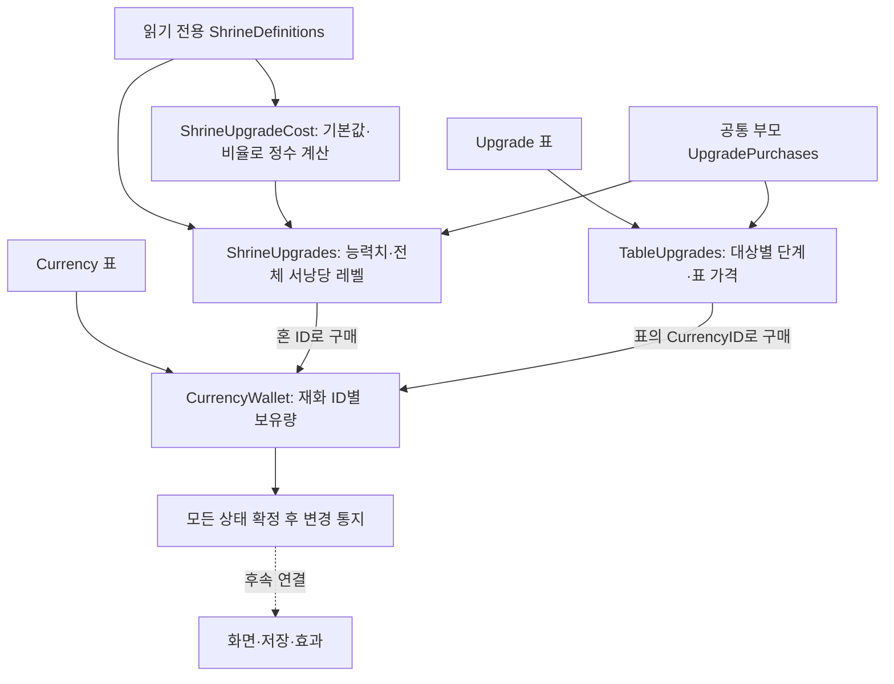
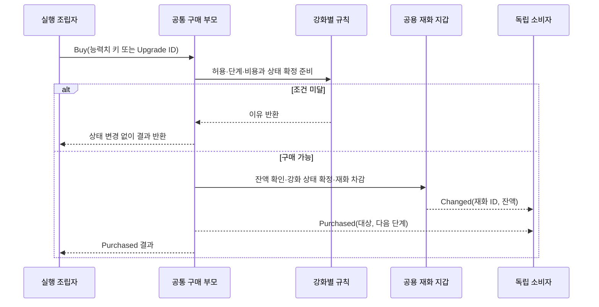

# 재화와 강화 구매 설계

기준일: 2026-11-10, 최신 클라이언트 24f82dc·DataSheet 8470b2e 위에 재적용했습니다. 이번 범위는 독립 코어와 자동 정의 공급까지입니다. 게임 세션·UI·처치 보상·효과 적용·파일 저장·사망 손실 연결은 아직 후속입니다. [기획자 안내](../기획자용%20안내문서/기획자용%20재화와%20강화%20준비%20안내.md)를 함께 봅니다.

## 1. 왜 이 구조인가

혼과 엽전은 같은 재화 보유량 규칙을 사용하지만 서로 다른 ID와 잔액입니다. 서낭당 능력치 강화는 전체 서낭당 레벨에 따라 비용이 바뀌고, 약초 강화는 Upgrade 표의 대상·단계·가격을 사용합니다. 재화 처리를 두 번 만들거나 서로 다른 비용 정책을 한쪽 규칙에 묶지 않도록 책임을 나눴습니다.



## 2. 코드 위치와 재사용 계약

모든 새 코드는 Core/Progression에 있습니다. Unity·씬·파일·입력·프리팹을 참조하지 않아 게임 씬 없이 검사하고 사용할 수 있습니다.

| 코드 | 책임 |
| --- | --- |
| CurrencyWallet.cs | 정의를 참조하고 보유량 사본을 소유. 획득·차감·상한·잠금·변경 통지를 공용 처리 |
| UpgradePurchases.cs | 공통 구매 명령과 재화 차감·상태 확정·완료 통지 순서를 가진 추상 부모 |
| ShrineUpgrades.cs | 전체 서낭당 레벨·능력치별 단계·상한. 비용 정책은 함수로 주입 |
| ShrineUpgradeCost.cs | 기획의 비율식을 읽기 전용 정의로 계산. 다른 정책으로 교체 가능 |
| TableUpgrades.cs | Upgrade.ID로 구매하고 Target별 다음 단계만 허용. 엽전 약초 외 같은 표 구조에도 재사용 |

두 강화는 같은 구매 책임을 가지므로 공통 부모를 상속해 고유 조건만 재정의합니다. 새로운 실행 어댑터는 만들지 않았습니다. 후속 연결도 기존 서낭당 상호작용·저장 소유자·구독 수명 도구를 우선 재사용합니다.

## 3. 구매의 한 번 처리



완료 통지 때에는 잔액·능력치 단계·서낭당 레벨이 함께 확정돼 있습니다. 통지 중 같은 지갑에 대한 재화 변경이나 다른 강화의 구매도 차단합니다. 동기 이벤트의 소비자 예외는 기존 규칙대로 전파하며 이미 확정한 구매를 되돌리지 않습니다. 소비자 오류를 구매 실패로 해석해 자동 재시도하면 안 됩니다. 표시 소비자는 자기 Unity 오류를 자기 경계에서 처리하고 콜백에서 코어 명령을 다시 실행하지 않습니다.

## 4. 비용과 단계 규칙

최신 기획은 다음입니다.

`비용 = 버림(soulCostBase × soulCostRate^(서낭당 레벨−1) ÷ 10000^(서낭당 레벨−1))`

현재 70·11500·최대 레벨5이면 비용은 70·80·92·106입니다. 이전 레벨에서 버린 결과에 다시 비율을 곱하지 않습니다. BigInteger 정수 연산으로 계산한 뒤 마지막에 나누므로 105로 잘못 내려가는 누적 버림을 피합니다. 보유량 int 범위를 넘는 결과·상한 레벨에는 비용을 제공하지 않습니다. 기본값·비율·상한은 데이터에서 읽으며 숫자 70을 규칙에 고정하지 않습니다.

능력치를 하나 사면 선택 능력치 단계와 전체 서낭당 레벨이 각각 1 오릅니다. 다른 능력치로 바꿔도 비용은 전체 레벨을 기준으로 합니다. 초기화·복원 시 구매 단계 합계는 서낭당 레벨−1과 일치해야 합니다. 정책 함수가 연결되지 않았거나 유효한 비용을 반환하지 않으면 CostUnavailable이며 무료·임시 표 가격으로 대신 구매하지 않습니다.

Upgrade 표 강화는 CurrencyID·Target·Step·Price를 그대로 사용합니다. 현재 약초 개수·회복량 강화는 엽전 ID2를 차감합니다. 혼과 엽전의 잔액은 독립적입니다. Value는 정의로 보존하며 실제 약초 효과를 바꾸는 연결은 다음 단계입니다.

## 5. 조립·상태·수명

세션 소유자는 초기화 완료 후 한 번 구성합니다. 메뉴를 열 때마다 새 지갑을 만들면 안 됩니다.

```csharp
var wallet = new CurrencyWallet(data.GetTable<Currency>().All);
var definitions = data.GetDefinition<ShrineDefinitions>();
var costs = new ShrineUpgradeCost(definitions.Level);
var shrine = new ShrineUpgrades(definitions, wallet, costs.GetCost);
var herbs = new TableUpgrades(data.GetTable<Upgrade>().All, wallet);
```

위 코드는 조립 예시이며 기존 게임 세션에 자동 연결한 상태가 아닙니다. CaptureBalances·CaptureSteps는 읽기 전용 사본을 반환하고, 생성자에 그 사본을 전달하면 별도 인스턴스로 복원할 수 있습니다. 저장 파일 스키마·현재 SaveSnapshot에는 아직 연결하지 않았습니다. 원본 정의는 수정하지 않습니다.

핵심 기능끼리 이벤트 구독을 만들지 않으므로 별도 해제 작업이 없습니다. 화면·저장 소비자가 구독하면 기존 SubscriptionScope 등을 사용해 자기 수명에 맞게 해제합니다. 모든 명령은 호출자 실행 흐름에서 동기로 처리하며 Update·코루틴·추가 비동기 작업·전역 이벤트 버스는 없습니다. 네트워크 권한·통신은 구현하지 않았으며 멀티스레드 안전성을 보장하는 API도 아닙니다. ID·단계·수량은 정수, 순서는 조립자가 결정합니다.

## 6. 검사와 후속

재화별 잔액 독립·음수/상한/잔액 부족·잠금·사본 보존, 비용식 마지막 버림·데이터 변경, 전체/개별 단계 상한·다른 능력치 구매·엽전 표의 단계·중복 진입·소비자 오류 후 확정 상태와 잠금 해제를 검사합니다. 실제 세션·UI·약초 효과·저장·사망 손실·처치/갈림길 보상은 연결 후 별도 검증합니다. 다른 개발자의 전투·애니메이션은 최신 리베이스 결과를 보존했습니다.

최종 결과: 생성기 109개·데이터 1007개·코어 810개 검사와 일반/편집기 Unity 참조 컴파일 경고·오류 0개. 최신 EXE의 24탭·정의28·계획1·스폰4·서낭당6 검사·배포도 통과했습니다. 실제 Play·Windows 빌드는 이번 단계에서 실행하지 않았습니다.
