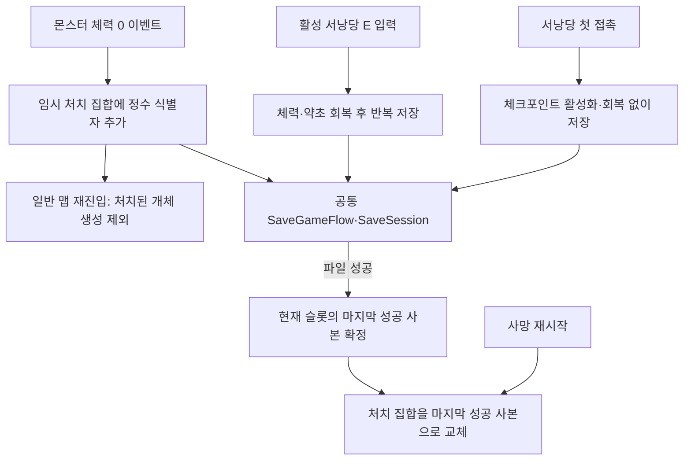
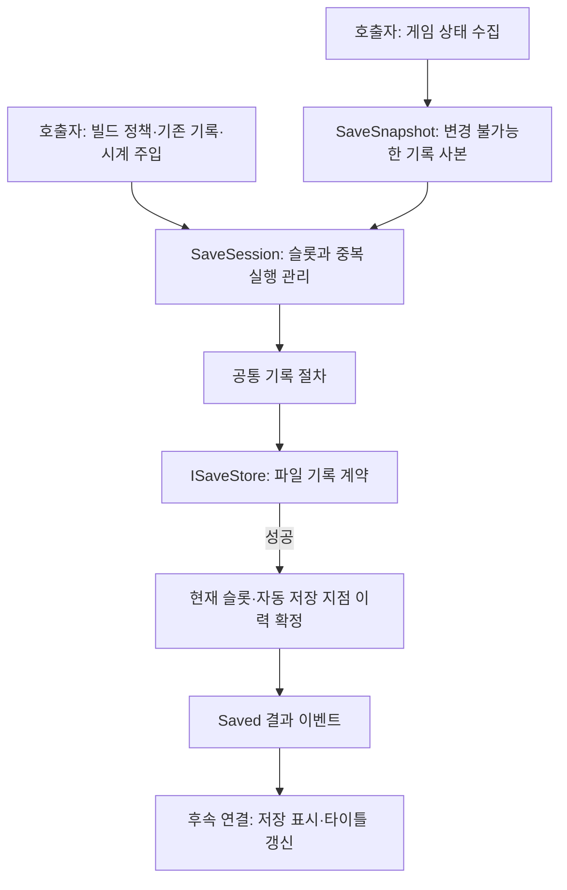
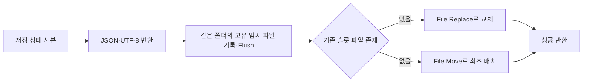
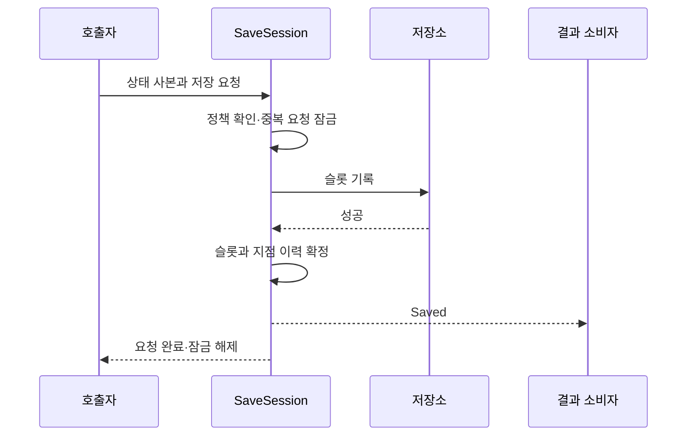
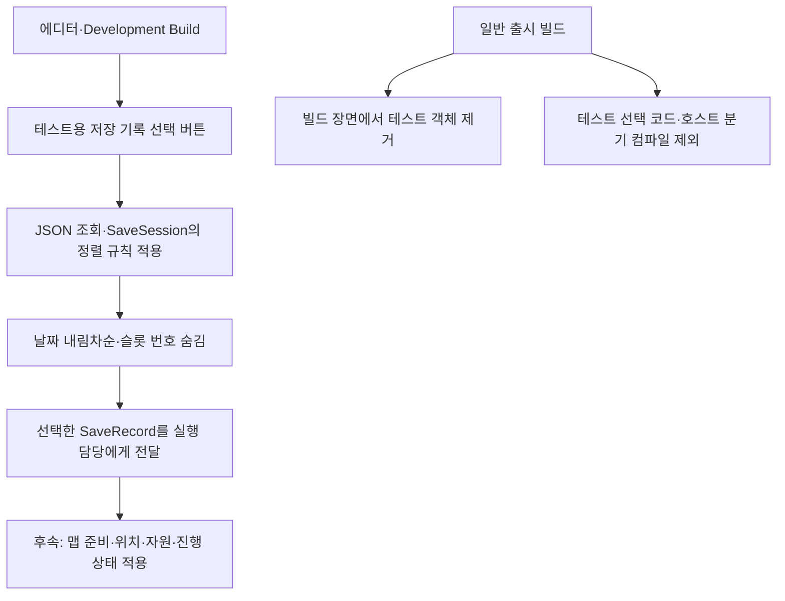
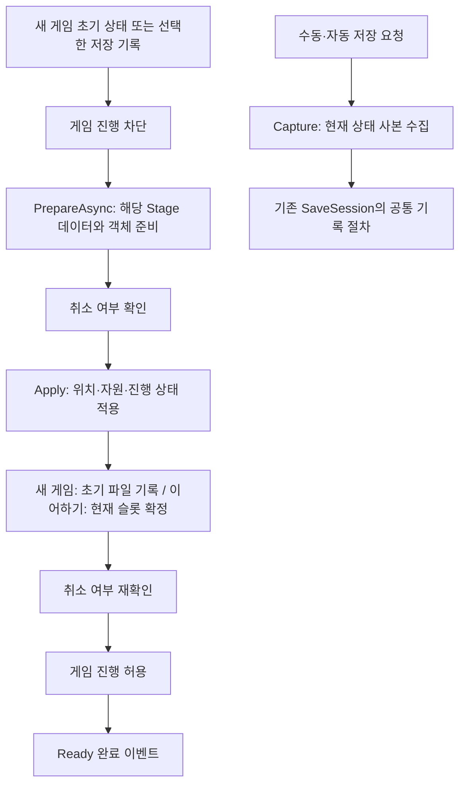
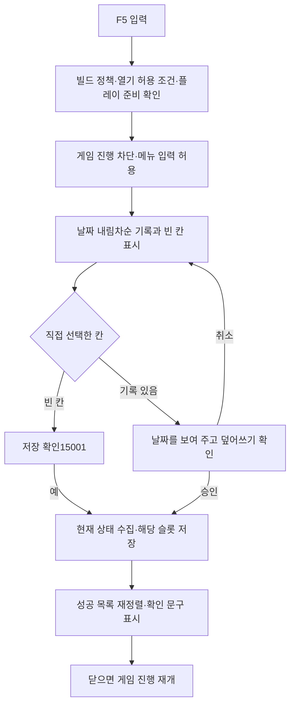
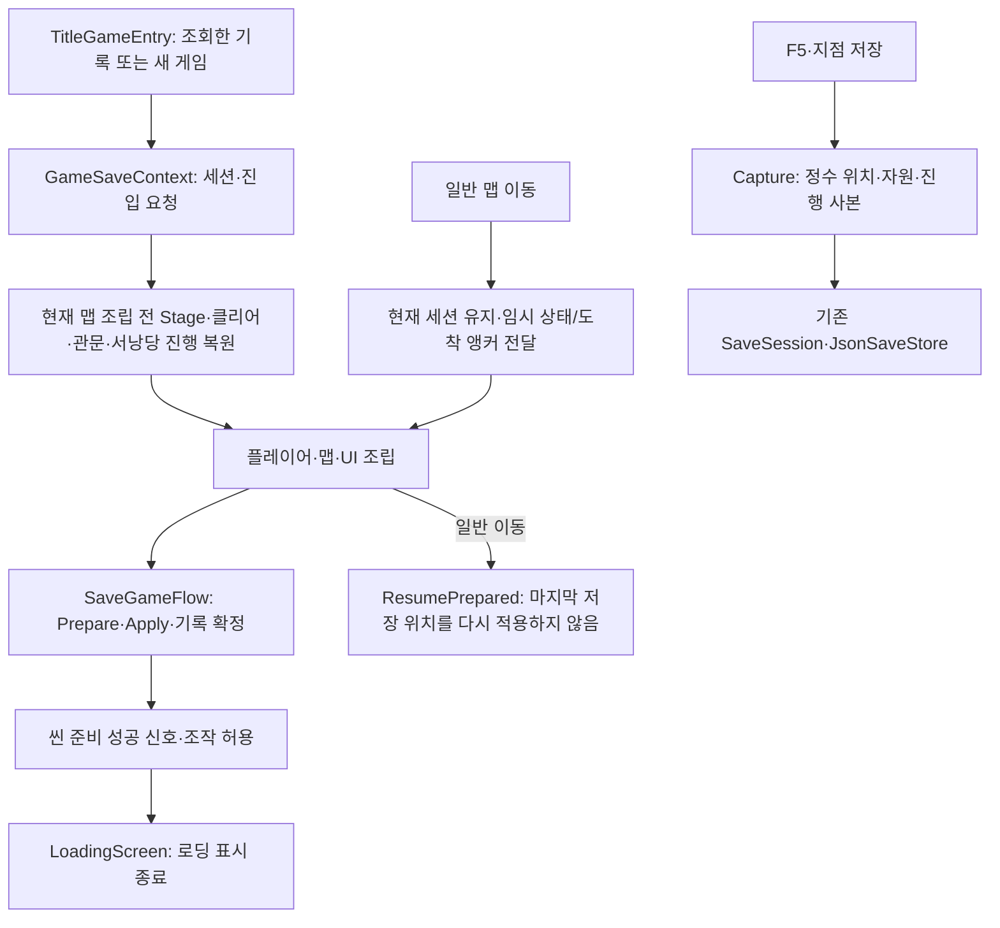

# 저장 기능 설계

> 2026-11-06: 현재 테스트 맵에 서낭당 접촉·휴식 저장, 일반 몬스터 처치 유지·사망 복원을 연결했습니다. 실제 Unity 플레이와 정식 공간 연결 검증은 남아 있습니다.

기준일: 2026-11-06. 슬롯 직접 선택·위치 복원·빌드별 정책을 유지하고 서낭당 접촉/휴식 저장과 일반 몬스터 개별 처치 기록을 추가했습니다. 아래 과거 점검 기록보다 이 절과 마지막 연결 계약을 우선합니다.

## 서낭당과 개별 처치를 저장하는 이유

맵을 왕복할 때 쓰러뜨린 몬스터가 다시 나타나는 문제를 막고, 사망하면 마지막으로 저장한 진행까지 되돌아가도록 합니다. 원본 스폰 JSON은 읽기 전용으로 유지하고 개체 식별자만 임시 집합과 저장 사본에 보관합니다. 별도 저장소·슬롯 정책·이벤트 버스는 만들지 않습니다.



### 책임과 수명 계약

| 위치 | 담당하는 이유와 동작 |
| --- | --- |
| Core/Saves/SaveRecord.cs | MonsterSpawnId는 StageId·PlacementId·Sequence 정수 값입니다. SaveSnapshot은 목록을 복사·중복 제거·정렬해 원본 변경을 차단합니다. |
| Core/Saves/SaveSession.cs | CurrentSnapshot은 현재 슬롯의 마지막 성공 기록입니다. 최초 접촉은 기본 중복 차단, 명시적 휴식만 repeat=true로 같은 슬롯에 다시 기록합니다. 실패 시 사본과 성공 이력은 유지합니다. |
| Adapters/Interaction/ShrineInteract.cs | 활성 상태와 주입한 저장 요청만 연결합니다. 비활성화 시 요청 참조를 해제합니다. 독립 배치 후 재활성화하는 조립자는 Connect를 다시 호출해야 합니다. |
| Preview/GameplayPreview.Saves.cs | 현재 맵의 접촉·회복·처치 이벤트를 저장 계약으로 연결합니다. SubscriptionScope로 구독을 해제하고, 파일 완료 후에는 같은 저장 수명인지 확인합니다. |
| Preview/PreviewStage.cs | 저장·임시 처치 집합에 있는 개체는 생성하지 않습니다. 몬스터와 식별자를 조립자에게 전달하며 프리팹·JSON 원본은 변경하지 않습니다. |
| Preview/PreviewDeathRestart.cs | 위치는 서낭당 체크포인트 규칙, 개별 처치는 현재 슬롯의 마지막 성공 사본을 사용합니다. 수동 저장 좌표를 사망 위치로 사용하지 않습니다. |

첫 접촉 확인은 위치 변경 통지를 받아 기존 진행 단계에서 한 번 처리합니다. 현재 접촉 범위는 기존 월드 단위 한 타일 반경이며 데이터 컬럼을 추가하지 않았습니다. 자동 저장 중 중복 요청은 거부합니다. 실패한 첫 접촉은 재접촉 또는 E키로 재시도할 수 있습니다. 회복과 체크포인트 활성은 임시 게임 상태이므로 파일 실패만으로 되돌리지 않으며 기존 파일과 실패 로그를 보존합니다.

사망 암전의 지연 콜백도 SubscriptionScope.Guard를 사용하며 조립자 비활성화 때 해제합니다. 이전 씬의 늦은 암전 콜백은 새 씬의 처치 집합이나 이동을 변경하지 않습니다. 저장 파일 성공 후 알림 소비자가 실패한 경우는 파일 기록 실패와 다른 로그로 구분합니다. 파일 저장·복원 자동 검사와 엔진 참조 컴파일은 통과했지만 Unity 연결이 응답하지 않아 실제 플레이 검증은 남아 있습니다.

### 개체 키와 파일 호환

Sequence는 같은 PlacementID의 Monsters 목록을 펼친 1부터의 순번입니다. 좌표·Unity InstanceID·몬스터 종류로 식별하지 않습니다. 비활성·없는 코드의 자리도 순번을 차지하고 중복 PlacementID는 건너뜁니다. 목록 중간 삽입·삭제·재정렬이나 배치 ID 재사용은 기존 기록의 의미를 바꾸므로 배포 전에 저장 호환 정책을 협의해야 합니다.

저장 버전 1의 정수 구조에 DefeatedMonsters 배열을 추가했습니다. 예전 파일에 이 필드가 없을 때만 읽는 메모리에서 빈 배열로 확장하며 원본 파일을 자동 덮어쓰지 않습니다. 명시적인 null·잘못된 정수·지원하지 않는 버전은 계속 거부합니다. 이전 실행파일은 새 필드를 모를 수 있으므로 새 저장 파일을 구버전 실행파일에 되돌려 사용하는 호환성은 보장하지 않습니다.

현재는 스테이지당 Seonangdang 한 개이고 Stage ID를 지점 ID로 사용합니다. 다중 서낭당·구간별 리스폰 ON/OFF 데이터·별도 보스 영구 처치 정책·화폐 손실은 이번 범위가 아닙니다. 네트워크나 리플레이는 구현하지 않았으며 향후에는 처치 명령의 권한·순서·배치 버전 동기화를 별도로 정해야 합니다. 사용·검증 순서는 [서낭당과 처치 기록 안내](../기획자용%20안내문서/서낭당%20저장과%20몬스터%20처치%20기록%20확인%20안내.md)를 참고합니다.

**관문 식별 확정:** 사용자 승인으로 Stage.xlsx/GateConfig에 정수 ID를 추가했습니다. ID와 StageID·AnchorName을 연결하고 SaveSnapshot.OpenedGates의 정수 목록은 유지합니다. 이전 StageID_PlacementID 문자열 저장안은 현재 적용안이 아닙니다. 몬스터 식별자는 StageID·PlacementID·Sequence 정수 조합을 사용합니다.

## 1. 왜 저장과 화면을 분리하는가

테스트·시연 빌드는 슬롯을 선택하지만 출시 빌드는 자동 저장만 사용합니다. 두 빌드가 같은 기록 절차를 사용하도록 저장 규칙과 화면·입력·파일 처리를 분리합니다. 작은 조건을 각각 클래스로 분리하지 않고, 슬롯을 결정하는 기능과 실제 기록하는 기능의 경계만 둡니다.

## 2. 어떤 구조인가



| 위치 | 책임과 배치 이유 |
| --- | --- |
| `Assets/3.Script/Core/Saves/SaveRecord.cs` | 저장할 상태와 슬롯 기록. Unity 객체 참조 없이 복원에 필요한 정수와 ID를 보관 |
| `Assets/3.Script/Core/Saves/SaveSession.cs` | 새 게임·수동·자동 슬롯 정책과 저장소 계약. 공통 기록·성공 처리를 한곳에서 실행 |
| `Assets/3.Script/Core/Saves/SaveGameFlow.cs` | 상태 수집·준비·적용·게임 진행 허용 순서와 실행 담당 계약. 미완성 맵 없이 검사 가능한 연결 창구 |
| `Assets/3.Script/Adapters/JsonSaveStore.cs` | JSON 변환·UTF-8 파일 기록·교체·불러오기. 게임 규칙에서 파일 시스템 의존성을 분리 |
| `Assets/3.Script/Adapters/TitleSaveSelection.cs` | 테스트 타이틀의 기록 조회·선택·실행 담당 연결. 기존 타이틀 입력 재사용 |
| `Assets/3.Script/Adapters/ManualSaveHost.cs` | F5·슬롯 선택·덮어쓰기 확인과 저장 흐름 연결. 스테이지와 독립적인 전용 프리팹 조립자 |
| `Assets/3.Script/Presentation/SaveSlotScreen.cs` | 타이틀과 F5의 날짜·빈 칸·선택·확인 표시 공통화 |
| `Assets/3.Script/Adapters/MenuInput.cs` | 타이틀과 F5의 메뉴 입력 복제·구독·해제 공통화 |
| `Assets/Editor/TitleTestBuildProcessor.cs` | 출시 빌드 장면에서 테스트 버튼·창·전용 입력 객체와 컴포넌트 제거 |
| `Tools/Locomotion.Checks/SaveChecks.cs` | 파일·씬 없이 정책, 실패 복구, 비동기 중복 요청 검사 |
| `Tools/CsvReader.Checks/JsonSaveStoreChecks.cs` | 실제 임시 폴더에서 기록·복원·손상·교체 실패 검사 |

JSON 파일 저장소, 테스트 타이틀과 F5 수동 저장 화면, 독립적인 상태 수집·복원 순서 모듈을 구현했습니다. 실제 게임 상태 수집·맵 준비·복원 담당과 운영 씬 연결은 아직 후속입니다. 저장 데이터는 콘텐츠 테이블과 달리 실행 중 생성되는 사용자 기록이므로 파일 경계의 버전·형식 확인이 필요합니다. 저장 데이터 클래스를 그대로 변환하고 필수 필드는 공통 JSON 계약에서 지정해 별도 JSON 사본 클래스나 수동 필드 목록을 만들지 않습니다.



슬롯 하나는 `slot-내부ID.json` 파일 하나입니다. 파일명 ID는 화면에 표시하지 않습니다. 기존 파일을 먼저 지우지 않으며 교체 실패 시 삭제 후 재작성하는 우회 처리를 하지 않습니다. 정상 완료·실패 시 이번 요청의 임시 파일을 정리합니다. 프로세스 강제 종료로 남은 임시 파일은 불러오기에서 제외하고 자동 복구·삭제하지 않습니다. 파일 교체 지원 여부와 전원 차단 시 보존 수준은 실제 대상 환경에서 별도 검증해야 합니다.

불러오기는 필수 필드·정수 형식·지원 버전·파일명과 내부 슬롯 ID 일치를 확인합니다. 값의 기본 범위는 저장 데이터 생성자 검사를 재사용합니다. 손상되거나 지원하지 않는 파일이 있으면 전체 불러오기를 실패로 반환하고 원본 파일을 유지합니다. 손상 기록을 빈 슬롯으로 보거나 기본 기록을 자동 생성하지 않습니다. 버전 변환·사용자 복구 화면은 후속 기능입니다.

## 3. 저장 규칙과 처리 순서

| 요청 | 처리 |
| --- | --- |
| 새 게임 | 즉시 이어하기 가능한 초기 상태 기록. 빈 슬롯 번호순, 가득 차면 가장 오래된 기록 교체. 자동 저장 지점 이력 초기화 |
| 수동 저장 | 테스트·시연 빌드에서만 허용. 사용자가 선택한 슬롯 사용. 기존 기록은 덮어쓰기 승인 필요 |
| 슬롯 화면 | 저장 날짜·시각 내림차순. 슬롯 번호는 표시하지 않음. 빈 칸도 직접 선택 가능 |
| 자동 저장 | 현재 플레이 슬롯 갱신. 지점 ID별 최초 성공 한 번만 처리 |
| 이어하기 | 최신 날짜의 기록 반환. 현재 플레이 슬롯과 지점 이력 복원 |
| 출시 빌드 | 슬롯 1개. 수동 저장 요청 자체 거부. F5와 슬롯 화면은 연결 계층에서도 제공하지 않음 |

저장 중에는 새 저장·이어하기 요청을 거부합니다. 성공한 수동 저장 슬롯은 이후 자동 저장 대상이 됩니다. 실패하면 기존 슬롯과 현재 슬롯, 사용한 자동 저장 지점 이력을 변경하지 않습니다. 저장소 예외는 호출자에게 전달하므로 호출자는 실패 표시와 재시도를 결정합니다.



위치는 맵 ID와 타일×100 단위의 정수 X·Y를 기록합니다. 이어하기 호출자는 맵을 준비한 뒤 이 위치와 HP·약초를 적용해야 합니다. 사망·부활은 이 기록을 읽어 결정하지 않고 별도 체크포인트 규칙을 사용합니다.

## 4. 다른 개발자가 연결할 때

1. 조립자가 저장 폴더와 지원 버전으로 `JsonSaveStore`를 만듭니다. `ReadAsync`를 기다린 뒤 반환한 기록으로 `SaveSession`을 생성하고 같은 저장소와 UTC 밀리초 시계를 주입합니다. 버전 1에서 누락된 개별 처치 배열만 빈 목록으로 확장하고 다른 버전은 실패합니다. 테스트·시연과 출시는 폴더를 분리해 10슬롯 기록을 출시 1슬롯으로 잘못 읽지 않게 합니다. Unity 저장 폴더 선택은 후속 조립자가 담당합니다.
2. 새 게임의 맵·위치·초기 자원이 확정되면 `NewGameAsync`를 기다립니다. 성공 전에는 초기 기록이 있다고 표시하지 않습니다.
3. 테스트·시연용 슬롯 화면은 `Capacity`로 빈 칸을 구성하고 `GetRecords()`로 기록을 표시합니다. 목록은 날짜 내림차순이며 동일 밀리초는 기록 순서로 구분합니다. 내부 슬롯 ID는 선택 대상 연결에만 사용하고 화면에는 표시하지 않습니다. 파일 저장소는 `SaveOrder`도 함께 보존합니다.
4. 사용자가 고른 슬롯과 덮어쓰기 승인을 `SaveManualAsync`에 전달합니다. 화면이 자동으로 다른 슬롯을 골라서는 안 됩니다.
5. 자동 저장 지점은 안정적인 양수 ID를 전달합니다. 지점 활성 조건은 해당 게임 기능이 소유하며 저장 모듈은 처치 수를 직접 판단하지 않습니다.
6. `TryContinue`가 반환한 상태를 실제 게임에 적용합니다. 새 게임 외에는 지점 사용 이력을 초기화하지 않습니다.
7. 한 실행 흐름에서 호출하고 완료를 기다립니다. 백그라운드 스레드에서 동시에 호출하는 API가 아닙니다. 이벤트는 동기로 전달하며 구독자는 콜백 안에서 저장 명령을 재호출하지 않습니다.

파일 저장소는 한 인스턴스 안의 읽기·쓰기를 순차 처리하고 파일 작업은 작업 스레드에서 수행합니다. 같은 폴더를 여러 저장소·프로세스가 동시에 사용하는 것은 지원하지 않습니다. 완료를 기다리면 `SaveSession`은 호출 시 Unity 실행 문맥으로 돌아와 성공 이벤트를 보냅니다. 파일 계층은 Unity API나 화면을 호출하지 않습니다. 기록이 시작되면 완료를 기다리는 계약이며 취소 API는 제공하지 않습니다.

```csharp
// 조립자가 경로·정책·지원 버전을 결정하며 전역 저장소를 만들지 않습니다.
var store = new JsonSaveStore(saveDirectory, saveVersion);
var records = await store.ReadAsync();
var session = new SaveSession(buildMode, saveVersion, store,
    () => DateTimeOffset.UtcNow.ToUnixTimeMilliseconds(), records);
```

화면 소비자 오류는 해당 표시 경계에서 처리합니다. 저장소 기록 성공 뒤 소비자 오류가 나도 저장된 파일과 현재 슬롯은 되돌리지 않습니다. 호출자는 예외만 보고 파일 기록이 실패했다고 단정하지 않아야 합니다.

## 5. 기획자가 알아둘 점과 다음 연결

F5 수동 저장 화면은 독립 프리팹과 연결 API까지 준비했습니다. 실행 담당을 연결하지 않은 씬에서는 F5가 동작하지 않습니다. [수동 저장 사용 안내](../%EA%B8%B0%ED%9A%8D%EC%9E%90%EC%9A%A9%20%EC%95%88%EB%82%B4%EB%AC%B8%EC%84%9C/%EA%B8%B0%ED%9A%8D%EC%9E%90%EC%9A%A9%20%EC%88%98%EB%8F%99%20%EC%A0%80%EC%9E%A5%20%EC%82%AC%EC%9A%A9%20%EC%95%88%EB%82%B4.md)를 참고합니다. 타이틀 기록 조회는 [타이틀 사용 안내](../%EA%B8%B0%ED%9A%8D%EC%9E%90%EC%9A%A9%20%EC%95%88%EB%82%B4%EB%AC%B8%EC%84%9C/%EA%B8%B0%ED%9A%8D%EC%9E%90%EC%9A%A9%20%ED%83%80%EC%9D%B4%ED%8B%80%EA%B3%BC%20%EC%BD%98%ED%85%90%EC%B8%A0%20%EC%9E%A0%EA%B8%88%20%EC%82%AC%EC%9A%A9%20%EC%95%88%EB%82%B4.md)의 테스트 기록 선택 항목을 참고합니다.

최신 K05_1 R4와 다르더라도 사용자가 확정한 직접 슬롯 선택·날짜 내림차순·테스트 및 시연용 수동 저장 허용·슬롯 번호 비표시를 우선합니다. 기획서의 빈 슬롯 자동 선택·오래된 슬롯 자동 선택은 수동 저장에 적용하지 않습니다. 새 게임의 슬롯 배정 규칙은 유지합니다.

자동 저장 지점 ID는 배포 이후 의미를 바꾸거나 다른 지점에 재사용하지 않습니다. 사용 이력이 해당 ID로 유지되기 때문입니다. 슬롯 화면과 확인창의 일시정지 여부는 아직 확정이 필요합니다.

이 구조에서는 저장 화면을 교체해도 슬롯 규칙을 재작성하지 않습니다. 네트워크 전송은 구현하지 않으며 저장 상태는 로컬 플레이 세션이 소유합니다. 정수 위치와 주입 시계는 검사에 도움이 되지만 물리·명령 순서까지 결정적으로 만드는 것은 아닙니다.

## 6. 테스트 타이틀의 기록 선택



`TitleSaveSelection.ConnectLoadHandler(Func<SaveRecord, bool>)`에 실행 담당을 연결합니다. true는 요청 인수, false는 거부입니다. 연결한 소유자가 `DisconnectLoadHandler`로 해제합니다. 실행 담당이 없으면 미연결 안내를 표시하며 실제 복원을 완료한 것처럼 처리하지 않습니다. 담당자는 선택한 기록으로 상태를 복원하고 해당 슬롯을 이후 자동 저장 대상으로 설정해야 합니다. 같은 기록 목록으로 생성한 세션의 `TryContinue(record.Slot, out snapshot)`을 사용할 수 있습니다. 기본 `TryContinue(out snapshot)`의 최신 기록 이어하기 동작도 유지합니다.

조회 도중 닫거나 비활성화하면 세대 번호를 바꿔 늦은 결과가 창을 다시 열지 않게 합니다. 키보드·패드 입력은 기존 `TitleSceneHost`를 재사용하고 창이 열렸을 때만 선택 창으로 전달합니다. 포인터 전용 EventSystem은 탐색 이벤트를 보내지 않아 키보드 입력이 두 번 실행되지 않습니다. 매 프레임 기록 조회·화면 갱신은 하지 않습니다.

기본 조회 경로는 `Application.persistentDataPath/Saves/Demo`입니다. 테스트 타이틀은 기록을 읽기만 하며 파일 생성·수정·삭제를 하지 않습니다. 정식 저장 조립자도 이 경로와 버전을 맞춰야 같은 기록이 보입니다.

출시 빌드는 단순 비활성화가 아닙니다. `IProcessSceneWithReport`가 빌드 사본의 테스트 버튼·창·전용 EventSystem·레이캐스터·선택 컴포넌트를 제거하며, `UNITY_EDITOR || DEVELOPMENT_BUILD` 조건으로 선택 코드와 호스트 연결 필드·분기를 제외합니다. 원본 씬·프리팹은 유지합니다. 원본 프리팹을 별도로 Resources·Addressables에 등록하는 경우에도 테스트 구성을 출시 자산으로 배포하지 않아야 합니다. 실제 출시 빌드의 제거 결과는 플레이어 빌드에서 별도 확인이 필요합니다.

## 7. 스테이지 완성 전에 준비한 실행 연결

맵이 완성될 때까지 실제 씬 이름·주소·임시 스폰 위치를 저장 모듈에 넣지 않습니다. `SaveGameFlow`는 하나의 `ISaveGameRuntime`을 전달받아 준비 순서만 실행합니다. 작은 메서드마다 인터페이스를 나누거나 맵마다 다른 저장 코드를 만들지 않습니다.



| 실행 담당 계약 | 나중에 연결할 책임 |
| --- | --- |
| `Capture()` | 현재 위치·HP·약초·진행 상태를 변경 불가능한 `SaveSnapshot`으로 수집 |
| `PrepareAsync(snapshot, cancellation)` | 저장된 Stage ID로 데이터 조회·리소스·맵·대상 객체를 준비. 비활성 상태에서 준비하고 복원 기록을 참고해 스폰 대상을 결정 |
| `Apply(snapshot)` | 준비한 대상에 저장 위치와 자원·진행 기록 적용. 준비가 끝나기 전에 호출되지 않음 |
| `SetPlayable(bool)` | 로컬 입력뿐 아니라 AI·게임 진행까지 해당 실행 환경에서 차단·허용. 실패 시 자기 경계에서 부분 활성화를 정리 |

현재 Stage 정의의 `SpawnFile` 등은 나중의 맵 준비 담당이 조회합니다. 이번 작업은 데이터 컬럼·씬·맵 프리팹을 변경하지 않았고, 실행 담당의 실제 구현도 대신 만들지 않았습니다. 새 게임 초기 상태는 호출자가 데이터로 구성해 전달합니다.

```csharp
// 실제 게임 조립자가 세션과 맵·플레이어 담당을 주입합니다.
var flow = new SaveGameFlow(session, runtime);
await flow.NewGameAsync(initialSnapshot, lifetimeToken);
// 다른 진입 흐름에서는 최신 기록 또는 선택한 내부 슬롯을 이어합니다.
await flow.ContinueAsync(cancellation: lifetimeToken);
await flow.ContinueAsync(selectedRecord.Slot, lifetimeToken);
// 플레이 준비 성공 후 현재 상태 수집과 저장을 요청합니다.
await flow.SaveManualAsync(selectedSlot, overwriteConfirmed);
await flow.SaveAutomaticAsync(savePointId);
```

예제의 진입 메서드들은 각 상황에서 하나를 선택해 사용합니다. 이 조립자를 사용하면 같은 세션의 명령은 `SaveGameFlow`를 통해 전달하고, 준비 도중 다른 코드가 `SaveSession`을 직접 변경하지 않습니다. 별도 게임 진행 제어기로 같은 런타임을 동시에 조작하지 않습니다.

조립자는 활성 수명에 맞는 취소 토큰을 전달하고 장면 종료 시 취소합니다. 준비 담당이 취소를 무시하고 늦게 끝나도 상태 적용과 게임 진행 허용 전에 다시 확인합니다. 이미 파일 기록이 시작됐다면 기록 완료를 기다리며, 취소 중 기록이 성공해도 파일을 되돌리지 않고 종료된 장면의 진행은 허용하지 않습니다.

준비·적용·초기 기록이 실패하면 게임 진행은 차단된 채로 남고 현재 슬롯은 성공 전 값으로 유지합니다. 다만 실행 담당이 부분적으로 만든 맵·객체를 일반 모듈이 자동 되돌리지는 않습니다. 실행 담당이 소유 객체를 정리하거나 재시도할 수 있어야 합니다. `SetPlayable(true)`도 부분 활성화 후 예외를 남기지 않도록 해당 담당자가 정리해야 합니다.

`Ready`는 실제 준비·적용·슬롯 확정 이후의 동기 완료 이벤트입니다. 소비자는 콜백에서 새 코어 명령을 호출하지 않습니다. 소비자 예외가 나도 완료된 상태와 입력 허용을 실패로 되돌리지 않습니다. 준비 중·저장 중 요청은 거부하고 매 프레임 준비 확인·전역 장면 검색은 하지 않습니다.

가짜 실행 담당으로 순서·취소·실패·중복 실행을 검사했고 현재 테스트 맵의 저장 실행 담당을 연결했습니다. 정식 공간 연결과 실제 플레이 수용 검증은 남아 있습니다. 서낭당은 몬스터 전멸을 기다리지 않습니다.

## 8. F5 수동 저장의 독립 화면과 연결



`SaveSlotScreen.prefab`을 타이틀과 `ManualSaveScreen.prefab`에 중첩해 사용합니다. 목록·날짜 형식·커서·닫기·두 버튼 확인창을 복제하지 않습니다. `SaveSession.GetSlots(includeEmpty)`는 기록을 날짜순으로 먼저, 빈 슬롯은 내부 번호순으로 뒤에 구성합니다. 화면에는 슬롯 번호를 표시하지 않습니다. 모든 칸이 차도 자동 삭제·자동 슬롯 선택 없이 사용자가 선택한 기록만 덮어씁니다.

`ManualSaveHost.Connect(flow, data, canOpen)`은 기존 저장 흐름·검사된 데이터·열기 허용 판단을 전달받습니다. 별도 저장소나 임시 플레이어 상태를 만들지 않습니다. `canOpen`은 호출 시 판단하며 컷씬·로딩·사망·보스 처치 연출·타이틀·다른 일시정지 메뉴가 없는지 실제 담당자가 결정합니다. 미연결 상태는 F5 입력을 활성화하지 않습니다.

```csharp
#if UNITY_EDITOR || DEVELOPMENT_BUILD
manualSaveHost.Connect(flow, data, () => gameplayAllowsManualSave);
// 실행 담당의 수명이 끝날 때 자기 연결을 해제합니다.
manualSaveHost.Disconnect(flow);
#endif
```

예제의 연결과 해제는 각각 초기화·종료 단계에서 호출합니다. 프리팹은 비활성 상태에서 설정 후 활성화할 수 있습니다. 조립자가 같은 수명의 연결을 소유하고, 컴포넌트를 다시 활성화할 때는 다시 연결합니다. `_flow`와 다른 소유자가 해제를 요청하면 기존 연결을 끊지 않습니다.

일시정지는 `SaveGameFlow.TryOpenManualSave`와 `CloseManualSave`에서 실행 담당의 `SetPlayable`을 사용합니다. UI가 전역 `Time.timeScale`을 직접 바꾸지 않습니다. 실제 실행 담당은 플레이어 입력·AI·시간 진행을 함께 차단하되 수동 저장 UI는 비활성화하지 않아야 합니다. 재개 시 입력 버퍼 정리도 해당 담당자의 책임입니다. 메뉴 입력은 시간 배율과 무관한 입력 콜백으로 처리합니다.

게임이 멈춰 있어도 수동 상태 수집·저장은 허용하고 자동 저장·새 게임·이어하기는 막습니다. 기록 중에는 닫기·재저장을 막습니다. 장면 종료나 연결 해제는 예외로 창 수명을 끝낼 수 있지만, 완료된 기록을 유지하고 이전 장면의 게임 진행을 재개하지 않습니다. 파일 기록은 취소하지 않으며 늦은 UI 결과는 세대 번호로 무시합니다.

현재 구현은 빈 칸 저장 확인15001·선택 기록 덮어쓰기 확인15002를 사용합니다. 삭제된 Language30203은 조회하지 않으며 제목30207·빈 칸30208·성공30024를 사용합니다. 가장 오래된 기록을 자동 선택하는 동작으로 바꾸지 않습니다. 확인 기본 선택·취소는 연결한 Popup의 DefaultButton·CancelButton을 따릅니다. 원본 테이블을 수정하지 않았으며 기획자는 기존 연결 ID의 문구를 조정할 수 있습니다. 현재는 두 버튼 확인만 지원합니다.

저장 성공은 Language 30024로 표시하고 목록을 최신순으로 다시 만듭니다. 소비자 오류를 포함한 요청 오류는 파일 실패라고 단정하지 않고 안내·로그로 전달합니다. 엽전 회전 표시 같은 별도의 저장 연출은 `Saved` 결과 소비자로 연결하는 후속 범위입니다.

출시 빌드에서는 ManualSaveHost·공통 테스트 화면 코드가 컴파일에서 제외되고, 빌드 장면의 ManualSaveScreen 루트도 제거됩니다. 테스트 원본 프리팹을 별도로 Resources·Addressables에 넣어 출시 자산으로 배포하지 않습니다. 실제 씬 연결·Play·출시 실행파일 검증은 남아 있습니다.


## 10. 현재 테스트 맵의 실제 연결과 이유

기존 상태 소유자 GameplayPreview가 ISaveGameRuntime을 구현합니다. 공개 클래스와 프리팹 GUID는 유지하고 저장 연결 코드는 GameplayPreview.Saves.cs로 구분했습니다. 저장소·슬롯·화면 규칙은 기존 모듈을 사용하며 별도 저장 관리자를 만들지 않았습니다. GameSaveContext는 씬 사이에 SaveSession·불변 기록·준비 완료 신호만 전달하고 Unity 객체를 보관하지 않습니다. 현재 임시 조립 경계이며 정식 공간 공급 후 해당 공간의 상태 소유자를 연결합니다.



새 게임은 맵이 준비된 직후 초기 상태를 기록하고 성공 전에 플레이를 허용하지 않습니다. 이어하기는 최신 기록, 테스트 기록 선택은 해당 기록을 사용합니다. 기록의 StageID로 맵을 먼저 구성하고 저장 당시 위치·HP·약초를 적용합니다. 위치는 현재 Unity 좌표를 타일×100 정수로 반올림해 기록하고 출력 경계에서 변환합니다. 이는 기존 Preview 이동 전체를 정수 시뮬레이션으로 바꾸는 작업이 아닙니다.

관문은 Stage.xlsx/GateConfig의 ID·StageID·AnchorName으로 연결하고 PreviewSession.OpenedGates도 정수 집합으로 변경했습니다. 저장 스키마와 버전1의 정수 목록은 유지하므로 문자열 저장이나 임의 해시를 추가하지 않았습니다. 자동 생성 정의와 로딩 계획은 기존 배포 도구가 갱신했습니다.

현재 서낭당은 스테이지당 Seonangdang 한 개이며 StageID를 지점 ID로 사용합니다. 첫 접촉은 한 번, 활성화 후 E키 휴식은 반복 저장합니다. 다중 지점은 별도 고정 ID가 필요합니다. 파일 실패 시 기존 파일은 보존하고 임시 활성 상태와 구분합니다.

실제 파일 읽기·쓰기와 씬 로딩에만 대기가 있습니다. 현재 맵의 PrepareAsync는 이미 끝난 조립 결과를 확인하므로 Task.CompletedTask를 반환합니다. 세션의 진행 중 파일 쓰기는 다음 맵 조립자가 완료를 기다려 중복 저장/재개를 막습니다. 취소 토큰과 활성 상태를 확인한 뒤 상태를 적용하고, 종료한 장면의 입력을 다시 켜지 않습니다. 정상/오류 모달 정지와 저장 중 정지는 구분하며 수동 저장은 다른 메뉴가 열려 있으면 시작하지 않습니다.

로딩 화면은 선택적으로 받은 준비 결과를 실제 씬 활성화 뒤 확인합니다. 실패하면 화면을 정리해 오류를 가리지 않습니다. 초기 저장 실패는 플레이어를 잠근 채 오류를 표시하고, 현재 테스트 맵은 일시정지 메뉴에서 타이틀로 돌아갈 수 있게 합니다. 씬 로드 자체는 취소할 수 없다는 기존 계약을 유지합니다.

## 11. 현재 저장 범위의 한계

클리어 스테이지·기존 보스 기억·열린 관문·서낭당·컷씬 확인 목록·위치/HP/약초와 일반 몬스터 개별 처치를 다룹니다. 실제 컷씬 호출·정식 공간·구간별 리스폰 ON/OFF는 후속입니다. 일반 몬스터 기록을 별도 보스 영구 처치 정책 완료로 해석하지 않습니다.
