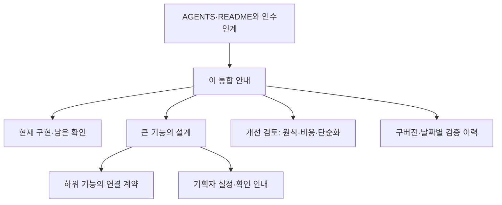
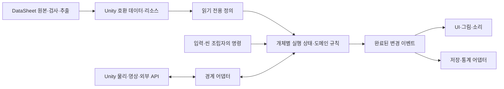

# 전체 개발 문서 통합 안내

기준일: 2026-11-17 · 클라이언트 `ab6277fc` · DataSheet `5ee30ee`.
**내부 개발 문서의 진입점**입니다. 기능 설계·사용법을 복제하지 않고 책임·현재 상태·근거·관련 문서를 연결합니다. 외부 제공은 [전용 소개](../외부%20공개용%20문서/지스타%20출품%20개발%20현황%20소개.md)만 사용합니다.

## 목차

1. [읽는 순서와 문서의 역할](#1-읽는-순서와-문서의-역할)
2. [전체 구조와 프로젝트 원칙](#2-전체-구조와-프로젝트-원칙)
3. [현재 반영과 검증 상태](#3-현재-반영과-검증-상태)
4. [기능별 연결 지도](#4-기능별-연결-지도)
5. [개선·구버전·협업 관리](#5-개선구버전협업-관리)
6. [개발 설계 전체 목록](#6-개발-설계-전체-목록)
7. [기획자 안내 전체 목록](#7-기획자-안내-전체-목록)
8. [날짜별 검증 이력 목록](#8-날짜별-검증-이력-목록)

## 1. 읽는 순서와 문서의 역할

| 문서 | 쓰임 |
| --- | --- |
| [현재 구현과 검증 현황](현재%20구현과%20검증%20현황.md) | 현재 Git·최근 반영·검증 경계 |
| [남은 구현과 검증 작업](남은%20구현과%20검증%20작업.md) | 구현·수용·보류 구분 |
| [프로젝트 전체 아키텍처](프로젝트%20전체%20아키텍처.md) | 계층·수명·오류·확장 이유 |
| [다른 PC 인수인계](다른%20PC%20작업%20시작과%20설계원칙%20인수인계.md) | 작업 시작 절차·기존 담당 보존 |
| [개선 검토](개선%20검토/코드%20구조와%20반복·재귀%20개선%20검토.md) | 코드 규칙·중첩 반복·재귀·프레임 경로·원칙 미준수 |
| [구버전 안내](구버전/구버전%20문서%20안내.md) | 이전 내용 보존과 최신 문서 선택 |

같은 문서에 과거 검토와 구현 결과가 함께 있으면 날짜와 최신 구현 절을 우선합니다. 과거의 미공급·미구현 문장을 현재 상태로 다시 합산하지 않습니다.

## 2. 전체 구조와 프로젝트 원칙

데이터 정의·변경 상태·규칙·표현·인프라를 분리합니다. 시간은 정수 ms, 공간은 기존 tile_x100·IntegerPosition, 비율은 분모 10000을 사용합니다. Unity API 실수는 경계에서 변환합니다. 이벤트는 결과 통지이며 모든 지역 호출을 전역 버스로 바꾸지 않습니다.

비활성 생성·연결 후 활성화하고, 발행자·소비자·지지면·비동기 결과의 수명을 확인합니다. 필수 실패는 조립자에게 전달하고 표시 실패는 표시 경계에서 정리·기존 오류 수집으로 보고합니다. 원본 정의는 수정하지 않고 가변 상태와 필요한 사본을 분리합니다.

패턴은 실제 책임이 있을 때 적용합니다. NPC의 기존 상속·공용 표시 계약, 경사 조회의 기반·파생 재사용, 효과 팩토리를 이름만 보고 제거하지 않습니다. [규격 점검](개선%20검토/코드%20구조와%20반복·재귀%20개선%20검토.md)에서 승인 예외와 미준수를 구분합니다.

네트워크·리플레이는 ID·명령 순서·시간·권한·상태 소유권을 별도로 설계해야 하며, 현재 싱글플레이 코드를 곧바로 서버 구현이라고 설명하지 않습니다.

## 3. 현재 반영과 검증 상태

| 최근 기능 | 현재 구분 | 근거 |
| --- | --- | --- |
| NPC 자동 이름표·안내 | 코드 반영, 기존 컴파일 기록, 새 표시 Play 확인 별도 | `4f175859`, NPC 설계 2장 |
| 일반 몬스터 경사 | 코드·정수 규칙 반영, 플레이어 적용 보류 | `98afeba2`·`2ee0a130`, 경사 설계 10장 |
| 에디터 출시 미리보기 | 코드 반영, 실제 빌드 수용과 구분 | `f28b5678` |
| 보스 돌진 회피 판정의 패턴 null 확인·인식 검사 기대값 갱신 | 코드 반영(런타임 인식 코드는 변경 없음, 검사 기대값만 `704fde84` 스폰 방향에 맞춤). 전체 회귀를 이번에 실행한 것은 아님 | `ab6277fc`, [현황 2장](현재%20구현과%20검증%20현황.md#2-최근-반영과-검증-경계) |
| 사운드·스폰 방향·처형 모션 | 다른 담당 Git 변경 확인 | `704fde84`·`2fdc2f03` NYM |

이번 정리는 로컬 코드·이력·문서를 읽은 점검입니다. 프로젝트 전체 컴파일·Play·새 빌드·Firebase 왕복·간트 조회를 수행한 결과가 아닙니다. 실제 완료율은 수용 기준·검증 증거가 필요하며 커밋 수로 환산하지 않습니다.

## 4. 기능별 연결 지도

| 큰 기능 | 핵심 설계 | 사용·확인 |
| --- | --- | --- |
| 자동화·데이터 | [자동 발견·배포 경계](데이터%20자동%20발견과%20Unity%20배포%20경계%20설계.md) | [새 시트·JSON 안내](../기획자용%20안내문서/새%20시트와%20JSON%20자동%20배포%20사용%20안내.md) |
| 타이틀·옵션·언어 | [타이틀](타이틀%20설계.md)·[옵션](옵션%20연결과%20실행파일%20검증%20설계.md)·[언어](언어%20선택%20설정%20설계.md) | [옵션 확인](../기획자용%20안내문서/기획자용%20옵션%20설정과%20실행파일%20확인%20안내.md) |
| 맵·출구·NPC | [출구](맵%20출구와%20도착%20앵커%20연결%20설계.md)·[NPC 표시](NPC%20이름표와%20말걸기%20안내%20배치%20설계.md) | [NPC 데이터·표시](../기획자용%20안내문서/NPC%20데이터%20작성과%20배포%20준비%20안내.md) |
| 이동·어그로·경사 | [경사](비탈길%20접지와%20이동%20벡터%20개선%20설계.md)·[8방향 인식](몬스터%208방향%20인식과%20추적%20설계.md) | [인식 시험](../기획자용%20안내문서/몬스터%20인식과%20추적%20데이터%20사용%20안내.md) |
| 저장·강화·갈림길 | [저장](저장%20기능%20설계.md)·[강화](재화와%20강화%20구매%20설계.md) | [저장·처치 확인](../기획자용%20안내문서/서낭당%20저장과%20몬스터%20처치%20기록%20확인%20안내.md) |
| 대화·컷씬·스킵 | [명부](명부%20대화와%20조사%20완료%20연결%20설계.md)·[컷씬](컷씬%20재생%20설계.md)·[즉시 스킵](공용%20즉시%20스킵%20설계.md) | [명부 작성](../기획자용%20안내문서/명부%20조사%20대화%20작성과%20확인%20안내.md) |
| 오류·수명·통계 | [오류 계약](필수%20기능과%20오류%20처리%20계약.md)·[Firebase](Firebase%20통계%20인증·전송·조회%20설계.md) | [조회·다운로드](../기획자용%20안내문서/통계%20콘솔%20조회와%20엑셀%20다운로드%20안내.md) |
| 빌드·테스트·리소스 | [빌드 선택](테스트와%20정식%20빌드%20선택%20설계.md)·[리소스 포함](빌드%20리소스%20포함과%20실행%20검증%20설계.md) | [출시 미리보기](../기획자용%20안내문서/에디터%20출시%20빌드%20미리보기%20사용%20안내.md) |

## 5. 개선·구버전·협업 관리

개선 문서는 **개선 검토**, 이전 기준은 **구버전**, 기능 설계와 사용 안내는 각 기존 폴더에서 관리합니다. 개선 제안을 현재 기능 설명이나 확정 일정에 섞지 않습니다.

현황·남은 작업·NPC의 과거 검토 합본은 구버전에 원문을 보존하고 최신 문서에는 현재 내용과 짧은 안내만 남겼습니다. 날짜별 검사·리소스 보고서는 당시 측정 이력으로 연결하며 새 검사 결과로 덮어쓰지 않습니다. 아직 사용 중인 기능을 오래된 문서라는 이유로 제거하지 않습니다.

작업자 귀속은 Git 작성자·변경 파일을 근거로 합니다. DataSheet의 Claude 커밋은 사용자 확정대로 Kim Hyun Ho의 작업으로 구분하고, 다른 계정의 실명은 추정하지 않습니다. 아트 담당자는 Git 외부 원본 공급에 함께 참여했으며 가공·통합 개발과 구분합니다. 이번 문서 정리는 새 구현이나 다른 담당 기능 변경이 아닙니다.

최근 생성한 ETB 로고는 `output/imagegen`의 **시안**이며 타이틀·아이콘에 실제 연결한 기능이 아닙니다.

## 6. 개발 설계 전체 목록

아래는 문서 탐색 목록입니다. 링크 존재와 내용 전체의 현재 수용 완료는 다른 뜻입니다. 각 문서의 기준일·현재 구현 절·보류 사항을 확인합니다.

- [간트와 프로젝트 통합 진행 현황](간트와%20프로젝트%20통합%20진행%20현황.md)
- [개발요청_잔불빙판_그림연결_1115](개발요청_잔불빙판_그림연결_1115.md)
- [검사 자동화와 데이터 오류 경계](검사%20자동화와%20데이터%20오류%20경계.md)
- [게임플레이 모듈 구조](게임플레이%20모듈%20구조.md)
- [게임플레이 코어와 프리팹 연결](게임플레이%20코어와%20프리팹%20연결.md)
- [공용 에러 팝업 설계](공용%20에러%20팝업%20설계.md)
- [공용 즉시 스킵 설계](공용%20즉시%20스킵%20설계.md)
- [공통 모듈과 객체 수명 설계](공통%20모듈과%20객체%20수명%20설계.md)
- [기획 완료 기준 점검표](기획%20완료%20기준%20점검표.md)
- [기획 확정 반영 기준](기획%20확정%20반영%20기준.md)
- [남은 구현과 검증 작업](남은%20구현과%20검증%20작업.md)
- [다른 PC 작업 시작과 설계원칙 인수인계](다른%20PC%20작업%20시작과%20설계원칙%20인수인계.md)
- [담당 예정 기능 설계와 연결 기준](담당%20예정%20기능%20설계와%20연결%20기준.md)
- [데이터 계층 인수인계 가이드](데이터%20계층%20인수인계%20가이드.md)
- [데이터 기반 모듈과 화면 표현 설계안](데이터%20기반%20모듈과%20화면%20표현%20설계안.md)
- [데이터 자동 발견과 Unity 배포 경계 설계](데이터%20자동%20발견과%20Unity%20배포%20경계%20설계.md)
- [리소스 압축 결과 종합 비교](리소스%20압축%20결과%20종합%20비교.md)
- [맵 출구와 도착 앵커 연결 설계](맵%20출구와%20도착%20앵커%20연결%20설계.md)
- [명부 대화와 조사 완료 연결 설계](명부%20대화와%20조사%20완료%20연결%20설계.md)
- [몬스터 8방향 인식과 추적 설계](몬스터%208방향%20인식과%20추적%20설계.md)
- [반복 갱신과 임시 표시 최적화 설계](반복%20갱신과%20임시%20표시%20최적화%20설계.md)
- [발판 내려가기와 사다리 이동 설계](발판%20내려가기와%20사다리%20이동%20설계.md)
- [배포 데이터와 기능 연결 검사 설계](배포%20데이터와%20기능%20연결%20검사%20설계.md)
- [병합 누락 복구와 갈림길 보상 설계](병합%20누락%20복구와%20갈림길%20보상%20설계.md)
- [보스 2페이즈 전투와 피격 반응 연결](보스%202페이즈%20전투와%20피격%20반응%20연결.md)
- [비탈길 접지와 이동 벡터 개선 설계](비탈길%20접지와%20이동%20벡터%20개선%20설계.md)
- [빌드 리소스 포함과 실행 검증 설계](빌드%20리소스%20포함과%20실행%20검증%20설계.md)
- [빌드 전 정합성과 테스트 기능 점검](빌드%20전%20정합성과%20테스트%20기능%20점검.md)
- [사운드 설정 설계](사운드%20설정%20설계.md)
- [서낭당 강화 데이터 배포 설계](서낭당%20강화%20데이터%20배포%20설계.md)
- [설계 기준 점검과 개선 방향](설계%20기준%20점검과%20개선%20방향.md)
- [쇄문아비 2페이즈 공격 전용 리그 개선과 검증](쇄문아비%202페이즈%20공격%20전용%20리그%20개선과%20검증.md)
- [쇄문아비 2페이즈 Attack1 대응 시험과 한계](쇄문아비%202페이즈%20Attack1%20대응%20시험과%20한계.md)
- [쇄문아비 2페이즈 Attack2 설계와 검증](쇄문아비%202페이즈%20Attack2%20설계와%20검증.md)
- [쇄문아비 2페이즈 Idle 리그 설계와 검증](쇄문아비%202페이즈%20Idle%20리그%20설계와%20검증.md)
- [쇄문아비 2페이즈 Walk 초안 설계와 검증](쇄문아비%202페이즈%20Walk%20초안%20설계와%20검증.md)
- [언어 선택 설정 설계](언어%20선택%20설정%20설계.md)
- [옵션 연결과 실행파일 검증 설계](옵션%20연결과%20실행파일%20검증%20설계.md)
- [이동과 스태미나 코어](이동과%20스태미나%20코어.md)
- [일반 몬스터 인공지능](일반%20몬스터%20인공지능.md)
- [재화와 강화 구매 설계](재화와%20강화%20구매%20설계.md)
- [저장 기능 설계](저장%20기능%20설계.md)
- [전투와 탐색 아이디어 검토안](전투와%20탐색%20아이디어%20검토안.md)
- [정수 단위 감사와 시간·좌표 경계 설계](정수%20단위%20감사와%20시간·좌표%20경계%20설계.md)
- [처형 보상과 오염 연결 틀](처형%20보상과%20오염%20연결%20틀.md)
- [체력 표시 모듈 사용과 설계 안내](체력%20표시%20모듈%20사용과%20설계%20안내.md)
- [최신 Git 반영과 코드·리소스 개선 비교](최신%20Git%20반영과%20코드·리소스%20개선%20비교.md)
- [캐릭터 상태 애니메이션 연결 설계](캐릭터%20상태%20애니메이션%20연결%20설계.md)
- [컷씬 재생 설계](컷씬%20재생%20설계.md)
- [콘텐츠 잠금 설계](콘텐츠%20잠금%20설계.md)
- [타이틀 설계](타이틀%20설계.md)
- [테스트 초기화와 공용 확인 팝업 설계](테스트%20초기화와%20공용%20확인%20팝업%20설계.md)
- [테스트와 정식 빌드 선택 설계](테스트와%20정식%20빌드%20선택%20설계.md)
- [프로젝트 개선 로드맵과 설계안](프로젝트%20개선%20로드맵과%20설계안.md)
- [프로젝트 전체 아키텍처](프로젝트%20전체%20아키텍처.md)
- [플레이 통계와 오류 수집 설계](플레이%20통계와%20오류%20수집%20설계.md)
- [필드 효과 상태와 enum 배포 설계](필드%20효과%20상태와%20enum%20배포%20설계.md)
- [필수 기능과 오류 처리 계약](필수%20기능과%20오류%20처리%20계약.md)
- [현재 구현과 검증 현황](현재%20구현과%20검증%20현황.md)
- [CSV 리더기](CSV%20리더기.md)
- [Firebase 통계 인증·전송·조회 설계](Firebase%20통계%20인증·전송·조회%20설계.md)
- [NPC 데이터 배포 준비 설계](NPC%20데이터%20배포%20준비%20설계.md)
- [NPC 이름표와 말걸기 안내 배치 설계](NPC%20이름표와%20말걸기%20안내%20배치%20설계.md)
- [UI 글꼴과 맵 도착 표시 설계](UI%20글꼴과%20맵%20도착%20표시%20설계.md)
- [UI 메뉴 레퍼런스 비교와 배치 기준](UI%20메뉴%20레퍼런스%20비교와%20배치%20기준.md)

## 7. 기획자 안내 전체 목록

- [1114 후속 작업 확인 안내](../기획자용%20안내문서/1114%20후속%20작업%20확인%20안내.md)
- [1115 그림 연결 확인 안내](../기획자용%20안내문서/1115%20그림%20연결%20확인%20안내.md)
- [갈림길 보상 작성과 검수 안내](../기획자용%20안내문서/갈림길%20보상%20작성과%20검수%20안내.md)
- [공통 언어와 기능별 문구 연결 시트 제안](../기획자용%20안내문서/공통%20언어와%20기능별%20문구%20연결%20시트%20제안.md)
- [기획자용 공통 모듈 연결과 확인 안내](../기획자용%20안내문서/기획자용%20공통%20모듈%20연결과%20확인%20안내.md)
- [기획자용 관문 데이터 작성과 확인 안내](../기획자용%20안내문서/기획자용%20관문%20데이터%20작성과%20확인%20안내.md)
- [기획자용 사운드 상황별 재생 조건 요청서](../기획자용%20안내문서/기획자용%20사운드%20상황별%20재생%20조건%20요청서.md)
- [기획자용 사운드 설정 사용 안내](../기획자용%20안내문서/기획자용%20사운드%20설정%20사용%20안내.md)
- [기획자용 사운드 테이블 작성과 배포 안내](../기획자용%20안내문서/기획자용%20사운드%20테이블%20작성과%20배포%20안내.md)
- [기획자용 수동 저장 사용 안내](../기획자용%20안내문서/기획자용%20수동%20저장%20사용%20안내.md)
- [기획자용 언어 선택과 문구 작성 안내](../기획자용%20안내문서/기획자용%20언어%20선택과%20문구%20작성%20안내.md)
- [기획자용 에러 팝업 사용 안내](../기획자용%20안내문서/기획자용%20에러%20팝업%20사용%20안내.md)
- [기획자용 옵션 설정과 실행파일 확인 안내](../기획자용%20안내문서/기획자용%20옵션%20설정과%20실행파일%20확인%20안내.md)
- [기획자용 재화와 강화 준비 안내](../기획자용%20안내문서/기획자용%20재화와%20강화%20준비%20안내.md)
- [기획자용 즉시 스킵 사용 안내](../기획자용%20안내문서/기획자용%20즉시%20스킵%20사용%20안내.md)
- [기획자용 컷씬 표시와 씬 이동 안내](../기획자용%20안내문서/기획자용%20컷씬%20표시와%20씬%20이동%20안내.md)
- [기획자용 콘텐츠 잠금 사용 안내](../기획자용%20안내문서/기획자용%20콘텐츠%20잠금%20사용%20안내.md)
- [기획자용 타이틀 사용 안내](../기획자용%20안내문서/기획자용%20타이틀%20사용%20안내.md)
- [기획자용 프로젝트 검사 사용 안내](../기획자용%20안내문서/기획자용%20프로젝트%20검사%20사용%20안내.md)
- [기획자용 F12 초기화 사용 안내](../기획자용%20안내문서/기획자용%20F12%20초기화%20사용%20안내.md)
- [기획자용 K9 맵 공급과 연결 확인 안내](../기획자용%20안내문서/기획자용%20K9%20맵%20공급과%20연결%20확인%20안내.md)
- [디스코드 알림 설정 안내](../기획자용%20안내문서/디스코드%20알림%20설정%20안내.md)
- [명부 조사 대화 작성과 확인 안내](../기획자용%20안내문서/명부%20조사%20대화%20작성과%20확인%20안내.md)
- [몬스터 인식과 추적 데이터 사용 안내](../기획자용%20안내문서/몬스터%20인식과%20추적%20데이터%20사용%20안내.md)
- [배포 검사 결과 확인 안내](../기획자용%20안내문서/배포%20검사%20결과%20확인%20안내.md)
- [보스 시험 기능 사용 안내](../기획자용%20안내문서/보스%20시험%20기능%20사용%20안내.md)
- [새 시트와 JSON 자동 배포 사용 안내](../기획자용%20안내문서/새%20시트와%20JSON%20자동%20배포%20사용%20안내.md)
- [서낭당 강화 데이터 배포 안내](../기획자용%20안내문서/서낭당%20강화%20데이터%20배포%20안내.md)
- [서낭당 저장과 몬스터 처치 기록 확인 안내](../기획자용%20안내문서/서낭당%20저장과%20몬스터%20처치%20기록%20확인%20안내.md)
- [쇄문아비 2페이즈 Attack1 개선본 확인 안내](../기획자용%20안내문서/쇄문아비%202페이즈%20Attack1%20개선본%20확인%20안내.md)
- [쇄문아비 2페이즈 Attack1 대응 시험 안내](../기획자용%20안내문서/쇄문아비%202페이즈%20Attack1%20대응%20시험%20안내.md)
- [쇄문아비 2페이즈 Attack2 확인 안내](../기획자용%20안내문서/쇄문아비%202페이즈%20Attack2%20확인%20안내.md)
- [쇄문아비 2페이즈 Idle 확인 안내](../기획자용%20안내문서/쇄문아비%202페이즈%20Idle%20확인%20안내.md)
- [쇄문아비 2페이즈 Walk 초안 확인 안내](../기획자용%20안내문서/쇄문아비%202페이즈%20Walk%20초안%20확인%20안내.md)
- [앵커 기반 프리팹 배치 안내](../기획자용%20안내문서/앵커%20기반%20프리팹%20배치%20안내.md)
- [앵커 체력 표시 테스트 안내](../기획자용%20안내문서/앵커%20체력%20표시%20테스트%20안내.md)
- [에디터 출시 빌드 미리보기 사용 안내](../기획자용%20안내문서/에디터%20출시%20빌드%20미리보기%20사용%20안내.md)
- [오류 안내와 기능 중단 확인 안내](../기획자용%20안내문서/오류%20안내와%20기능%20중단%20확인%20안내.md)
- [임시 게임플레이 확인 안내](../기획자용%20안내문서/임시%20게임플레이%20확인%20안내.md)
- [정수 단위 설정과 확인 안내](../기획자용%20안내문서/정수%20단위%20설정과%20확인%20안내.md)
- [최신 맵과 리소스 압축 확인 안내](../기획자용%20안내문서/최신%20맵과%20리소스%20압축%20확인%20안내.md)
- [캐릭터 스프라이트 애니메이션 확인 안내](../기획자용%20안내문서/캐릭터%20스프라이트%20애니메이션%20확인%20안내.md)
- [통계 콘솔 조회와 엑셀 다운로드 안내](../기획자용%20안내문서/통계%20콘솔%20조회와%20엑셀%20다운로드%20안내.md)
- [표시 갱신 최적화 확인 안내](../기획자용%20안내문서/표시%20갱신%20최적화%20확인%20안내.md)
- [플레이 통계 수집과 확인 안내](../기획자용%20안내문서/플레이%20통계%20수집과%20확인%20안내.md)
- [플레이어 동작 사운드 연결 안내](../기획자용%20안내문서/플레이어%20동작%20사운드%20연결%20안내.md)
- [필드 효과와 enum 시트 사용 안내](../기획자용%20안내문서/필드%20효과와%20enum%20시트%20사용%20안내.md)
- [하단 점프·사다리·신규 인게임 UI 확인 안내](../기획자용%20안내문서/하단%20점프·사다리·신규%20인게임%20UI%20확인%20안내.md)
- [GitHub 빌드와 디스코드 공지 사용 안내](../기획자용%20안내문서/GitHub%20빌드와%20디스코드%20공지%20사용%20안내.md)
- [NPC 데이터 작성과 배포 준비 안내](../기획자용%20안내문서/NPC%20데이터%20작성과%20배포%20준비%20안내.md)
- [UI 글꼴과 맵 도착 표시 안내](../기획자용%20안내문서/UI%20글꼴과%20맵%20도착%20표시%20안내.md)

## 8. 날짜별 검증 이력 목록

다음은 당시 검사·피드백의 근거 문서입니다. 현재 상태·담당·검증 결과는 최신 현황을 먼저 봅니다.

- [1114 다른 작업자 작업 가이드](1114%20다른%20작업자%20작업%20가이드.md)
- [1114 전투·입력·리깅 후속 구현](1114%20전투·입력·리깅%20후속%20구현.md)
- [1114 통합 전달 대응 현황](1114%20통합%20전달%20대응%20현황.md)
- [1115 13시23분 이후 변경 이력과 통합 상태](1115%2013시23분%20이후%20변경%20이력과%20통합%20상태.md)
- [1115 리소스 연결과 QA 현황](1115%20리소스%20연결과%20QA%20현황.md)
- [1115 유저테스트 기획 반영 현황과 사용자 작업 목록](1115%20유저테스트%20기획%20반영%20현황과%20사용자%20작업%20목록.md)
- [1115 화면·발판 인식과 이동 피드백 보완](1115%20화면·발판%20인식과%20이동%20피드백%20보완.md)
- [1116 남은 개발 요청과 연결 설계](1116%20남은%20개발%20요청과%20연결%20설계.md)
- [1116 엄격 QA와 자체 피드백](1116%20엄격%20QA와%20자체%20피드백.md)
- [1116 최우선 요청 반영 및 QA](1116%20최우선%20요청%20반영%20및%20QA.md)
- [1117 매달리기·옹귀 투척·어그로 시험 QA와 인수인계](1117%20매달리기·옹귀%20투척·어그로%20시험%20QA와%20인수인계.md)
- [2026-11-12 보스방 반영 후 Git 대비 리소스 절감 요약](2026-11-12%20보스방%20반영%20후%20Git%20대비%20리소스%20절감%20요약.md)
- [2026-11-12 최신 3번맵 PNG 압축 결과](2026-11-12%20최신%203번맵%20PNG%20압축%20결과.md)
- [2026-11-12 최신 보스방 PNG 압축 결과](2026-11-12%20최신%20보스방%20PNG%20압축%20결과.md)
- [2026-11-12 최신 Git 대비 리소스 절감 요약](2026-11-12%20최신%20Git%20대비%20리소스%20절감%20요약.md)
- [2026-11-12 PNG 무손실 압축 결과](2026-11-12%20PNG%20무손실%20압축%20결과.md)
- [2026-11-16 설계·수명·테스트 감사와 리소스 점검](2026-11-16%20설계·수명·테스트%20감사와%20리소스%20점검.md)

구버전 보존본은 [별도 목록](구버전/구버전%20문서%20안내.md)에서 읽습니다. 이 문서 외의 일반 진입점은 [문서 안내](../문서%20안내.md)입니다.

