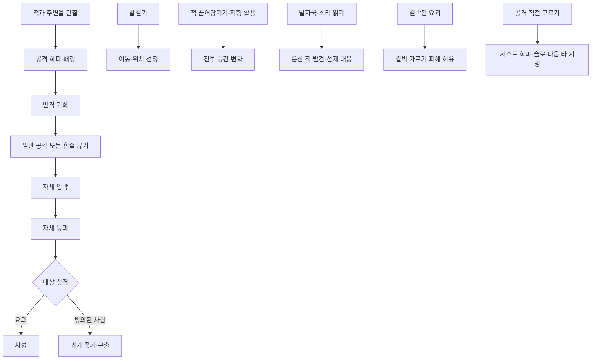
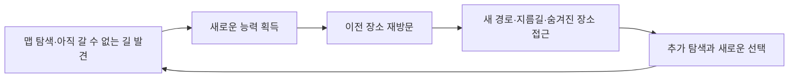
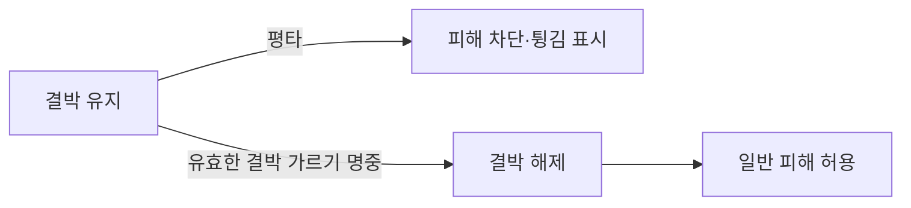
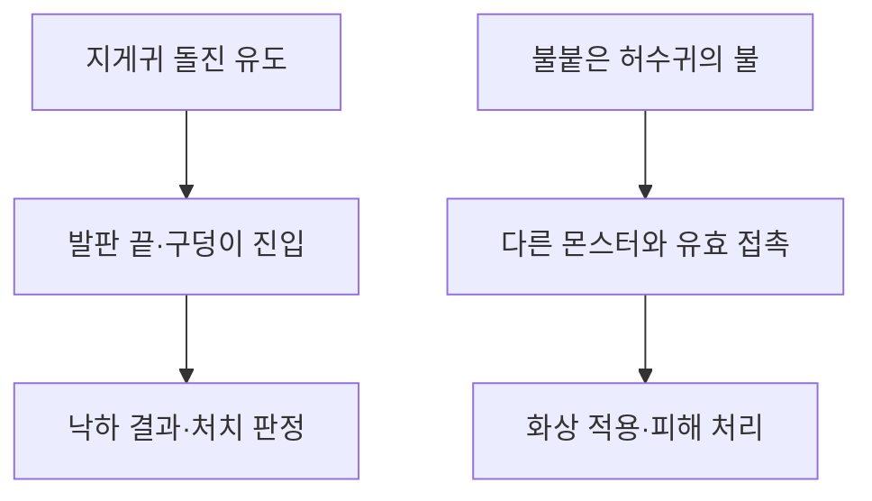
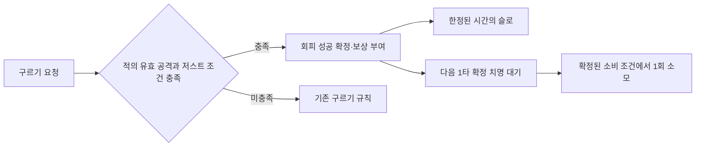
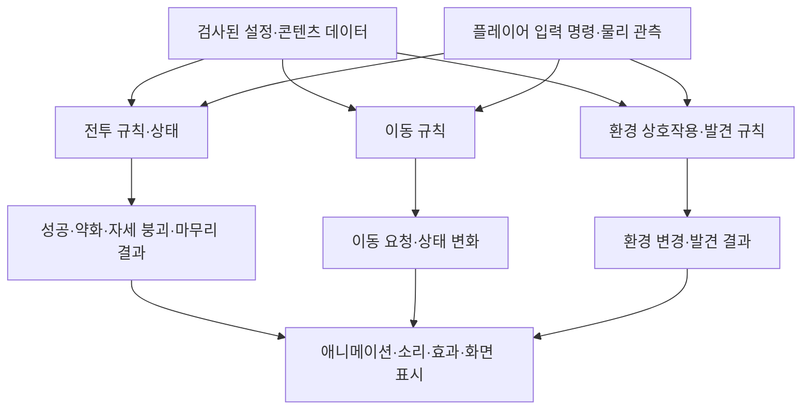
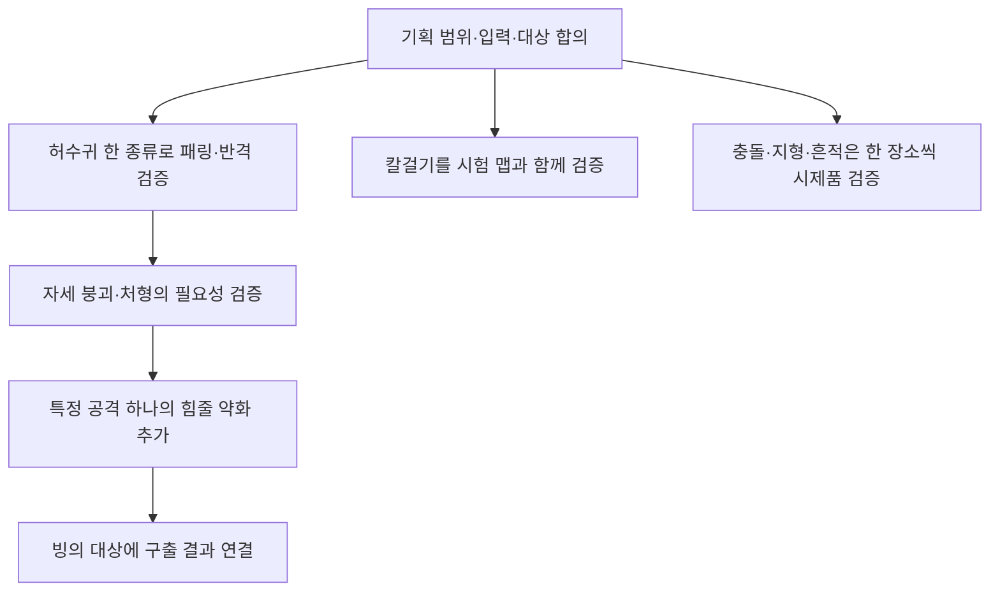

# 전투와 탐색 아이디어 검토안

> 2026-11-04 최신 풀 점검: 11/4 회의에서 재논의한 제안입니다. 결박된 요괴는 애니 반영 후11/9확인, 일부 적의 범위 피해는 대상 규칙 협의, 저스트 회피는 전투 카메라 기획 보강 후 판단합니다. 현재 명중 진동·치명 슬로와 신규 저스트 회피는 다른 기능입니다. 전체 상태는 [현재 구현과 검증 현황](%ED%98%84%EC%9E%AC%20%EA%B5%AC%ED%98%84%EA%B3%BC%20%EA%B2%80%EC%A6%9D%20%ED%98%84%ED%99%A9.md), 우선순위는 [남은 작업](%EB%82%A8%EC%9D%80%20%EA%B5%AC%ED%98%84%EA%B3%BC%20%EA%B2%80%EC%A6%9D%20%EC%9E%91%EC%97%85.md)을 따릅니다.

2026-11-04. 사용자가 제안한 열한 가지 아이디어와 검토 의견을 정리한 협의 문서입니다. 확정 기획·구현 완료 목록·오늘 빌드의 포함 범위가 아닙니다. 코드·데이터·씬은 변경하지 않습니다.

## 목차

1. [제안 목적과 전체 방향](#1-제안-목적과-전체-방향)
2. [메트로배니아 장르와의 정합성](#2-메트로배니아-장르와의-정합성)
3. [현재 기획과 구분할 점](#3-현재-기획과-구분할-점)
4. [열한 아이디어와 검토](#4-열한-아이디어와-검토)
5. [모듈과 데이터의 책임](#5-모듈과-데이터의-책임)
6. [실행 순서·성능·재사용 주의점](#6-실행-순서성능재사용-주의점)
7. [우선 검증 순서 제안](#7-우선-검증-순서-제안)
8. [기획자와 개발자의 다음 협의](#8-기획자와-개발자의-다음-협의)
9. [11월4일 회의 이후의 판단 조건](#9-11월4일-회의-이후의-판단-조건)

## 1. 제안 목적과 전체 방향

목표는 **적의 행동과 흔적을 읽고 백정의 기술로 약점을 끊어 유리한 상황을 만드는 경험**입니다. 단순 피해 증가뿐 아니라 공격 약화·구출·위치 선정·지형 변화로 선택을 넓힙니다.

열한 기능을 동시에 독립 시스템으로 늘리면 입력·표현·예외 처리가 커집니다. 중심 전투를 먼저 검증하고 이동·환경·관찰 기능은 각 책임에 맞춰 연결하는 방향을 제안합니다.

이 도식은 제안 연결입니다. 모든 공격에 패링을 강제하거나 모든 적에게 자세·처형을 적용한다는 뜻은 아닙니다.

## 2. 메트로배니아 장르와의 정합성

**장르와 정합성이 있는 제안입니다. 다만 현재 아이디어는 전투가 더 풍부하므로 탐색·능력 획득·경로 해금·재방문 연결을 보강하는 방향을 권장합니다.** 열한 기능을 모두 구현해야 장르에 맞는다는 의미는 아닙니다. 아래 내용은 설계 관점의 검토이며 확정된 맵 진행 규칙은 아닙니다.

이 검토에서는 연결된 맵을 탐색하고, 새로운 능력을 얻은 뒤 이전 장소에서 새 경로와 의미를 발견하는 경험을 주요 기준으로 삼습니다.

| 아이디어 | 장르와 연결되는 역할 | 설계 시 주의점 |
| --- | --- | --- |
| 패링·힘줄 끊기·자세 붕괴·처형 | 적의 패턴 학습과 전투 숙련 | 모든 적에게 같은 절차를 강요하면 탐색 흐름보다 반복 전투 시험이 앞설 수 있음 |
| 귀기 끊기·구출 | 세계관과 플레이 결과 연결 | 구출 결과가 정보·거점·경로에 영향을 주는 연결은 추가 제안이며 별도 합의 필요 |
| 칼걸기 | 이동 능력 획득과 새로운 경로 접근 | 한 번의 장애물 통과로 끝내지 않고 이전 맵에서도 새 접근 방법을 제공 |
| 적 끌어당기기·충돌 | 위치 선정과 다수 전투의 선택 | 필수 진행에 적이 필요하다면 이미 처치한 상태에서도 통과 가능한지 검증 |
| 불길·지형 활용 | 경로 선택과 맵 상태 변화 | 영구 차단으로 진행 불가·복귀 불가가 생기지 않도록 확인 |
| 흔적으로 요괴 찾기 | 환경 관찰과 숨겨진 존재 발견 | 필수 경로의 단서가 모호해 진행을 막지 않도록 가독성과 대체 단서 확인 |
| 결박된 요괴 | 능력 획득의 의미를 전투에서도 확인 | 해금 전 필수 통로에 배치하면 우회·후퇴가 가능한지 확인 |
| 돌진 낙하 유도·불 전파 | 적의 성질과 맵을 활용하는 전투 | 일회성 시연 뒤에도 진행·재방문 상태가 일관돼야 함 |
| 저스트 회피 | 공격 관찰과 회피 숙련에 보상 | 메트로배니아 탐색의 필수 요소는 아님. 패링과 역할·보상 구분 |

### 탐색의 축: 칼걸기

예를 들어 처음에는 닿지 못했던 나무 벽 위 통로를 보여주고, 칼걸기를 얻은 뒤 돌아오면 그 통로로 접근할 수 있게 구성할 수 있습니다. 같은 능력을 다른 장소의 지름길·숨겨진 공간에서도 활용하면 재방문에 목적이 생깁니다. 구체적인 획득 위치·해금 순서·숨겨진 보상은 아직 정하지 않았습니다.

### 전투의 축: 관찰과 선택적인 약화

패링·반격·힘줄 끊기·자세 붕괴를 모든 적에게 차례대로 수행해야 하는 필수 절차로 만들지 않는 방향을 권장합니다. 일반 공격으로 처리하거나 위험한 공격만 약화하거나 이동으로 피하는 선택을 검토합니다. 실제 처형을 필수로 만들 대상이 있는지는 별도 기획 사항입니다.

재방문 때 처치 기록을 유지하는 기존 방향도 함께 고려합니다. 이미 정리된 길에서는 새 능력으로 탐색하게 하고, 새 구역의 적에서는 전투 숙련을 활용하게 구성할 수 있습니다. 기능을 보여주기 위해 처치한 적을 임의로 재생성하는 방향은 제안하지 않습니다.

### 세계관의 축: 읽고, 틈을 만들고, 끊기

| 상황 | 플레이 행동 | 전달하려는 의미 |
| --- | --- | --- |
| 적의 공격 | 타이밍을 읽고 패링·반격 | 상대를 관찰하는 숙련 |
| 위험한 공격 부위 | 힘줄을 끊어 다음 공격 약화 | 백정 기술의 전투 활용 |
| 빙의된 사람 | 귀기만 끊어 구출 | 주인공이 싸우는 이유 |
| 주변 환경 | 밧줄을 끊어 지형 변경 | 도구와 환경을 활용하는 판단 |
| 숨은 요괴 | 발자국·소리를 읽어 선제 대응 | 세계를 관찰하는 탐색 |

공통 주제는 유지하되 모든 상호작용을 같은 입력·같은 판정·같은 클래스로 통합할 필요는 없습니다. 플레이 의도는 연결하고 실행 책임은 각 모듈이 소유합니다.

### 권장 구성과 검증 기준

칼걸기로 탐색의 축을, 패링과 선택적 약화로 전투의 축을 세우는 구성을 추천합니다. 처형·구출은 대상에 따라 연결하고 지형 활용·흔적은 특정 장소의 개성을 만드는 데 사용하면 기능 규모를 조절할 수 있습니다.

- 새 능력을 얻은 뒤 이전 장소로 돌아갈 이유가 생기는지 확인합니다.
- 전투를 잘하는 것 외에도 관찰·이동·경로 선택으로 유리해질 수 있는지 확인합니다.
- 적을 모두 처치한 뒤에도 필수 경로를 이용할 수 있는지 확인합니다.
- 지형 변화와 저장·재방문 상태가 충돌하지 않는지 확인합니다.
- 짧은 시연에서도 이동 능력으로 새 길을 발견하는 경험을 보여줄지는 기획자와 협의합니다. 오늘 빌드에 추가하기로 확정한 사항은 아닙니다.

## 3. 현재 기획과 구분할 점

기존 [일반 몬스터 인공지능](%EC%9D%BC%EB%B0%98%20%EB%AA%AC%EC%8A%A4%ED%84%B0%20%EC%9D%B8%EA%B3%B5%EC%A7%80%EB%8A%A5.md) 문서는 일반 몬스터의 체세·해체를 데모 범위에서 제외하고 있습니다. [게임플레이 코어와 프리팹 연결](%EA%B2%8C%EC%9E%84%ED%94%8C%EB%A0%88%EC%9D%B4%20%EC%BD%94%EC%96%B4%EC%99%80%20%ED%94%84%EB%A6%AC%ED%8C%B9%20%EC%97%B0%EA%B2%B0.md)의 체세·해체 코어는 보스 중심이며 실제 판정·표현 연결도 구분돼 있습니다.

따라서 허수귀의 자세 붕괴·처형은 기존 기획을 넓히는 **신규 제안**입니다. 보스 코어를 일반 몬스터에 그대로 붙이면 된다고 보지 않습니다. 이번 문서에서는 기존 문서의 확정 규칙을 변경하지 않으며 실제 코드 재점검도 수행하지 않았습니다.

## 4. 열한 아이디어와 검토

### 4.1. 패링 → 반격 기회

**원안:** 적의 공격 타이밍을 읽고 받아쳐 큰 빈틈을 만듭니다. 허수귀의 마지막 내려찍기를 받아치면 팔이 튕기며 반격할 시간이 생깁니다.

**의도와 효과:** 적의 패턴을 학습할 이유가 생기고 방어 성공이 능동적인 공격 기회로 이어집니다. 중심 전투로 먼저 검증하기 적합합니다.

**확정할 내용:** 패링 가능한 공격의 표시, 입력·성공 판정 시간, 실패 결과, 적의 빈틈 시간, 연속 타격 처리입니다. 판정 시간과 빈틈은 밀리초로 표현합니다.

**주의점:** 패링 성공과 자세 붕괴는 구분하는 방향을 제안합니다. 패링마다 즉시 처형하면 반격·공격 약화의 선택 기회가 줄어들 수 있습니다.

### 4.2. 힘줄 끊기 → 다음 공격 약화

**원안:** 왼손으로 팔다리를 끌어당겨 버선칼로 끊는 백정 기술입니다. 허수귀의 팔을 노리면 다음 가로 공격의 범위가 짧아집니다.

**의도와 효과:** 백정이라는 설정을 실제 전투 규칙으로 보여줍니다. 피해를 더 줄지, 다음 공격의 위험을 줄일지 선택하게 할 수 있습니다.

**연결 제안:** 패링으로 만든 빈틈에서 사용할 수 있는 선택 기술로 먼저 시험합니다. 이는 확정 발동 조건이 아닙니다.

**확정할 내용:** 부위 선택 방법, 대상 공격, 약화 수치, 지속 횟수·해제 시점, 중복 적용, 보스 적용 범위입니다.

**주의점:** 전체 몬스터에 부위 파괴를 구현하기보다 허수귀의 특정 공격 하나로 검증합니다. 부위별 판정·애니메이션·공격 범위 변형 작업이 함께 필요합니다.

### 4.3. 자세 붕괴 → 처형

**원안:** 패링과 공격으로 자세를 무너뜨린 뒤 근접 입력으로 마무리합니다. 플레이어는 잡아당겨 짧게 긋는 공통 모션을 쓰고, 허수귀는 기존 해체 모션을 활용합니다.

**의도와 효과:** 일반 공격과 패링에 공통 목표를 제공하고 전투의 마무리를 강조합니다. 공통 플레이어 모션과 대상별 반응을 나누면 재사용에 유리합니다.

**확정할 내용:** 대상 범위, 자세 누적·회복, 노출 시간, 접근 거리, 입력 우선순위, 처형 중 피격·무적, 대상 사망·연출 중단 처리입니다.

**주의점:** 일반 몬스터 적용은 기존 데모 기획 변경에 해당합니다. 기존 해체 모션의 실제 재사용 가능 여부는 애니메이션 담당 확인이 필요합니다.

### 4.4. 귀기 끊기 → 빙의된 사람 구출

**원안:** 빙의된 적의 자세를 무너뜨린 뒤 몸에 붙은 귀기만 끊어 사람을 구합니다.

**의도와 효과:** 주인공이 싸우는 이유를 대사뿐 아니라 플레이 결과로 전달합니다.

**구조 제안:** 자세 붕괴·대상 확인·마무리 진입은 처형과 공유할 수 있고, 완료 결과는 적 제거와 구출로 분리합니다. 결과 선택은 대상 데이터와 규칙으로 명시합니다.

**확정할 내용:** 구출 대상의 시각적 구분, 처형과 입력을 공유할지, 실패·사망 가능성, 구출 후 사람의 행동, 진행 기록·보상·저장 여부입니다.

### 4.5. 칼걸기 → 이동과 위치 선정

**원안:** 공중에서 버선칼을 특정 나무 벽에 박아 잠깐 매달립니다. 벽을 차고 높은 발판이나 적 뒤로 이동할 수 있습니다.

**의도와 효과:** 탐색과 전투 위치 선정을 연결하는 메트로배니아 이동 기술입니다.

**확정할 내용:** 사용 가능한 표면 표시, 입력, 매달림 시간, 벽차기 방향·거리, 재사용 조건, 스태미나 소모, 피격·낙하·공격 전환입니다.

**주의점:** 맵 높이·우회 경로·도달 가능 구역에 영향을 주므로 이동 성능과 맵을 함께 검증합니다. 단순 전투 효과 모듈 안에 이동 물리를 넣지 않습니다.

### 4.6. 적 끌어당기기 → 적끼리 충돌

**원안:** 작은 적을 끌어당겨 뒤에서 달려오는 적과 부딪치게 합니다. 둘이 넘어지면 공격하거나 빠져나갈 틈이 생깁니다.

**의도와 효과:** 다수 전투에서 적의 위치와 행동을 활용할 수 있습니다.

**확정할 내용:** 끌 수 있는 크기·대상, 거리·방향·속도, 벽에 걸리는 경우, 충돌 성립 조건, 피해·넘어짐·무적, 다중 충돌 처리입니다.

**주의점:** 힘줄 끊기와 잡아당기는 표현은 재사용할 수 있지만 이동 규칙과 공격 약화 규칙을 하나로 묶지는 않습니다. 넘어짐과 충돌 결과를 먼저 제한해 예외를 줄입니다.

### 4.7. 불길과 지형을 이용한 전투

**원안:** 밧줄을 끊어 불붙은 지붕을 무너뜨리고 적의 진입로를 막습니다. 플레이어가 쓰던 길도 막히므로 탈출 경로를 먼저 봐야 합니다.

**의도와 효과:** 주변 환경을 읽고 위험과 이익을 비교하는 선택을 만듭니다.

**확정할 내용:** 작동 조건, 피해 판정, 길 차단 범위, 복구 여부, 재방문·저장 시 상태, 필수 탈출로입니다.

**주의점:** 필수 진행 경로가 막혀 게임을 계속할 수 없게 되는 상황을 검사해야 합니다. 실제 물리 붕괴와 연출용 파괴 프리팹 중 무엇이 적합한지도 검증 후 결정합니다.

### 4.8. 흔적으로 숨어 있는 요괴 찾기

**원안:** 재 위의 발자국이나 빈 처마 밑의 짚 소리로 요괴의 위치를 읽습니다. 먼저 공격하면 기습을 피하고 유리하게 시작할 수 있습니다.

**의도와 효과:** 전투 전에 관찰과 긴장감을 제공합니다.

**확정할 내용:** 흔적 생성 조건·빈도·유지 시간, 발견 판정, 선제공격의 이점, 숨은 상태 해제, 재방문 처리입니다.

**주의점:** 소리만으로 필수 정보를 전달하지 않고 시각 흔적도 함께 검토합니다. 발자국·음원은 필요한 순간에 생성하고 수명과 재사용을 관리합니다.

### 4.9. 결박된 요괴 → 결박 가르기로 피해 허용

**원안:** 결박을 두른 몬스터에게는 평타가 튕깁니다. 결박 가르기로 결박을 끊은 뒤 피해를 줄 수 있습니다. 스킬과 이야기를 전투의 중심으로 가져오는 제안이며 제안자의 개발 비용 예상은 중간입니다.

**검토:** 세 추가안 중 인귀의 설정과 능력 획득을 가장 직접적으로 연결합니다. 기존 결박 가르기의 대상을 관문에서 적으로 확장하는 의미가 있습니다. 다만 기존 관문 해금과 적 방어 해제를 동일한 상태로 취급하지 않습니다.

**확정할 내용:** 평타 외 공격·불·낙하·처형에도 면역인지, 결박 해제에 피해가 함께 들어가는지, 한 번에 끊는지, 재결박 여부, 평타 튕김이 공격자 경직까지 뜻하는지, 결박 상태의 저장·재방문 정책입니다. ‘평타가 튕김’과 ‘모든 피해 면역’은 서로 다른 규칙이므로 임의로 확장하지 않습니다.

**주의점:** 결박 가르기 획득 전 반드시 처치해야 하는 적으로 배치하면 진행이 막힐 수 있습니다. 획득 전에는 피할 수 있게 할지, 능력을 보여주는 대상으로만 둘지 합의해야 합니다. 결박 해제는 처형·구출과 별개의 상태입니다.

**비용 검토:** 피해 허용 조건 하나와 기존 표현 재사용으로 제한하면 중간 범위의 시제품을 검토할 수 있습니다. 대상 선택·명중 판정·신규 모션·저장까지 포함하면 범위가 커지므로 현재 문서 확인만으로 비용을 확정하지 않습니다.

### 4.10. 적의 성질을 이용한 지형 전투 → 낙하 유도·불 전파

**원안:** 지게귀 돌진을 구덩이로 유도해 떨어뜨리고 불붙은 허수귀의 불로 다른 몬스터도 태웁니다. 제안자의 개발 비용 예상은 작음~중간입니다.

**검토:** 기존 4.7의 지붕 붕괴와 같은 환경 전투 범주이지만 지형 자체를 바꾸지 않고 적의 성질을 활용하는 별도 사례입니다. 기존 돌진·낙하·피해 연결을 재사용할 수 있다면 큰 지형 파괴보다 작은 범위로 시험할 수 있습니다.

**확정할 내용:** 돌진 중 발판 끝에서 멈출지 낙하할지, 낙하가 즉사인지 복귀인지, 보상·처치 수 집계 여부입니다. 불은 접촉 피해인지 지속 화상인지, 아군 공격 허용 대상·재적용 간격·중첩·불에 탄 적의 추가 전파 여부를 정해야 합니다.

**주의점:** 적끼리 피해를 줄 수 있다는 이유로 모든 공격에 아군 공격을 허용하지 않습니다. 화상 전파가 무제한 연쇄로 이어지지 않게 범위를 명시합니다. 낙하·화상·일반 공격이 같은 순간 들어와도 사망·보상·처치 이벤트가 중복 발생하지 않아야 합니다. 맵 밖 낙하 개체도 수명 소유자가 정리해야 합니다.

**비용 검토:** 낙하 유도와 불 전파는 서로 다른 작업입니다. 운영용 발판·낙하 판정이 연결돼 있으면 낙하 유도부터 작게 시험할 수 있습니다. 기존 문서상 변종의 불 지속 피해는 미구현 범위이므로 불 전파를 단순 설정 변경만으로 완성할 수 있다고 보지 않습니다. 화상 표시·타이머·중첩·대상 규칙까지 필요하면 중간 이상으로 커질 수 있습니다.

### 4.11. 저스트 회피 → 짧은 슬로·다음 1타 확정 치명

**원안:** 맞기 직전에 구르면 짧은 슬로가 걸리고 다음 1타가 치명으로 확정됩니다. 회피 숙련의 손맛을 강화하는 제안이며 제안자의 개발 비용 예상은 중간입니다.

**검토:** 공격 타이밍을 읽는 선택을 패링 외에도 제공합니다. 기존 구르기·무적·치명 피해 계산의 재사용 후보가 있지만, 저스트 성공 판정과 일회성 보상·슬로 시간 관리는 별도 책임입니다. 실제 적용 가능성은 코드 점검이 필요합니다.

**확정할 내용:** 입력 시점과 실제 공격 접촉 중 어떤 기준으로 판정할지, 성공 시간 창, 구르기 한 번의 중복 성공 제한, 연속 성공 시 갱신·연장 여부입니다. 보상은 다음 공격 시도·다음 명중·다음 피해 중 무엇에 소모되는지, 빗나감·적 회피·다중 대상·다단 공격·결박 튕김 때 어떻게 되는지와 유효 시간을 정해야 합니다.

**패링과의 관계:** 패링은 적에게 빈틈을 만들고, 저스트 회피는 플레이어의 위치 변경과 다음 공격 보상을 제공하는 식으로 역할을 구분할 수 있습니다. 두 기능을 모두 필수로 가르치기보다 시제품에서 선택 가치와 입력 부담을 비교합니다. 회피의 이동·무적·슬로·확정 치명이 항상 더 유리하면 패링의 사용 이유가 줄어들 수 있습니다.

**시간·표현 주의점:** 슬로의 적용 대상은 전역·플레이어·적 중 무엇인지 합의해야 합니다. 게임 시간과 실제 경과 시간을 구분해 슬로 종료가 슬로 자신 때문에 늦어지지 않게 하고, 일시정지·컷씬·사망·씬 이동과의 우선순위를 정합니다. 한 기능이 전역 시간 배율을 임의로 복원해 다른 기능의 정지를 풀지 않도록 시간 제어 소유권이 필요합니다. 기존 체계로 해결 가능한지 먼저 확인하고 이를 이유로 큰 범용 프레임워크를 선행 제작하지 않습니다.

**치명 판정 주의점:** 확정 치명은 일반 치명 확률 추첨과 구분합니다. 대상 회피를 무시하거나 해체 피해까지 치명으로 바꾸는 의미는 아닙니다. 치명 배율·정수 계산은 기존 경로를 재사용하고 난수 소비 순서와 보상 소비 시점을 명시해야 합니다.

**비용 검토:** 공격 판정·입력 시각·무적 기간·시간 제어·화면 효과가 함께 연결되므로 ‘구르기에 조건 하나 추가’로 끝나지 않습니다. 중간이라는 예상은 범위를 제한한 시제품 기준으로 검토하며 실제 비용은 운영 판정 연결 상태에 따라 달라집니다.

## 5. 모듈과 데이터의 책임

| 경계 | 담당 내용 |
| --- | --- |
| 데이터 정의 | 대상·공격의 사용 가능 기능, 수치, 표현 참조. 런타임 값과 분리 |
| 개체의 실행 상태 | 자세·약화 잔여 횟수·현재 행동·발견 여부 등 실제 진행 값 |
| 도메인 규칙 | 발동 허용·소모·판정·상태 전환·결과 결정 |
| Unity 연결 | 입력·충돌·표면 관측·이동 실행·프리팹 수명 |
| 표현 | 결과 이벤트를 받아 모션·소리·효과·화면 갱신 |
| 진행·저장 | 구출·환경 변화 등 확정된 저장 대상만 기록 |
| 조건부 피해·효과 | 결박의 피해 차단, 화상 대상·중첩, 일회성 치명 보상. 공통 피해 적용 경계에 연결 |
| 시간 제어 | 슬로·일시정지·컷씬의 시간 적용과 해제 소유권. 표현과 판정 시간 구분 |

이 표는 책임 구분이며 각 칸을 반드시 새 클래스나 파일로 나누라는 뜻은 아닙니다. 기존 모듈에 맞춰 최소한으로 확장합니다. 상태 머신은 중복·충돌하는 행동을 제어하는 곳에, 전략은 실제로 교체할 규칙이 있을 때, 이벤트는 독립 소비자에게 완료 결과를 알릴 때 사용합니다. 모든 호출을 전역 이벤트로 전달하지 않습니다.

기획자는 구현된 기능의 허용 여부·수치·참조를 데이터로 조정합니다. 아직 없는 행동을 데이터 행이나 문자열 함수명만 추가해 자동 생성할 수 있다는 뜻은 아닙니다. 구체적인 신규 컬럼·테이블은 기획 확정과 기존 스키마 점검 뒤 제안합니다.

## 6. 실행 순서·성능·재사용 주의점

- 대상 데이터·규칙·표현 연결을 준비한 뒤 입력을 허용합니다. 초기화 전 이벤트를 놓치거나 미연결 상태로 실행하지 않도록 조립자가 순서를 책임집니다.
- 입력 요청과 성공 결과를 구분합니다. 표현 소비자는 결과를 표시하며 이벤트 콜백에서 코어 명령을 재호출해 상태를 변경하지 않습니다. 구독은 비활성화·회수 시 해제합니다.
- 필수 판정·초기화 실패는 호출자에게 전달합니다. 표현 오류는 해당 표시 경계에서 처리하고 실제 성공 결과를 되돌리거나 가짜 성공을 만들지 않습니다.
- HUD·모션 선택은 상태 변화에 반응합니다. 이동·판정 창·매달림 등 시간 진행이 필요한 동작만 명시적인 Tick 또는 물리 갱신을 사용합니다.
- 시간은 밀리초, 게임 수치는 원칙적으로 정수이며 좌표·속도는 기존 단위를 따릅니다. 확률이 필요하면 분모 10000을 사용합니다. 정수만으로 결정성이 보장되지는 않으므로 처리 순서와 난수 소유권도 명시합니다.
- 프리팹·효과·모션은 재사용하되 개체별 상태는 공유하지 않습니다. 풀 반환 시 약화·노출·매달림·대상 참조·구독을 초기화합니다.
- 네트워크 구현은 이번 범위가 아닙니다. 명령·개체 ID·상태 소유권을 분리해 이후 확장 검토가 가능하도록 합니다.

## 7. 우선 검증 순서 제안

일정 확정이나 구현 착수 승인이 아니라 의존성을 고려한 제안 순서입니다. 보스의 기존 해체와 일반몹 마무리를 어느 수준까지 공유할지는 확인 후 결정합니다.

| 시제품 | 확인할 질문 |
| --- | --- |
| 패링·반격 | 공격 예고를 보고 성공 원인과 실패 원인을 이해할 수 있나요? |
| 힘줄 끊기 | 약화된 다음 공격이 눈에 보이며 일반 공격과 다른 선택 가치가 있나요? |
| 처형·구출 | 대상 선택·입력 우선순위가 명확하고 다른 적이 있어도 흐름이 끊기지 않나요? |
| 칼걸기 | 가능한 표면을 구분하고 예상한 발판에 도달할 수 있나요? |
| 적 충돌 | 작은 적과 돌진 적의 충돌 결과를 예측할 수 있나요? |
| 지형 변화 | 위험을 읽고 탈출할 수 있으며 필수 경로가 남아 있나요? |
| 흔적 발견 | 소리와 흔적으로 적을 찾을 수 있고 무작정 공격하는 것보다 이점이 있나요? |
| 결박된 요괴 | 평타가 막히는 이유와 사용할 기술을 알아보고, 해금 전 진행이 막히지 않나요? |
| 낙하 유도·불 전파 | 의도한 적만 영향을 받고 사망·보상·처치 집계가 한 번만 처리되나요? |
| 저스트 회피 | 성공 시점이 납득되고 보상이 정확히 한 번 소비되며 슬로 종료·중단이 정상인가요? |

### 추가 세 안의 검증 우선순위

새 기능을 더 많이 넣기보다 기존 후보와 비교해 선택하는 순서를 권장합니다.

| 순서 제안 | 이유와 전제 |
| --- | --- |
| 결박된 요괴 한 종류 | 스토리·기존 스킬과 연결이 직접적. 피해 차단·해제 결과부터 검증 |
| 지게귀 낙하 유도 한 장소 | 돌진·운영 낙하 판정이 준비된 경우 좁은 범위로 검증 가능 |
| 저스트 회피와 패링 비교 | 둘 중 먼저 완성할 방어 경험을 결정. 동시에 도입하는 것을 전제로 하지 않음 |
| 불붙은 허수귀의 제한된 화상 | 화상 기본 효과·대상 규칙을 준비한 뒤 전파 범위를 제한해 검증 |

기존 1~8번과 추가안 모두를 구현하는 일정은 아닙니다. 특히 오늘 빌드에 포함하기로 승인된 기능으로 취급하지 않습니다.

## 8. 기획자와 개발자의 다음 협의

기획자는 먼저 시연에 넣을 핵심 경험을 선택하고 대상 공격·발동 조건·성공/실패 결과·입력을 확정합니다. 수치 조정 전에 플레이어가 무엇을 보고 무엇을 선택하는지 합의하는 것이 우선입니다. 이후 필요한 모션·효과·대상 표시를 담당자와 확인합니다.

개발자는 확정된 기능 단위마다 기존 코어·입력·프리팹을 확인하고 재사용 범위와 변경 영향을 설명합니다. 검증 가능한 최소 단위로 구현하고 다음 기능으로 넘어가기 전에 사용자 확인을 받습니다. 문서의 제안 수순이나 흐름도를 확정 기획으로 간주해 선행 구현하지 않습니다.

## 9. 11월4일 회의 이후의 판단 조건

회의는 아이디어의 재논의이며 열한 기능 전체 구현 승인이 아닙니다. 기본 전투·진행 버그와 최종 애니 연결을 먼저 확인합니다.

| 안건 | 회의 의견 | 다음 판단 |
| --- | --- | --- |
| 결박된 요괴 | 현재 스킬이 단순 추가 피해처럼 보임. 미반영 애니 영향 확인 필요 | 11/9(월) 애니 반영 상태를 보고 피해 차단·해제 도입 필요성 판단 |
| 적끼리 범위 피해 | 일부 몬스터가 다른 몬스터에게도 범위 피해를 주는 사례 필요 | 대상·자기 피해·피해원·연쇄·사망 중복 방지를 기획으로 확정 |
| 저스트 회피 | 전투 카메라 연출을 종합 보강할 필요 | 패링/치명 슬로와의 역할·슬로 범위·다음 타 보상을 별도 결정 |
| 타이틀 | 아이콘 확대·하단 버튼·배경 애니/파티클 검토 | 시안 공유 후 별도 화면 작업. 전투 기능과 묶지 않음 |

최신 코드의 일반/치명 명중 진동과 기존 치명 슬로는 저스트 회피 구현이 아닙니다. 현재 사망 불을 꺼둔 임시 조치도 몬스터 간 화상 전파를 승인하거나 구현한 것이 아닙니다. 개발 비용은 자원 공급·범위에 따른 추정으로 유지합니다.
