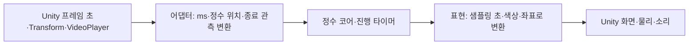

# 정수 단위 감사와 시간·좌표 경계 설계

2026-11-18 회귀 수정: 일반몹 보행 구간을 long으로 바꾼 `2ee0a130`에서 옹귀 뒤로 깡총의 `PreviewMonsterDriver.CanRetreatFrom`이 float 월드 X와 long 구간을 직접 비교하던 호출부 누락을 정수 비교로 고쳤습니다. C#의 long→float 암시 변환은 컴파일 오류를 내지 않으므로 정수화 변경 시 비교·대입 호출부를 검색으로 함께 확인합니다. 상세와 남은 Play 확인은 [코드 구조와 반복·재귀 개선 검토](개선%20검토/코드%20구조와%20반복·재귀%20개선%20검토.md)의 S09에 있습니다.

2026-11-18 효과음 병합 시간: `GameAudio.ShouldMergeEffect`가 float 초(`Time.unscaledTime`, 0.06초)로 저장·비교하던 판정을 long ms(`Time.unscaledTimeAsDouble`을 읽는 순간 내림 변환, 60ms 상수)로 바꿨습니다. 누적이 아닌 실제 시각 차이 비교라 경계에서 한 번 변환하고, 프레임 누적용 MillisecondClock은 쓰지 않습니다. 상세는 같은 문서의 S13에 있습니다.

2026-11-18 표현 경계 확인: `StageContentSet.BackgroundPosition.LocalX/LocalY`(배경 레이어 Transform 위치)는 규칙·판정·상태에 쓰지 않는 부모 기준 로컬 표시값이므로 float로 유지합니다. 코드에 `[정수화 미적용 이유]`를 남겼습니다.

2026-11-18 남은 정수화 일괄 적용(사용자 지시):

| 대상 | 변경 | 경계로 남긴 부분 |
| --- | --- | --- |
| GameplayPreview Inspector | `_stageHalfWidth`(float) → `_stageHalfWidthUnits` 800, `_combatMinX/MaxX` → `_combatMinUnits/MaxUnits` tile_x100. GameplayPreview·도화골 시험·_Recovery/0 씬 값을 같은 의미로 변환(-9/9→-900/900, -8.5/34→-850/3400, 8→800) | 모든 씬의 타일당 화면 거리가 1이라 값 의미가 같음 |
| 일반몹 이동 한계 | `PreviewMonsterDriver.Step(seconds, long minimumX, long maximumX)`로 바꿔 float 맵 경계 계약 예외를 제거 | 없음 |
| 플레이어 이동·보스 구동 | 정수 한계를 넘기는 순간만 월드로 변환 | 플레이어 비탈 보류(11/17)·S11 보스 담당 이관으로 기존 float 계약 유지 |
| 턱 오르기 | 시작·도착 `IntegerPosition`, 백만분율 정수 SmoothStep, `ClimbProgress` 분모 10000 int | 표시 크기·손 위치·클립 샘플링은 /10000f로 변환 |

`ClimbProgress`를 int로 바꾸면서 0~1 float로 가정하던 표시 소비처 4곳(손 보정·클립 시간 등)을 함께 /10000f로 바꿨습니다. 암시 변환 때문에 컴파일은 통과하므로 이런 소비처는 검색으로 확인해야 합니다. 엔진 참조 컴파일 오류 0·데이터 10,856개·코어 2,316개 통과. 2026-11-18 사용자 Play 확인 완료(턱 오르기·몹 이동 한계·옹귀 후퇴·효과음 병합).

2026-11-16 프레임 경계 보완: Unity의 편집기 단계 실행·MCP 캡처에서 유한한 음수 프레임이 관측되어 카메라·보스 등의 시간 검사가 실패했습니다. Unity 프레임 소비자는 공통 `MillisecondClock.AdvanceFrame`을 사용합니다. 음수 프레임은 0ms로 건너뛰며 기존 소수 ms 나머지를 보존합니다. 정상 프레임 누적, `Advance`·`ToMilliseconds`의 음수 거부, 모든 경로의 NaN·무한대 거부와 `AdvanceSigned`의 역방향 샘플링 계약은 유지합니다.

이번 검증: Unity 컴파일·실행, 코어 2,228개·데이터 9,241개·실제 엔진 시계 입력 검사 9개 통과. 인트로 자연 종료 후 시작 맵 진입, F8 보스 처치 경로의 엔딩 자연 종료·탐색·마무리·타이틀 복귀를 확인했습니다. 같은 MCP 단계 캡처에서 음수 프레임 1회를 관측하면서 예외 0건을 확인했습니다. 기존 저장·설정 11개의 해시는 동일하며 씬·프리팹·원본 아트·메타·공급 데이터는 수정하지 않았습니다. 로컬 SDK가 없어 Unity에 포함된 컴파일러·런타임으로 기존 검사 프로젝트를 실행했으며 새 실행파일 빌드는 하지 않았습니다.

2026-11-15 G-106 후속: 카메라 아래 보기600·사다리 선택 축 보정-50을 정수 tile_x100으로 추가했습니다. 기존 위 보기300·대기500ms와 경계 변환 원칙은 유지합니다. [최신 피드백 설정/검사](1115%20화면·발판%20인식과%20이동%20피드백%20보완.md)이 아래 과거 ±3타일 설명보다 최신입니다.

기준일: 2026-11-15. 사용자 지시에 따라 프로젝트 전체 직접 작성 C#을 감사하고 공통 계약·호출부 정수화를 승인받아 적용했습니다. 원칙의 단일 기준은 [AGENTS.md](../../AGENTS.md#정수화-기본-원칙), 전체 책임은 [아키텍처](프로젝트%20전체%20아키텍처.md#정수화는-기본-계약입니다--2026-11-15)를 따릅니다. 사용 절차는 [정수 단위 설정과 확인 안내](../기획자용%20안내문서/정수%20단위%20설정과%20확인%20안내.md)로 분리합니다.

## 목차

1. [발견한 문제와 범위](#1-발견한-문제와-범위)
2. [단위와 변환 경계](#2-단위와-변환-경계)
3. [기능별 변경과 보존 계약](#3-기능별-변경과-보존-계약)
4. [직렬화된 기존 값](#4-직렬화된-기존-값)
5. [검사 실행과 제한](#5-검사-실행과-제한)

## 1. 발견한 문제와 범위

상하 보기 구현은 있었지만 카메라 입력 유지 시간을 float 초로 저장·누적했습니다. 추가 감사에서 Core의 상호작용 좌표·게임 속도 비율·로딩 진행, 보스 전환·엔딩·서낭당·해체·사망 복귀·UI 대기·발소리·애니메이션 재생에도 실수 상태가 남아 있었습니다. 기능의 존재와 원칙 준수, 실제 동작 검증을 구분하지 못한 기존 설명을 바로잡습니다.

범위는 `Assets/3.Script`의 직접 작성 코드와 그 사용처·에디터 검증·씬/프리팹입니다. 외부 패키지·공급 자동 생성 코드·정의 스키마는 직접 고치지 않았습니다. 다른 기능의 콘텐츠 수치·아트 원본을 새로 설계하지 않고 기존 값을 같은 의미의 정수 단위로 옮깁니다. 기존 아트의 원본 제작·공급 기여와 개발자의 연결·검증 작업도 구분합니다.

## 2. 단위와 변환 경계

| 값 | 프로젝트 소유 단위 | 경계 변환 |
| --- | --- | --- |
| 시간·입력 유지·대기 | int ms, 긴 표시 누적은 long ms | Unity 프레임 초는 MillisecondClock.AdvanceFrame, 단일 클립 길이는 ToMilliseconds |
| 시트·Inspector 거리·속도 | 기존 tile_x100 | IntegerPosition.FromData |
| 런타임 공간 좌표 | 기존 long·타일당 1,000,000 단위 유지 | SpatialRuntime.FromWorld/ToWorld |
| 게임 속도·재생 비율 | 분모 10000의 int | Time.timeScale·샘플링 API 직전에 정규화 |
| Unity 표시·물리 관측 | Vector/Bounds/Color·외부 API 실수 | 관측 입력·최종 출력 경계에서만 사용 |

`MillisecondClock`는 외부 시간 변환 책임이므로 Core/Timing에서 Adapters로 이동하고 GUID·기존 네임스페이스를 유지했습니다. 내부 double은 외부 초의 소수 ms 나머지 보존을 위한 경계 구현입니다. 일반 게임 시간은 음수를 거부하며, 역방향 애니메이션 샘플링에만 AdvanceSigned를 사용합니다. 단일 길이의 ToMilliseconds는 최근접 ms·중간값 절댓값 바깥쪽 반올림을 사용합니다. 프레임 누적에 이 반올림을 반복 적용하지 않습니다.

공격 표시 프레임 매핑인 AttackAnimationTiming은 Core/Combat에서 Presentation으로 이동했습니다. VideoPlayer의 double 시간·길이·프레임률은 Adapters/VideoEndObservation이 마지막 프레임 여부로 바꾸며 Core/VideoEndGuard는 bool 관측과 정수 ms만 받습니다. Core 직접 작성 소스의 실수형 재도입을 회귀 검사로 막습니다.

## 3. 기능별 변경과 보존 계약

| 기능 | 변경 | 보존하는 동작 |
| --- | --- | --- |
| 상호작용 | InteractionCandidate/Pick은 long 정수 좌표, Inspector 범위는 tile_x100 | 가로 거리 우선·범위 끝점 포함·동률 등록 순서 |
| 게임 속도 | GameSpeedState.Scale/Critical 비율 0~10000 | 정지 소유권·히트스톱 우선·50% 슬로는 5000 |
| 로딩 | 진행도 분모10000·경과/최소 시간 ms | 실제 로딩과 최소 대기 중 느린 쪽 사용 |
| 카메라 | 입력 유지 500ms·거리300, 흔들림/보간 설정 ms | A/B 입력·상하3타일·키 해제 복귀·장부방 제외 |
| 진행 흐름 | 보스 전환700ms·엔딩 대기·해체·서낭당·사망 복귀를 ms로 누적 | 모달/일시정지 잠금·양쪽 해체 클립 완료 대기 |
| 공간 판정 | 사다리 속도·이동 나머지·저장점/해체 후보의 원형 거리 정수화 | 타일당 백만 정밀도·정면/원형 범위·가까운 후보 선택 |
| 화면·소리 | 잔상·피해/체세 표시·알림·맵 이름·페이드·발소리·음악 전환 ms | 최종 알파·색상·오디오 볼륨은 Unity 경계에서 실수 변환 |
| 애니메이션 | 재생 누적 ms·표시 fps 정수·재생 비율 분모10000 | 기존 클립·그림·곡선·공격 판정 시간 유지 |

IntegerDistance는 원형 반경과 후보 정렬을 정수로 처리합니다. long 극단 좌표 차이는 부호 없는 차이로 구하고, 축 범위를 먼저 제외한 뒤 제곱 거리의 128비트 표현을 비교해 오버플로와 매 프레임 큰 정수 객체 할당을 피합니다. 회귀 검사는 독립 BigInteger 계산과 대조합니다. Bounds 충돌·색상·SmoothDamp·AnimationClip 샘플링의 실수 연산은 Unity 경계에 남으며 도메인 시간 상태로 재사용하지 않습니다.

실수 API 입력을 즉시 정수화하는 Step(float seconds) 같은 어댑터 진입점은 유지했습니다. 새 실수 게임 상태를 허용하는 예외가 아닙니다. 데이터 공급값·난수 순서·전투 명령 순서는 변경하지 않았습니다. 이 정수화만으로 전체 물리·외부 엔진의 결정성을 보장하지는 않습니다.

## 4. 직렬화된 기존 값

18개 씬/프리팹의 76개 필드를 변환했습니다. 예: 점프0.8초→800ms, 카메라0.12초→120ms, 해체1.75타일→175, 사다리3타일/초→300, 보스 리그0.8배→8000, 지게귀1.4배→14000입니다. 이름이 같고 기존 값이 정수였던 표시 fps10은 10을 유지합니다.

필드 타입만 바꿔 기존 0.5가 0이 되게 하지 않았습니다. 원본 Git 내용과 변환 결과를 대조해 지정한 이름·단위 외 내용과 YAML 문서 개수를 보존했습니다. PlayerInteractor의 기존 에디터 진단 코드도 새 필드·단위로 갱신했습니다. 시트 스키마·데이터 정의 클래스 변경은 없습니다.

## 5. 검사 실행과 제한

`./Tools/Verify-Project.ps1 -CompileUnity`가 기존 데이터/코어와 새 IntegerPolicyChecks를 실행합니다. 시간 나머지·역방향 샘플링·잘못된 외부 시간·상호작용 끝점/동률/극단 좌표·게임 속도 최소 비율·로딩 경계·원형 거리의 독립 대조·직렬화 문서 경계를 포함합니다.

`Assets/Editor/Preview/CameraLookVerification.cs`는 별도 Unity 배치 프로세스의 `HumanGhost.EditorTools.CameraLookVerification.Run`으로 실행합니다. 실제 씬의 카메라 대상 연결을 확인하고, 빈 Play 장면에서 실제 플레이어 프리팹·입력 에셋·코어·카메라를 격리 검증합니다. 합성 키보드 상태를 InputAction에 전달해 A/B·499/500ms·±3타일·키 해제·공중·잠금·장부방 정책을 검사합니다. 비활성 테스트 범위의 카메라 의존성은 확인한 동일 대상으로 공급합니다. 입력 설정은 종료 시 원복하며 게임 저장·통계 연결을 만들지 않습니다.

최신 통과 수치와 빌드 결과는 [현재 구현과 검증 현황](현재%20구현과%20검증%20현황.md)에 기록합니다. 합성 입력과 목표 좌표 검사를 물리 키보드·카메라 보간의 실제 화면·전체 게임 완주 검증으로 바꾸어 적지 않습니다. 코드가 바뀐 뒤 기존 실행파일은 갱신되지 않으며 새 빌드 확인이 필요합니다.
