# 조건 규칙 교차 감사와 흐름 단절 위험 분석

2026-11-19 · 대상: 조건·규칙을 고치거나 새 콘텐츠 조건을 추가하는 개발자, 데이터 공급 담당

데이터 규칙·코어 규칙·어댑터 판정·표현 콜백이 서로 중복되거나 상충할 수 있는 지점을 점검한 문서입니다. 상태 처리만 보는 것이 아니라, 조건의 소유권과 반환·이벤트 후속 처리의 의미를 나눠 흐름 단절 가능성을 찾습니다.

**기준(사용자 결정, 2026-11-19): 모든 조건은 데이터를 기준으로 합니다. 코드와 데이터가 상충하면 데이터가 이기도록 고칠 수 있게 설계합니다.** 7장이 그 설계도입니다.

이 문서는 분석과 설계를 기록합니다. 코드·데이터·시트는 수정하지 않았습니다. 같은 날 실제 코드·CSV·JSON·프리팹·패턴 자산으로 교차검증했으며(0장), 실제 Play로 확인하지 않은 항목은 잠재 위험으로 표시합니다.

## 목차

0. [교차검증 결과 요약](#0-교차검증-결과-요약)
1. [감사 모델](#1-감사-모델)
2. [전체 조건 흐름](#2-전체-조건-흐름)
3. [확인된 중복·상충 지점](#3-확인된-중복상충-지점)
4. [콜백과 반환 흐름의 단절 위험](#4-콜백과-반환-흐름의-단절-위험)
5. [파생효과와 우선 점검 순서](#5-파생효과와-우선-점검-순서)
6. [개선 시 지켜야 할 계약](#6-개선-시-지켜야-할-계약)
7. [데이터 우선 조건 설계도](#7-데이터-우선-조건-설계도)
8. [이행 순서와 추가할 검사](#8-이행-순서와-추가할-검사)

## 0. 교차검증 결과 요약

2026-11-19 `HYT/work`(`acd7601d`) 기준으로 1차 분석의 각 주장을 코드와 데이터 원본으로 다시 확인했습니다.

### 0.1 1차 분석 주장의 판정

| 절 | 주장 | 판정 | 근거 |
| --- | --- | --- | --- |
| 3.1 | `MonsterState` 소비자 없음 | **확인** | `Assets/3.Script`(Data 제외)에 `MonsterState` 참조 0건. `MonsterState.json`에는 1003(지게귀)의 `Knockback Immune=true`가 실제로 들어 있음 |
| 3.2 | `AIType` 소비자 없음 | **확인 + 실제 불일치 발견** | 참조 0건. 3004·3005의 `AIType`이 실제 패턴과 다름(3.7) |
| 3.3 | 어그로 없는 호환 경로가 `SightRange` 사용 | **확인** | [MonsterActor.cs:53](../../Assets/3.Script/Core/Characters/MonsterActor.cs#L53), 호환 생성자 [:82](../../Assets/3.Script/Core/Characters/MonsterActor.cs#L82) |
| 3.4 | `MonsterRuntime.Initialize`가 `ContentEnabled`를 재검사하지 않음 | **확인 + 보완** | 이미 있는 `ContentAccess.Evaluate(Monster)`([ContentAccess.cs](../../Assets/3.Script/Core/Content/ContentAccess.cs))를 쓰지 않음. 재사용하면 새 규칙 없이 해결됨 |
| 3.5 | 공격 범위가 세 곳에서 겹침 | **확인, 현재 데이터는 정상** | 다섯 몬스터 모두 패턴 `Range ≤ AttackRange`(3.7 표). 다만 교차 검사가 없어 다음 변경에서 깨질 수 있음 |
| 3.6 | 표현 상태 중복 키가 첫 항목으로 조용히 선택됨 | **확인** | [PreviewStateSprite.cs:84-86](../../Assets/3.Script/Preview/PreviewStateSprite.cs#L84-L86) `ContainsKey`로 건너뜀 |
| 4.1 | `AttackWindowChanged` 예외가 정리를 막음 | **확인** | [AttackWindow.cs](../../Assets/3.Script/Core/Combat/AttackWindow.cs) `SetActive`가 상태 변경 뒤 바로 `Changed`. [MonsterActor.cs:442-447](../../Assets/3.Script/Core/Characters/MonsterActor.cs#L442-L447)은 그 뒤에 `_pattern=null`·구속 해제 |
| 4.2 | `Changed` 콜백 중 재전환 허용 | **확인** | [ActorStateMachine.cs](../../Assets/3.Script/Core/States/ActorStateMachine.cs) `finally { _transitioning = false; }` 뒤에 `Changed` 호출 |

### 0.2 1차 문서의 수정 사항

| 항목 | 이전 | 수정 |
| --- | --- | --- |
| 인식 관측 함수 이름 | `PreviewMonsterDriver.Observe` | `ObserveTarget`([:97](../../Assets/3.Script/Preview/PreviewMonsterDriver.cs#L97)) |
| 근접 판정 줄 | `PreviewMonsterDriver.cs:379` | `CheckMonsterHit`는 [:380](../../Assets/3.Script/Preview/PreviewMonsterDriver.cs#L380) |
| `ResolveMonsters` 줄 | `StageLayout.cs:60` | [:61](../../Assets/3.Script/Core/Stages/StageLayout.cs#L61) |
| 범위 | 몬스터·콜백 중심 | 스테이지 역할·콘텐츠 ID·패턴 자산·문구 대체를 추가(3.7~3.11) |

### 0.3 새로 찾은 지점

| 절 | 위험 | 한 줄 요약 |
| --- | --- | --- |
| 3.7 | 높음 | 몬스터 공격 패턴·경직 시간은 시트가 아니라 `MonsterPatternSettings` 자산이 소유. `AIType`과 실제 불일치 2건 |
| 3.8 | 높음 | 마을·장부방·보스방 역할이 코드 상수(`StageExitRules`)로 20곳 넘게 분기. `Stage.csv`에는 역할 컬럼이 없음 |
| 3.9 | 중간 | 콘텐츠 ID·앵커 이름을 코드가 직접 비교(3002, 4002, 8002·8003, `Myeongbu` 등) |
| 3.10 | 중간 | 로드되지만 소비되지 않는 데이터 컬럼(`Stage.Active`·`Order`), 소비자 없는 코드 규칙(`StageExitRules.CanLeave`) |
| 3.11 | 낮음 | 화면 문구 ID를 코드가 다른 ID로 바꿔 읽는 분기 5곳 |

## 1. 감사 모델

### 1.1 규칙이 통과하는 경계

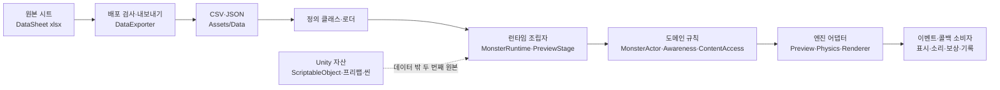

`I`(Unity 자산)가 데이터와 같은 의미의 값을 가지면 원본이 둘이 됩니다. 이번 감사에서 가장 큰 상충은 여기서 나왔습니다(3.7).

각 조건은 다음 질문으로 점검합니다.

| 질문 | 위험 신호 |
| --- | --- |
| 이 조건의 단일 소유자는 누구인가? | 같은 의미의 값이 CSV·자산·코드 상수에 동시에 있음 |
| 데이터를 바꾸면 런타임이 따르는가? | 컬럼은 로드되지만 소비자가 없음, 또는 코드가 ID·이름을 직접 비교 |
| 이 조건이 거짓이면 무엇을 중지하는가? | `return false`가 거부·무효·이미 처리됨을 구분하지 않음 |
| 통과 후 어떤 상태가 확정되는가? | 상태는 바뀌었지만 이벤트가 성공 기준처럼 쓰임 |
| 다음 조건이 이 결과를 재판정하는가? | 데이터 범위와 패턴 범위가 겹쳐 도달 불가능한 항목이 생김 |
| 예외가 나면 앞선 변경은 되돌아가는가? | 동기 이벤트 예외가 반환·후속 상태·정리 흐름을 끊음 |

### 1.2 위험도

- **높음**: 데이터가 바뀌어도 런타임이 따르지 않거나, 상태 변경 뒤 후속 정리가 실행되지 않을 수 있음
- **중간**: 특정 조립 경로·테스트·콘텐츠 조합에서만 다른 결과가 나올 수 있음
- **낮음**: 현재 의도는 명확하지만 새 기능 추가 시 규칙이 다시 복제될 가능성이 있음

## 2. 전체 조건 흐름

### 2.1 몬스터 생성·인식·행동

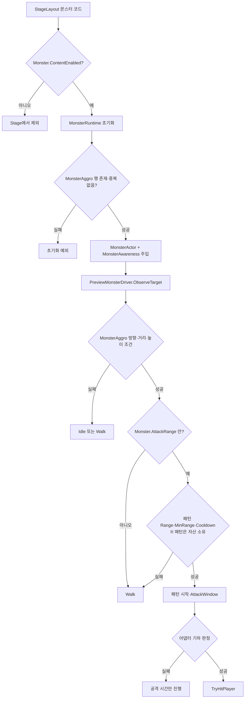

`ContentEnabled`, 인식 범위, `AttackRange`(데이터), 패턴 `Range`(자산), 실제 충돌 범위가 서로 다른 계층·원본의 조건입니다. 한 값을 바꾸면 다음 조건의 도달 가능성까지 검증해야 합니다.

### 2.2 상태 변경·이벤트·표현

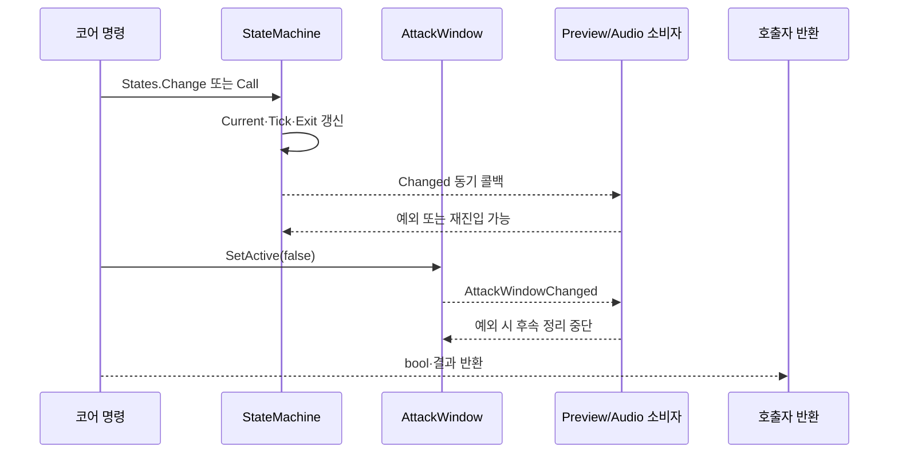

현재 이벤트는 대부분 동기로 실행됩니다. 이벤트 소비자 예외는 격리되지 않으므로, "게임플레이 상태 변경 성공"과 "모든 표현 소비자 처리 성공"이 같은 호출 결과에 섞일 수 있습니다.

### 2.3 스테이지 진입·이동·클리어

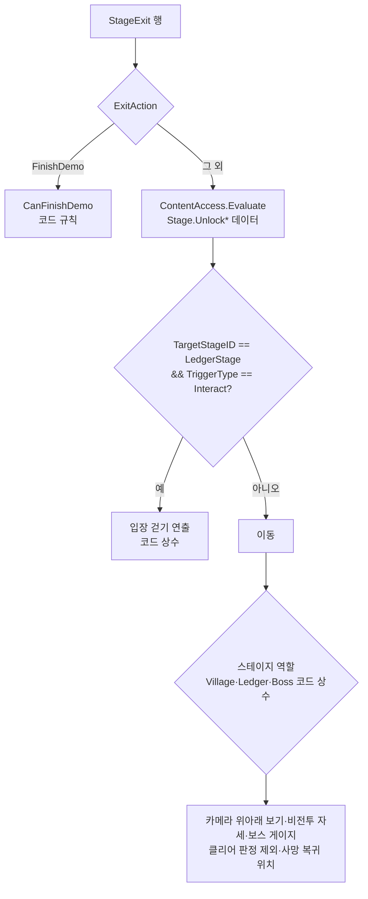

이동 허용은 데이터(`Stage.Unlock*`)를 따르지만, 도착한 맵이 어떤 역할인지는 코드 상수가 정합니다(3.8).

## 3. 확인된 중복·상충 지점

### 3.1 높음 — `MonsterState` 데이터와 실제 효과 면역 규칙이 분리됨

근거:

- [MonsterState.cs](../../Assets/3.Script/Data/MonsterState.cs)에는 `Category`, `Immune`, `Duration`이 있고 [GeneratedDataLoadPlan.cs](../../Assets/3.Script/Data/Generated/GeneratedDataLoadPlan.cs)가 로드합니다.
- 런타임 코드에서 `MonsterState` 소비자는 없습니다(교차검증 0건).
- 실제 효과 면역은 [FieldEffectTargetBinding.cs](../../Assets/3.Script/Adapters/FieldEffectTargetBinding.cs)가 `Monster.EffectImmunities` 문자열을 `EffectTarget`에 넘겨 처리합니다.
- 실제 데이터: `MonsterState.json`의 UnitID 1003(몬스터 3002 지게귀)은 `Knockback Immune=true`입니다. 같은 몬스터는 `Monster.csv`에서 `SuperArmor=Y`인데, 코드는 `SuperArmor`를 **돌진 중에만** 적용합니다([MonsterActor.cs:65](../../Assets/3.Script/Core/Characters/MonsterActor.cs#L65)). "넉백 면역"이라는 같은 의미가 세 곳(MonsterState·SuperArmor·EffectImmunities)에 나뉘어 있습니다.

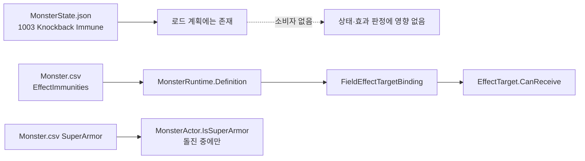

파생효과:

- 기획자가 `MonsterState.Immune`을 바꿔도 실제 면역은 바뀌지 않습니다.
- `Duration`을 상태 지속 시간으로 기대해도 `MonsterActor`의 기절·노출 시간이나 패턴 자산의 경직 시간을 대체하지 않습니다.
- 나중에 `MonsterState` 소비자를 추가하면 `EffectImmunities`·`SuperArmor`와 이중 판정이 생깁니다.

판정: **미연결 데이터 계약.** 데이터 우선 원칙에 따라 면역의 단일 원본을 정하고(7.4의 `IEffectImmunityPolicy`), 나머지 컬럼은 폐기하거나 그 원본으로 합칩니다.

### 3.2 높음 — `AIType` 데이터와 실제 행동 선택 규칙이 분리됨

[Monster.cs](../../Assets/3.Script/Data/Monster.cs)의 `AIType`은 저장되지만 소비자가 없습니다. 실제 행동은 [MonsterPatternSettings.cs](../../Assets/3.Script/Adapters/MonsterPatternSettings.cs) 자산의 `_chargeSpeed`, `_projectile`, `_lob`, `_retreatDistance`와 공용 [MonsterActor.cs](../../Assets/3.Script/Core/Characters/MonsterActor.cs)의 패턴 선택이 정합니다. 실제 불일치 사례는 3.7 표에 있습니다.

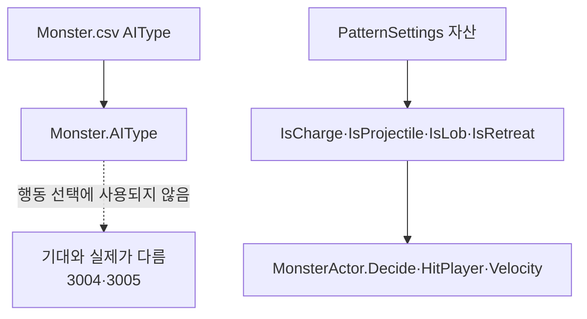

파생효과:

- `AIType=CHARGER`로 바꾸거나 추가해도 돌진이 생기지 않습니다.
- 패턴 자산만 바꾸면 `AIType`과 무관하게 행동이 바뀝니다.

데이터 우선 원칙의 결론: `AIType`을 **행동 전략 선택 키**로 살립니다(7.4의 `IMonsterBehavior`). 폐기하면 행동 종류가 데이터에서 사라져 원칙에 어긋납니다.

### 3.3 중간 — 인식 규칙의 운영 경로와 호환 경로가 다름

[MonsterActor.HasAggro](../../Assets/3.Script/Core/Characters/MonsterActor.cs#L53)는 `_awareness`가 있으면 `MonsterAggro` 결과를 쓰고, 없으면 `Definition.SightRange`와 `_distance`를 씁니다. [MonsterRuntime.Initialize](../../Assets/3.Script/Adapters/MonsterRuntime.cs)는 운영 조립에서 `MonsterAggro`를 주입하지만(행이 없으면 예외), [호환 생성자](../../Assets/3.Script/Core/Characters/MonsterActor.cs#L82)는 어그로 없이도 만들 수 있습니다.

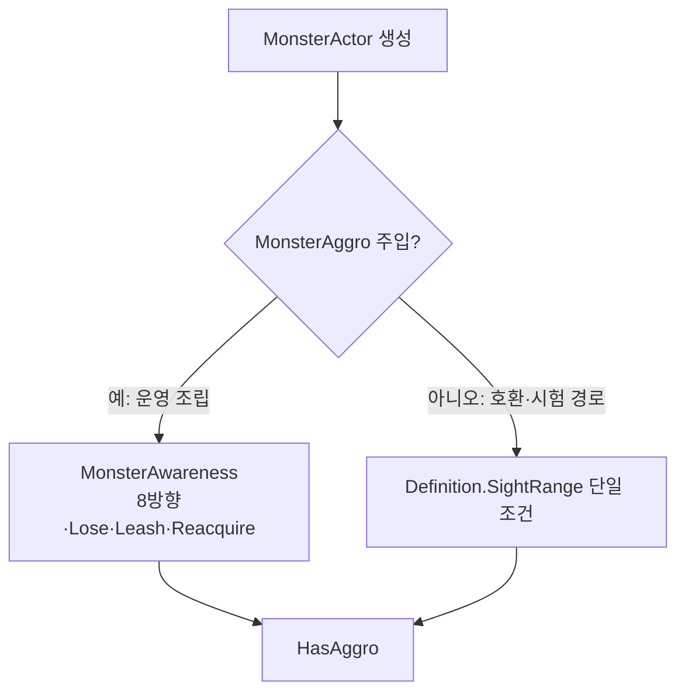

파생효과:

- 운영 Play와 코어 단위 테스트가 같은 위치에서 다른 인식 결과를 낼 수 있습니다.
- `SightRange`는 운영 규칙에서 빠졌는데 fallback으로 살아 있어, 데이터 컬럼의 의미가 경로마다 다릅니다.

개선 방향: 인식 정책을 인터페이스로 만들어 항상 주입하고, 시험용 단순 인식도 그 인터페이스의 **명시적 구현**으로 둡니다(7.4의 `IMonsterAwareness`). `SightRange`는 운영에서 쓰지 않으면 시트에서 폐기하거나 `MonsterAggro`로 옮깁니다.

### 3.4 중간 — `ContentEnabled`가 스테이지와 런타임에 분산됨

[StageLayoutRules.ResolveMonsters](../../Assets/3.Script/Core/Stages/StageLayout.cs#L61)는 `ContentEnabled`가 꺼진 몬스터를 제외합니다. [MonsterRuntime.Initialize](../../Assets/3.Script/Adapters/MonsterRuntime.cs)는 정의를 가져온 뒤 다시 검사하지 않습니다. 같은 판정 함수 `ContentAccess.Evaluate(Monster)`가 이미 있는데 쓰지 않습니다.

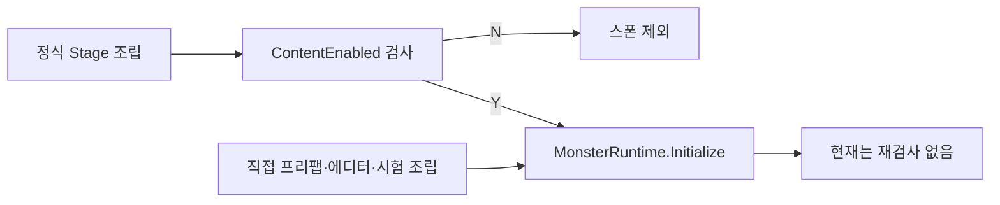

파생효과:

- 정식 맵에서는 비활성 콘텐츠가 나오지 않지만, 직접 생성·시험·다른 조립자는 비활성 몬스터를 실행할 수 있습니다.
- 비활성 데이터의 패턴·보상·리소스가 준비되지 않았으면 초기화 실패나 의도하지 않은 전투가 생깁니다.

개선 방향: `MonsterRuntime.Initialize`에서 `ContentAccess.Evaluate(Monster)`를 재사용합니다. 시험용 우회가 필요하면 이름 있는 옵션으로 분리합니다.

### 3.5 중간 — 공격 가능 범위가 세 곳에서 겹침

공격 시작에는 [MonsterActor.Decide](../../Assets/3.Script/Core/Characters/MonsterActor.cs)의 `Definition.AttackRange`(데이터)와 패턴 `Range`·`MinRange`(자산)가 함께 쓰입니다. 실제 근접 접촉은 [PreviewMonsterDriver.CheckMonsterHit](../../Assets/3.Script/Preview/PreviewMonsterDriver.cs#L380)에서 다시 패턴 `Range`로 판정합니다. 투사체와 돌진은 별도 기하 조건을 씁니다.

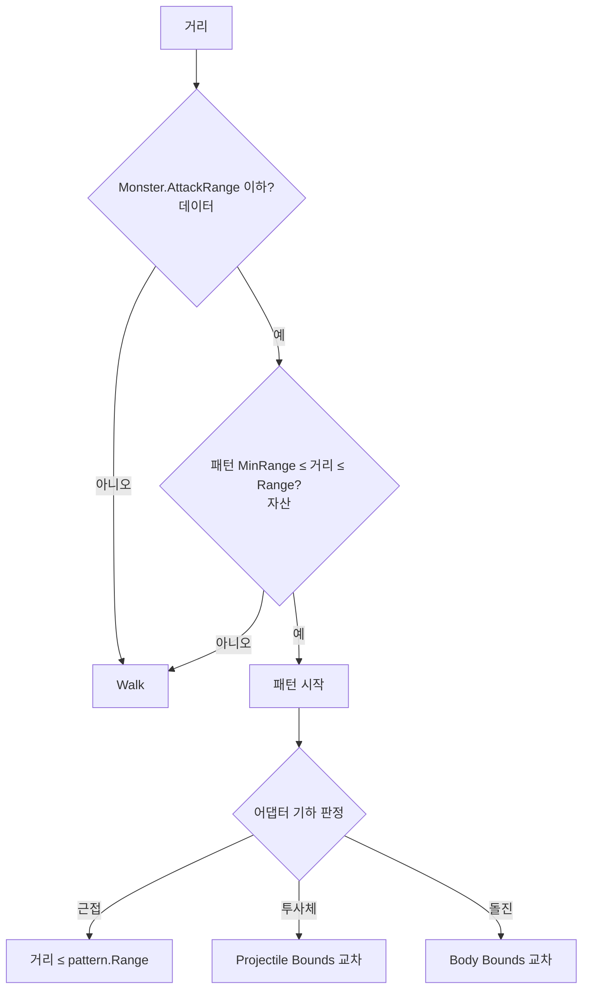

파생효과:

- 패턴 `Range`가 `AttackRange`보다 크면 그 거리 구간에는 도달할 수 없습니다.
- `MinRange`가 너무 크면 근접·원거리 패턴 사이에 빈 구간이 생겨 계속 Walk만 할 수 있습니다.
- 시작 조건과 실제 타격 조건이 다른 값으로 바뀌면 "공격 그림은 나오지만 맞지 않음" 또는 그 반대가 생깁니다.

현재 데이터는 정상입니다(3.7 표, 모든 패턴 `Range ≤ AttackRange`). 하지만 두 원본이 달라 배포 검사가 이를 볼 수 없습니다. 패턴을 데이터로 옮기면 DataExporter 교차 검사로 막을 수 있습니다(8.2).

### 3.6 낮음~중간 — 상태 키와 표현 데이터의 중복 기본값

`State.csv`에서 생성된 [StateKey.cs](../../Assets/3.Script/Data/StateKey.cs)와 코어 상태 클래스는 키를 맞춰 씁니다. 다만 표현 계층은 `PreviewStateSprite`의 `_fallback`, `_frames`, `_animations`에 상태를 다시 등록하고, [PrepareLookup](../../Assets/3.Script/Preview/PreviewStateSprite.cs#L77)은 같은 `StateKey`가 여러 번 들어오면 첫 항목을 남기고 나머지를 조용히 버립니다. 잘못된 중복이 오류가 아니라 잘못된 그림 선택으로 나타납니다.

개선 방향: 프리팹 검사(`ResourceConnectionChecks`)에서 중복 키를 실패시킵니다. 이 값은 표현 자산이므로 데이터로 옮길 대상은 아닙니다.

### 3.7 높음 — 몬스터 전투 패턴이 시트가 아닌 자산에 있음 (신규)

몬스터의 공격 패턴(사거리·최소 사거리·선딜·판정·후딜·추가 피해·구속·돌진 속도·투척·높이 던지기·물러서기·재사용 대기)과 피격 경직(`HitStun`·`CritHitStun`), 사망 불 장판 값은 모두 [MonsterPatternSettings](../../Assets/3.Script/Adapters/MonsterPatternSettings.cs) ScriptableObject 자산의 직렬화 값입니다. 시트에는 같은 몬스터의 `AIType`·`AttackRange`가 있습니다. 같은 행동을 두 원본이 나눠 가집니다.

교차검증(프리팹 `_monsterId` → 연결된 패턴 자산 → `Monster.csv`):

| 몬스터 | 프리팹 | 패턴 자산 | 자산이 정한 실제 행동 | `AIType`(데이터) | `AttackRange` | 패턴 Range | 판정 |
| --- | --- | --- | --- | --- | --- | --- | --- |
| 3001 | HusugwiGameplay | HusugwiPatterns | 근접 2종 | MELEE | 150 | 150·150 | 일치 |
| 3002 | JigegwiGameplay | JigegwiPatterns | 근접 + 돌진(900) | CHARGER | 600 | 150·600 | 일치 |
| 3003 | HusugwiFireGameplay | HusugwiFirePatterns | 근접 2종 | MELEE | 150 | 150·150 | 일치 |
| 3004 | JigegwiThrowerGameplay | JigegwiThrowerPatterns | 근접 + **투척**(MinRange 300) | **CHARGER** | 600 | 150·600 | **불일치** |
| 3005 | OnggwiGameplay | OnggwiPatterns | **투척 + 높이 던지기 + 물러서기** | **MELEE** | 600 | 600·600·200 | **불일치** |

파생효과:

- 기획자가 시트만 보고 3004를 "돌진형", 3005를 "근접형"으로 이해합니다. 실제 플레이와 다릅니다.
- 패턴 수치 조정은 Unity 에디터에서 자산을 고쳐야 해서 시트 배포·검증·이력 흐름을 타지 않습니다.
- 같은 패턴 자산을 다른 몬스터 ID가 공유하면 데이터 ID와 행동의 연결이 프리팹 배치에 숨습니다.

데이터 우선 결론: 패턴 수치는 새 시트(`MonsterPattern`, 7.5)로 옮기고, 자산에는 **그림·이펙트 연결 같은 표현 값만** 남깁니다.

### 3.8 높음 — 스테이지 역할이 코드 상수로 분기됨 (신규)

[StageExitRules](../../Assets/3.Script/Core/Stages/StageLayout.cs#L92)는 `VillageStage = 8001`, `LedgerStage = 8005`, `BossStage = 8004`를 코드 상수로 둡니다. 이 상수로 갈리는 규칙은 다음과 같습니다.

| 규칙 | 위치 | 데이터로 표현 가능한가 |
| --- | --- | --- |
| 첫 시작·사망 복귀 기본 맵 | [GameProgressState.cs:53·110-119](../../Assets/3.Script/Core/Interaction/GameProgressState.cs#L53) | 예(시작 맵·복귀 맵 지정) |
| 보스 게이지 표시·보스 활성 | [GameplayPreview.cs:633-634](../../Assets/3.Script/Preview/GameplayPreview.cs#L633-L634) | 예(맵 기능 플래그) |
| 장부방 비전투 자세 | [GameplayPreview.cs:256](../../Assets/3.Script/Preview/GameplayPreview.cs#L256) | 예 |
| 장부방 카메라 위아래 보기 끔 | [GameplayPreview.cs:755](../../Assets/3.Script/Preview/GameplayPreview.cs#L755) | 예 |
| 장부방 문 입장 걷기 연출 | [GameplayPreview.cs:567](../../Assets/3.Script/Preview/GameplayPreview.cs#L567) | 예(출구 행의 연출 지정) |
| 잡몹 전멸 클리어에서 마을·장부방·보스방 제외 | [GameplayPreview.cs:785](../../Assets/3.Script/Preview/GameplayPreview.cs#L785) | 예(클리어 조건 종류) |
| 보스 처치 기록·엔딩 대상 맵 | [GameplayPreview.cs:783](../../Assets/3.Script/Preview/GameplayPreview.cs#L783), [Cutscenes.cs:26·73](../../Assets/3.Script/Preview/GameplayPreview.Cutscenes.cs#L26) | 예 |
| 장부방 관련 출구 사전 준비 | [GameplayPreview.cs:144](../../Assets/3.Script/Preview/GameplayPreview.cs#L144) | 예 |
| 보스방 플레이어 소리 위치 | [GameplayPreview.cs:244](../../Assets/3.Script/Preview/GameplayPreview.cs#L244) | 예 |

`Stage.csv`에는 맵의 역할·기능을 나타내는 컬럼이 없습니다. 맵 ID를 바꾸거나 두 번째 보스방·장부방을 추가하면 코드를 고쳐야 합니다.

파생효과: 기획자가 새 보스방을 데이터로 추가해도 보스 게이지·처치 기록·엔딩이 동작하지 않습니다. 맵 ID 재배정이 코드 수정을 강제합니다.

데이터 우선 결론: `Stage.csv`에 역할·기능 컬럼을 추가하고, 코드는 그 값을 해석하는 정책 객체만 갖습니다(7.4의 `IStageRule`, 7.5).

### 3.9 중간 — 콘텐츠 ID·앵커 이름의 코드 직접 비교 (신규)

| 코드 | 위치 | 데이터 쪽 원본 | 상충 시 결과 |
| --- | --- | --- | --- |
| `_jigegwiMonsterId = 3002`로 타격 이펙트 선택 | [GameplayPreview.cs:92·464](../../Assets/3.Script/Preview/GameplayPreview.cs#L464) | `Monster.ID` | 다른 몬스터가 같은 이펙트를 쓰려면 코드 수정 |
| 보스 2페이즈 대사를 `TriggerTargetID == 4002`로 `Single` 조회 | [GameplayPreview.BossPhase.cs:40](../../Assets/3.Script/Preview/GameplayPreview.BossPhase.cs#L40) | `Dialogue.csv` 24003 | 데이터에서 대상 상태를 바꾸면 **시작 시 예외** |
| 삭제된 관문 표식 `8002 BindGate_1·2`, `8003 BindGate_3` | [PreviewBindGates.cs:66-68](../../Assets/3.Script/Preview/PreviewBindGates.cs#L66-L68) | `GateConfig.csv` | 맵 정리 이력이 코드에 남음. 맵에서 표식을 지우면 불필요 |
| 표식 이름 `Myeongbu`·`Seonangdang`로 상호작용 종류 결정 | [GameplayPreview.cs:720·726](../../Assets/3.Script/Preview/GameplayPreview.cs#L720) | 없음(맵 표식) | 새 상호작용 종류는 코드 수정 |
| 복귀 앵커 `Respawn_Seonangdang` | [GameProgressState.cs:113](../../Assets/3.Script/Core/Interaction/GameProgressState.cs#L113), [GameplayPreview.cs:1022](../../Assets/3.Script/Preview/GameplayPreview.cs#L1022) | 없음 | 코어 규칙에 앵커 문자열이 들어 있음 |
| `ExitAction == "FinishDemo"` | [GameplayPreview.cs:565·775](../../Assets/3.Script/Preview/GameplayPreview.cs#L565) | `StageExit.ExitAction`(DataExporter가 검사) | 값은 데이터지만 해석이 `if` 분기. 새 동작은 코드 분기 추가 |

### 3.10 중간 — 로드되지만 쓰이지 않는 데이터, 쓰이지 않는 코드 규칙 (신규)

| 대상 | 상태 | 위험 |
| --- | --- | --- |
| `Stage.Active`, `Stage.Order` | 로드되지만 게임 규칙 소비자 없음([ContentAccess](../../Assets/3.Script/Core/Content/ContentAccess.cs) 주석은 "각 실행 담당이 처리"라고만 함) | 기획자가 `Active=N`으로 맵을 끌 수 있다고 기대함 |
| `Monster.SightRange` | 운영 경로 미사용, 호환 경로에서만 사용(3.3) | 경로마다 의미가 다름 |
| `StageExitRules.CanLeave` | **호출부 없음.** 실제 이동 허용은 `ContentAccess`가 `Stage.Unlock*`(8002는 8005 클리어 필요)으로 판정 | 같은 규칙의 코드 사본이 남아 있어, 누군가 다시 쓰면 데이터와 상충 |

### 3.11 낮음 — 화면 문구 ID 대체 분기 (신규)

`id == 30330 ? ReadUi(52104) : Read(id)` 형태로, 직렬화된 Language ID가 특정 값이면 UI_Lang 키로 바꿔 읽는 분기가 5곳 있습니다([ErrorPopupHost.cs:96](../../Assets/3.Script/Adapters/ErrorPopupHost.cs#L96), [ManualSaveHost.cs:120-146](../../Assets/3.Script/Adapters/ManualSaveHost.cs#L120), [ShrineScreen.cs:137-138](../../Assets/3.Script/Presentation/ShrineScreen.cs#L137), [SkipHint.cs:22](../../Assets/3.Script/Presentation/SkipHint.cs#L22), [GameplayPreview.Cutscenes.cs:99](../../Assets/3.Script/Preview/GameplayPreview.Cutscenes.cs#L99)). `UI_Lang.csv`가 이미 `52104 → 30330`처럼 연결을 가지고 있으므로, 이 분기는 데이터 연결의 코드 사본입니다. 결과는 같지만 UI_Lang 연결을 바꾸면 이 5곳이 따라가지 않습니다.

개선 방향: 직렬화 필드를 UI_Lang 키로 바꾸고 분기를 지웁니다. 표현 계층의 정리라 우선순위는 낮습니다.

## 4. 콜백과 반환 흐름의 단절 위험

### 4.1 높음 — `AttackWindowChanged` 예외가 공격 종료 정리를 막을 수 있음

[AttackWindow.SetActive](../../Assets/3.Script/Core/Combat/AttackWindow.cs)는 `IsActive`를 먼저 바꾼 뒤 `Changed`를 동기로 호출합니다. [MonsterActor.ClearPattern](../../Assets/3.Script/Core/Characters/MonsterActor.cs#L442)은 먼저 `SetAttackActive(false)`를 호출하고, 그다음 `_pattern = null`, 대상 목록·구속을 정리합니다.

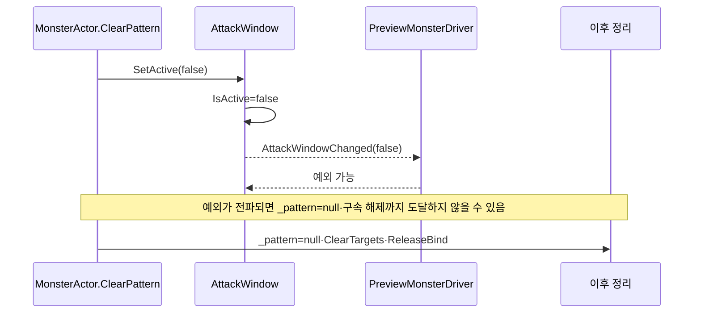

파생효과:

- 투사체 표시만 실패해야 하는데 공격 패턴·구속·대상 목록까지 남을 수 있습니다.
- 다음 `Decide`가 `_pattern != null`에서 막혀 몬스터가 멈출 수 있습니다.
- 이벤트 소비자가 현재 패턴을 읽으면 이벤트 시점에는 아직 이전 `_pattern`이 남아 있어 순서가 애매합니다.

개선 방향: 코어 정리를 먼저 끝내고 마지막에 알립니다(`_pattern=null`·구속 해제 → `SetActive(false)`). 소비자 예외 정책 자체는 바꾸지 않습니다.

### 4.2 높음 — 상태 전환 콜백은 재진입과 후속 순서가 분리되어 있지 않음

[ActorStateMachine.Transition](../../Assets/3.Script/Core/States/ActorStateMachine.cs)은 `_transitioning = false`로 되돌린 뒤 `Changed`를 호출합니다. 그래서 `Changed` 소비자가 다시 `States.Change`를 호출하면 재진입이 허용됩니다. 주석의 "진입·종료 중 재전환 방지"는 `enter`·`exit` 실행 중에만 지켜지고 `Changed` 콜백은 포함하지 않습니다.

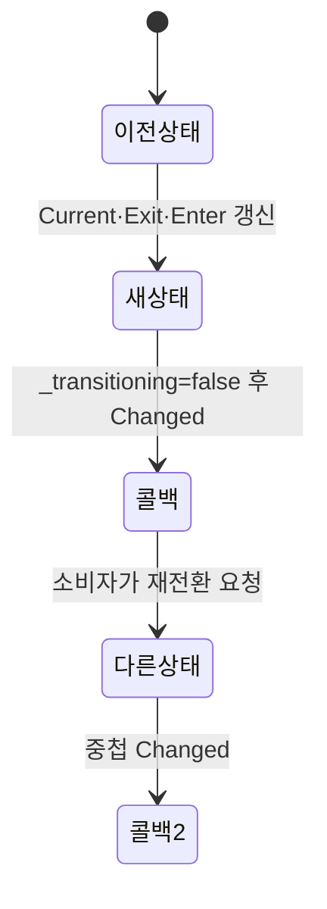

파생효과:

- 표시·소리 소비자가 실수로 명령을 호출하면 상태 이벤트 순서가 중첩됩니다.
- 첫 번째 `Changed`를 처리하는 동안 두 번째 상태가 확정되어, 이전 이벤트의 의미가 현재 상태와 달라질 수 있습니다.
- `States.Change` 반환값을 보지 않는 호출부는 "변경됨"과 "같은 키라 변경 없음"을 구분하지 못합니다.

AGENTS 계약("표시 소비자는 콜백 안에서 코어 명령을 다시 호출해 상태를 바꾸지 않습니다")을 코드로 강제하려면 `Changed` 중 재전환을 예외로 막습니다.

### 4.3 중간 — 상태 확정과 이벤트 성공을 같은 반환 흐름으로 취급

게임플레이 이벤트는 동기 전파입니다. 예를 들어 `MonsterActor.ReceiveDamage`는 HP·상태를 먼저 바꾼 뒤 `HealthChanged`를 호출하고 반환합니다. `PatternStarted`, `Parried`, `PlayerDodged`, `_applyHitEffects`도 핵심 판정과 후속 알림이 한 호출 흐름에 있습니다.

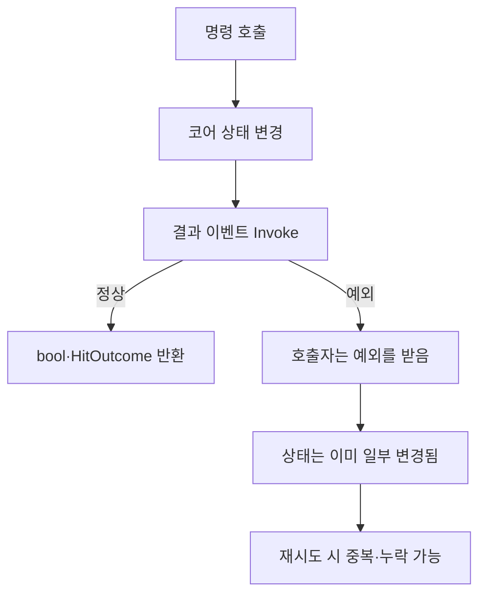

이는 프로젝트가 의도적으로 고른 계약이지만, 다음을 구분해 기록해야 합니다.

- **명령 결과**: 피해 적용·패턴 시작·패링 수락 여부
- **완료 이벤트**: 상태 변경이 끝난 뒤 독립 소비자에게 알림
- **표현 실패**: 표시·소리·통계 소비자 내부에서 정리할 오류

소비자 예외는 전파되므로 코어 변경을 되돌릴 수 없습니다. 따라서 소비자에서 코어 명령을 다시 호출하지 않고, 표시 경계에서 예외를 정리하는 규칙을 모든 구독자에 적용해야 합니다.

### 4.4 중간 — `false` 반환값의 의미가 여러 가지임

| 의미 | 예시 | 호출자가 구분하지 못할 때 |
| --- | --- | --- |
| 조건 불충족 | 죽은 대상, 사거리 밖, 이미 실행 중 | 정상 거부를 오류로 기록하거나 재시도 |
| 이미 처리됨 | `AttackWindow` 대상 중복, 이미 종료된 세션 | 중복 처리를 다시 시작 |
| 외부 데이터 누락 | 패턴·대상·어그로 없음 | 콘텐츠 오류를 단순 전투 실패로 숨김 |
| 후속 소비자 실패 | 이벤트 예외 | 상태는 변경됐지만 호출자는 성공을 받지 못함 |

`HitOutcome.None`과 `bool false`는 "맞지 않음", "무적", "판정 창 아님", "대상 사망"을 모두 압축합니다. 진단·보상·재시도 경계에서는 원인을 별도 결과 타입이나 진단 코드로 보존해야 합니다. 데이터 기반 조건에서는 `ContentAccessResult`(`Allowed`·`DisabledByPlanner`·`UnlockRequired`)가 이미 좋은 예입니다. 7장의 조건 평가도 같은 방식을 따릅니다.

## 5. 파생효과와 우선 점검 순서

### 5.1 예상 파생효과 지도

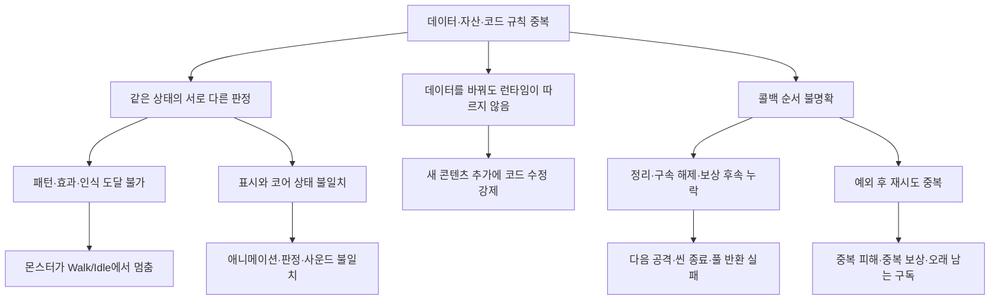

### 5.2 우선순위

| 순서 | 항목 | 이유 | 시트 변경 |
| --- | --- | --- | --- |
| 1 | 4.1 `ClearPattern` 정리 순서 | 코드만으로 고칠 수 있고 몬스터 정지 위험을 없앰 | 없음 |
| 2 | 3.4 `ContentAccess.Evaluate(Monster)` 재사용 | 기존 함수 재사용, 새 규칙 없음 | 없음 |
| 3 | 3.10 `StageExitRules.CanLeave` 삭제, `Stage.Active` 소비 여부 결정 | 데이터와 상충하는 코드 사본 제거 | 결정에 따라 |
| 4 | 3.7·3.2 `MonsterPattern` 시트와 `AIType` 전략 키 | 가장 큰 이중 원본. 실제 불일치 2건 | 필요(데이터 공급 담당) |
| 5 | 3.8 `Stage` 역할·기능 컬럼 | 새 맵 추가 시 코드 수정 강제 해소 | 필요 |
| 6 | 3.1 면역 단일 원본(`MonsterState`·`SuperArmor`·`EffectImmunities`) | 의미 세 곳 분산 | 필요 |
| 7 | 3.3 인식 정책 항상 주입 | 테스트·운영 결과 일치 | `SightRange` 폐기 시 필요 |
| 8 | 3.9 콘텐츠 ID·앵커 비교 제거 | 새 콘텐츠의 코드 수정 강제 해소 | 일부 필요 |
| 9 | 4.2 `Changed` 중 재전환 거부 | 계약을 코드로 강제 | 없음 |
| 10 | 3.6·3.11 표현 중복 키 검사, 문구 대체 분기 정리 | 낮은 위험 | 없음 |

1·2·3·9는 시트 변경 없이 할 수 있습니다. 4~8은 AGENTS 규칙대로 데이터 공급 담당과 스키마를 맞춘 뒤 진행합니다.

### 5.3 최소 재현 테스트

| 테스트 | 확인할 결과 |
| --- | --- |
| `MonsterState.Immune`만 변경 | 실제 필드 효과 수신이 바뀌는지, 무관한지 명확해야 함 |
| `Monster.EffectImmunities`만 변경 | `EffectTarget.CanReceive`와 피해 결과가 일치해야 함 |
| `AIType`만 변경 | 행동이 바뀌지 않는다면 미사용 계약으로 명시해야 함 |
| `MonsterAggro` 없이 Actor 생성 | 운영 8방향 경로와 결과 차이를 테스트에 기록해야 함 |
| 패턴 `Range > AttackRange` | 배포 전에 실패하거나 의도적으로 허용된다는 설명이 있어야 함 |
| `ContentEnabled=N` 직접 프리팹 초기화 | 조립 경로에 따라 허용·거부가 달라지지 않아야 함 |
| `AttackWindowChanged(false)` 소비자 예외 | 패턴 제거·구속 해제·대상 목록 정리가 보장되어야 함 |
| `StateChanged` 소비자 재전환 | 재진입을 거부하거나 명시적으로 큐잉해야 함 |
| `HealthChanged` 소비자 예외 | 코어 결과와 호출자 관측 결과의 계약이 문서화되어야 함 |
| `Dialogue.csv` 24003의 `TriggerTargetID` 변경 | 시작 시 예외 없이 새 대상 상태에서 대사가 나와야 함(현재는 예외) |
| `Stage.csv`에 보스 역할 맵 추가 | 코드 수정 없이 보스 게이지·처치 기록이 동작해야 함(현재는 불가) |

## 6. 개선 시 지켜야 할 계약

- 데이터 정의, 런타임 상태, 도메인 규칙, 표현, 인프라 중 한 계층만 각 조건의 소유자로 지정합니다. **콘텐츠 조건의 소유자는 데이터입니다.**
- 데이터로 표현할 수 있는 규칙을 코드 상수나 Unity 자산으로 복제하지 않습니다. 반대로 데이터 필드 이름만으로 코드 전략이 자동 구현된다고 가정하지 않습니다. 데이터 값마다 해석기를 등록합니다(7장).
- `MonsterState`, `EffectImmunities`, `SuperArmor`, `AIType`, `MonsterAggro`, 패턴처럼 의미가 겹치는 계약은 배포 검증에서 중복·누락·도달 불가 조합을 검사합니다.
- 명령 반환값과 완료 이벤트를 구분합니다. 이벤트 소비자 예외가 코어 상태를 되돌릴 수 없다면 그 사실을 호출 계약에 명시합니다.
- 상태 변경 전후의 이벤트 순서, 구독 수명, 재진입 허용 여부를 테스트합니다.
- `false`와 `None`만으로 원인을 압축하지 말고, 운영 로그·QA 진단에는 실패 이유를 보존합니다.
- 네트워크·리플레이를 고려할 때는 데이터 행·패턴·상태의 안정적인 ID와 정수 ms·명령 순서를 기준으로 기록합니다. Unity 표시 콜백과 Transform 참조를 동기화 계약으로 쓰지 않습니다.
- 확인된 항목은 즉시 구조를 다시 쓰지 않고, 기능 담당자와 계약 소유권을 확정한 뒤 교차 검증·집중 테스트부터 추가합니다. 다른 담당 기능(보스·패링 등)은 그 담당과 경계를 확인합니다.

## 7. 데이터 우선 조건 설계도

### 7.1 원칙

1. **데이터가 이긴다.** 같은 의미의 값이 데이터와 코드·자산에 함께 있으면 데이터 값을 쓰고 코드·자산 사본을 지웁니다.
2. **코드에 규칙·조건을 새로 만들지 않는다(사용자 결정, 2026-11-19).** 꼭 필요한 경우가 아니면 콘텐츠 규칙·조건·콘텐츠 ID 비교·규칙 상수를 코드에 두지 않습니다. 필요한 컬럼이 없으면 코드에 임시 기본값을 두지 않고, 데이터 공급 담당과 컬럼 추가를 먼저 맞춥니다. 엔진 경계·안전장치처럼 코드 조건이 불가피하면 이유를 주석과 이 문서에 남기고 사용자 확인을 받습니다.
3. **코드는 해석기만 갖는다.** 코드는 `AIType=CHARGER` 같은 데이터 값을 "어떻게 실행하는지"만 압니다. 어떤 몬스터·맵이 그 값을 갖는지는 모릅니다. 콘텐츠 ID·앵커 이름을 코드가 직접 비교하지 않습니다.
4. **모르는 값은 배포에서 실패한다.** 데이터에 해석기가 없는 값이 오면 DataExporter·`Verify-Project.ps1`이 실패합니다. 런타임에서 조용히 기본 동작으로 넘어가지 않습니다(`ContentAccess`의 `NotSupportedException`과 같은 방향).
5. **표현 자산은 데이터를 따른다.** 프리팹·ScriptableObject에는 그림·이펙트·소리 연결만 둡니다. 판정·수치·행동 종류는 두지 않습니다.

### 7.2 전체 구조

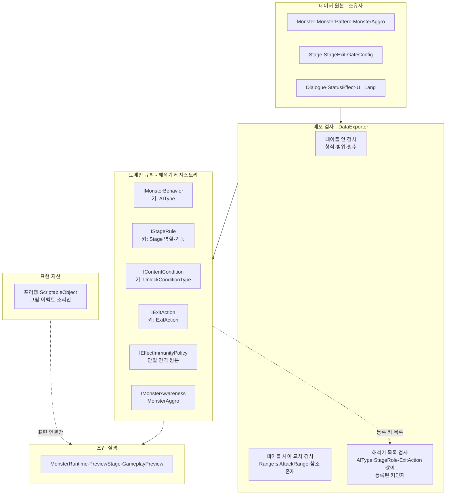

`Rules`의 등록 키 목록이 배포 검사(`V3`)의 기준이 됩니다. 해석기를 추가하면 그 키가 자동으로 허용 목록에 들어가고, 시트에 모르는 키를 쓰면 배포가 실패합니다.

### 7.3 상충이 생겼을 때의 결정 흐름

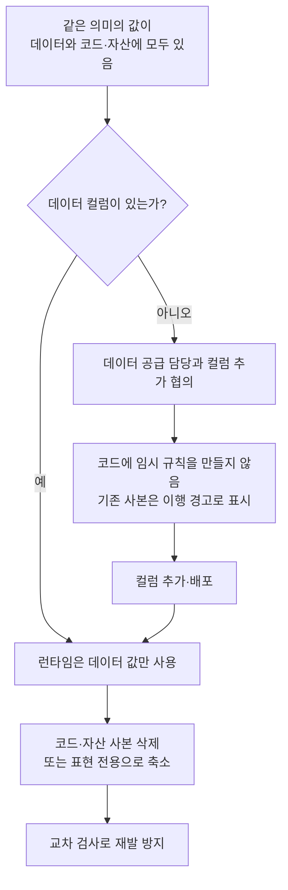

### 7.4 인터페이스화 판단

현재 인터페이스는 15개이며 대부분 인프라 경계(`ISaveStore`·`ITextSource`·`ITelemetryTransport`·`IModalInputTarget` 등)에 있습니다. **콘텐츠 조건과 행동 선택은 `switch`·`if`·상수 비교로만 표현되어 있습니다.** 데이터 값으로 구현을 고르는 지점은 인터페이스 + 레지스트리가 유리합니다. 새 데이터 값을 추가할 때 기존 분기를 고치지 않고 구현 하나만 등록하면 되고(개방-폐쇄), 등록 키 목록을 배포 검사에 그대로 쓸 수 있기 때문입니다.

| 인터페이스(제안) | 선택 키(데이터) | 대체할 현재 코드 | 이점 | 판단 |
| --- | --- | --- | --- | --- |
| `IMonsterBehavior` | `Monster.AIType` | 패턴 자산 플래그 조합(`IsCharge`·`IsProjectile`·`IsLob`·`IsRetreat`)과 `MonsterActor.Decide` 내부 분기 | `AIType`이 실제 행동을 결정. 3004·3005 불일치가 배포에서 드러남 | **유리** |
| `IStageRule` | `Stage` 역할·기능 컬럼(7.5) | `StageExitRules` 상수 비교 20곳 넘음 | 새 보스방·장부방을 데이터로 추가 | **유리** |
| `IContentCondition` | `UnlockConditionType` | `ContentAccess`의 `switch(conditionType)` | 해금 조건 종류(보스 처치·아이템 보유 등) 추가가 구현 등록으로 끝남 | **유리**. 결과 타입 `ContentAccessResult` 유지 |
| `IExitAction` | `StageExit.ExitAction` | `if (route.ExitAction == _finishDemoExit)` | 출구 동작 추가가 분기 수정 없이 가능 | **유리** |
| `IEffectImmunityPolicy` | 면역 단일 원본 | `MonsterState`·`SuperArmor`·`EffectImmunities` 분산 | 면역 판정 한 곳. 필드 효과·피격 반응이 같은 답을 받음 | **유리** |
| `IMonsterAwareness` | `MonsterAggro` | `_awareness != null ? … : SightRange` fallback | 테스트용 구현을 명시적으로 주입. fallback 제거 | **유리** |
| `IMarkerBinding` | 맵 표식 종류(데이터 또는 표식 컴포넌트) | `marker.name == "Myeongbu"` 비교 | 새 상호작용 표식 추가 | 조건부: 표식 종류가 2개뿐이면 표식 컴포넌트 배치로 충분 |
| 타격 이펙트 선택 | 몬스터 표현 자산 | `MonsterId == 3002` 비교 | — | **불필요.** 몬스터 프리팹의 표현 필드로 옮기면 됨 |
| 표현 상태 조회(`PreviewStateSprite`) | — | — | 이미 상속·재정의로 충분 | **불필요** |

인터페이스를 쓰지 않는 기준: 구현이 하나뿐이고 데이터 값으로 고르지 않는 경우, 표현 전용 값, 성능상 매 프레임 가상 호출이 문제 되는 핫 경로입니다.

### 7.5 해석기 구조 예시 (설명용, 미구현)

```csharp
// 설명용 예시입니다. 실제 이름·위치는 구현 시 확정합니다.
public interface IMonsterBehavior
{
    string Key { get; }                       // 데이터 AIType 값과 같음. 배포 검사가 이 목록을 허용 키로 씀
    MonsterPattern Choose(MonsterDecisionContext context);
}

public sealed class MonsterBehaviorRegistry
{
    private readonly Dictionary<string, IMonsterBehavior> _behaviors;
    public MonsterBehaviorRegistry(IEnumerable<IMonsterBehavior> behaviors)
        => _behaviors = behaviors.ToDictionary(b => b.Key, StringComparer.Ordinal);   // 중복 키는 조립 실패
    public IReadOnlyCollection<string> Keys => _behaviors.Keys;
    public IMonsterBehavior Get(string aiType) => _behaviors.TryGetValue(aiType, out var b) ? b
        : throw new NotSupportedException("등록되지 않은 AIType입니다: " + aiType);
}
```

데이터 쪽 변경 제안(설명용 값, 공급값 아님). 실제 컬럼은 데이터 공급 담당과 확정합니다.

| 시트 | 추가·변경 | 예시 |
| --- | --- | --- |
| `MonsterPattern`(신규) | `MonsterID, StateID, Range, MinRange, Windup, Active, Recovery, ExtraDamage, BindTime, BindPresses, ChargeSpeed, WallStun, Kind(MELEE·CHARGE·PROJECTILE·LOB·RETREAT), RetreatDistance, Cooldown` | `3005, 10005, 600, 300, …, LOB` |
| `Monster` | `HitStun`, `CritHitStun` 추가. `AIType` 값을 실제 행동에 맞춤(3004·3005). 운영에서 안 쓰면 `SightRange` 폐기 | `3004 … THROWER` |
| `Stage` | `StageRole`(FIELD·VILLAGE·LEDGER·BOSS), `ClearCondition`(KILL_ALL·BOSS·NONE), `CameraLook`(Y/N), `CombatStance`(Y/N), 시작·복귀 맵 지정 | `8005, …, LEDGER, NONE, N, N` |
| `StageExit` | 입장 연출 지정(`EnterPerformance`) | `9, …, WALK_IN` |
| `MonsterState`/`Monster` | 면역 단일 원본 확정 후 나머지 폐기 | — |

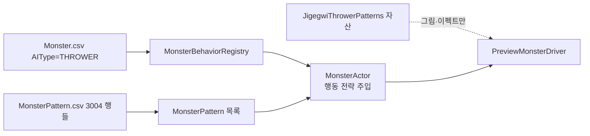

## 8. 이행 순서와 추가할 검사

### 8.1 이행 단계


| 단계 | 작업 | 담당 확인 |
| --- | --- | --- |
| 1 | 4.1 정리 순서, 3.4 `ContentAccess` 재사용, 3.10 `CanLeave` 삭제, 4.2 재전환 거부, 3.9 보스 대사 `Single(4002)`를 데이터 조회로 변경 | 코드 담당. 보스 부분은 보스 담당과 확인 |
| 2 | 8.2 검사 추가. 현재 데이터 그대로 통과해야 하며, 3004·3005 `AIType` 불일치는 **경고로 시작** | 검사 담당 |
| 3 | `MonsterPattern`·`Stage` 컬럼 추가, 해석기·레지스트리 도입. 같은 값을 데이터로 옮겨 동작 보존을 확인 | 데이터 공급 담당 + 기능 담당 |
| 4 | 패턴 자산의 수치 필드, `StageExitRules` 상수, ID 비교 삭제. 경고를 실패로 승격 | 기능 담당 |

각 단계는 AGENTS 규칙대로 이유·재사용 범위·코드 위치를 설명하고 기능 단위로 확인받은 뒤 진행합니다.

### 8.2 추가할 교차 검사

| 검사 | 위치(제안) | 실패 조건 |
| --- | --- | --- |
| 패턴 사거리 상한 | DataExporter(패턴이 시트로 옮겨진 뒤), 그 전에는 `Locomotion.Checks`가 패턴 자산을 읽어 확인 | 패턴 `Range > Monster.AttackRange`, `MinRange > Range` |
| 행동 종류 일치 | 같음 | `AIType`과 패턴 종류 조합 불일치(현재 3004·3005) |
| 해석기 키 등록 | `Verify-Project.ps1` 코어 검사 | 데이터의 `AIType`·`StageRole`·`ExitAction`·`UnlockConditionType` 값이 레지스트리에 없음 |
| 소비자 없는 컬럼 | `Verify-Project.ps1` | 로드되지만 코드 소비자가 없는 컬럼이 허용 목록에 없음(`Stage.Active`·`Order`·`MonsterState` 등) |
| 콘텐츠 ID 직접 비교 금지 | `IntegerPolicyChecks`와 같은 방식의 소스 검사 | `Core`·`Adapters`·`Preview`에서 `== 3002` 같은 데이터 ID 리터럴 비교, `StageExitRules` 상수 사용 |
| 표현 상태 중복 키 | `ResourceConnectionChecks` | `PreviewStateSprite`의 `_animations`·`_frames`에 같은 `StateKey`가 둘 이상 |
| 대사 대상 존재 | DataExporter | `Dialogue.TriggerTargetID`가 `BossState` 등 대상 테이블에 없음 |

관련 문서는 [프로젝트 전체 아키텍처](프로젝트%20전체%20아키텍처.md), [일반 몬스터 인공지능](일반%20몬스터%20인공지능.md), [몬스터 8방향 인식과 추적 설계](몬스터%208방향%20인식과%20추적%20설계.md), [게임플레이 코어와 프리팹 연결](게임플레이%20코어와%20프리팹%20연결.md), [배포 데이터와 기능 연결 검사 설계](배포%20데이터와%20기능%20연결%20검사%20설계.md), [콘텐츠 잠금 설계](콘텐츠%20잠금%20설계.md), [맵 출구와 도착 앵커 연결 설계](맵%20출구와%20도착%20앵커%20연결%20설계.md)를 함께 봅니다.
