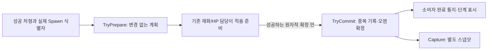

# 처형 보상과 오염 연결 틀

2026-11-13. 사용자 요청은 「남은 구현과 검증 작업」 중 **처형 보상·오염의 틀만**입니다. 다른 미구현 목록을 일괄 구현하지 않았습니다. 기존 MonsterRewards·지갑·강화·일반 사망 보상·게임 저장 형식은 유지합니다.

## 준비한 계약

`Assets/3.Script/Core/Progression/ExecutionRewardSession.cs`는 Unity/UI/파일/지갑과 독립적입니다.

| API | 소유하는 일 |
| --- | --- |
| `TryPrepare(spawn, monsterId, out plan)` | ExecuteReward의 추가 엽전·회복·오염·아이템 계획 조회. 값 변경 없음 |
| `CanCommit(plan)` | 같은 세션·현행 revision·미처리 스폰 확인 |
| `TryCommit(plan)` | 오염과 처리한 스폰만 한 번 확정. 외부 콜백 없음 |
| `CurrentStep / InkAlpha` | 0/10/20/30 문턱, 먹 투명도0/2500/5000/7500을 제공 데이터에서 조회 |
| `Capture()` / 생성자 snapshot | 오염·처리 스폰의 읽기 전용 사본. 기존 게임 파일에 자동 저장하지 않음 |

준비 후 다른 계획이 확정되면 오래된 계획은 거부합니다. 실패한 지급은 Commit하지 않고 다시 준비합니다. 일반 사망 보상의 엽전/경험치는 여기서 다시 지급하지 않습니다. 성공 처형만 공급하며 취소·일반 사망·보스·에디터 테스트 개체는 제외해야 합니다. DropItemID가 나중에 채워져도 소유권·인벤토리 구현 없이 지급 완료로 처리하면 안 됩니다.

현재 표는 허수귀/지게귀 추가 엽전1, 변형2, 회복5, 오염1, 아이템0입니다. 코드에 몬스터별 수치를 고정하지 않았습니다. 음수·잘못된 스폰·중복·세션 혼용·오래된 계획·잘못된 단계/투명도를 거부합니다. 알림에서 core 명령을 재진입하지 않습니다.

## 아직 연결하지 않은 것

- 실제 지갑 추가 지급, PlayerActor의 처형 회복, 아이템, HUD 먹 번짐.
- GameProgressState/SaveSnapshot/JsonSaveStore의 정식 저장 필드와 버전 이관.
- 실제 처형 완료 이벤트·중복 일반 사망 보상과 함께 확정하는 조립 경계.

따라서 **게임 보상·오염 완성 상태가 아닙니다.** 기존 보상 담당은 위 계획을 기존 원자적 지급 경계에 연결하고, 회복도 같은 확정 뒤에 통지해야 합니다. 저장 담당은 오염 값과 처리 스폰을 함께 보존해야 합니다. UI는 CurrentStep/InkAlpha만 소비하고 전투 수치를 변경하지 않습니다. 이 후속 합의 전 임의로 게임에 자동 연결하지 않았습니다.

독립 검사에서 준비 무변경, 1회 확정, 동시 계획 무효화, 오염10/20/30 경계, 스냅샷 복원, 다른 세션 거부를 확인했습니다. 데이터 시트·생성 모델·일반 보상 코드는 수정하지 않았습니다.
