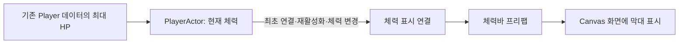
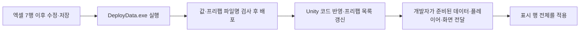
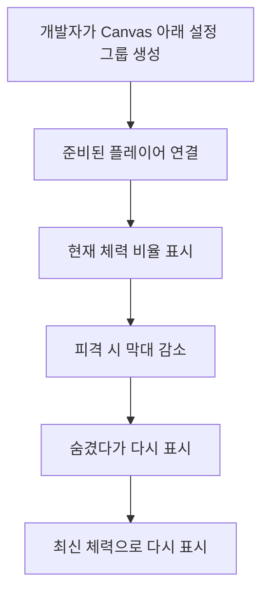
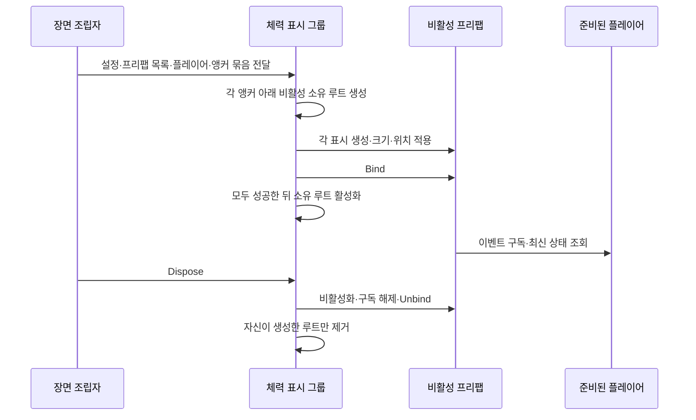
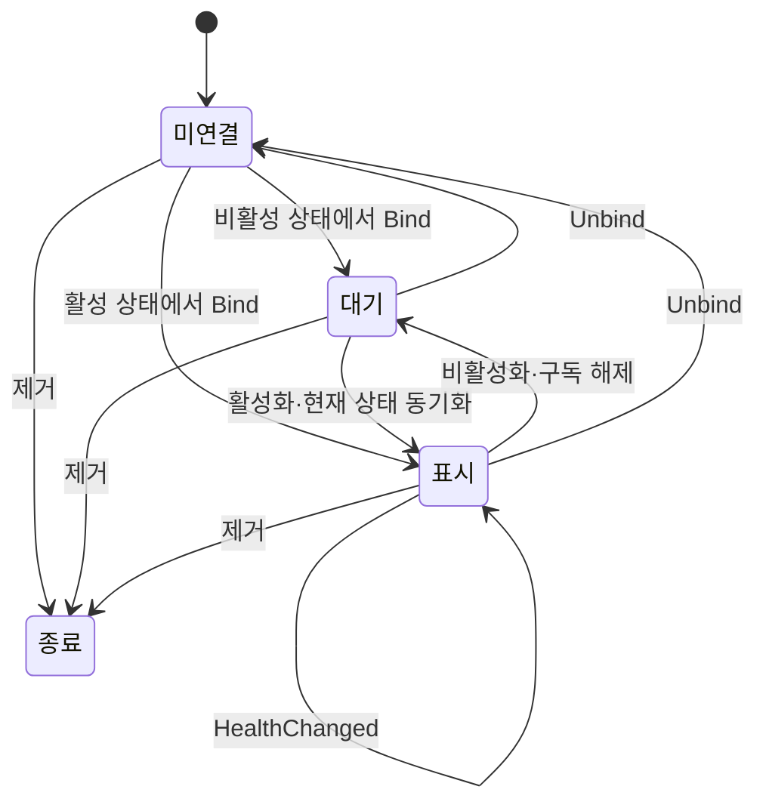
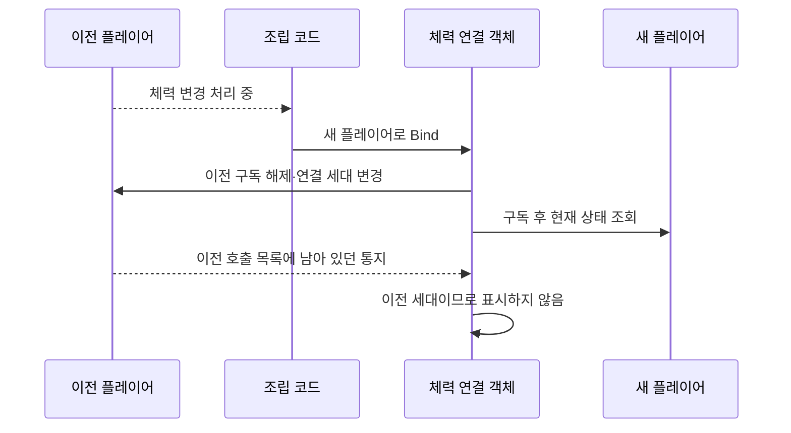
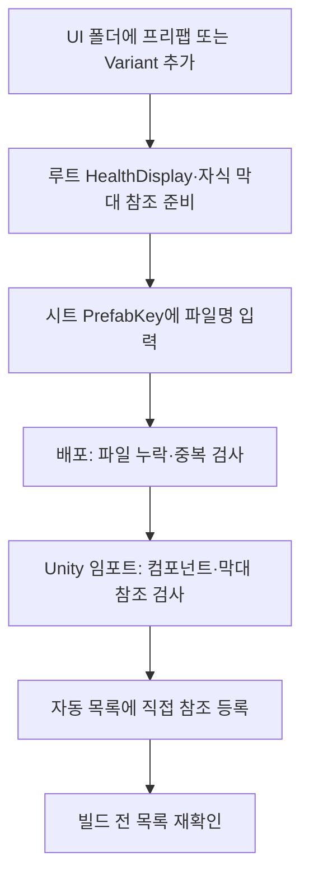
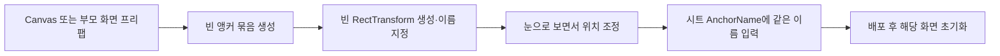
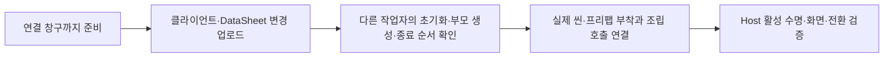

# 체력 표시 모듈 사용과 설계 안내

> 2026-11-04 최신 풀 점검: 공통 체력 표시와 앵커 API는 유지합니다. 테스트 HUD·보스 게이지·잔상 등 표현이 추가됐지만 최종 시안·아트 연결은 남았습니다. 과거 검사 개수는 당시 범위이며 최신 전체 결과를 대신하지 않습니다. 전체 상태는 [현재 구현과 검증 현황](%ED%98%84%EC%9E%AC%20%EA%B5%AC%ED%98%84%EA%B3%BC%20%EA%B2%80%EC%A6%9D%20%ED%98%84%ED%99%A9.md), 우선순위는 [남은 작업](%EB%82%A8%EC%9D%80%20%EA%B5%AC%ED%98%84%EA%B3%BC%20%EA%B2%80%EC%A6%9D%20%EC%9E%91%EC%97%85.md)을 따릅니다.

작성일: 2026-11-02. **플레이어 체력 표시·연결 수명·재사용 프리팹·설정 테이블 연결**을 설명합니다.
기획자는 1~3절, 개발자는 4절 이후를 함께 읽으면 됩니다.
실제 Unity 실행 순서는 [앵커 체력 표시 테스트 안내](../%EA%B8%B0%ED%9A%8D%EC%9E%90%EC%9A%A9%20%EC%95%88%EB%82%B4%EB%AC%B8%EC%84%9C/%EC%95%B5%EC%BB%A4%20%EC%B2%B4%EB%A0%A5%20%ED%91%9C%EC%8B%9C%20%ED%85%8C%EC%8A%A4%ED%8A%B8%20%EC%95%88%EB%82%B4.md)를 따릅니다. 2026-11-02 사용자가 직접 실행해 통과했다고 전달했습니다. 현재 MapDohwagolTest의 HealthDisplayHost 연결은 있으며 최종 화면·실제 실행 확인은 별도입니다.
이번 모듈은 기존 전투 규칙을 변경하지 않습니다.

## 1. 무엇이 만들어졌나요?



| 준비된 것 | 역할 |
| --- | --- |
| HealthDisplay | 화면 막대 갱신, 활성·비활성·제거 시점 연결 |
| HealthDisplayBinding | 플레이어 연결·해제, 이벤트 구독, 오래된 호출 거부 |
| PlayerHealthBar.prefab | 배경과 막대 내부 참조가 연결된 재사용 UI |
| HealthDisplayConfig | 표시 행의 프리팹·앵커 이름·크기·사용 여부 |
| SpawnAnchors | 전달받은 씬·부모 인스턴스 안에서 앵커 이름 연결 |
| HealthDisplayPrefabs | 에디터가 자동 수집하는 프리팹 참조 목록 |
| HealthDisplayGroup | 설정 전체를 읽어 생성·연결·활성화하고 자신이 만든 표시를 정리 |
| HealthDisplayHost | 씬 조립자가 호출할 Connect·Disconnect와 컴포넌트 활성 수명 연결 |
| 수명 검사 20개 | 준비 전 접근·재연결·해제·대상 교체의 경계 확인 |

현재 대상은 **PlayerActor 하나**입니다. 몬스터·보스용 표시나 통합 HUD 전체가 아닙니다.
씬을 검색하거나 자동으로 플레이어를 선택하지 않습니다. 개발자가 표시할 플레이어를 전달합니다.
프리팹은 Canvas 밑에 넣는 UI 부품입니다. Canvas 자체는 포함하지 않습니다.
이번 작업은 기존 씬·캐릭터 프리팹에 새 표시를 자동 부착하지 않았습니다.

## 2. 기획자는 무엇을 조절할 수 있나요?

| 변경할 것 | 어디에서 하나요? |
| --- | --- |
| 플레이어 최대 HP | 기존 DataSheet의 공통 스탯 연결을 따름. 현재 스탯 원본은 UnitStat의 HP |
| 체력바 크기·표시 여부·앵커 선택 | DataSheet의 HealthDisplayConfig.xlsx, 같은 이름의 탭 |
| 실제 배치 위치 | 씬 또는 부모 프리팹 안의 빈 앵커 오브젝트 |
| 사용할 체력바 외형 | 같은 탭의 PrefabKey에 프리팹 파일명 입력 |
| 막대 색상·이미지 | 프리팹의 체력 막대 자식에 있는 Image |
| 배경 색상·이미지 | 프리팹 루트의 Image |

공통 원본 프리팹을 수정하면 이를 사용하는 화면에 영향을 줄 수 있습니다.
다른 화면만 바꾸려면 개발자와 프리팹 Variant 사용 여부를 확인하세요.
HP를 바꾸는 것은 데이터 작업이고, 현재 체력을 바꾸는 것은 게임 동작입니다.
막대 길이를 손으로 줄여 현재 체력을 표현하지 않습니다.

크기는 그룹 생성 시 시트 값으로 적용합니다. 위치는 AnchorName으로 지정한 빈 오브젝트를 따릅니다.
색상·이미지는 프리팹에서 조절합니다. 지원하지 않는 표시 종류를 새 행만으로 구현할 수는 없습니다.



| 컬럼 | 예시 | 기획자가 바꾸는 결과 |
| --- | --- | --- |
| ID | 1 | 행 고유 번호. 다른 행과 겹치지 않는 양의 정수 |
| PrefabKey | PlayerHealthBar | 확장자를 제외한 프리팹 파일명. 대소문자 구분 |
| Width·Height | 240·20 | 가로·세로 크기. 양의 정수 |
| AnchorName | PlayerHealthAnchor | 해당 인스턴스 안에 배치한 빈 RectTransform 이름 |
| Visible | Y | Y면 생성, N이면 생성하지 않음 |

너비·높이는 Canvas 기준 UI 단위입니다. 맵의 타일×100 좌표와 다르며 실제 픽셀 크기는 Canvas 배율에 따라 달라집니다.
위치는 앵커를 눈으로 보면서 옮깁니다. Width를 320으로 수정하면 다음 초기화에서 더 넓어지고, Visible=N이면 생성하지 않습니다.
행을 추가하면 같은 플레이어를 표시하는 체력바가 하나 더 생깁니다. 다른 캐릭터를 선택하는 행은 아닙니다.
행 삭제도 다음 초기화에서 반영합니다. 데이터 영역 중간의 ID를 비워두면 그 아래 행은 추출되지 않습니다.
게임 실행 중 엑셀만 저장해 화면이 즉시 바뀌는 기능은 없습니다. 저장·배포·Unity 반영·다시 초기화가 필요합니다.

## 3. 화면에서 확인할 때



프리팹 위치는 **Assets/2.Model/Prefabs/UI/PlayerHealthBar.prefab**입니다.
연결하기 전에는 막대가 비어 있고, 플레이어를 연결하면 현재 체력이 표시됩니다.
플레이어가 피해를 받아 체력이 바뀌면 표시가 갱신됩니다.
사망해서 체력이 0이면 막대가 비어도 배경은 남습니다.

화면이 보이지 않으면 다음 내용을 개발자에게 알려주세요.

```text
확인한 씬 이름:
Canvas 아래 체력바를 넣었나요?: 예 / 모르겠음
게임을 시작했을 때 표시:
피격 후 표시:
숨겼다가 다시 켰을 때 표시:
콘솔 오류 또는 화면:
```

기획자가 C# 코드·연결 필드·생성 클래스를 직접 고칠 필요는 없습니다.
막대 자식의 앵커·너비 설정이나 HealthDisplay의 체력 막대 영역 참조는 임의로 바꾸지 마세요.

## 4. 왜 이런 구조와 위치인가요?

| 위치 | 설계 이유 |
| --- | --- |
| Assets/3.Script/Presentation/HealthDisplay.cs | Unity 화면만 조작. Core에 UI 의존성을 넣지 않음 |
| 같은 폴더의 HealthDisplayBinding.cs | Unity와 분리된 작은 수명 객체. 실제 PlayerActor 이벤트로 순서·해제를 검사 |
| Assets/2.Model/Prefabs/UI/PlayerHealthBar.prefab | 기존 프리팹 경로를 유지하고 UI를 재사용 단위로 관리 |
| Tools/Locomotion.Checks/HealthDisplayChecks.cs | 기존 코어 검사 실행 경로에 연결 수명 회귀 검사를 추가 |
| Presentation/HealthDisplayGroup.cs | 설정 적용·프리팹 생성·구독·정리를 한 진입점으로 묶음 |
| Adapters/SpawnAnchors.cs | 실제 Transform 이름을 연결하는 공통 엔진 경계. UI·월드 기능에서 재사용 |
| Presentation/HealthDisplayPrefabs.cs | 실행 중 파일 검색 없이 프리팹 직접 참조 |
| Assets/Editor/Data/HealthDisplayPrefabBuilder.cs | 수집·Unity 구성 검사는 에디터에 두어 플레이 코드와 분리 |

표시 대상·동작이 하나인 첫 단계이므로 별도 인터페이스·범용 이벤트 버스·퍼사드·관리자를 추가하지 않았습니다.
Binding은 화면 대상과 구독 수명만 소유하고 피해·최대 HP·게임 진행을 소유하지 않습니다.
단일 표시 수명은 기존 연결 객체가 맡고, 여러 표시의 조립만 그룹이 담당합니다.
변형 프리팹으로 외형을 바꾸는 경우 같은 코드를 재사용할 수 있습니다.

## 5. 개발자가 연결하는 방법

일반적인 데이터 연결은 다음 진입점을 사용합니다. 데이터는 CSV 다음 JSON까지 전체 준비된 카탈로그이며, 플레이어와 앵커를 포함한 화면 인스턴스도 준비된 상태여야 합니다.

```csharp
// 외부 조립자가 데이터·플레이어·부모 화면 준비를 확인한 뒤 호출합니다.
_healthHost.Connect(data, prefabs, player, anchorRoot);

// 대상 교체·부모 반환·화면 종료 전에 참조와 소유 표시를 모두 정리합니다.
_healthHost.Disconnect();
```

_healthHost는 HealthDisplayHost 컴포넌트 참조입니다. 전달할 prefabs는 **Assets/Data/HealthDisplayPrefabs.asset**, anchorRoot는 생성 완료된 인스턴스 안의 앵커 묶음입니다.
HealthDisplayHost는 Assets/3.Script/Presentation에 구현했습니다. UI 생성 수명만 맡으므로 데이터 로더·플레이어 초기화·전역 관리자를 새로 만들지 않았습니다.
**현재는 연결 구조만 준비했습니다. 기존 씬·프리팹 부착과 조립자의 호출 추가는 작업 업로드 및 다른 작업자 코드 확인 후 진행합니다.**
앵커는 Canvas 아래의 빈 RectTransform입니다. 위치는 시트가 아닌 앵커를 옮겨 조절합니다.
부모 프리팹을 먼저 생성하는 경우에는 생성 완료 후 **그 인스턴스 내부**의 앵커 묶음을 사용합니다. 원본 프리팹 에셋을 전달하지 않습니다.
같은 부모 프리팹의 여러 인스턴스는 서로 다른 SpawnAnchors를 사용합니다. 자세한 준비 순서는 [앵커 배치 안내](../%EA%B8%B0%ED%9A%8D%EC%9E%90%EC%9A%A9%20%EC%95%88%EB%82%B4%EB%AC%B8%EC%84%9C/%EC%95%B5%EC%BB%A4%20%EA%B8%B0%EB%B0%98%20%ED%94%84%EB%A6%AC%ED%8C%B9%20%EB%B0%B0%EC%B9%98%20%EC%95%88%EB%82%B4.md)를 따릅니다.
이 직접 참조로 프리팹이 빌드에 포함됩니다. 에셋 파일이 폴더에 있다는 사실만으로 모든 빌드에 포함되지는 않습니다.
씬 조립자가 Connect를 호출합니다. 기존 GameplayPreview에는 이번 그룹을 자동 부착하지 않았습니다.
Host가 비활성인 상태에서 Connect하면 의존성만 보관하고 활성화 때 생성합니다. 임시 비활성화는 표시만 정리하고 재활성화 때 보관한 의존성으로 다시 생성합니다.
대상 교체·반환·영구 종료에서는 Disconnect를 호출해 보관한 참조도 지웁니다. 단순 화면 숨김만 필요하면 앵커의 부모 화면을 비활성화하고 Host는 유지할 수 있습니다.
Connect 중 생성 실패는 정리 후 호출자에게 예외를 전달합니다. 재활성화 중 실패는 정리 후 한글 오류를 기록하며 IsConnected는 거짓입니다.
IsConnected는 생성 그룹이 있다는 뜻이며, 설정이 비어 있어 실제 표시가0개여도 참일 수 있습니다. 게임 전체 준비 완료를 뜻하지 않습니다.
Create는 Visible=Y인 모든 행을 한 번 읽습니다. 행마다 ID 등록 코드를 추가하거나 매 프레임 호출하지 않습니다.
Create 실패는 화면 소비자 처리 실패입니다. 이미 준비된 데이터 카탈로그를 실패 상태로 되돌리거나 다시 로딩하지 않습니다.



앵커나 부모 화면이 비활성이라면 실제 구독은 해당 경로가 활성화될 때 시작합니다.
표시의 피벗이 앵커의 위치에 놓이며 앵커 아래 자식으로 생성되므로 이동·회전·배율을 함께 따릅니다.
이름을 찾지 못하거나 같은 범위에 해당 이름이 중복되면 실패합니다. 자동으로 원점에 표시하지 않습니다.
생성 중 실패하면 중간에 만든 객체도 정리합니다. 그룹을 교체할 때 이전 그룹은 호출자가 먼저 Dispose합니다.
반복 Dispose는 안전하며 외부 Canvas·앵커·플레이어·원본 프리팹을 파괴하지 않습니다. 자신이 만든 자식만 정리합니다.
Unity Destroy는 지연되므로 즉시 비활성화·구독 해제한 다음 제거를 요청합니다.
비동기 화면 전환의 취소·세대 판단은 호출자가 맡습니다. 늦게 도착한 결과로 Connect하지 않도록 확인해야 합니다.

단일 프리팹을 직접 재사용할 때는 아래 Bind 방법도 사용할 수 있습니다. 같은 화면에 그룹 경로와 직접 배치 경로를 중복 연결하지 않습니다.

플레이어 Runtime의 초기화가 완료된 뒤 **HealthDisplay.Bind(playerRuntime.Actor)**를 호출합니다.
Actor가 null인 상태로 호출하지 않습니다. 준비 전이면 Runtime의 Initialized를 구독하고 현재 Actor도 확인합니다.

```csharp
using HumanGhost.Gameplay;
using HumanGhost.Gameplay.Adapters;
using HumanGhost.Gameplay.Presentation;
using UnityEngine;

// 장면의 조립 코드에 적용하는 예시입니다. 이 클래스 파일을 별도로 생성한 것은 아닙니다.
public sealed class PlayerHealthConnection : MonoBehaviour
{
    [SerializeField] private PlayerRuntime _player = null;
    [SerializeField] private HealthDisplay _display = null;

    private void OnEnable()
    {
        _player.Initialized += OnPlayerReady;
        if (_player.Actor != null) OnPlayerReady(_player.Actor);
    }

    private void OnPlayerReady(PlayerActor actor)
    {
        if (isActiveAndEnabled && _display != null) _display.Bind(actor);
    }

    private void OnDisable()
    {
        if (_player != null) _player.Initialized -= OnPlayerReady;
        if (_display != null) _display.Unbind();
    }
}
```

예시의 _player·_display는 Inspector에서 연결하고 이 조립 코드를 Runtime·표시보다 먼저 제거할 수 있게 수명을 관리합니다.
하나의 체력바에는 조립 소유자 하나만 둡니다. 여러 소유자가 번갈아 Bind·Unbind하지 않습니다.
IsBound는 표시 대상 참조가 있다는 뜻입니다. 비활성 중에도 참일 수 있으며 게임 전체 준비 완료나 화면 활성 상태를 뜻하지 않습니다.
외부 Runtime의 Initialized는 최초 연결용이고 실제 체력 갱신은 Actor.HealthChanged를 사용합니다.
직접 매 프레임 Bind를 호출하지 않습니다.

| 함수 | 언제 호출하나요? |
| --- | --- |
| HealthDisplayHost.Connect | 준비된 데이터·프리팹 목록·플레이어·부모 앵커를 전달할 때 |
| HealthDisplayHost.Disconnect | 대상 교체·반환·영구 종료 전에 표시와 보관 참조 정리 |
| HealthDisplay.Bind | 준비된 플레이어를 최초 연결하거나 다른 플레이어로 교체할 때 |
| HealthDisplay.Unbind | 풀 반환·스테이지 인계·연결 소유자 종료 전 |
| HealthDisplayBinding.SetActive | 컴포넌트가 활성 상태 변경을 전달. 일반 조립자는 직접 사용할 필요 없음 |
| HealthDisplayBinding.Dispose | 컴포넌트 제거 시 최종 종료. 종료 객체 재사용 금지 |

프리팹을 만든 직후 내부 참조가 없는 상태로 활성화하지 않습니다. 제공 프리팹은 내부 참조를 미리 연결했습니다.
Canvas와 PlayerRuntime은 외부 소유 자원이므로 표시 컴포넌트가 생성·초기화·파괴하지 않습니다.
씬의 입력 허용·게임 준비 완료 여부는 기존 조립자가 결정합니다.

## 6. 이벤트 갱신과 수명 순서



**Update·LateUpdate는 없습니다.** 최초 연결·재활성화 때 현재 값을 맞추고 체력 변경 이벤트 때만 화면을 갱신합니다.
유휴 상태에서 매 프레임 문자열·비율을 계산하지 않습니다.
화면 너비로 바꾸는 경계에서만 정수 HP를 비율로 변환하며 게임 수치는 변경하지 않습니다.
같은 대상을 다시 연결하면 기존 구독을 끊고 한 벌만 연결합니다.
비활성화하면 대상 참조는 보관하고 구독만 해제합니다. 재활성화하면 비활성 중 달라진 최신 값을 읽습니다.
단순히 컴포넌트만 끄면 기존 막대는 화면에 남을 수 있으므로 화면을 숨길 때는 해당 GameObject 또는 부모 화면을 비활성화합니다.
풀에 반환할 때는 단순 비활성화에 그치지 말고 **Unbind 후 비활성화**해 이전 대상 참조를 제거합니다.



이벤트 발행 도중 연결을 교체해도 이전 호출 목록의 통지는 새 화면을 덮어쓰지 않습니다.
생성·Bind·활성화의 순서가 달라도 대상과 활성 상태가 모두 준비되기 전에는 표시 갱신을 시작하지 않습니다.
제거된 Unity 컴포넌트에 새 Bind 요청은 오류로 거부합니다.
초기 표시에서 예외가 발생하면 구독을 정리하고 연결을 비활성 상태로 바꿉니다. 상위 호출자가 오류를 처리해야 합니다.

## 7. 다른 개발자가 유의할 점

- 모든 연결·UI 접근·현재 코어 이벤트는 Unity 주 실행 흐름에서 사용합니다. 멀티스레드 동기화 기능은 아닙니다.
- 같은 플레이어의 데이터와 코어 HP를 단일 원본으로 사용합니다. 표시용 현재 HP를 별도 저장하지 않습니다.
- 최대 HP는 현재 읽기 전용 Player.Definition.HP입니다. 장비·버프로 최대 HP가 바뀌는 기능은 별도 계약이 필요합니다.
- 빈 대상은 잘못된 Bind 요청으로 거부합니다. 대상을 지우려면 Unbind를 호출합니다.
- 이미지의 RectTransform을 직접 줄이지 말고 표시 컴포넌트가 너비 앵커를 소유하게 합니다.
- 이 모듈은 외부 비동기 작업을 시작하지 않습니다. 늦은 비동기 Bind 요청 자체의 세대·소유자 검사는 호출자가 책임집니다.
- 연결 세대는 이미 발행된 체력 이벤트의 오래된 콜백을 차단하는 범위입니다. 전체 씬 로딩의 세대 제어가 구현된 것은 아닙니다.
- 기존 Preview 이름표·확률 타격·공격 창 이벤트는 변경하지 않았습니다. 같은 UI를 두 표시 경로가 함께 수정하지 않게 합니다.
- 체력바는 플레이어를 파괴·저장·부활시키지 않습니다. GameObject 프리팹화와 코어 재사용 정책은 별개입니다.

## 8. 검증 결과와 이번 단계의 한계

2026-11-02 앵커 방식 전환 후 **데이터659개·코어310개·DataSheet48개**를 통과했습니다. 기존 체력 수명 검사20개는 유지합니다.
데이터 검사에 AnchorName 문자열 변환을 포함했으며, 실제 Unity 앵커 탐색·배치 실행을 검증한 결과는 아닙니다.
코어에는 기존290개와 체력 표시 수명20개가 포함됩니다.
새 표현 코드와 관련 순수 코어의 Unity 모듈 참조 컴파일은 경고0개·오류0개로 통과했습니다.
기존 Unity Roslyn·Mono 검사 경로에서도 코어310개가 통과했습니다.

| 검사 내용 | 결과 |
| --- | --- |
| 대상 준비 전 갱신 차단·최초 현재 HP 표시 | 통과 |
| 같은 대상 재연결·반복 활성화 | 중복 호출 방지 확인 |
| 비활성 중 대상 교체·재활성화 | 최신 값 반영 확인 |
| 이전 대상 변경·해제·중복 종료 | 분리·정리 확인 |
| 이벤트 발행 중 대상 교체·재활성화 | 오래된 호출 차단 확인 |
| 종료 후 재사용·null 대상·최초 표시 실패 | 오류·정리 확인 |

실제 Unity 메뉴 검사 통과는 사용자 확인으로 기록했습니다. 운영 씬의 Canvas 최종 화면·플레이어 빌드는 아직 확인하지 않았습니다.
프리팹 내부 참조·스크립트 GUID는 정적으로 확인하며 엔진 실행 확인을 대신하지 않습니다.
이번 검사는 체력 변경 연결의 수명 검사이며 전체 씬 로딩·풀 시스템의 안전성을 보장하지 않습니다.
표현 테이블·파일명 키 수집·그룹 생성 API까지 구현했습니다. 보스/몬스터 HUD·숫자/언어 표시·연출 재생·실제 씬 연결은 후속 범위입니다.

## 9. 프리팹 추가와 오류 확인



수집 위치는 **Assets/2.Model/Prefabs/UI와 하위 폴더**입니다. 키는 확장자 없는 파일명이고, 하위 폴더가 달라도 같은 이름을 쓰지 않습니다.
HealthDisplay는 프리팹 루트에 두고 루트는 RectTransform이어야 합니다. 루트와 컴포넌트를 활성 상태로 저장하고 _fill에는 별도 자식 RectTransform을 연결합니다.
일반 UI 프리팹도 같은 폴더에 둘 수 있지만 HealthDisplay가 없으면 체력 표시 목록에는 등록되지 않습니다.
Visible=N인 행도 참조 프리팹은 존재해야 합니다. 숨김은 잘못된 참조를 허용한다는 뜻이 아닙니다.
자동 갱신 결과는 Assets/Data/HealthDisplayPrefabs.asset입니다. 직접 목록을 고치지 않습니다.
임포트·에디터 시작·빌드 전 갱신 진입점은 기존 GameDataAssetBuilder로 일원화했습니다. 체력 표시 목록 수집 자체는 별도 도우미가 맡습니다.
필요하면 **인귀 → 데이터 → 체력 표시 프리팹 목록 갱신** 메뉴를 사용합니다.

| 오류 | 처리 |
| --- | --- |
| 배포 중 프리팹 없음 | 시트 키·파일명·양쪽 저장소 최신화 확인 |
| 중복 파일명 | 이름을 구분하고 해당 시트 키도 함께 수정 |
| 에디터의 루트·자식 막대·활성 설정 오류 | 개발자가 프리팹 내부 연결 수정 |
| 생성 API에서 목록에 키가 없음 | 에디터 오류를 먼저 해결하고 목록 갱신 |

숫자·중복 ID·시트 값 검사는 DataSheet에서 수행합니다. 클라이언트 실행 중에 CSV 검사를 다시 수행하지 않습니다.
에디터 검사는 Unity 프리팹의 구조와 실제 컴포넌트 연결을 확인하는 범위입니다.
예상 효과는 기획자의 크기·위치·외형 선택 변경에 필요한 C# 수정을 줄이고, 새 표시 행마다 수동 등록하는 일을 없애는 것입니다.

## 10. 기획자 앵커 배치 순서



기본 행의 앵커 이름은 **PlayerHealthAnchor**입니다. 앵커와 호출용 이름은 영문 ASCII로 작성합니다.
앵커는 여러 단계 아래에 있어도 되지만 선택할 이름은 전달받은 범위 안에서 하나여야 합니다.
같은 앵커에 여러 행을 지정하면 표시가 겹칩니다. 별도 위치가 필요하면 앵커를 추가합니다.
앵커를 지우거나 이름을 바꾸면 시트도 함께 수정합니다. 앵커 변경 후에는 묶음을 다시 수집합니다.
부모를 먼저 제거해도 Unity 컴포넌트 제거 시 구독은 해제하지만, 정상 종료 순서는 자식 그룹 Dispose 다음 부모 반환·제거입니다.
부모 프리팹 생성·앵커 연결·이벤트·정리를 포함한 Play 메뉴 검사는 사용자 직접 실행 결과로 통과 확인했습니다. 아트·해상도별 최종 출력과 운영 씬 연결 검증은 별도입니다.

다음 작업은 이번 기능을 확인받은 뒤 결정합니다.
예상 효과는 매 프레임 불필요한 표시 작업과 재연결 구독 오류를 줄이고 프리팹 외형을 같은 코드로 재사용하는 것입니다.
프레임 비용 감소량은 아직 측정하지 않았습니다.

## 11. 현재 반영 순서와 업로드 범위



| 저장소 | 함께 공유할 변경 |
| --- | --- |
| Human_Ghost- | 표현·앵커·Host 코드, 프리팹과 메타 파일, 데이터 정의·CSV·자동 로딩 계획·배포 목록, 에디터 수집·검사, 회귀 검사, 문서 |
| DataSheet | HealthDisplayConfig 원본 엑셀, 추출·배포 검사 소스와 DeployData.exe, 기획자 가이드·README |

실제 씬 연결 전에는 다른 작업자의 데이터 완료 통지·PlayerRuntime 초기화·부모 화면 생성 및 제거 시점을 확인합니다.
Host는 이미 준비된 값을 받는 창구이며 GameDataInitializer나 PlayerRuntime을 임의로 실행하지 않습니다. 비동기 결과의 취소·유효한 소유자 확인은 호출자가 맡습니다.
Host는 부모·플레이어보다 먼저 Disconnect합니다. 풀 반환 후 다른 대상에 쓸 때는 새 의존성으로 Connect합니다.
새 Host의 Unity 모듈 참조 컴파일은 경고·오류0개로 확인했습니다. 이전24개 메뉴 검사 통과는 기존 그룹 검사 결과이며 새 Host의 실제 Play 검증은 후속입니다.
