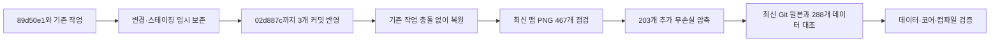
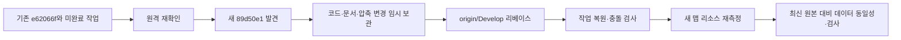
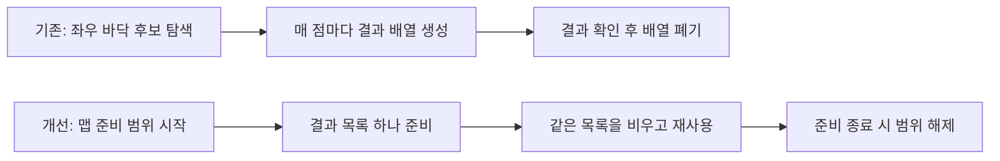
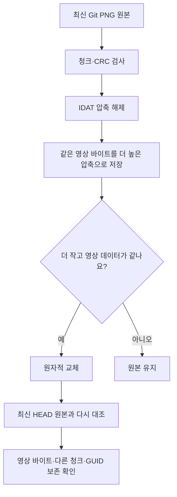

# 최신 Git 반영과 코드·리소스 개선 비교

> **아트 공동 기여:** 공급된 원본 아트의 제작·Git 외부 파일 전달에는 아트 담당자가 함께 참여했습니다. 아래 리소스 가공·프리팹·애니메이션·화면 연결 이력과 원본 제작 기여를 구분합니다. 미공급 전용 자산은 완료로 표기하지 않습니다. [작업자·커밋 기준](현재%20구현과%20검증%20현황.md#5-작업자별-역할과-git-근거)

이 문서의 리소스 측정일은 2026-11-12이며 당시 기준 커밋은 `02d887c370c4517301ebb27461de30353ee445c3`입니다. 기능의 전체 사용법은 [통계 조회 안내](../기획자용%20안내문서/통계%20콘솔%20조회와%20엑셀%20다운로드%20안내.md), 리소스 육안 확인은 [리소스 확인 안내](../기획자용%20안내문서/최신%20맵과%20리소스%20압축%20확인%20안내.md)를 봅니다.

현재 로컬은 7d13442이며 이후 NPC·로딩 그림·신규 데이터가 추가됐습니다. 아래 절감량은 02d887c 대비 측정 기록이며 현재 전체 용량을 다시 측정한 결과가 아닙니다. [현재 현황](현재%20구현과%20검증%20현황.md)을 우선합니다.

## 목차

1. [최신 보스방 반영 후 재점검](#최신-보스방-반영-후-재점검)
2. [최신화 과정과 보존 범위](#1-최신화-과정과-보존-범위)
3. [프로젝트 규칙과 점검 범위](#2-프로젝트-규칙과-점검-범위)
4. [코드의 기존 방식과 변경 이유](#3-코드의-기존-방식과-변경-이유)
5. [리소스 압축 방식](#4-리소스-압축-방식)
6. [최신 기준의 측정 결과](#5-최신-기준의-측정-결과)
7. [검토 후 유지한 부분](#6-검토-후-유지한-부분)
8. [검증 결과와 남은 확인](#7-검증-결과와-남은-확인)

## 최신 보스방 반영 후 재점검

원격의 보스방 맵·발판 점프 수정·불꽃과 깃발 애니메이션을 유지했습니다. 이번 원격 변경에는 `Assets/Data` 변경이 없습니다. 기존 배열 할당 절감 코드와 통계 작업은 복원했고, 새 발판 이동 연결은 그대로 유지했습니다. 프리팹·애니메이션·충돌 처리 코드에는 최신 HEAD 대비 추가 변경이 없습니다.

| 구분 | 이전 | 이번 결과와 이유 |
| --- | --- | --- |
| 기준 원본 | 89d50e1 | 02d887c. 새 맵을 이전 그림으로 덮어쓰지 않도록 최신 원본을 사용 |
| 추가 압축 | 기존 결과만 보유 | Kits9 PNG 467개 중 203개 변경, 이번 실행에서 3,198,173 B 추가 절감 |
| 최신 원본 대비 누적 | 과거 결과와 혼동 가능 | 변경 PNG 288개: 132,202,214 → 125,546,813 B, 총 6,655,401 B(약 6.35MiB) 절감 |
| 그림과 연결 | 최신 원본 | 변경된 288개 모두 압축 해제 데이터·IDAT 밖 청크 동일. 해상도·투명도·메타데이터 보존 |
| 검사 | 과거 실행 결과 | 최신 기준 데이터 5,529개·코어 1,330개 통과, 엔진 참조 컴파일 경고·오류 0개, PNG 도구 검사 2개 통과 |

PNG 도구는 `Tools/Resources`에 두어 게임 실행과 분리합니다. 이미지 내부 압축만 바꾸므로 기획 데이터나 GUID를 바꿀 필요가 없고 반복 실행해도 더 작아지는 파일만 교체합니다. 저장 파일 용량 절감이며 VRAM·프레임·최종 빌드 크기 개선을 입증한 결과는 아닙니다. 실제 Unity 플레이와 빌드는 별도 확인해야 합니다.

[이번 압축 실행 기록](2026-11-12%20최신%20보스방%20PNG%20압축%20결과.md)과 [최신 Git 대비 파일별 동일성·절감 근거](2026-11-12%20보스방%20반영%20후%20Git%20대비%20리소스%20절감%20요약.md)를 구분합니다. 기존 압축 파일의 현재 크기에서 다시 절감한 수치와 최신 HEAD 대비 누적 수치를 더하지 않습니다. 복구용 `codex/pre-rebase-20261112-data-refresh` 브랜치와 임시 보관본을 유지했습니다. 커밋·푸시는 하지 않았습니다.

아래는 이전 89d50e1 기준 점검 기록입니다. 현재 결과는 위 항목을 우선합니다.

## 1. 최신화 과정과 보존 범위

첫 fetch에서는 같은 커밋이었고, 사용자의 재확인 요청 뒤 새 커밋 하나가 확인됐습니다. 작업을 Git stash에 보존한 뒤 HYT/work를 리베이스하고 복원했습니다. 충돌은 없었고, 원격의 3번 맵 프리팹·플랫폼 연결·추가 애니메이션은 유지했습니다. 백업 브랜치 `codex/pre-rebase-20261112-telemetry`와 이름에 ‘Firebase 통계 작업과 무손실 압축 보존’이 있는 임시 보관본은 복구용으로 남깁니다. 새 작업 커밋·푸시는 수행하지 않았습니다.

## 2. 프로젝트 규칙과 점검 범위

Assets/3.Script의 254개 C# 파일을 대상으로 반복 탐색·비동기 진입·이벤트·수명 관련 정적 검색을 수행하고, 실제 수정 경계인 통계·전송·맵 준비·저장 조립자의 호출 흐름을 추적했습니다. 30개의 Update 계열 콜백은 발견 여부만으로 오류로 취급하지 않았습니다. 이동·충돌·애니메이션·진행 중 연출의 시간 처리는 이벤트로 없앨 수 없기 때문입니다.

전체 기능의 모든 수명 오류나 성능 문제를 해결했다는 뜻은 아닙니다. 기존 패링 흐름, 승인된 타이틀 직접 편집, 데이터·원본 프리팹 불변 원칙은 유지합니다. 측정 없는 범용 관리자·상속 계층·전역 이벤트 버스는 만들지 않았습니다.

## 3. 코드의 기존 방식과 변경 이유

| 기존 방식·발견 근거 | 문제의 원인과 영향 | 변경 방식·위치 | 왜 이 방식인가 |
| --- | --- | --- | --- |
| 몬스터 이동 구간 준비에서 OverlapPointAll을 좌우 각각 최대 800번 사용 | 매 조회의 결과 배열 생성. 발판을 찾는 로딩 단계에서 임시 할당 누적 | GameplayPreview.ApplyWalkableSpans 범위에서 List 하나를 만들고 OverlapPoint의 목록 오버로드에 전달 | 전역 캐시 수명이나 결과 개수 고정 제한 없이 기존 판정 유지. 준비 범위가 끝나면 참조 정리 |
| 시험 Firebase 코드에 인증·문자열 JSON·전송이 혼합 | 요청 주소 오류, 호출자가 기다릴 수 없는 async void, 토큰·수명 소유 불명확 | FireBase 폴더에서 기록·보관·Auth/REST·단일 전송 작업 분리 | 게임은 기존 이벤트만 제공. 외부 서비스 계약은 교체 가능 |
| 메모리 기록이나 로컬 열람 파일만으로 전송 성공을 표현 | 종료·통신 실패 시 재시도할 근거 부족 | TelemetryOutbox가 같은 이벤트 ID를 파일에 보존하고 전체 서버 확인 뒤 제거 | 보관 성공과 서버 저장 성공을 구분. 재전송은 같은 문서를 생성해 중복 방지 |
| 손상된 전송 파일을 같은 위치에서 계속 재시도할 가능성 | 한 파일이 뒤의 모든 정상 전송을 막음 | 손상 JSON을 Rejected로 이동하고 다음 파일 처리 | 데이터를 삭제하지 않으면서 실패 범위를 격리 |
| 이름 이동 직전에 앱이 종료되면 임시 파일이 남음 | 이미 쓴 정상 기록을 다음 실행에서 사용하지 못할 수 있음 | 시작 시 정상 임시 파일 복원·불완전 파일 격리 | 불필요한 파일을 방치하거나 정상 기록을 무조건 삭제하지 않음 |
| 로컬 열람 사본의 한도·쓰기 실패가 전송까지 막을 수 있음 | 별도 책임인 로컬 사본이 원격 수집을 중단 | 전송 대기 파일 확정 후 사본 실패는 ArchiveFailure로 보관 | 원본 기록이 영속 대기열에 있으므로 게임·전송을 계속할 수 있음 |
| 파일·토큰·Unity 객체 수명이 혼재할 가능성 | 종료 후 예약 또는 통신 결과가 빈 객체에 접근 | Host가 앱 수명을 소유하고 취소, 전송 작업은 Unity 객체 미참조 | 씬 이동과 관계없는 전송 수명 명확화 |
| 통계를 단순 이벤트 합계로만 확인 | 재화 소비·사망률·선택률을 잘못 해석할 가능성 | 순수 집계 모듈에서 지표별 분모·수량·고유 세션 계산 | 화면·그래프·xlsx가 같은 계산 사용 |
| 조회 상한과 추가 페이지를 표시하지 않으면 일부 기록이 전체처럼 보임 | 잘못된 기획 판단·버전 혼합 | 500개 페이지·5000개 상한·전체/부분 표시·버전 혼합 안내 | 무료 할당량과 데이터의 해석 범위를 동시에 드러냄 |
| 수집 초기화 일부가 실패해도 준비된 Recorder가 남을 수 있음 | 미완료 호스트에 게임 이벤트가 붙어 보관 없는 기록을 쌓음 | 공통 Release에서 구독·통신·시계를 정리하고 실패 시 Recorder 제거 | 정상 종료와 부분 초기화 실패의 정리 계약 일원화 |
| 엑셀 생성 도중 로그아웃·필터 변경 가능 | 늦게 끝난 파일이 이전 계정 자료를 내보내거나 새 날짜 이름으로 붙을 수 있음 | 생성 시작 조건을 고정하고 라이브러리 준비·파일 생성 완료 뒤 수명·조건 재확인 | 화면 조회와 다운로드에 같은 수명 원칙 적용 |
| 추가한 조회 의존성의 하위 패키지에 보안 권고 확인 | 불필요한 취약 버전을 유지할 이유 없음 | 호환 범위의 grpc-js·uuid 수정 버전 적용, lockfile 보존 | 전체 SDK를 과거 버전으로 강제 내리지 않고 실제 사용 기능 검사 |
| 조회 전용 화면에 실시간·오프라인 기능을 포함한 Firestore SDK 사용 | 쓰지 않는 기능이 기본 다운로드에 포함 | main.js를 Firestore Lite의 서버 조회로 변경 | 수동 조회 요구에 맞춰 기본 JS 약 552.09KB→198.18KB, 약 64.1% 감소 |

### 반복 물리 조회의 전후

몬스터 30개, 양방향 800단계, 단계당 2회 조회의 단순 상한은 96,000회입니다. 실제로는 벽·낭떠러지와 단축 평가로 훨씬 일찍 끝날 수 있으므로 이 수를 실제 발생 횟수나 프레임 시간으로 주장하지 않습니다. 새 목록도 초기 확장 비용은 있을 수 있습니다. 기본 레이어와 트리거 조회 정책, 캐릭터 제외·벽/바닥 판단·간격·최대 탐색 수는 유지했습니다. 실제 이동 구간의 육안 대조는 남아 있습니다.

## 4. 리소스 압축 방식

Tools/Resources/Optimize-Png.py는 PNG의 IDAT만 다시 압축합니다. 해상도·색상·투명도·필터·메타데이터·스프라이트 시트 구획을 변경하지 않습니다. 임포트 meta·GUID·슬라이스·애니메이션 참조도 변경하지 않았습니다. 움직이는 PNG는 제외하고 해제 데이터 한도를 둡니다. 기본은 점검만 하며 --apply를 지정했을 때만 더 작은 결과를 반영합니다. 손상 파일을 조용히 재작성하지 않습니다.

픽셀을 줄이거나 손실 포맷으로 바꾸지 않은 이유는 도트 표현·발 정렬·히트 이펙트·새 맵 애니메이션 품질을 보존하기 위해서입니다. 오디오 재인코딩·아틀라스 재구성·최대 텍스처 크기 축소는 이번에 일괄 적용하지 않았습니다. 원본 WAV·PNG 크기만으로 실제 빌드의 압축·VRAM 사용을 판단할 수 없기 때문입니다.

## 5. 최신 기준의 측정 결과

| 대상 | 점검 파일 | 변경 파일 | 원본 합계 | 반영 후 | 절감 |
| --- | ---: | ---: | ---: | ---: | ---: |
| Art_New의 4MB 이상 이미지 | 10 | 4 | 107,852,286 B | 105,801,348 B | 2,050,938 B |
| 최신 Kits9/03_Hyeopgok | 84 | 81 | 15,453,627 B | 14,047,337 B | 1,406,290 B |
| 점검 대상 합계 | 94 | 85 | 123,305,913 B | 119,848,685 B | **3,457,228 B / 약 3.30MiB / 2.80%** |

실제로 바뀐 85개 파일만의 합계는 76,345,577 B → 72,888,349 B입니다. 재측정 시 이미 압축한 배경을 다시 절감한 것으로 더하지 않았습니다. 최신 3번 맵 묶음 자체의 절감률은 약 9.10%입니다. 하늘_가로반복.png는 7,057,642 B → 5,772,107 B로 줄었습니다. 대상 밖의 모든 프로젝트 리소스를 최적화했다는 뜻은 아닙니다.

GitHub 프로젝트 검사에도 통계·xlsx·격리된 Firestore 규칙 검사와 PNG 계약 검사를 추가했습니다. 원격 저장소에 올린 뒤 새 워크플로 실행부터 적용됩니다. 로컬 통과와 원격 Actions 실행 통과는 구분합니다.

각 변경 파일을 최신 HEAD에서 다시 읽어 압축 해제한 영상 바이트가 완전히 같은지 비교했고, IDAT 밖의 청크도 동일했습니다. 이는 원본 파일의 무손실 절감이며 **GPU 메모리·드로콜·프레임 시간·최종 ZIP 용량 감소를 같은 수치로 보장하지 않습니다.** 새 게임 빌드가 필요합니다.

근거 파일:

- [최신 Git 대비 전체 검증](2026-11-12%20최신%20Git%20대비%20리소스%20절감%20요약.md)
- [배경 대상 결과](2026-11-12%20PNG%20무손실%20압축%20결과.md)
- [최신 3번 맵 결과](2026-11-12%20최신%203번맵%20PNG%20압축%20결과.md)

## 6. 검토 후 유지한 부분

| 항목 | 유지한 이유 |
| --- | --- |
| 게임 이동·전투·애니메이션의 Update/Tick | 진행 중 시간과 물리 관측은 필요. 변경이 없는 UI 갱신과 같은 방식으로 제거하지 않음 |
| 컷씬·저장 조회의 기존 취소·세대/수명 검사 | 실제 파일·리소스 준비에 필요한 비동기이며 기존 보호 계약을 보존 |
| 준비 단계의 프리팹 내부 검색 | 범위가 명시되고 한 번 수행되는 조립. 매 프레임 전체 검색으로 오해하지 않음 |
| 매복 발동 목록 | 발동 후 목록에서 제거하는 기존 계약이 있어 같은 대상을 계속 활성화하지 않음 |
| 중복처럼 보이는 과거·신규 아트 폴더 | 참조·작업 중 원본 여부를 모르는 상태에서 삭제·GUID 합치기를 하면 다른 작업 손상 가능 |
| 오디오·텍스처 손실 임포트 설정 | 빌드 보고서·청취·도트 품질 대조 없이 일괄 축소하지 않음 |

## 7. 검증 결과와 남은 확인

최신 기준 데이터 5,529개·코어/전송/연결 1,330개와 엔진 참조 컴파일 경고·오류 0개를 확인했습니다. 통계 집계·실제 xlsx 왕복 Node 검사 8개, Firestore 에뮬레이터 권한·REST 재전송 4개, PNG 계약 검사 2개가 통과했습니다. 실행 의존성 npm audit에서 알려진 취약점은 0개였습니다. Vite 빌드는 통과하며 엑셀 라이브러리 묶음의 크기 경고가 남습니다. 엑셀은 다운로드할 때만 로드합니다. 기본 조회 JS는 Lite로 줄였으며 gzip 전송 추정치도 167.00KB→61.59KB로 줄었습니다. 이는 게임 리소스 절감량과 별개입니다.

Unity Play·전체 게임 빌드·최소 사양 프레임 측정·실제 Firebase 프로젝트 전송·웹 로그인 검증은 아직 수행하지 않았습니다. 브라우저 UI 자동 검증은 현재 주소 확인 제한으로 중단됐습니다. 운영 규칙·Hosting·팀원 허용 목록도 게시하지 않았습니다. 검증하지 않은 범위를 ‘정상 동작 완료’로 표현하지 않습니다.
