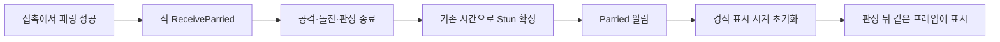

# 캐릭터 상태 애니메이션 연결 설계

2026-11-09. `State.csv`의 ID/Key를 검증하고 기존 StateKey→AnimationClip 참조를 각 표시 컴포넌트에 연결했습니다. 데이터 정의·상태 전환·타격·이동 판정은 변경하지 않습니다. 사다리의 폐루프·방향/정지는 [이동 설계](발판%20내려가기와%20사다리%20이동%20설계.md)를 따릅니다. 확인 순서는 [사용 안내](../기획자용%20안내문서/캐릭터%20스프라이트%20애니메이션%20확인%20안내.md)를 따릅니다.

## 소유와 실행

- PreviewStateSprite는 클립 선택·시간 샘플링을 공유합니다. 일반몹은 상태 진입 시 발 정렬, 플레이어는 초기 Idle 기준1회 정렬 뒤 기본 상대 좌표를 보존하며 절벽 자세만 손 기준 크기·높이를 보정합니다. 각 표시 컴포넌트는 기존 런타임 상태·시간·방향/색을 제공합니다.
- SpriteRenderer가 있는 오브젝트에 비활성 Animator를 둡니다. Unity의 비레거시 클립 샘플링에 필요하며 컨트롤러는 연결하지 않습니다. 매 프레임 `AnimationClip.SampleAnimation`으로 표시만 갱신합니다.
- 적 공격은 코어의 현재 타격·경과 시간으로 선딜/판정/후딜 표시 구간을 샘플링합니다. 2026-11-11에 머지 누락을 복구했으며 상태 조회 캐시는 유지합니다. 일반몹 패링은 공격 종료·경직 확정 뒤 Parried 이벤트로 표시를 갱신합니다. 표시가 판정 창을 열거나 전투 시간을 진행하지 않습니다.
- 루프 상태는 경과 시간을 반복하고 단발은 끝에서 멈춥니다. 일반몹 정렬은 상태/클립 변경 시 한 번이며 플레이어 발 정렬은 초기1회이며 절벽 자세의 표시 보정은 별도입니다. 셀 내부 동작은 유지합니다. 보스는 기존 바닥 피벗·좌우 보정/색을 유지합니다.
- PlayerRuntime.PresentationCue는 CSV 상태가 없는 Climb/Save의 성공 알림입니다. 이동/저장 담당이 성공 뒤 발행하고 플레이어 표시는 활성 수명에만 구독합니다. 알림에서 코어 상태를 바꾸지 않습니다.

## 자산과 연결

- `Assets/5.Animation/Characters`에 클립52개·순환 미리보기 컨트롤러4개·프리팹4개·독립 확인 씬을 둡니다. 원본50개 시트의 순서는 위→아래, 왼쪽→오른쪽입니다.
- 기존 자동 분할620개 ID를 유지하고 43개 PNG의 importer에 AnimFrame 셀을 추가했습니다. PNG는 보존했습니다. 기본256셀, Attack2는 원본의 왼쪽26px 여백을 반영합니다. Climb은 불규칙 배치17프레임의 실제 경계·개별 기준점으로 재단하고 캐릭터 공통 PPU100을 사용합니다.
- 보스는 기존256셀 Sprite를 재사용합니다. Attack2는 기존26프레임 연결을 유지하고 사망 전용 시트가 없어 별도 마지막 프레임 고정 클립을 둡니다. 2페이즈 리그는 독립 시험 상태로 보존합니다.
- 실제 적용은 HusugwiGameplay/JigegwiGameplay/BossGameplay와 MapDohwagolTest의 기존 플레이어 표시 참조입니다. 두 일반몹 변형은 프리팹 상속으로 받습니다. PlayerGameplay의 판정용 Body 사각형은 유지합니다.
- 미리보기 컨트롤러는 클립을 순환해 육안 확인을 돕습니다. 본게임에는 이 컨트롤러를 붙이지 않습니다. 모든 새 클립은 Sprite 곡선 하나뿐이며 루트 이동·콜라이더·전투 이벤트 곡선이 없습니다.

## 검사와 경계

격리1,552·코어718·데이터940 통과. 표시 상태 강제/샘플 검사와 독립 씬 Play를 구분합니다. 기본 이동 표시는 사용자 요청으로 기존 Walk 상태10002에 Player_Run을 연결합니다. 이동 속도·상태 등록·발소리 정책은 유지하며 기존 Walk 클립은 미리보기용으로 보존합니다. 장시간 Run은 준비 자세0번·마지막 중복 키를 제외한1~8번을0.1초 간격으로 반복합니다. 10fps·0.8초 순환으로 매 회전마다 서는 자세와 끝 프레임의 긴 정지를 제거했습니다. 클립 GUID·원본 PNG·Sprite ID·이동 속도는 유지합니다. Unity에서300회/240초 상당의 반복 구간2,400샘플을 대조했습니다(실제 게임4분 Play와 구분). 최종 음원 접촉 동기, 신규 변형 선택, 본게임 완주 검증은 남습니다. 클립·참조만으로 미공급 동작 원본이나 새 게임 규칙을 확정하지 않습니다.

## 적 공격 판정과 프레임 동기화 — 2026-11-10

> 2026-11-11: `1673afb`에서 제거된 아래 표시 계약을 다시 연결했습니다. 패링 취소·경직은 표시 프레임 설정과 독립적인 이벤트 구조를 유지합니다.

전체 클립을 총시간에 맞추던 방식은 실제 타격 프레임이 판정 창과 어긋났습니다. 특히 보스2연타의 두 번째 판정이 표시보다 먼저 발생했습니다. 이제 독립 `AttackAnimationTiming.FrameAt`이 AttackSpec의 선딜·판정·후딜을 프레임 구간으로 대응합니다. Unity·상태 ID에 의존하지 않으며 전투 수치를 바꾸지 않습니다.

`MonsterActor.AttackElapsed`와 `BossCombat.HitElapsed/HitIndex`는 읽기 전용입니다. `PreviewStateSprite`는 프리팹의 상태별 `_hitFrames`를 읽고 실제 코어 시간을 샘플링합니다. 표시가 중단되어도 코어는 독립적으로 실행됩니다. 클립·AnimationEvent로 판정을 바꾸지 않으며 매 프레임 객체나 키 배열을 만들지 않습니다. 같은 상태로 연속 공격해도 코어 시간이0부터 시작하여 표시가 초기화됩니다.

Inspector의 표시 프레임은0부터 시작하며 끝은 미포함입니다.

| 동작 | 시작 | 타격 시작 | 후딜 시작 | 끝 |
| --- | ---: | ---: | ---: | ---: |
| 허수귀 Attack1 | 0 | 7 | 8 | 13 |
| 허수귀 Attack2 잡기 | 0 | 20 | 22 | 25 |
| 지게귀 Attack1 | 0 | 5 | 7 | 9 |
| 지게귀 Attack2 돌진·투척 | 0 | 8 | 10 | 13 |
| 보스 Attack1·Skill1 대체 모션 | 0 | 6 | 8 | 13 |
| 보스 Attack2 첫 타 | 0 | 8 | 10 | 13 |
| 보스 Attack2 두 번째 타 | 13 | 21 | 24 | 26 |
| 보스 Attack3 사슬 | 0 | 8 | 10 | 13 |

허수귀가 잡고 있는 동안 마지막 타격 자세를 유지하고 놓으면 후딜로 진행합니다. 사슬로 당기는 보스도 팔을 뻗은 자세를 유지합니다. 돌진 명중·벽 충돌·패링·피격/스턴 시에는 실제 코어의 후딜 또는 새 상태로 즉시 이동합니다. 불붙은 허수귀·투척 지게귀는 기본 프리팹의 설정을 상속합니다. 전용 돌진/투척/잡기 그림이 없는 동작의 기존 대체 클립은 유지합니다.

Unity 격리395건: 기본·변형·보스13패턴의 판정 시작 직전/시작/끝 직전/종료, 실제 Sprite, 피해 허용, 2연타, 반복 공격, 잡기/사슬 유지, 돌진 중단, 패링 전환을 확인했습니다. 코어773·데이터993 통과. 독립 순환 미리보기는 원본 클립 확인용이므로 이 판정 시간 대응을 적용하지 않습니다. 실제 게임 Play의 전체 전투 수용은 후속입니다.

## 전체 스프라이트 재단·비율 검수 — 2026-11-10 후속

프로젝트의 스프라이트 곡선 애니메이션 전체53클립,51시트,550개 고유 참조 프레임을 대조했습니다. 별도6개 클립은 본/리그 동작으로 스프라이트 곡선이 없습니다. 캐릭터는 PPU100, 패링 이펙트는 별도 크기 기준을 유지합니다. 서로 다른 캐릭터를 같은 키로 확대하지 않으며 준비·공격·구르기 등 실제 포즈 변화는 보존합니다.

| 보정 시트 | 변경 프레임 | 내용 |
| --- | ---: | --- |
| Player/20.Climb | 17 | 불규칙 배치를232px 격자로 자르던 오류 제거, 완전한 인체 경계·몸통 기준점으로 재단, PPU100 |
| Heosugui/Heosugui_Dead | 2 | 옆 칸으로 넘어간 손끝 복구·이웃 프레임 혼입 제거 |
| Player/18.Skill(2) | 2 | 망토가 이웃 칸으로 넘어간 경계 조정 |
| Player/9_1.Execute | 2 | 망토 경계 조정 |

정상 분할된 나머지 프레임은 그대로 유지했습니다. 지게귀 Execute는 파편 효과의 연결 영역 때문에 단순 연결 경계 검사에 걸렸지만 원래4×4 배치가 맞아 유지했습니다. 모든 PNG 바이트, Sprite 이름/ID, 기존 클립 참조를 보존했습니다. 신체 분할 수정과 별개인 판정·루트 좌표·크기는 바꾸지 않았습니다.

플레이어는 Awake에서 기존 발 높이를 Idle 첫 프레임 기준으로 한 번 맞추고 기본 표시 좌표·배율을 보존합니다. 후속 사용자 확인에서 매달리기 자체의 인체가 작다는 문제가 남았습니다. 종전 검사는 매달리기와 오르기 시작의 전체 외곽 크기만 비교하여 기본 자세와의 머리·몸통 비율 차이를 놓쳤습니다.

절벽 매달리기는 `_hangScale=1.4`로 확대합니다. 확대 때문에 손이 위로 이동하지 않도록 Hang 기준 프레임의 보이는 맨 위 높이를 캐시해 보상하고 `_hangVerticalOffset=-0.1`을 더합니다. 기어오르기는 `_climbStartScale * _hangScale=1.33`에서 끝1.0으로, 높이 보정도0으로 함께 복귀합니다. 사다리는 기존0.95·기본 표시 좌표를 유지합니다. 매번 원래 좌표·배율에서 계산하여 누적 오차를 막으며 비활성/피격·이탈 때 복원합니다. 표시 순서는 이동 처리 뒤10이며 이동·충돌 몸체와 분리됩니다.

원본·ID·경계/피벗·참조2,484건과 실제53클립621샘플2,643건은 전회 통과했습니다. 이번 매달리기 후속은 실제 맵 표시 설정으로179건 통과: 기존 대비40% 확대, 손 높이 약0.097 아래, 좌우17프레임 전환, 정지·복귀·비활성·사다리 유지입니다. 시작/종료 외곽 크기 전환은3.5% 허용 검사를 유지하고, 기본 자세·변경 전후 매달리기·오르기의 같은 카메라 렌더도 비교했습니다. 기존 오르기/패링 이펙트36건과 사다리27곳182건을 다시 통과했습니다. 실제 키·패드의 최종 Play/체감 수용은 후속입니다.

## 패링 수신과 경직 알림 — 2026-11-10

일반몹이 공격을 패링당했을 때의 필수 처리와 선택적인 연출 알림을 분리합니다. 장면 전체 이벤트 버스나 애니메이션 프레임 번호를 경유하지 않고 실제 공격자에게만 명령을 전달합니다.

`MonsterActor.ReceiveParried(int stunMilliseconds)`는 양수 시간만 허용하며 살아 있는 유효 공격의 판정 중에만 적용합니다. 잡기·사망·선딜·이미 취소한 공격은 거부합니다. 공격 창 종료 알림, 패턴/대기 정리, 기존 패링 경직 시간 설정과 Stun 전환을 마친 뒤 `Parried`를 동기로 발행합니다. 이벤트 구독이 없어도 취소·경직은 작동하고 중복 요청은 알림을 재발행하지 않습니다. 구독자 예외는 기존 게임플레이 계약대로 전파하되 이미 확정한 경직은 되돌리지 않습니다.

PreviewMonsterSprite는 활성화 때 런타임 초기화를 기다려 해당 개체의 이벤트에 연결하고, 비활성화 때 초기화/패링 구독을 모두 해제합니다. 이벤트에서는 표시 시계만 초기화하며 코어 명령을 호출하지 않습니다. 일반몹·보스 표시 실행 순서는10, GameplayPreview는0으로 판정 뒤 표시합니다. 보스는 기존 체간 피해·급소 노출 규칙을 유지하며 일반몹처럼 매 성공마다 Stun을 강제하지 않습니다. 기존 플레이어 성공음·히트스톱·이펙트 경로와 MD 수치, 입력 키는 유지합니다.

리베이스 기준 코어851·데이터1023 통과 후 변경했습니다. 최종 코어868·데이터1023, Unity 격리150건 통과: 실제4프리팹의 패링 가능한7패턴(근접·돌진·투척), 상태 확정 뒤 알림, 동일 프레임 경직 첫 그림, 공격 종료 신호, 중복 방지, 초기화 전 연결·비활성/재활성 구독 수명, 표시 없는 경직, 사망 전환을 확인했습니다. 실제 키 조작·청취·전체 Play 및 성능 측정은 후속입니다. 이벤트 분리 자체를 FPS 향상 수치로 보고하지 않습니다.

## 머지 회귀 복구 — 2026-11-11

`1673afb`에서 절벽 오르기680ms 진행·잠금과 적 공격 시간 소비가 빠졌습니다. 시작 즉시 EndHang/접지로 이동이 풀리고 타격 포즈가 판정 창과 어긋났습니다. 이전 코드 전체나 전투 수치를 되돌리지 않고 누락된 연결만 복구했습니다.

PreviewPlayerMotion은 Hang을 유지해 수직 상승 후 난간 안쪽으로 이동하고 완료 시 접지·이동을 복구합니다. 잡을 때 방향을 고정하고 반복 위/점프·아래 입력은 진행을 재시작하지 않습니다. 피격·모서리 소실·종료는 진행률과 표시를 취소합니다. PreviewPlayerSprite는 같은 ClimbProgress로 크기·오프셋·클립을 샘플링합니다. 사다리는 별도입니다.

기본 적3프리팹의11개 표시 구간을 복구했고 변형은 상속합니다. 패링은 ReceiveParried의 공격/돌진/판정 종료→Stun 확정→Parried 알림을 유지합니다. 삭제된 impact_white_6x4 원본·24셀 메타·14프레임 클립·프리팹·표시 모듈도 기존 GUID로 복구했습니다. 선택적인 PreviewParryFeedback이 성공 이벤트를 받아 단발 표시·재사용·종료를 소유합니다. 표시 실패는 해당 경계에서 기록·정리합니다.

검증: 적13패턴395·패링 경직/구독150·오르기/이펙트36·크기/좌우179·성공 이벤트→맵 이펙트9건의 Unity 격리 검사, Play 입력18건(A 왼Shift/B 오른Shift/LT·누름 유지·모달·재활성) 통과. 합계787건. 코어868·데이터1023 통과. 실제 Unity 오류0, 기존 영상 색상/카메라 경고3개. 전체 맵 전투·완주·실제 저장은 미검증이며 데이터·기획 수치·다른 담당 기능은 변경하지 않았습니다.

## 플레이어 단타 분리와 방향·공중 이동 — 2026-11-11

5.Attack(1)의24프레임에는4회 휘두르기가 들어 있습니다. 기존 전체 클립을 매 타수 재생해 한 공격에4동작이 압축 재생됐습니다. 원본·메타·기존 클립은 보존하고 Clips 폴더에 `_Single.anim`4개를 만들었습니다. 실제 맵과 독립 미리보기 Player.controller가 같은 새 클립을 사용합니다.

| 상태 | 원본 셀(0부터) | 판정 표시 구간(단타 내부, 끝 미포함) |
| --- | --- | --- |
| Attack1 /10004 | 0~4 | 2~3 |
| Attack2 /10005 | 5~9 | 1~2 |
| Attack3 /10006 | 10~15 | 1~3 |
| Attack4 /10024 | 16~23 | 1~2 |

Evade10007은 기존 연결을 유지합니다. 표시는 PlayerActor.AttackElapsed와 기존 AttackAnimationTiming을 소비하며 전투 타이밍·입력 창·스태미나 수치는 바꾸지 않습니다. 공격 중 Facing은 고정하고 콤보 종료 후 현재 이동 입력으로 복귀합니다. GameplayPreview의 판정 방향도 같은 Facing을 사용합니다. 패링은 전체 공격 클립 대신 준비 자세 한 프레임을 판정/후딜 동안 고정합니다.

공중 공격 여부는 접지 상태를 추측하지 않고 실제 공격 인덱스4로 판단합니다. PlayerActor.HorizontalMoveSpeed는 이 공격이 공중에 있는 동안 수평 입력을 허용합니다. 일반 행동 잠금은 유지하여 추가 점프·매달리기·추가타를 풀지 않습니다. 착지/피격/종료 시 기존 지상 정지·경직·이동 복귀를 따릅니다.

새 회귀27건 포함 코어895·데이터1023 통과. 실제 맵 표시 설정·4단타 경계·판정 방향·공중 물리380ms·패링 고정 자세의 Unity 격리287건, 새4음원 실제 준비 통과. 전체 맵 연속 전투·최종 청취/체감 수용과 구분합니다.

## 착지·비전투 이동·경직·콤보 후속 — 2026-11-11

공중공격 착지 시 PlayerRuntime.SetGrounded → PlayerActor.SetGrounded가 잔여 공격/판정을 정리하고 이동·방향을 즉시 복구합니다. 해당 착지에는 추가 Land 잠금을 걸지 않습니다. 일반 높은 낙하의 Land 규칙과 지상 공격 잠금은 유지합니다.

장부방8005만 GameplayPreview가 SetNonCombatArea를 전달하여 이동 상태에만 기존 Walk 클립을 선택합니다. 마을8001을 포함한 전투 스테이지는 Run, 실제 이동 속도·상태 ID·발소리 정책은 동일합니다. 비활성화 때 지역 표시 문맥을 해제합니다.

허수귀·지게귀와 변형은 각자의 Stun 클립을 반복 없이 한 번 재생합니다. MonsterActor.StunDuration이 진입 때 확정한 시간을 제공하며 표시는 그 시간 안에 전체 클립을 샘플링합니다. 마지막 프레임은 상태 종료까지 유지하고 다음 패링은 처음부터 시작합니다. 기존 일반몹1000ms 경직·보스 체간 규칙은 유지합니다.

최신 [C02_1 R3](https://drive.google.com/file/d/1nfMq4LtoHsLkgHRcNfMduntQ32I7Lz2J/view)의 11/9 변경 문단을 적용합니다. 1~3타는 선딜88/판정59/후딜183ms(합330), 4타는157/79/314ms(합550)입니다. 원래450/700ms 각 구간을 같은 비율로 축소한 뒤 정수 ms로 반올림해 총시간을 보존했습니다. 1~3타 후딜 앞 입력 창도200→147ms로 비례 축소합니다. 코드 기본값과 실제 PlayerCombatSettings 에셋이 같습니다. 네 타 총1540ms, 공중380ms·소모10·피해·체세는 유지합니다. 그림의 접촉 경계는 각 타의 실제 선딜/판정 시간을 소비합니다. 다음 타는 공격 종료 경계에서 시작하며 Idle 프레임이나 별도 지연을 넣지 않습니다. 리깅·보간용 그림은 추가하지 않았습니다.

최종 코어897·데이터1023 통과. Unity 격리636건(물리 착지/발판/카메라56, Walk/확정 콤보/Stun143, 패링 이벤트150, 단타·방향·공중 이동 회귀287) 통과. 실제 Play에서 장부방·보스방 메뉴 이동과 도착 앵커, 장부방 Walk 선택을 확인했습니다. 전체 맵 연속 전투·최종 청취·카메라 체감 수용은 별도입니다. 기획 전체 대조와 남은 차이는 [기획 완료 기준 점검표](기획%20완료%20기준%20점검표.md)를 따릅니다.

## 아래 점프 낙하 표현 — 2026-11-11

하단 점프는 코어 상태가 Jump로 바뀌어 기존에는 Jump 클립을 0초부터 재생해 낙하 중 도약 웅크림이 보였습니다. `PreviewPlayerMotion`이 발판 통과를 시작하는 두 경로(지상 즉시·착지 직전 예약)에서 `DropThrough` 표현 알림을 보내고, `PreviewPlayerSprite`가 Jump 상태 동안 클립 시간 0.3→0.6초(프레임 3→6)를 0.2초에 진행한 뒤 6번에서 유지합니다. Jump 상태를 벗어나면 해제되고 공격 중에는 기존 공격 시간 매핑이 우선합니다. 코어 상태와 이동은 바꾸지 않습니다.

## 플레이어 검은 실루엣 시안 — 2026-11-11

PlayerGameplay 프리팹의 PreviewVisuals/Body 아래 PlayerSilhouette을 추가했습니다. 원본보다1.04배인 검은 SpriteRenderer1개이며 가장자리는 PlayerSilhouette 머티리얼의2.0px Gaussian3×3 샘플로 부드럽게 표시합니다. SpriteSilhouette은 원본 SpriteRenderer만 참조합니다. 별도 Animator·전투 상태·시계·입력·충돌은 추가하지 않습니다.

표시 갱신 순서는 PreviewPlayerSprite(10)→SpriteSilhouette(20)입니다. 같은 프레임의 그림·좌우/상하 반전·알파·정렬 레이어·마스크를 소비하고 원본보다 정렬 순서를1 낮춥니다. 위치·회전·기어오르기 배율은 Body 자식 관계로 함께 움직입니다. 피격 색상에도 실루엣 RGB는 검정입니다. 원본 숨김·빈 그림·원본 제거·모듈 비활성화 때 실루엣도 숨깁니다. 편집 상태의 저장된 그림자 렌더러는 비활성이며 실행 시 모듈이 활성화하므로 임시 사각형이 장면에 남지 않습니다.

현행 스프라이트는 Tight 메시여서 블러가 바깥에서 잘릴 수 있습니다. 원본 텍스처·사각 영역·피벗·PPU를 보존한 FullRect 표시용 Sprite를 최초 사용 때만 캐시합니다. 원본 PNG·메타·클립은 수정하지 않습니다. 머티리얼 속성으로 현재 셀 UV만 읽어 옆 애니메이션 셀이 번지지 않게 하며, 생성한 표시 Sprite는 모듈 파괴 시 정리합니다. 추가 비용은 표시 렌더러1개·픽셀당9회 알파 샘플이며 별도 애니메이션 평가가 없습니다.

검증: 비패킹 원본233프레임의 그림/피벗·반전·검정/알파·정렬·확대·반복 캐시·비활성·자원 해제1176건, 빈 그림/원본 제거3건 통과. 실제 머티리얼 렌더에서 검은 내부와 반투명 가장자리를 확인했습니다. 운영 씬의 프리팹 상속·원본 참조 연결도 확인했습니다. 이는 격리 표시 검사이며 전체 전투 Play 수용과 구분합니다.

사용자 추가 요청으로 실루엣 크기를106%→108%로 소폭 확대했습니다. 운영 씬 상속·표시 프레임·방향·상대 크기·원본 크기/기존 블러/카메라 보존22건과 GPU 렌더를 재확인했습니다. 원본 제거 등 이전1179건은 당시 검사 기록이며 이번에 모두 재실행한 것으로 집계하지 않습니다.

## 실제 플레이어 표시 대상 연결 보완 — 2026-11-11

전체 애니메이션 적용 범위를 재점검하면서 운영 씬의 그림자 원본이 비활성 임시 Body를 가리키는 연결 누락을 확인했습니다. 기존233프레임 복사 검사는 독립 렌더러 검사였으며 실제 표시 대상과 동일한지까지 보장하지 못했습니다. MapDohwagolTest의 SpriteSilhouette 원본을 PreviewPlayerSprite._renderer와 같은 PreviewPlayerSprite 렌더러로 교정했습니다.

프리팹의 기본 원본은 Body로 유지하고 운영 씬에서 실제 표시 렌더러를 명시적으로 덮어씁니다. SpriteSilhouette.Awake는 자신을 그 원본 Transform 아래로 연결합니다. 따라서 기본 Body를 쓰는 프리팹과 별도 표시 대상을 쓰는 운영 씬 모두 해당 렌더러의 위치·크기·회전을 상속합니다. 애니메이션 표시 코드나 원본 클립은 바꾸지 않습니다.108%·블러1.25px은 유지합니다.

저장한 씬을 다시 열어 원본 참조 일치를 확인하고, 실제 플레이어 복제본에서 표시 렌더러에28개 클립을 샘플링했습니다.285개 표시 키·고유233프레임의 표시 여부/그림/피벗/반전/108%/정렬과 매달리기 크기·위치 상속, 숨김·자원 해제까지1717건 통과했습니다. 이는 실제 씬 연결을 사용하는 격리 검사이며 전체 전투 Play 재실행과 구분합니다. 새로 추가하는 플레이어·별도 표시 렌더러도 그 렌더러를 원본으로 연결해야 합니다.

사용자 요청으로 그림자 크기만108%→106%로 복원했습니다. 실제 애니메이션 표시 원본 연결·부모 상속 교정과 블러1.25px은 유지합니다. 위108% 검사 기록은 복원 전 기록입니다.

최신 사용자 조정: 크기110%, 가장자리 블러2.0px(이전1.25px)입니다. 저장 프리팹·공유 머티리얼과 실행 중인 실제 표시 대상에 반영했습니다. 실제 원본 참조·부모 연결·기존 카메라는 유지합니다. 이전106%/108%·1.25px 검사 수치는 당시 기록입니다.

## Player_Skill_Final·PlayerClimb 연결 — 2026-11-11

최신 그림자 크기는104%, 블러는2px입니다. 기존 실제 PreviewPlayerSprite 원본 참조·부모 상속은 유지합니다.

Player_Skill_Final의 자동14조각을3×3의9개 완전한 셀로 다시 분할했습니다. PNG·파일 GUID와 재사용하는 Sprite ID는 보존했습니다. 첫 자세의 보이는 높이2.16과 발 -1.18을 Idle에 맞춰 PPU93.98148·공통 피벗을 사용합니다. 새 Player_10009_Skill1_Final은15fps·9프레임·0.6초·비반복이며 기존 Skill7001/State10009의 씬 클립·첫 자세·AnimatorController 모션을 연결했습니다. 기존 클립은 보존합니다.

표시 프레임은0/접촉2/후딜6/끝9입니다. PlayerActor.AttackElapsed가 결박가르기 시간도 제공하고 PreviewPlayerSprite는 기존 AttackAnimationTiming으로 소비합니다. 선딜150/판정120/후딜350=620ms, 돌진 거리200·이동270ms, 피해·체세·쿨타임은 그대로입니다. 클립이 판정을 구동하거나 루프를 반복하지 않습니다.

PlayerClimb은5열256px 셀의17개 자세를 공통 피벗·100PPU로 정리했습니다. 완전한 교대 주기0~9를10fps·1초로 반복합니다. 뒤10~16은 부분 주기라 루프에서 제외하고 원본 Sprite로 보존합니다. 씬의 사다리 전용 슬롯만 Player_LadderClimb_Final로 교체했습니다. 기존 LadderUp/Down/Hold/Exit 신호와 시간 진행 방향을 재사용합니다. 사다리 표시에는 절벽 오르기용0.95배 축소를 적용하지 않아 두 동작의 크기 책임을 분리합니다. 기존 절벽 클립·State 등록·이동 속도는 유지합니다.

실제 씬 복제본에서 스킬0~619ms 매 시점의 접촉 그림·판정 경계·종료, 사다리10자세·정지·역방향·방향 전환 시 시간 보존, 원본 크기·발 기준·104% 그림자·2px 블러와 컨트롤러 참조를3151건 검증했습니다. GPU 렌더로 두 자세의 전체 그림과 외곽을 확인했습니다. 원본 PNG2개 해시는 같으며 CSV/JSON·기존 전투 설정은 변경하지 않았습니다.

## 적 명중 표시와 수명 — 2026-11-12

표시 크기 후속 조정: EnemyHitImpact 프리팹의 X/Y 배율을1→1.5로 확대했습니다.9종 모두 같은 배율을 상속합니다.

GIF9종을 원본 RGBA 프레임 그대로61×320 고정 셀 시트로 옮겼습니다. Native SpriteDataProvider로 슬라이스하고 SpriteRenderer.m_Sprite 곡선·25fps·비루프 클립을 생성했습니다. SpriteClipEffect는 선택 변형이 있으면 Play마다 하나를 선택해 `_playingClip`으로 사용하며, 변형이 비어 있는 기존 패링은 기존 `_clip` 그대로입니다.

EnemyHitImpact의 **비활성 Animator는 SampleAnimation 바인딩용으로 필요**합니다. 자동 컨트롤러·애니메이션 시간·상태를 실행하지 않습니다. 이를 누락하면 클립 키가 있어도 SpriteRenderer.sprite가 갱신되지 않는 것을 검사에서 발견해 기존 ParryImpact와 동일하게 연결했습니다.

GameplayPreview는 `_hitImpactPrefab`과 확정 공격 방향을 PreviewCombatFeedback에 주입합니다. Hit/Critical 결과에서만 적 표시 bounds 중심을 기준으로 하고, 보스처럼 표시 대상이 없으면 전달 위치를 기준으로 합니다. 발생 위치는 이 기준에서 확정 공격 방향으로0.2월드 단위(적 뒤쪽·플레이어 반대편) 옮깁니다. 방향·정렬을 매번 설정하며 재사용 후 보스 기본 정렬도 복구합니다. 표시용 경과시간으로 단발을 마치고 개별 동시 이펙트·최대16개 대기 풀을 소유합니다. 종료 시 사용 중/대기 표시를 모두 해제합니다. 기존 패링 프리팹·상태·판정·피해·사운드·코어 난수는 바꾸지 않고 Unity 표시 오류는 해당 경계에서 기록/정리합니다.

검증은 클립122키·전체 프레임/길이·정지 위치·기존 패링·불성립 접촉·좌우·동시 개체·재사용·보스 정렬·실제 PlayerActor 공격 창·저장 씬 연결463건입니다. 프레임 원본 보존은 변환 시 RGBA 바이트 대조로 별도 확인했습니다. 사용 절차는 [이펙트 확인 안내](../기획자용%20안내문서/캐릭터%20스프라이트%20애니메이션%20확인%20안내.md#적-명중-이펙트--2026-11-12)를 따릅니다.

## Editor 피격 점검 대상 — 2026-11-12

`GameplayPreview.EditorHitDummy`가 허수귀3001의 별도 소유 범위를 비활성 상태에서 조립한 뒤 활성화합니다. 기존 맵 충돌 조회로 앞쪽 바닥을 찾고, 같은 메뉴를 다시 선택하면 기존 개체를 이동합니다. 정상 몬스터/드라이버 배열에는 등록하지 않아 처치 수·보상·저장·일반 AI/이동 연결에서 제외됩니다.

`MonsterActor`의 생성 시 선택값 `keepHealth`는 HP 감소만 생략합니다. 기본값false로 정상 개체의 사망 규칙을 유지하고, 테스트 개체도 명중 수락·피격 상태·동기 통지를 유지합니다. `MonsterRuntime.Initialize`가 값을 전달하며 `MonsterAnimationAudio`는 이 개체의 같은 HP 통지도 실제 피격음으로 처리합니다. 데이터 정의와 원본 표는 변경하지 않습니다.

테스트 드라이버에는 AI 관측/이동 Step을 호출하지 않고 실제 플레이어 공격 창 접촉만 조회합니다. 결과는 기존 명중 피드백으로 보내므로 단발 이펙트·동시 재생·중복 방지 경로를 공유합니다. 제거/씬 비활성화 때 드라이버·사운드 구독과 자체 생성 범위만 정리합니다. Editor 전용 partial/메뉴가 생성 수명을 소유하며 출시 실행 경로에는 포함하지 않습니다. [사용과 검증 범위](../기획자용%20안내문서/캐릭터%20스프라이트%20애니메이션%20확인%20안내.md#이펙트-점검용-허수귀--2026-11-12)를 따릅니다.

## 사다리 전용 리스케일 — 2026-11-12

PlayerClimb의 전체 외곽 높이는 팔을 뻗는 자세에 따라1.88~2.37로 달라집니다. 전체 높이를 프레임마다 Idle에 맞추면 신체 비율과 위치가 흔들리므로, 기존 클립/피벗을 유지하고 표시 배율만 주기 전체에 고정 적용합니다.

PreviewPlayerSprite에 선택 설정 `_ladderScale=1.1`을 추가해 LadderUp/Down/Hold의 Hang 표시만110%로 조정했습니다. Awake에서 Idle 기준 `_standingBottom`을 캐시하고, 사다리 표시 좌표에 `(1-scale)*standingBottom*baseScale.y`를 더해 기준 발 높이를 보존합니다. 매 프레임 원래 `_baseScale`/`_basePosition`에서 계산하므로 반복 진입 때 누적되지 않습니다. 절벽의 `_hangScale`·`_climbStartScale` 및 이탈/비활성화 복원은 기존 계약을 유지합니다.

SpriteSilhouette는 실제 표시 렌더러의 자식이므로 같은 확대·높이 보정을 상속하며 상대104%·블러2px은 그대로입니다. 원본 리슬라이싱·PPU/메타 수정·콜라이더/루트 이동·클립 재생속도 변경 없이 표시 스크립트1개만 수정했습니다. 기존 운영 씬의 누락 필드가 기본1.1로 초기화되는 것도 확인했습니다.

검증211건:10프레임×상승/정지/하강의 고정 배율·표시 위치, 원본/그림자 프레임과 상대 크기, 발 기준 보존, 정지·방향 전환·반복 진입/이탈, 절벽 매달림·기어오르기 배율 유지, 비활성화 복원과 원래 씬 보존. 같은 고정 카메라에서 Idle/변경 전 사다리/변경 후 사다리를 비교했습니다. Edit 격리 표시 검사이며 실제 전체 맵 Play와 구분합니다.

## 치명타의 패링 임시음 호출 제거 — 2026-11-12

사용자 조건에 따라 현행 Drive 통합 R35·C05 R3·C11 R2·C12add R5·K19add R4와 DataSheet의 개발자_제안사항_1109.md를 대조했습니다. 확률 회피와 표시/회피 능력치가 남아 있어 HitRoll·피해 판정·Language30021 팝업·기존 회피 큐를 유지합니다. [C05 근거](https://drive.google.com/file/d/1U4Q7Y0_MAAX2ht97GWaHHrCpL8gLVGrB/view)·[C11 근거](https://drive.google.com/file/d/1Ty5rdYK85v_mHv0IWg7lFTrMELiEj2rh/view).

GameAudio.prefab의 SFX_CRIT는 Player_Parry.wav를 가리켰고, PreviewCombatFeedback.OnPlayerHit의 Critical 분기에서 매번 호출됐습니다. 이 한 줄만 제거해 치명타 때 패링 금속음이 섞이지 않게 했습니다. GameAudio의 클립/큐 설정이나 원본 음원을 수정하지 않았으며 정상 공격음·몬스터 피격음·독립 PreviewParryFeedback는 기존 경로입니다. 치명타의 피해·히트스톱/슬로·색·이펙트도 유지합니다.

격리16건은 실제 PlayerActor의 치명 피해/MonsterActor.CritHit, 기본 회피 확률/난수 소비/무피해/창 등록, 팝업/이펙트를 확인했습니다. 복제 GameAudio의 잘못된 치명 큐·헛스윙·별도 패링 큐를 준비된 무음 표식으로 연결해 Started 요청을 관찰했습니다. 반복 Critical에서 추가 요청0, 기존 Dodged에서 별도 헛스윙1, 실제 패링 표시 요청에서 독립 큐1을 확인했습니다. 원본 패링 음원 배선 전체와 실전 청취를 새로 검증했다는 뜻은 아닙니다.

## 공통 해체 대상·기존 애니메이션 완료 연결 — 2026-11-12

사용자의 일반몹 포함 확정이 이전 C06 데모 보스 전용 제한보다 우선합니다. BossPoise.cs의 IExecutionTarget은 노출/시작/완료/취소 계약만 제공하며 BossPoise와 MonsterActor가 각자의 수치·상태를 소유합니다. 일반몹의 HP와 별개인 체세는 기존 공격/패링의 PoiseDamage, Monster의 딜레이/초당 회복/ExposeTime을 사용하고 HP0 사망을 우선합니다. 노출 중 추가 피해로 노출 시간이 연장되지 않으며 해체 중에는 타격 난수·피해·AI를 진행하지 않습니다.

GameplayPreview는 소유한 활성 개체 중 지상·전방·몸통 높이 겹침·기존 거리 안의 가장 가까운 노출 대상을 선택합니다. PlayerInteractor의 매달리기→해체→기타 상호작용 순서를 유지합니다. 일반몹 상태/공간 변경으로 표시를 무효화하고 구독은 기존 scope에서 해제합니다. 고정0.9초를 제거해 PreviewStateSprite.ExecutionDuration으로 플레이어와 대상의 긴 쪽 클립 완료 시간을 사용합니다. 클립이 없으면 전환 전 필수 연결 오류를 알립니다. 표시 이벤트에서 코어 명령을 호출하지 않으며 프리뷰 소유자가 완료를 요청합니다.

Execute 동안 두 대상은 무적, 플레이어 물리·회전과 일반몹 관측 이동은 정지합니다. 일시정지/히트스톱은 기존 scaled time을 따르고, 참여자 비활성화는 이동 처리의 활동 잠금 검사보다 먼저 취소합니다. OnDisable도 취소하여 다시 켰을 때 잠기지 않습니다. KILL은 HealthChanged의 기존 사망 경로로 한 번만 통지하고, WasExecuted는 처형 사망의 불 생성만 막습니다. 무한 체력 점검 개체는 체세 감소·해체 대상에서 제외합니다. 별도 보상·데이터·맵·메타 변경은 없습니다.

기존 코어 회귀에31개 경계 검사를 추가해1,361건, 데이터5,529건 통과. Unity 격리288건은 실제4종 프리팹·보스·PlayerInteractor, 모든 해체 Sprite·실루엣, 지게귀1.4초 완료, 양쪽 고정/무적, 중복·전후/거리/높이·참여자/소유자 비활성화를 확인했습니다. Edit 격리와 실전 Play를 구분합니다.

## NPC1 독립 반복 표시 프리팹 — 2026-11-12

기존 NPC1_Idle.png의9개 Sprite ID·rect·pivot·PPU100을 재사용해 NPC1/Clips의 Idle 클립과 단일 기본 Idle 컨트롤러를 만들고 NPC1.prefab의 Animator에 연결했습니다. 기존 캐릭터 기준10fps·0.9초 반복이며 제어 스크립트·데이터/대사·콜라이더·스폰/배치를 추가하지 않았습니다. 원본Sprite 메타 대신 자식Visual의 셀 기준 X와 보이는 발 기준 Y를 계단식 곡선으로 보정합니다. 루트 위치·크기·root motion은 변화하지 않습니다. PPtr 마지막 프레임은0.8초이며0.9초부터 처음으로 반복하여 첫 프레임이 불필요하게 길어지지 않습니다.

사용 안내는 형제 캐릭터 애니메이션 확인 안내의 NPC1 절을 따릅니다. Native120항목은 저장된 프리팹→AnimatorController→Clip→원본9Sprite 의존성, 파라미터 없는 기본 재생, 실제 Animator4회 순환/자연 루프 이음새·발/루트 고정·원래 씬 보존을 확인했습니다. 렌더용 임시PreviewScene·카메라는 정리하며 실제 맵에는 배치하지 않았습니다. 새 에셋/폴더의 신규meta만 생성했습니다.

## Editor 처형 테스트 개체 — 2026-11-13

GameplayPreview.EditorExecutionDummy가 3001/3002의 실제 StageContentSet 프리팹을 소유한 별도 범위에 생성합니다. 종류별 슬롯 하나를 사용하고 재생성은 같은 슬롯만 교체합니다. 기존 HitDummy의 바닥 탐색을 공용 메서드로 추출했으며 원래 2타일 배치·무한체력·타격 경로는 유지합니다.

일반 MonsterActor로 초기화한 뒤 ReceiveHit(0, false, Poise)로 실제 노출 상태를 만듭니다. MonsterRuntime의 UNITY_EDITOR 전용 FreezeForEditorTest만 켜 Tick/노출 타이머를 멈추며 Runtime 자체·상태 전환·표시 컴포넌트는 활성 상태입니다. 일반몹/driver/저장 목록에 추가하지 않아 AI 이동·공격·처치 보상·맵 클리어를 연결하지 않습니다.

UNITY_EDITOR 분기의 기존 FindExecutionTarget에 두 소유 개체만 후보로 추가합니다. 전방/거리/높이·매달리기 우선·E 프롬프트와 TryExecute/StepExecution·해체 클립 길이·KILL은 기존 경로입니다. 생성/제거는 RequestInteractionRefresh를 호출합니다. 활성 처형 대상 제거 시 PlayerActor.CancelExecution과 진행 참조를 정리하고 소유자 OnDisable도 두 슬롯을 해제합니다. 일반 Actor 규칙·데이터·맵 배치/메타는 변경하지 않습니다.

Native 90항목은 실제 두 프리팹의 노출·정지·E 프롬프트/Press·해체 전 프레임/완료·양쪽 무적·이동 잠금 해제·슬롯 재생성·기존 무한체력 개체 독립·종료 정리와 목록 불변을 확인했습니다. Edit 격리이며 실제 Play 메뉴 검증과 구분합니다.
