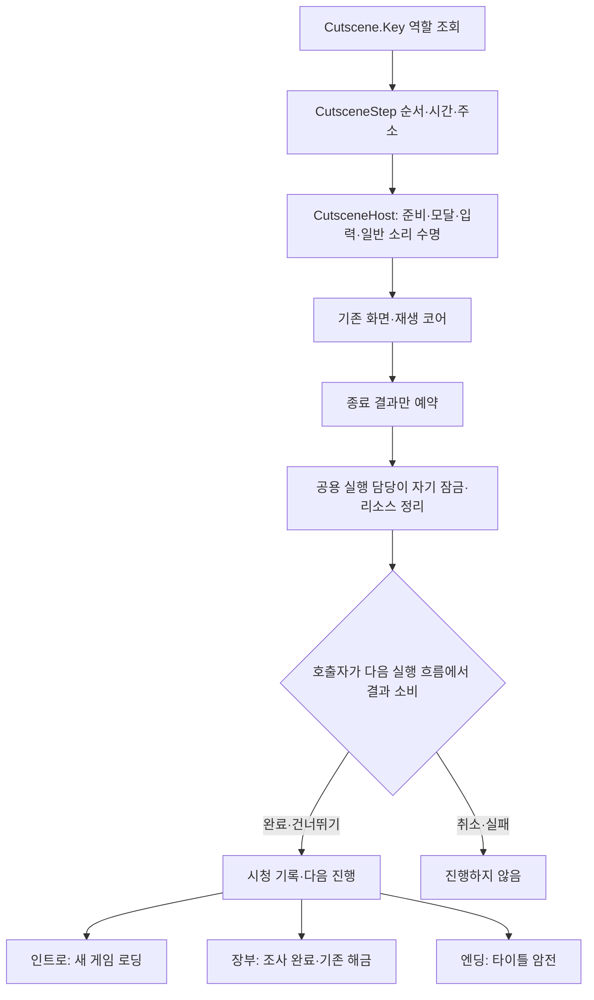
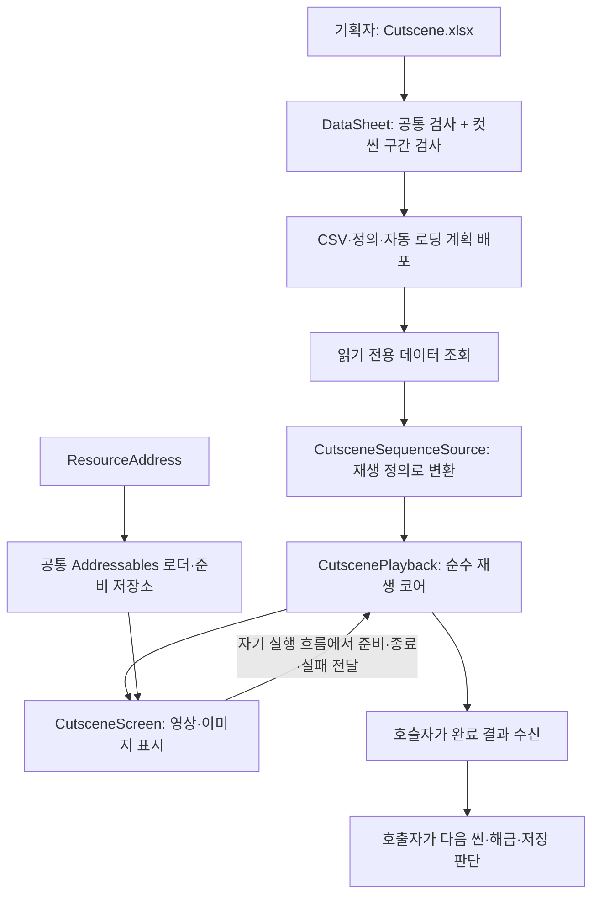
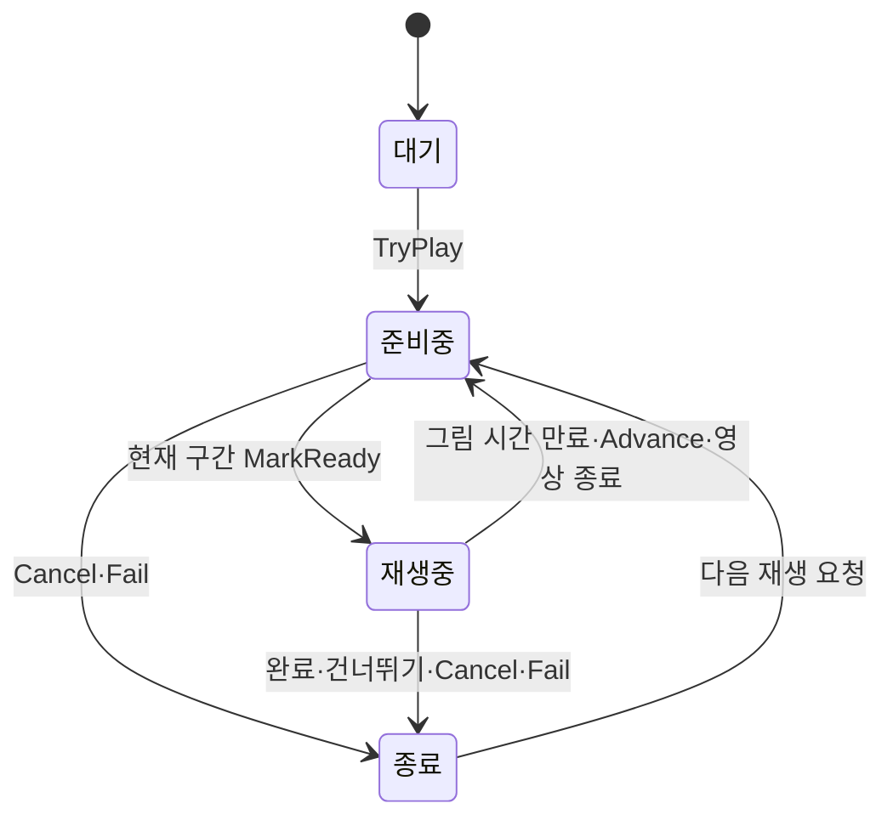
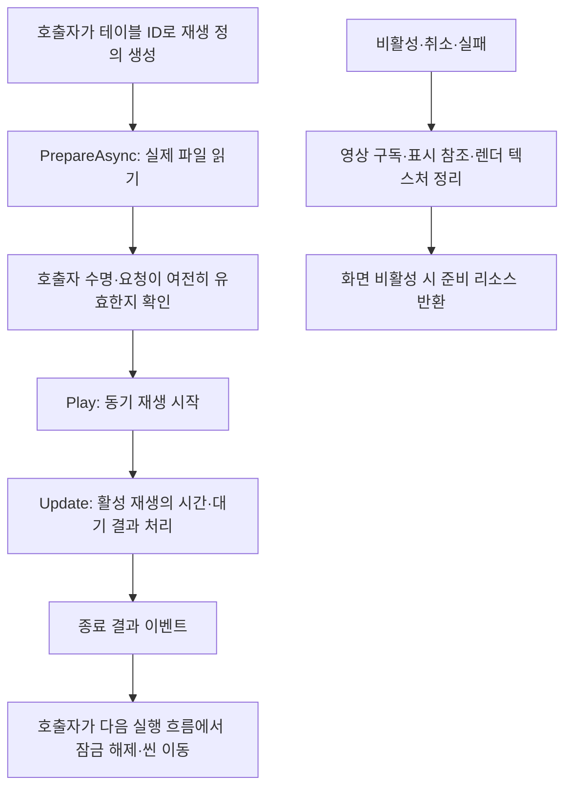

# 컷씬 재생 설계

> 2026-11-05: 기존 재생 코어에 그림·영상 표시와 선택 입력 연결을 추가했습니다. Addressables 공급자와 준비 저장소는 사운드와 공용입니다. 공용 실행·게임 잠금과 인트로/장부/엔딩 호출 준비를 추가했습니다. 실제 행·미디어·화면 배치는 대기입니다. 사용법은 [컷씬 표시와 씬 이동 안내](../기획자용%20안내문서/기획자용%20컷씬%20표시와%20씬%20이동%20안내.md)를 따릅니다.

## 1. 왜 독립 모듈로 구성하는가

### 2026-11-06 공용 실행과 데이터 기반 흐름 연결

현재 표에는 실제 행이 없으며 사용자도 확정 ID·미디어가 없다고 확인했습니다. 아래는 호출 준비 구현이며 실제 프리팹 배치·영상 재생·전체 완주 완료를 뜻하지 않습니다. Cutscene 표의 기존 Key를 `Intro`·`Ledger`·`Ending`으로 지정하면 실행 담당이 ID를 자동 조회합니다. 콘텐츠 ID·순서·시간·주소를 인스펙터에 중복 입력하지 않습니다. 역할 키가 없는 경우는 제작 대기로 기존 흐름을 유지하며, 행이 있는데 연결이나 주소가 잘못된 경우는 실패로 처리합니다. 임의의 실제 데이터 행은 추가하지 않았습니다.



| 위치 | 책임과 배치 이유 |
| --- | --- |
| CutsceneSequenceSource | 읽기 전용 표의 역할 키→ID 조회를 한곳에서 수행합니다. ID를 바꿔도 각 씬을 다시 편집하지 않습니다. |
| CutsceneHost | 여러 호출자가 같은 준비·잠금·정리 절차를 재사용합니다. 씬·해금·슬롯 규칙은 넣지 않습니다. |
| TitleGameEntry | 새 게임 요청에서 Intro를 재생하고 성공한 결과에만 기존 맵 진입을 호출합니다. 이어하기는 인트로를 재생하지 않습니다. |
| GameplayPreview.Cutscenes | 장부와 보스 종료를 기존 게임 흐름에 연결합니다. 보스 해체 상태가 끝난 뒤 Ending을 요청합니다. |
| LedgerInteract | 주입된 재생 요청을 사용하고 성공 후에만 기존 조사 완료를 실행합니다. 표에 Ledger가 없으면 기존 임시 조사를 유지합니다. |

비동기는 주소 리소스 준비에만 사용합니다. 준비는 30000ms 제한 후 실패 처리하며 이미 시작한 엔진 로드는 늦게 끝날 수 있어 준비 저장소의 반납 계약을 유지합니다. 구독과 잠금 해제는 SubscriptionScope, 준비 취소는 해당 요청의 토큰이 담당합니다. 씬 종료·비활성화 후 늦은 결과는 재생이나 게임 진행을 호출하지 않습니다. 재생 결과 이벤트 안에서는 다음 씬이나 코어 명령을 실행하지 않습니다.

기존 ErrorPopupSceneBinding의 모달 소유권을 재사용해 게임 시간과 일반 입력을 막습니다. 오류·확인 팝업 등 자기 외의 모달이 열리면 컷씬 시간·영상·유지 입력도 멈추고, 닫으면 컷씬만 이어갑니다. 일반 게임 소리는 GameAudio의 소유자별 무음으로 묶고 컷씬 자체 영상 소리와 분리합니다. 설정 음량은 변경하지 않습니다. 한 씬의 공용 실행 담당은 한 요청만 처리하고 결과가 소비되기 전 다음 재생을 거부합니다.

인스펙터에는 Unity 객체 참조만 남습니다. 화면 내부 Image·RawImage·자막과 입력 액션, 공용 실행 담당의 화면·입력·모달 참조는 프리팹/씬을 처음 조립할 때 개발자가 연결합니다. 기획자는 이후 기존 두 표와 Addressables 리소스를 변경합니다. 자막 언어는 현재 한국어로 연결하며 옵션 언어 선택은 별도 후속입니다. 네트워크 전송·권한·리플레이 동기화는 추가하지 않았습니다.

인트로 영상·장부방 그림·엔딩이 재생 순서와 건너뛰기 규칙을 재사용하도록 구성합니다. 씬 이동·저장·해금은 컷씬을 호출한 기능의 책임입니다. 테이블·리소스 로드·화면을 바꿔도 순수 재생 규칙은 유지하는 것이 목적입니다.

현재 문서는 구현한 데이터·코어·표시와 이후 연결할 실제 게임 흐름을 구분합니다. 사용법은 형제 DataSheet 프로젝트의 [기획자 설명서](../../../DataSheet/Docs/%EA%B8%B0%ED%9A%8D%EC%9E%90%EC%9A%A9%20%EC%BB%B7%EC%94%AC%20%EB%8D%B0%EC%9D%B4%ED%84%B0%20%EC%9E%91%EC%84%B1%EA%B3%BC%20%EC%82%AC%EC%9A%A9%20%EC%95%88%EB%82%B4.md)를 참고합니다.

## 2. 책임과 계층



| 위치 | 역할 | 분리 이유 |
| --- | --- | --- |
| DataSheet `tables/Cutscene.xlsx` | 공통 설정·구간 행 | 기획자가 코드 없이 순서·시간·주소 수정 |
| DataSheet `CutsceneDataValidator` | 컷씬 고유 조건 | 클라이언트에 배포 전 검사기를 복제하지 않기 |
| `Assets/3.Script/Data/Cutscene.cs`·`CutsceneStep.cs` | 읽기 전용 정의 | 기존 생성·매핑·조회 재사용 |
| `Assets/3.Script/Adapters/CutsceneSequenceSource.cs` | 데이터 조회와 재생 정의 연결 | Data가 게임 코어에 의존하지 않기 |
| `Assets/3.Script/Core/Cutscenes` | 상태·시간·재생 결과 | Unity·Addressables·저장 방식과 독립 |

빈 두 탭도 기존 탐색·배포·자동 로딩 계획에 포함됩니다. 새 정의는 도구가 최초 생성하며 기존 파일을 덮어쓰지 않습니다. 생성 코드를 DataSheet에 중복 보관하지 않습니다.

## 3. 왜 두 탭인가

```text
Cutscene: ID·Key·SkipHoldMs
   └─ CutsceneStep 여러 행
      ID·CutsceneID·Order·MediaType·ResourceAddress·DurationMs·TextID·CanAdvance
```

공통 건너뛰기 시간을 컷마다 반복하지 않도록 분리했습니다. 컷씬 ID와 구간 ID는 기획자가 대역을 정한 뒤 입력하며 현재 실제 행은 없습니다. 구간은 같은 CutsceneID 안에서 Order로 정렬합니다. TextID는 미사용 시 빈칸이고 재생 코어에서 0으로 변환합니다.

영상은 실제 종료 신호를 사용하므로 DurationMs=0·CanAdvance=N입니다. 그림은 양수 밀리초가 지나거나 허용된 다음 장 명령을 받으면 넘어갑니다. ResourceAddress는 Addressables의 논리 주소이며 파일 경로나 앵커 이름이 아닙니다.

## 4. 재생 수명과 결과



`StepToken`은 구간마다 증가하며 재시작 때도 초기화하지 않습니다. 이전 리소스의 지연 완료·실패 콜백은 현재 토큰과 다르면 무시합니다. 준비 중에는 그림 표시 시간·건너뛰기 시간을 진행하지 않습니다. 큰 프레임 시간이 들어와도 현재 구간까지만 진행하고, 아직 준비되지 않은 다음 그림을 건너뛰지 않습니다.

시간 누적·상한 처리는 AccumulateTime, 현재 구간 판정은 IsCurrent, 상태 변경 알림은 ChangeState로 일원화했습니다. 외부 명령은 준비·다음 장·영상 종료·취소·실패라는 서로 다른 의도를 유지합니다.

결과는 Completed·Skipped·Cancelled·Failed를 구분합니다. Changed와 Finished는 동기 결과 알림이며 소비자가 콜백 안에서 코어 명령을 다시 호출하지 않습니다. 다음 재생이나 씬 이동은 호출자가 자기 실행 흐름에서 처리합니다. 입력·시간·소리 잠금의 정리는 실제 조립 단계에서 종료 이유와 무관하게 수행해야 합니다.

## 5. 배포 전 검사의 경계

기존 컬럼 규칙으로 타입·범위·ID와 키 중복·참조·컷씬별 순서 중복을 검사합니다. CutsceneDataValidator는 구간 없는 컷씬, 1부터 연속되지 않는 순서, 미디어별 시간·넘김 조건, 주소 ASCII 형식만 추가 검사합니다. 해당 두 탭이 없는 다른 파일에는 영향을 주지 않습니다.

배포 전 검사는 주소 형식까지 담당합니다. 현재 Addressables 패키지와 공용 로더가 설치돼 있으며 표시 시작 전에 전체 리소스 준비와 Sprite·VideoClip 타입, 필수 자막 연결을 확인합니다. 실제 주소 콘텐츠 빌드·영상 코덱 호환성·최종 재생은 Unity와 플레이어 빌드에서 별도로 확인합니다.

## 6. 개발자 연결 방법

1. 데이터 초기화 완료 후 조회 묶음을 명시적으로 전달합니다.
2. `CutsceneSequenceSource.Create(data, cutsceneId)`로 재생 정의를 얻습니다.
3. CutscenePlayback에 TryPlay를 요청합니다. 이미 재생 중이면 거부합니다.
4. 표시 담당이 현재 ResourceAddress를 로드하고 준비가 끝난 구간 토큰으로 MarkReady를 호출합니다. 결과 이벤트 안에서 명령을 다시 호출하지 않도록 비동기 준비 또는 별도 실행 흐름에서 전달합니다.
5. 영상 종료는 ReportVideoEnded, 그림 다음 장은 Advance, 유지 입력은 SetSkipHeld로 전달합니다.
6. 호출자가 정한 시간 공급으로 Tick에 정수 밀리초를 전달합니다. 게임 시간이 멈춰도 컷씬이 진행되어야 할 때의 시간 선택은 조립자의 책임입니다.
7. 실패는 현재 토큰의 Fail, 중단은 Cancel로 전달합니다. 리소스·구독·잠금 수명은 Unity 조립자가 소유합니다.

네트워크 전송·권한 로직은 포함하지 않습니다. 경계를 넘는 값은 ID·주소·정수 시간·토큰이며 Unity 오브젝트를 순수 코어로 전달하지 않습니다. 정수 시간만으로 리플레이 결정성이 보장되는 것은 아닙니다.

## 7. 현재 구현과 다음 범위

현재 구현: 빈 데이터 탭·검사·배포·정의 생성·자동 로딩·재생 정의 변환·순수 재생 코어·Addressables 타입별 준비·그림/영상 표시·자막 조회·선택한 입력 액션 연결. 실제 행은 기획자 입력 대기입니다. 공용 실행과 역할 키별 호출·잠금 준비는 추가했으며 실제 배치·완주 검증은 대기입니다.

미구현: 건너뛰기 안내 게이지·게임 입력/시간/소리 잠금의 실제 조립·인트로/장부방/엔딩 호출·전체 주소 콘텐츠의 배포 전 검사. 기존 씬·프리팹을 자동 수정하지 않았습니다. 저장·씬 전환은 독립 기능으로 유지합니다.

## K16 R2 피해 차단 연결

PlayerActor.SetCutsceneDamageBlocked는 실제 피해·잡기 경계를 차단합니다. 연출을 인수한 단일 소유자가 시작/준비 때 true를 전달하고 완료·스킵·취소·실패·비활성 정리에서 자기 실행 흐름으로 false를 전달합니다. 거부된 중복 재생 요청은 기존 차단을 해제하지 않습니다. 현재 게임 연결은 재생 요청 수락 후 피해 차단을 켜고 결과 소비·비활성 정리에서 해제합니다. 입력·시간·소리는 공용 실행 담당이 맡으며 실제 화면 배치는 대기입니다. 코어 회귀9개·Unity 피해 차단4개 통과이며 실제 컷씬 씬 연결 완료를 뜻하지 않습니다.


## 8. 표시와 리소스를 이 위치에 둔 이유

`Presentation/CutsceneScreen`은 Unity의 Image·RawImage·VideoPlayer·자막을 소유하므로 표현 계층에 둡니다. `Adapters/CutsceneInput`은 외부 입력 액션을 복제하여 화면의 명령에 연결하므로 어댑터에 둡니다. 기존 코어를 복제하거나 씬 이동을 컷씬 안에 넣지 않았습니다. 그림은 Sprite, 영상은 VideoClip 타입으로 준비하여 텍스처와 스프라이트를 혼동하지 않게 했습니다.



그림과 영상의 준비는 서로 독립된 파일 읽기이므로 Task.WhenAll로 합칩니다. 각 주소의 중복 로드·실패 재시도·늦은 완료 반환은 기존 PreparedAssetStore가 담당합니다. 재생·다음 장·정지에는 비동기를 추가하지 않았습니다. VideoPlayer 이벤트는 결과만 기록하며 현재 플레이어와 일치할 때만 수용합니다. 구간 전환 시 이전 플레이어를 구독 해제·중지한 뒤 제거합니다. 영상 준비에는 15000ms 기본 제한을 두며, 재생 중에만 시간 진행을 확인합니다.

화면 취소는 재생을 끝내되 같은 활성 수명의 준비 리소스를 재사용합니다. 화면 비활성화는 준비 수명까지 종료합니다. 이후 재사용은 Connect와 PrepareAsync를 다시 수행합니다. 실패는 정리 후 한국어 맥락과 원래 예외를 Unity 로그에 남기므로 기존 오류 팝업 수집과 연결됩니다. 잘못된 필수 연결로 시작을 못 하면 호출자에게 예외를 전달합니다.

## 9. 씬 이동 재사용과 변경 범위

기존 LoadingScreen의 로딩 그림·툴팁·도장 표현은 유지합니다. 코루틴을 제거하고 활성 작업의 Update에서 정수 밀리초로 진행합니다. 기존 Begin은 맵 진입용 최소 2000ms 표시이고, BeginFade는 타이틀 복귀용 암전입니다. 두 경로가 씬 유효성 확인·비동기 로드·활성화·표시 정리를 공유합니다. GameplayPreview의 타이틀 복귀는 BeginFade를 사용하도록 연결했습니다.

동시에 두 씬 로드를 시작하지 않도록 활성 이동을 한 곳에서 제한합니다. Unity 씬 로드는 시작 뒤 취소할 수 없습니다. 화면이 비활성화되더라도 allowSceneActivation 대기를 해제해 로드 큐를 영구 정지시키지 않습니다. 이는 원래 씬으로 되돌리는 취소가 아닙니다. 이후 저장 연결에서 선택적인 준비 결과를 전달하도록 확장했습니다. 현재 테스트 맵은 조립·플레이어 복원·최초 기록이 끝나야 로딩을 닫습니다. 정식 공간별 상태 소유자는 별도 연결해야 합니다.

로딩의 새 디자인·BGM 전환·태평소 애니메이션은 기획 확정 및 리소스 준비 후 연결합니다. 빈 컷씬 표에 가짜 ID를 넣거나 실제 새 게임 경로에 존재하지 않는 인트로를 연결하지 않았습니다. 네트워크나 저장 형식을 추가하지 않았으며 재생 규칙은 ID·주소·정수 시간으로 전달됩니다. 영상 디코딩·씬 로드는 엔진 실행에 의존하므로 리플레이 결정성을 보장하지 않습니다.

### 로딩 종료까지 플레이어 이동 잠금 — 2026-11-10

도착 장면의 저장/복원 준비가 완료되면 `SetPlayable(true)`가 호출되지만, LoadingScreen은 그 뒤에도 완료 표시·암전 해제를 진행합니다. 종전에는 이 간격에 이동과 출구 판정이 다시 실행되어 활성 로딩 화면이 있는 동안 `GoToStage`가 두 번째 이동을 요청할 수 있었습니다.

GameplayPreview의 입력 잠금에 `LoadingScreen.IsActive`를 함께 반영합니다. `_loadingLocked`는 마지막으로 반영한 로딩 상태이며 LateUpdate에서 종료 변화를 확인해 기존 입력 잠금 계산을 다시 적용합니다. `_leaving` 또는 활성 로딩 중에는 실제 이동/중력·출구 판정까지 실행하지 않습니다. 도착 준비 완료만으로는 해제하지 않고 로딩 화면 종료 뒤 재개합니다. 저장·대화·일시정지·오류 모달의 별도 잠금은 유지합니다.

`GoToStage`는 진행 중인 로딩을 먼저 확인하여 BeginScene/새 화면 생성 전 중복 요청을 무시합니다. 같은 구간의 일시정지·타이틀 재요청·대화 넘김도 차단합니다. LoadingScreen의 중복 시작 예외와 유효성 검증은 유지하며, 시작 준비 실패 때 기존 상태를 보존하는 계약도 그대로입니다. 전역 시간 배율과 데이터·저장 형식은 바꾸지 않습니다.

Unity 격리80건: 활성 로딩5단계, 도착 SetPlayable 호출, 반복 이동/타이틀 요청, 점프 관성 중 위치 고정, 종료 후 실제 이동 재개, 저장·모달 잠금 유지, 같은 프레임/수직 입력 정리, 초기화 전·출발 장면 정지를 확인했습니다. 활성 로딩 수명을 대역으로 공급해 조립 코드를 검사했으며 실제 씬 파일을 전환하는 Play 검사는 아닙니다. 코어847·데이터1017 통과, Unity 컴파일 오류0. 실제 키로 왕복 전환 수용은 후속입니다.

### 폐기 표식으로 인한 도착 준비 실패 — 2026-11-10

Editor.log에서 최초 실패는8002의 BindGate_1과 빈 GateConfig 사이의 연결 검사였습니다. GameplayPreview.BuildStage가 실패해 준비 결과를false로 완료한 뒤 LoadingScreen이 도착 준비 실패를 보고했습니다. 기획자 제안사항1109의10절에는11/10 확정으로 관문800201·800202·800301을 삭제하고 빈 표를 허용하라고 명시돼 있습니다. 실제 운영 K9 맵에는 그 이전 표식이 남아 있었습니다.

PreviewBindGates의 조립 경계에서 설정이 없는 경우에만8002의 BindGate_1·BindGate_2,8003의 BindGate_3을 폐기 표식으로 처리합니다. 같은 이름에 새 설정이 공급되면 그 행을 우선 사용합니다. 최신 Develop의 임시 정책에 따라 다른 미연결 표식은 경고 후 생성을 생략하고 통행을 허용합니다. 임의 관문 ID나 개방 기록은 만들지 않습니다. CSV·JSON·맵 프리팹·관문 전투 규칙·저장 복원 코드는 변경하지 않았습니다. 로딩의 준비 실패 검증도 유지합니다.

실제 StageContentSet의8001~8005 맵과 공급 데이터로 조립·몬스터 초기화·활성화와 미연결 관문의 경고·통행·저장 미생성을 포함한24항목을 격리 검사했습니다. 빈 표에서8002/8003이 차단물을 생성하지 않고 완료되며, 새 설정을 준 같은 이름은 정상 차단물을 생성하고 열린 관문 기록도 존중합니다. 코어868·데이터1023 통과. 실제 씬 전환을 반복하는 Play와 저장 파일 쓰기는 포함하지 않습니다.
