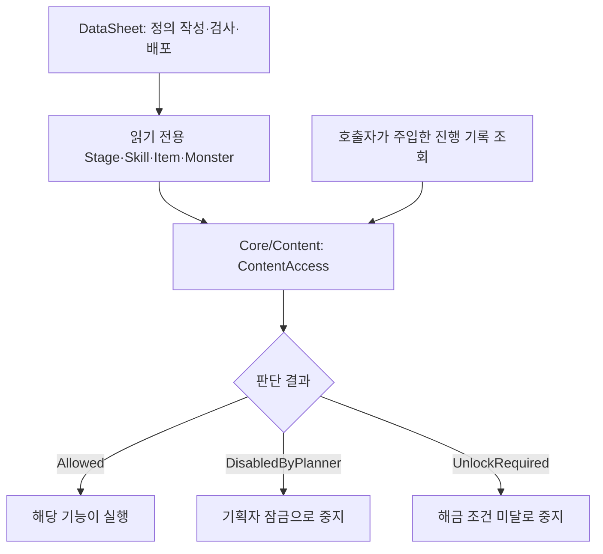
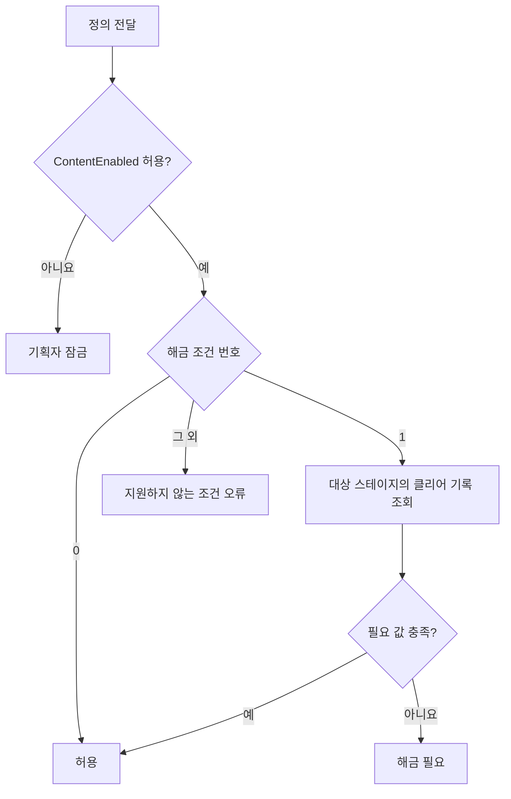

# 콘텐츠 잠금 설계

기준일: 2026-11-09. 콘텐츠 사용 허용과 플레이어 해금 조건을 판단하는 독립 기능입니다. 타이틀 화면·메뉴·개인 옵션과는 별개이며, 타이틀을 생성하지 않아도 사용할 수 있습니다. 기획자의 작성·배포·확인은 [사용 안내](../기획자용%20안내문서/기획자용%20콘텐츠%20잠금%20사용%20안내.md)를 따릅니다.

## 1. 왜 별도 기능인가

기획자가 콘텐츠를 중지하는 정책은 플레이어가 조건을 달성해 해금하는 규칙보다 우선합니다. 메뉴를 감추는 것만으로 실제 실행을 차단할 수 없으므로, 게임 기능의 실행 경계에서 판단합니다. 저장 없음으로 이어하기를 숨기는 타이틀 정책은 콘텐츠 잠금에 넣지 않습니다.

## 2. 책임과 데이터 흐름

| 구획 | 책임 |
| --- | --- |
| DataSheet | 필드·형식·범위·참조 검사와 배포. 클라이언트에 검사기를 복제하지 않음 |
| Core/Content/ContentAccess.cs | 콘텐츠 정의와 진행 조회 계약을 받아 이용 가능 여부 반환. Unity·타이틀·저장 파일 직접 참조 없음 |
| 진행 기록 소유자 | 스테이지 클리어 기록의 소유·변경·저장. 판단기에 최신 기록을 조회할 함수 전달 |
| 각 기능의 실행 담당 | 판단 결과에 따라 이동·생성·활성화를 허용하거나 중지 |
| 각 기능의 표시 담당 | 필요한 경우 결과를 안내. 판단기에서 팝업·화면·씬을 직접 열지 않음 |

## 3. 판단 순서

Stage·Skill은 ContentEnabled와 UnlockConditionType·UnlockTargetID·UnlockRequiredValue를 사용합니다. Item·Monster는 현재 ContentEnabled만 판단합니다. Active·UnlockType은 각 기능 고유의 기존 의미를 유지하며 대체하지 않습니다. Item의 삭제된 InGstar 컬럼을 다시 사용하지 않습니다. 기획 잠금이면 진행 기록 조회보다 먼저 중지합니다.

## 4. 개발자가 연결하는 방법과 수명

`new ContentAccess(progress.IsCleared)`로 스테이지 ID를 받아 클리어 여부를 반환하는 함수를 주입합니다. `Evaluate(definition)`의 결과가 Allowed인 경우에만 해당 기능을 실행합니다. 원본 정의나 진행 기록을 변경하지 않고 판단 결과도 저장하지 않습니다.

판단기 자체는 상태 변경 이벤트·Update·코루틴·비동기 작업이 필요하지 않습니다. 기록 변경 이벤트를 받은 소비자가 필요한 시점에 다시 판단합니다. 진행 조회 함수를 가진 호출자는 해당 진행 세션보다 오래 판단기를 보유하지 않아야 합니다. 새 게임·복원·세션 교체 시 새 기록 소유자에 연결합니다.

현재 클라이언트의 실행은 로컬 기준입니다. 이 판단 결과만으로 네트워크 권한·상태 동기화·리플레이 결정성이 구현되는 것은 아니며 해당 기능은 이번 범위가 아닙니다.

## 5. 구현 범위와 남은 연결

| 대상 | 현재 연결 | 남은 범위 |
| --- | --- | --- |
| Stage | GameplayPreview의 목적지 진입에서 ContentAccess 판단. 다음 맵 탐색의 ContentEnabled 제외 정책도 별도 존재 | 신규 맵·새 진입 기능도 같은 실행 경계에서 판단해야 함 |
| Skill | PlayerRuntime.EnableSkill과 장부 상호작용이 잠금·해금을 확인 | 향후 다른 스킬 획득 경로도 확인 필요 |
| Monster | PreviewStage가 ContentEnabled인 코드 집합을 스폰 규칙에 전달 | 풀링·리스폰 정책과 혼용하지 않음 |
| Item | ContentAccess의 정의 판단 API는 있음 | 모든 획득·장착 경계에 연결된 상태는 아님 |
| 타이틀 | 의존하지 않음 | 저장 유무·메뉴 정책은 타이틀 기능에서 관리 |

ContentAccessChecks는 기획 잠금 우선·조건 달성 전후·지원하지 않는 조건·빈 정의를 검사합니다. 이번 문서 분리는 런타임 코드·직렬화 참조·스키마를 변경하지 않았습니다. 실제 콘텐츠별 차단은 사용 안내의 확인표로 별도 검증합니다.
