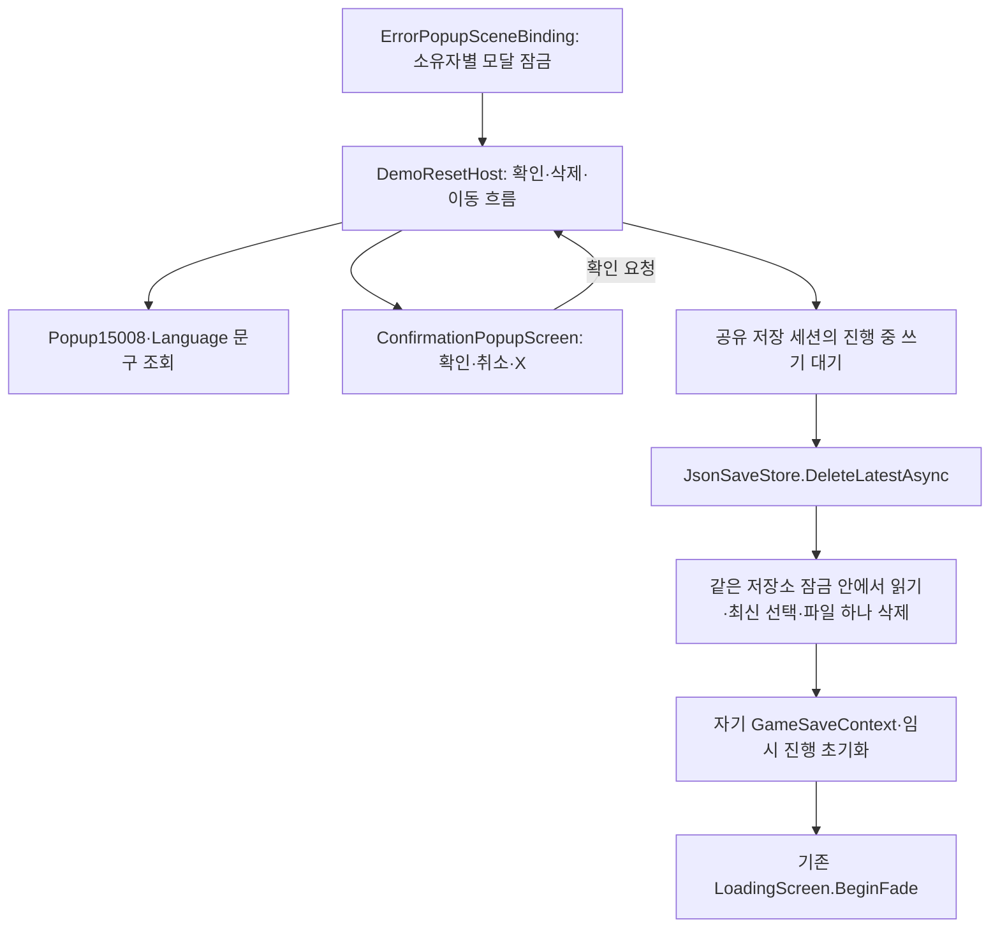
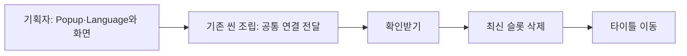

# 테스트 초기화와 공용 확인 팝업 설계

## 목차

1. [기능을 나눈 이유](#1-기능을-나눈-이유)
2. [위치와 책임](#2-위치와-책임)
3. [순서·오류·수명](#3-순서오류수명)
4. [검사와 사용 문서](#4-검사와-사용-문서)
5. [공통 연결을 반복하지 않는 이유](#5-공통-연결을-반복하지-않는-이유)

## 1. 기능을 나눈 이유

초기화 확인 화면을 다른 기능에서도 쓸 수 있도록 표현과 파일 삭제를 분리했습니다. 슬롯 목록·이어하기·삭제가 서로 다른 최신 기준을 쓰지 않도록 SaveRecord.LatestFirst로 정렬을 일원화했습니다. 사용자 확정은 테스트 빌드 F12 한 번·최신 슬롯 하나 삭제·설정 유지이며 옛 5초/현재 슬롯 규칙을 대체합니다.

## 2. 위치와 책임

| 위치 | 책임과 이유 |
| --- | --- |
| Core/Saves/SaveRecord | 기존 저장 목록·이어하기·삭제의 정렬 기준을 소유 |
| Adapters/JsonSaveStore | 파일 읽기·쓰기·삭제를 같은 SemaphoreSlim 경계에서 직렬화 |
| Presentation/ConfirmationPopupScreen | PopupScreen의 표시·선택 복귀를 상속하고 확인/취소/X·처리 중 버튼 잠금만 추가 |
| Adapters/DemoResetHost | 데이터·저장소·모달·타이틀 이동을 주입받아 실행. 출시에는 컴파일하지 않음 |
| Adapters/ErrorPopupSceneBinding | 기존 모달 경계에 소유자 집합을 두어 한 창의 닫힘이 다른 창의 잠금을 풀지 않게 함 |
| Editor/TitleTestBuildProcessor | 출시 씬 사본에서 테스트 실행 컴포넌트를 제거 |

확인 화면 프리팹은 공용으로 유지하고 기존 PopupButton 인스턴스를 조합합니다. 오류 팝업의 복사 기능이나 저장 슬롯 화면에 초기화 규칙을 넣지 않았습니다. 이벤트는 선택 결과만 전달하고 실행 담당이 파일 삭제·이동 명령을 처리합니다.

## 3. 순서·오류·수명

F12 요청은 현재 모달과 로딩 상태를 확인합니다. 로딩 중 요청은 정적 요청 값만 다음 씬으로 전달하고 Unity 객체를 보관하지 않습니다. 화면 참조는 각 씬의 실행 담당이 소유합니다. 데이터가 준비된 뒤 같은 Popup ID로 표시하며 확인/취소 문구는 Language에서 읽습니다.

삭제 확인 전에 타이틀 씬의 로드 가능 여부를 확인합니다. 진행 중인 파일 기록이 끝난 후, 동일한 저장소 잠금 안에서 현재 파일을 읽고 최신 슬롯을 정합니다. 날짜·저장 순서·슬롯 번호의 안정적인 정렬을 공유합니다. 파일 형식 오류·버전 오류·파일 잠금 등은 실패로 전달하고 나머지 기록을 삭제하지 않습니다. 파일이 없으면 성공적인 빈 처리로 타이틀에 갑니다.

입력/문구/정렬/이동 요청은 동기입니다. 실제 파일 작업에만 비동기를 사용하고, 취소는 삭제 직전 확인합니다. 삭제가 끝난 뒤의 취소는 이미 성공한 파일 삭제를 되돌리지 않습니다. 지연 완료 후 자기 객체의 수명과 요청 토큰을 확인해 종료된 장면에 화면 명령을 보내지 않습니다. 새로운 GameSaveContext가 있으면 이전 요청이 그것을 초기화하지 않습니다.

팝업 열기 때 모달 소유권을 획득하고 취소/비활성화 때 자기 소유권만 해제합니다. 오류 창이 위에 뜨면 초기화 화면 입력은 막되 소유권을 유지합니다. 기존 수동 저장 입력도 모달 차단에 참여하고 월드 진행·출구 판정은 모달 중 정지합니다. 확인 후 이동할 때는 기존 게임 입력을 중간에 재활성화하지 않습니다.

초기화는 현재 로컬 파일·임시 진행에만 적용합니다. 네트워크 명령·권한 동기화는 추가하지 않았습니다. 출시에서는 실행 담당과 F12 바인딩·화면 생성 경로를 제외하며 공용 확인 화면 타입은 다른 기능에서 재사용 가능합니다.

## 4. 검사와 사용 문서

임시 저장 폴더로 최신 날짜·동일 시각의 저장 순서·기록 없음·취소·파일 잠금 실패·다른 슬롯/설정 보존을 검사합니다. 실제 사용자 기록은 자동 시험에서 사용하지 않습니다. Unity는 공용 확인 프리팹의 문구·확인·취소·X 참조를 해석했으며 실제 버튼·F12·로딩 예약·출시 실행 검증은 별도입니다.

사용 순서와 데이터 변경은 [기획자용 안내](../기획자용%20안내문서/기획자용%20F12%20초기화%20사용%20안내.md)를 따릅니다. 과거 간트의 5초·경고 없음 메모보다 이번 사용자 확정 지시를 우선하며 원격 기획 문서를 수정한 것은 아닙니다.

삭제가 완료된 뒤 타이틀 이동만 실패하면 확인으로 이동만 재시도합니다. 이때 취소·X는 막아 이미 삭제한 플레이 상태로 돌아가지 않으며 다른 슬롯을 추가로 삭제하지 않습니다.

## 5. 공통 연결을 반복하지 않는 이유

ErrorPopupSceneBinding은 같은 오브젝트의 DemoResetHost를 데이터 준비 시 한 번 조립합니다. 기존 오류 호스트의 입력 에셋과 씬 이벤트 시스템을 재사용하고 타이틀 검증·이동 명령을 전달합니다. DemoResetHost에는 화면 프리팹과 Popup ID만 직렬화합니다. 저장 삭제 기능에 GameDataInitializer를 다시 할당하지 않습니다. 씬 전체 검색·매 프레임 의존성 탐색·새 전역 관리자는 추가하지 않았습니다. 조립자 해제 시 실행 담당의 입력·구독·비동기 수명도 해제합니다.

