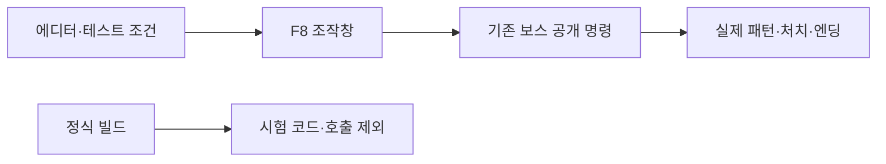
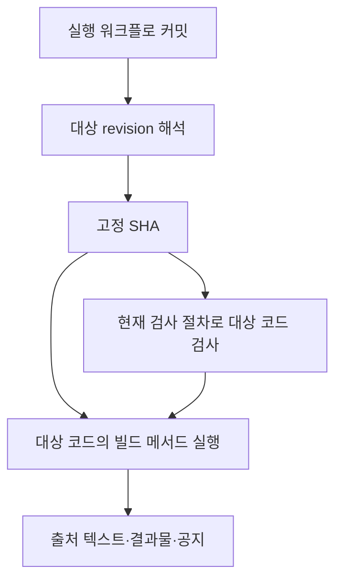
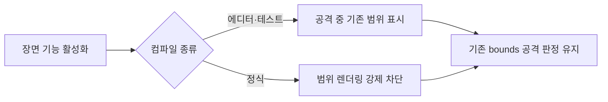
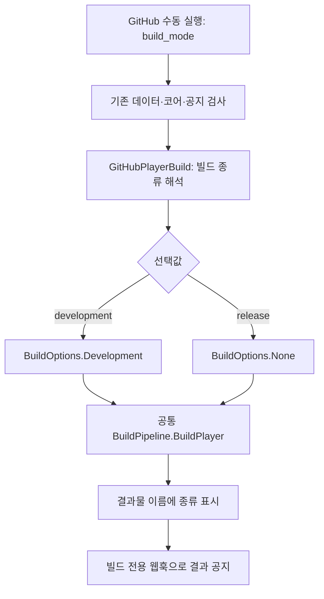
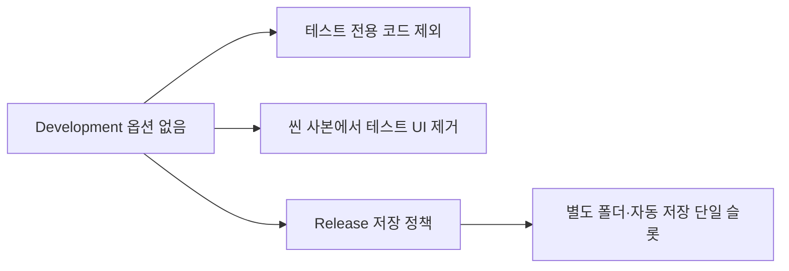

# 테스트와 정식 빌드 선택 설계

기준일: 2026-11-07. GitHub 수동 실행에서 빌드 종류를 선택하도록 연결했습니다. 실제 원격 실행은 변경 반영 후 확인해야 합니다. 기획자 조작 절차는 [빌드 사용 안내](../기획자용%20안내문서/GitHub%20빌드와%20디스코드%20공지%20사용%20안내.md)를 따릅니다.

## 목차

1. [실행파일 아이콘의 공용 입력](#실행파일-아이콘의-공용-입력)
2. [왜 필요한가](#1-왜-필요한가)
3. [책임과 연결 순서](#2-책임과-연결-순서)
4. [입력과 산출물 계약](#3-입력과-산출물-계약)
5. [정식 빌드에서 적용되는 기존 정책](#4-정식-빌드에서-적용되는-기존-정책)
6. [반영·검증과 남은 확인](#5-반영검증과-남은-확인)

## 실행파일 아이콘의 공용 입력

2026-11-09: Assets/4.Sprite/AppIcon.png를 PlayerSettings의 기본 아이콘으로 연결했습니다. 현재 그림은 HG_Logo.png를 변경 없이 복사한 임시 파일이며 원래 타이틀 에셋은 유지합니다. meta의 GUID를 보존하면 그림 내용 교체만으로 다음 로컬·GitHub 빌드에 반영됩니다. 별도 실행 코드·빌드 후 exe 수정 도구·테스트/정식용 중복 아이콘 설정을 추가하지 않았습니다. 기존 BuildPipeline이 프로젝트 설정을 사용하므로 빌드 스크립트도 변경하지 않습니다.

이미지 파일과 ProjectSettings 참조·GUID의 정합을 확인했습니다. 실제 Windows exe 아이콘과 운영체제 캐시는 새 빌드로 확인해야 합니다. [이미지 교체 절차](../기획자용%20안내문서/GitHub%20빌드와%20디스코드%20공지%20사용%20안내.md#실행파일-아이콘-교체--2026-11-09)를 따릅니다.

## 1. 왜 필요한가

### 보스 시험 조작창 — 2026-11-13

GameplayPreview.BossTests 부분 클래스 전체와 호출 지점은 UNITY_EDITOR 또는 DEVELOPMENT_BUILD 조건에서만 컴파일합니다. 맵 조립자의 기존 보스·진행·이동 참조를 사용하고 별도 전역 검색·테스트 보스 복제·새 프리팹은 추가하지 않습니다. F8로 여는 시험 도구이며 조작은 OnGUI에서 예약한 뒤 기존 실행 흐름에서 처리합니다. 숨긴 동안 화면 생성·패턴 목록 표시는 실행하지 않습니다.



패턴 수는 BossCombat에서 읽고 TryStartPattern·ReceiveHit·Release를 재사용합니다. PreviewBossDriver의 시험 조건부 자동 선택 스위치 외에 보스·패링 코어는 변경하지 않습니다. 실제 상태가 요청을 거부하면 강제 덮어쓰지 않습니다. 시험은 임시 진행을 바꾸고 저장·통계에 남을 수 있으므로 사용자는 별도 진행으로 확인합니다. [기획자 조작 안내](../기획자용%20안내문서/보스%20시험%20기능%20사용%20안내.md).

### 리비전 고정과 출처 기록 — 2026-11-13

workflow_dispatch의 revision 입력은 전체 SHA·태그·브랜치를 받으며 빈 입력은 github.sha를 사용합니다. 별도 revision 작업에서 checkout 후 실제 HEAD를 확정하고, 재사용 검사 워크플로의 revision 입력과 빌드 checkout에 같은 SHA를 전달합니다. 일반 push/PR 검사는 입력이 없으므로 기존 실행 SHA를 사용합니다.

확정된 소스 SHA는 디스코드·결과물 파일명 끝 12자리·빌드 출력의 빌드 정보.txt·작업 요약으로 전달합니다. 텍스트 파일에는 전체 소스 SHA와 워크플로 SHA·빌드 종류·씬·실행 번호/시도·UTC 기록 시각을 구분합니다. JSON 보고서나 게임 런타임 서비스는 추가하지 않습니다. 실제 HEAD와 확정 SHA 불일치 시 결과물 업로드를 중단합니다.



공지 코드는 실행 워크플로의 코드로 받고, 표시하는 게임 소스 SHA는 별도로 전달합니다. 리비전 해석 실패와 공지 시험은 실제 게임 빌드로 표시하지 않습니다. 전체 SHA를 사용해야 의도한 버전을 가장 명확하게 재현할 수 있습니다. 과거 코드의 빌드 계약 호환성과 별도 공급 리소스는 자동 복구하지 않습니다. 원격 실제 빌드는 로컬 검사 통과와 별개로 확인해야 합니다.

### 플레이어 공격 범위 표시 — 2026-11-13

플레이어의 노란 공격 범위는 GameplayPreview의 `_attackWindow`이며 몬스터·보스·관문이 같은 렌더러의 bounds로 판정을 확인합니다. 정식 빌드에서 객체·렌더러·스프라이트를 제거하거나 크기를 0으로 만들면 판정에 영향을 줄 수 있어, 기존 참조·크기·공격 시점 처리는 보존하고 `Renderer.forceRenderingOff`만 적용합니다.



별도 빌드 설정·Inspector 스위치·새 표시 관리자는 추가하지 않습니다. 기존 `UNITY_EDITOR || DEVELOPMENT_BUILD` 구분을 재사용하고 OnEnable에서 적용하므로 데이터 준비 전과 재활성화에도 표시 정책을 적용합니다. 표시용 렌더러는 판정 의존성 때문에 정식 빌드에도 남습니다. 공격 판정·피격 연출·필드 위험 표시를 함께 끄지 않습니다. 실제 테스트/정식 실행파일에서 공격 표시와 피해·관문 판정을 대조하는 확인은 별도 필요합니다.

기존 GitHubPlayerBuild는 BuildOptions.Development로 고정되어 정식 저장·테스트 기능 제외 경로를 원격 빌드로 확인할 수 없었습니다. 게임에는 이미 컴파일 조건과 저장 정책이 있으므로 새 정책을 만들지 않고 빌드의 선택값을 기존 경계에 연결합니다. 기본값은 기존과 같은 테스트로 유지합니다.

## 2. 책임과 연결 순서



| 위치 | 책임·배치 이유 |
| --- | --- |
| .github/workflows/unity-build.yml | 실행 입력·종류 전달·인증·결과물·공지 조립. 같은 작업을 두 워크플로로 복제하지 않음 |
| Assets/Editor/Build/GitHubPlayerBuild.cs | 명령줄 선택을 Unity 빌드 옵션으로 변환. Unity API를 쓰므로 Editor 아래 유지 |
| Assets/Editor/TitleTestBuildProcessor.cs | 기존 정식 빌드의 씬 사본에서 테스트 화면·연결 제외. 원본 씬 변경 없음 |
| GameSaveContext·SaveSession | 기존 DEVELOPMENT_BUILD 조건과 슬롯 정책. 이번 변경에서 정책 복제·변경 없음 |
| Tools/Automation/discord_notice.py | 전달받은 종류와 실행 결과를 공지 내용으로 변환. 전송은 기존 discord_webhook 재사용 |
| Tools/Automation/test_discord_notice.py | 실제 전송 없이 종류·성공·실패·취소·공지 시험의 결과를 검사 |

작은 빌드 선택에 상태머신·팩토리·전역 이벤트를 추가하지 않았습니다. 이미 있는 빌드 함수의 설정 분기이며 도메인 규칙을 새로 만들지 않기 때문입니다. 게임 프레임 처리·객체 수명·네트워크·리플레이의 실행 규칙은 바꾸지 않습니다.

## 3. 입력과 산출물 계약

- GitHub 입력: build_mode, choice development/release, 기본 development.
- Unity 인자: -humanGhostBuildMode development 또는 release. 생략하면 development, 지원하지 않는 값이면 빌드 전 실패.
- scene과 operation 선택은 기존 계약을 유지. 두 종류 모두 Windows 64비트 Mono이며 기존 Linux 실행 환경을 공유.
- Unity 버전은 ProjectVersion.txt 사용. 출력은 build/StandaloneWindows64/HumanGhost.exe, 버전은 0.1.실행번호 유지.
- 결과물 이름은 HumanGhost-Windows-종류-실행번호-시도번호. 7일 보관과 저장소 접근 권한은 기존 그대로.
- 디스코드 공지의 ‘빌드 종류’는 같은 입력에서 전달. 실패·취소 공지에 다운로드 성공을 표시하지 않음. notice-test는 종류를 표시해도 게임을 만들었다고 알리지 않음.
- 새로운 GitHub 비밀값은 필요 없음. 기존 개발 알림 웹훅과 빌드 알림 웹훅의 분리 유지.

씬 선택은 EditorBuildSettings를 변경하지 않고 빌드 호출에만 적용합니다. 기존 스크립팅 백엔드·버전은 finally에서 복원합니다. 개발·정식 빌드는 옵션만 달리하고 동일한 검사·출력·정리 절차를 재사용합니다. IL2CPP 전환·서명·설치 프로그램·스토어 배포는 이번 범위가 아닙니다.

## 4. 정식 빌드에서 적용되는 기존 정책



F5 수동 저장·타이틀 기록 선택·F12 초기화는 테스트 전용입니다. 정식은 Saves/Release 아래 자동 저장 슬롯 하나를 사용하며 테스트 기록을 이동·삭제하지 않습니다. 이 경로는 빌드 결과에서 검증해야 하며 Unity 에디터 Play는 UNITY_EDITOR 조건 때문에 정식 모드 검증을 대신하지 않습니다.

## 5. 반영·검증과 남은 확인

변경을 커밋·푸시하고 기본 브랜치와 실제 실행 브랜치에 반영한 뒤 새 workflow_dispatch 실행을 시작합니다. 예전 실행의 Re-run은 이전 실행 코드를 사용하므로 새 설정 적용 확인으로 사용하지 않습니다. 코드 반영·빌드 실행·디스코드 전송은 별도 작업입니다.

로컬 검사는 다음 명령으로 수행합니다. 공지 검사는 project-checks.yml에도 연결했습니다.

```powershell
python -B -m unittest discover -s Tools/Automation -p "test_*.py"
$env:DefineConstants='UNITY_EDITOR'
powershell.exe -NoProfile -ExecutionPolicy Bypass -File Tools/Verify-Data.ps1 -CompileUnity
```

원격에서는 development/release를 각각 새 실행으로 만들고 결과물 이름·공지 종류가 일치하는지 확인합니다. 정식 실행파일에서 F5·F12·테스트 기록 선택이 노출되지 않고 자동 저장·이어하기가 되는지 확인합니다. 두 빌드가 같은 저장 파일을 사용하거나 기존 기록을 삭제하면 안 됩니다. 정식 설정 성공은 출시 승인·전체 콘텐츠 완성·실제 완주 성공을 의미하지 않습니다.
