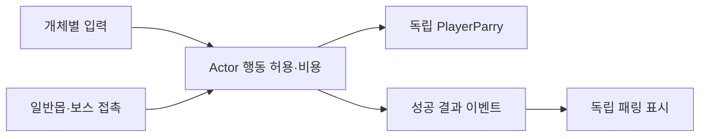

# 패링과 전투 보완 모듈 설계

기준: 2026-11-10, `개발자_제안사항_1109.md` 및 최신 담당 범위. 조작은 [확인 안내](../기획자용%20안내문서/패링과%20전투%20보완%20확인%20안내.md)를 따릅니다.

## 책임과 연결

`PlayerParry`는 공급 `PlayerAction`의 수치, 판정 창, 후딜만 관리하는 독립 코어입니다. Unity·입력·상태 ID·저장·보상·강화·무기에 의존하지 않습니다. 생성자로 정의를 받고 `TryBegin`, `Tick`, `Cancel`을 실행합니다. `Tick`은 소비한 시간만 반환합니다. 다른 개체와 상태를 공유하지 않습니다.

`PlayerActor.Actions`는 비용·접지·행동 허용 여부를 검사하고 이 모듈을 조립합니다. 패링 프로필이 연결되지 않은 Actor는 기존 전투를 계속 사용합니다. `PlayerRuntime`은 기존 카탈로그에서 플레이어별 프로필을 연결하며, 비활성화 시 남은 패링을 정리합니다. 활성 패링 중 프로필 교체는 거부합니다.

`PlayerParryInput`은 이동 입력 에셋 없이 생성하는 독립 입력 모듈입니다. 생성자로 Actor와 잠금 조건만 받으며 개체별 InputAction을 소유합니다. `PlayerLocomotionInput`은 이 모듈의 활성화·비활성화·폐기만 조립합니다. A(방향키)는 왼쪽 Shift, B(WASD)는 오른쪽 Shift, 패드는 LT입니다. 키 설정 변경 시 다시 연결하고 모달·일시정지·해제 프레임을 차단합니다. 비활성화 시 구독과 액션을 끄고 파괴 시 해제합니다. 구르기 A Space/B L은 유지합니다.

`MonsterActor`·`BossCombat`은 실제 공격 접촉을 전달하며 확률 추첨 전에 패링을 판단합니다. `ParrySucceeded`는 완료된 결과만 통지합니다. 독립 `PreviewParryFeedback`이 히트스톱·불꽃·효과음을 표시하고 수명을 정리합니다. 표시 모듈을 제거해도 판정은 작동합니다. `GameplayPreview`가 생성·연결·구독 해제를 소유합니다. 전역 객체 탐색은 추가하지 않습니다.

## 적용 수치와 경계

- 입력 시 기력30, 판정300ms, 성공 후딜200ms, 실패 총500ms. 부족하면 기존 게이지 깜빡임 이벤트만 발생합니다.
- 정면 성공: 플레이어 피해0. 일반몹은 판정 창·돌진·투척을 닫고 Stun1000ms. 보스는 스턴 없이 체세30, HP 피해0입니다. 잡기·사슬은 패링 대상에서 제외합니다.
- 공중·매달리기·약초·피격 경직·컷씬 중 시작 불가. 평타1~3타는 콤보 입력 창에서만 취소 가능하며 4타는 불가합니다. 중복 접촉은 한 번만 처리합니다.
- 히트스톱100ms, 공급 `impact_white_6x4` 단발 이펙트, 기존 Player_Parry 음원을 독립 `SFX_PARRY` 키로 재사용합니다. 데이터 Sound 행은 추가하지 않았습니다.
- 패링 상태 등록은 별도 담당입니다. 새 State ID를 만들지 않았으며 현재는 별도 행동 잠금과 임시 Idle 상태를 사용합니다. 전용 모션 공급 전 Attack1 첫 프레임을 임시 자세로 사용합니다.

## 나머지 전투·이동 보완

평타1~3타330ms, 4타550ms, 한 타 기력10입니다. 지게귀 돌진 설정은 거리400·속도800·판정500ms이며 명중하면 후딜로 진행합니다. 투척 사거리600은 유지합니다. 투사체는 공중 발판을 통과하고 고정 충돌체에서 사라집니다. 사망 모션 뒤 1초 동안 사체를 흐리게 합니다. 구덩이 낙하는 즉사입니다. 창모드 변경은 담당 범위 밖이므로 제거했습니다.

## 담당 경계와 검증

보상·재화·강화·레벨 보상·무기 스탯 합산·상태 등록·서낭당·관문·갈림길은 이번 코드 범위에서 제외했습니다. 이 작업 중 추가했던 성장/보상 코드, 강화 메뉴/프리팹, 성장 HUD, 저장 형식·이동 저장 변경, 관문 호환·맵 표식 변경은 제거했습니다. 기존 팀원 구현과 데이터는 보존합니다. 어두도는 보류 상태입니다. 사망 후 죽은 맵 입구/보스 서낭당 복귀와 저장 호환은 해당 연결 담당의 후속입니다.

코어753·데이터993 통과. 코어 검사는 창 경계, 비용, 취소·정리, 독립 동작, 일반몹/돌진/투척/잡기/보스 접촉을 포함합니다. 이동 컴포넌트·입력 에셋 없이 패링 입력만 생성하는 검사, 비활성화·재활성화, 실제 프리팹의 바인딩과 입력 콜백·잠금·독립 입력 수명19건, 공급 수치와 공격 시간은 Unity Edit에서 확인했습니다. Unity 네이티브 스크립트 컴파일 성공. 실제 키/패드 입력, 화면·청취, 발판/지면 투사체 접촉·사체 소멸의 Play 검증은 남아 있습니다. 편집 모드 가상 키 큐는 콜백을 발생시키지 않아 실입력 통과로 집계하지 않았습니다. 게임 빌드와 실제 저장 파일 쓰기는 하지 않았습니다.

## 공급 패링 이펙트 적용 — 2026-11-10 후속

원본은1746×1505이며 실제 셀 간격은291px입니다. 상단6×4를 같은291×291 셀24개로 분할하고 아래341px 투명 여백은 셀에서 제외했습니다. 자동 분할이 파편마다 잘랐던 메타만 수정했으며 PNG 픽셀은 보존했습니다. 첫 빈 셀0과 뒤 빈 셀15~23을 제외한1~14를24fps, 약0.583초 단발로 재생합니다. 시트 전체 셀은 Inspector에서 확인할 수 있습니다.

독립 `SpriteClipEffect`가 Sprite/클립·표시 시간만 소유합니다. `PreviewParryFeedback`은 전달받은 프리팹을 처음 성공할 때 생성해 재사용하고, 성공할 때마다 처음부터 재생합니다. `GameplayPreview._parryImpactPrefab`을 MapDohwagolTest에 연결했습니다. 미연결이어도 패링 판정·히트스톱·음원은 유지합니다. 진행 시간은 기존 표시 소유자가 비배율 시간으로 전달하여 히트스톱 중에도 표시됩니다. 종료 시 숨기고 해체 시 인스턴스를 정리합니다. 이전 임시 선4개 불꽃은 제거했습니다.

최신 코어773·데이터993, 적 공격 표시395건·효과와 매달리기/기어오르기36건 통과. 실제 렌더링에서도 흰 이펙트·투명 배경을 확인했습니다. 초기 패링 입력19건과 전체 Play/청취 후속 경계는 위 기록을 따릅니다.
