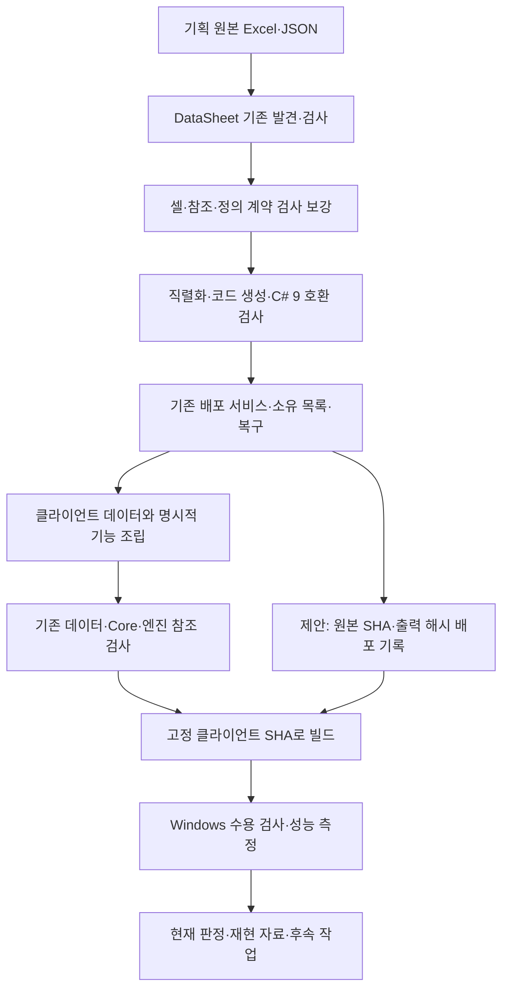
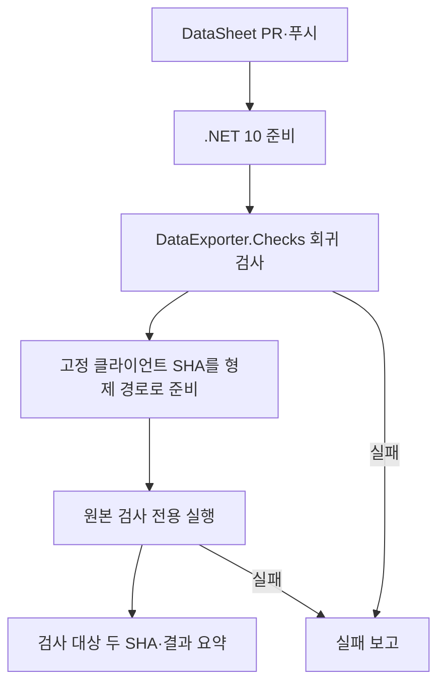
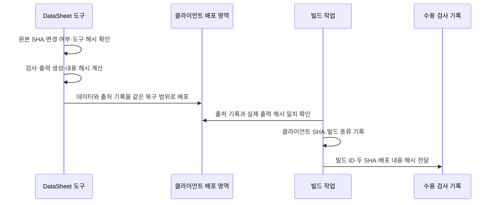
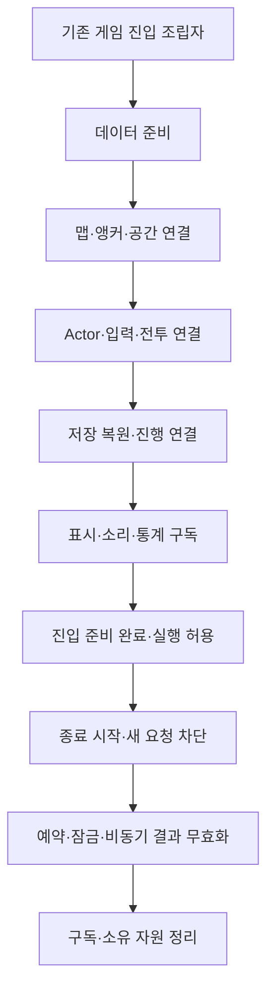

# 프로젝트 개선 로드맵과 설계안

작성일: 2026-11-14 · 대상: Human_Ghost- / DataSheet · 상태: 구현 전 제안

이 문서는 개선 방향·이유·기대 효과·책임·검증 조건을 정리한 내부 설계안입니다. 사용자는 문서 작성과 Git 게시를 요청했으며, 이 문서의 추가를 기능 구현 완료나 개별 설계 계약 변경 승인으로 해석하지 않습니다.

## 목차

1. [분석 기준과 현재 상태](#1-분석-기준과-현재-상태)
2. [우선순위와 기대 효과](#2-우선순위와-기대-효과)
3. [목표 구조와 책임](#3-목표-구조와-책임)
4. [실행파일 통합 검증 설계](#4-실행파일-통합-검증-설계)
5. [데이터 검사와 CI 설계](#5-데이터-검사와-ci-설계)
6. [두 저장소 버전 추적 설계](#6-두-저장소-버전-추적-설계)
7. [게임 조립과 수명 개선 설계](#7-게임-조립과-수명-개선-설계)
8. [성능과 리소스 개선 설계](#8-성능과-리소스-개선-설계)
9. [문서·협업과 실행 목록](#9-문서협업과-실행-목록)
10. [근거와 검증 범위](#10-근거와-검증-범위)

## 1. 분석 기준과 현재 상태

| 저장소 | 브랜치 | 확인한 커밋 |
| --- | --- | --- |
| Human_Ghost- | Develop | 23e19ff594d259ff70877df5a5316398a0587378 |
| DataSheet | main | 1e1f329717e10eb7bc85fa6f818a5dfef9ba28d8 |

클라이언트는 Unity 6000.2.8f1의 싱글플레이 2D 액션 게임입니다. DataSheet는 .NET 10 기반 원본 검사·추출·코드 생성·배포 도구입니다. 정의·실행 상태·규칙·표시·인프라 분리와 기존 검사 진입점을 재사용합니다.

현재 주요 기능과 공급 체계가 있으며, 최신 문서에는 엔딩·접지·재입장 보상 등의 후속 확인이 기록되어 있습니다. 해결된 항목을 다시 미구현으로 분류하지 않습니다. 아래 검증 항목은 현재 결함 확정 목록이 아니라 회귀 확인 목록입니다.

분석 시 원격 소스·문서·워크플로를 읽었습니다. 해당 클라이언트 SHA의 프로젝트 자동 검사 성공을 조회했지만, 이 문서 작성 과정에서 테스트·Unity Play·Windows 빌드를 새로 실행하지 않았습니다. 성능 저하·자산 중복·전체 완성률은 측정하거나 확정하지 않았습니다.

## 2. 우선순위와 기대 효과

| ID | 우선순위 | 개선 방향 | 필요한 이유 | 좋아지는 점 | 완료 증거 |
| --- | --- | --- | --- | --- | --- |
| I01 | P0 | 동일 빌드의 시작부터 엔딩까지 수용 검사 | 단위 검사만으로 씬·입력·영상·저장 통합을 확인하기 어려움 | 시연 진행 중단과 회귀 조기 발견 | 빌드 식별자·시나리오별 결과·재현 자료 |
| I02 | P0 | Excel 빈 셀·빈 시트·정의 계약 검사 보강 | 원본 표현 차이와 기존 정의 보존 정책의 틈을 보완해야 함 | 기획자가 오류 위치를 바로 확인하고 잘못된 공급 방지 | 정상·실패 입력 회귀 검사 |
| I03 | P1 | DataSheet 회귀 검사를 CI에 연결 | 현 트리의 워크플로는 머지 알림이며 도구 회귀 검사 연결이 없음 | 변경 전에 공급 도구 오류 발견 | PR에서 자동 검사 실행·실패 차단 확인 |
| I04 | P1 | 두 저장소 SHA와 실제 배포물의 출처 추적 | 클라이언트 SHA만으로 데이터 원본과 EXE 출처를 설명하기 어려움 | 빌드 재현·문제 추적·협업 인계 개선 | 빌드 정보와 배포 기록 대조 |
| I05 | P2 | 큰 게임 조립 책임을 점진적으로 분리 | Preview가 현재 운영 경로이며 초기화·정리 책임이 집중될 수 있음 | 변경 영향 축소·수명 오류 추적 용이 | 기존 동작 회귀 통과·종료 검사 |
| I06 | P2 | 실제 실행파일 성능 측정 후 최적화 | 현 분석으로 병목이나 풀링 필요성을 단정할 수 없음 | 목표 PC에서 안정적인 프레임·로딩 | 같은 장면의 전후 측정 |
| I07 | P2 | 자산 참조·빌드 포함·용량 점검 | 큰 PNG·WAV와 유사 경로는 실제 사용 확인이 필요함 | 다운로드·빌드·메모리 부담 개선 | 참조 검증·시각/청취 비교·용량표 |
| I08 | P1 | 최신 판정과 과거 이력 분리 | 최신 수정 기록과 과거 표가 함께 있어 판정이 어긋날 수 있음 | 담당자의 재조사·중복 작업 감소 | 항목별 현재 SHA·상태·근거 연결 |

P0는 다음 시연 안정성에 우선 적용합니다. P1은 변경의 재현성과 검사 체계를 강화하며 P0와 필요한 범위에서 함께 진행합니다. P2는 측정·변경 빈도·결함 근거가 있는 부분부터 적용합니다. 기간과 개인별 담당은 별도 합의하며 커밋 수를 기여율이나 완료율로 환산하지 않습니다.

## 3. 목표 구조와 책임

다음 도식은 기존 구조를 기반으로 추가하려는 검사·추적 지점을 보여 줍니다. 새 중앙 프레임워크를 도입하는 설계가 아닙니다.

| 책임 | 기존 위치·재사용 | 개선 경계 |
| --- | --- | --- |
| 원본 해석·검사 | DataSheet/Tools/DataExporter/Input·Validation | 값 검사를 클라이언트에 중복 구현하지 않음 |
| 정의·호환성 | Generation·Infrastructure | 일반 정의 보존, enum·계획은 생성기 소유 유지 |
| 배포 | DeploymentService·OutputCatalog | 기존 경로 검사·소유 목록·실패 복구 재사용 |
| 게임 규칙 | Assets/3.Script/Core | Unity 표시·파일 전송 책임을 넣지 않음 |
| 게임 조립 | Assets/3.Script/Preview와 Adapters | 필수 순서는 명시적 호출, 독립 결과는 기존 이벤트 |
| 빌드·검사 | Tools/Verify-Project.ps1·기존 GitHub 워크플로 | 검사한 SHA와 빌드한 SHA 일치 |
| 기록 | 기존 Firebase·빌드 정보·현황 문서 | 게임 규칙과 독립, 실제 원격 수신은 별도 검증 |

## 4. 실행파일 통합 검증 설계

### 방향과 순서

두 저장소 버전과 배포 상태를 고정한 기준 빌드를 먼저 만듭니다. 이미 해결된 문제도 회귀 시나리오로 확인하며, 같은 빌드에서 반복합니다. 기존 사용자 저장을 덮어쓰지 않도록 별도 테스트 환경·백업을 준비합니다.

| 검사 | 기대 결과 | 확인 자료 |
| --- | --- | --- |
| 새 게임·이어하기 | 선택한 정책에 맞는 위치·진행으로 진입 | 저장 전후 상태와 실행 로그 |
| 맵 재입장 | 처치·일회 보상·진행 정책 유지 | 진입 전후 재화·처치 기록 |
| NPC·메뉴·컷씬 중단 | 종료 후 조작·시간·모달 잠금 정상 해제 | 종료·사망·씬 이동별 조작 확인 |
| 사망·복원 | 최신 설계의 저장/리스폰 정책 일치 | 저장 상태와 복원 상태 비교 |
| 보스·엔딩 | 자연 종료와 스킵 모두 다음 진행 가능 | 영상·출구·타이틀 복귀 기록 |
| 한국어·영어 | 주요 UI·오류·닫기·저장된 언어 일치 | 동일 화면 비교·재실행 결과 |
| 네트워크 단절·재연결 | 게임 진행을 방해하지 않고 기존 전송 정책 준수 | 로컬 대기·전송 결과 대조 |

기록 필드: 시나리오 ID, 빌드 ID, 두 SHA, 실행 PC/해상도/빌드 종류, 사전 저장 상태, 재현 순서, 기대/실제 결과, 로그·영상, 판정, 담당 역할, 재검증 빌드. 실제 개인정보·인증값은 기록하지 않습니다.

완료 조건: 합의된 필수 시나리오의 진행 불가·저장 유실·정책 위반 보상 중복이 없고, 발견 결함의 수정 후 같은 경로를 재검증합니다. 단위 검사 통과를 실제 플레이 합격으로 대체하지 않습니다.

## 5. 데이터 검사와 CI 설계

### I02: 원본 오류를 배포 전에 설명하기

- ExcelTableReader의 inlineStr 처리에서 is 요소가 없는 표현을 확인합니다. 선택 문자열의 빈 값은 정상 빈 문자열로 읽고, 필수 여부는 스키마 검사에서 판정하도록 검토합니다.
- sharedStrings·빈 값·숫자·오류 셀·수식 금지 등 기존 계약을 유지하고, 지원하지 않는 표현은 SourceLocation으로 파일·탭·셀을 안내합니다.
- 빈 시트도 스키마와 참조 대상 테이블·컬럼의 존재를 검사합니다. 행이 없다는 이유로 규칙 자체의 오타가 통과하지 않게 합니다.
- 기존 일반 정의를 덮어쓰지 않고, 시트의 생성/매핑 계약과 실제 클래스의 생성자·매핑 대상 이름·형식을 비교합니다. Roslyn과 기존 코드 생성·컴파일 정보를 우선 재사용합니다.
- 같은 타입의 인접 컬럼 순서 변경처럼 컴파일만으로 놓칠 수 있는 사례를 검사 대상으로 명시합니다. 정상적인 상속·생성자 변환은 기존 생성 규칙을 기준으로 비교합니다.

| 회귀 사례 | 기대 결과 |
| --- | --- |
| is 없는 빈 inlineStr / 정상 빈 문자열 | 읽기 단계 예외 없이 스키마 필수 여부로 판정 |
| 빈 시트의 잘못된 참조 테이블·컬럼 | 행 수와 무관하게 규칙 오류 |
| 컬럼 삭제·타입 변경·의미 있는 순서 불일치 | 기존 정의와의 계약 차이를 명시하고 중단 |
| 정상 상속·그룹 JSON·enum·새 탭 | 기존 생성·로딩 동작 유지 |
| 검사 실패 | 배포 대상 파일 변경 없음 |
| 배포 중 쓰기 실패 | 기존 복구 정책대로 원복, 복구 실패 자료 보존 |

빈 inlineStr는 소스상 실패 가능성을 확인한 사항입니다. 현재 모든 원본에 대한 재현 완료로 표기하지 않습니다. 일반 정의의 수동 수정 정책과 기획자 소유 원본 보존 정책은 유지합니다.

### I03: 기존 검사를 CI에서 실행하기

1. 회귀 검사: dotnet run --project Tools/DataExporter.Checks.
2. 통합 검사: 동일 부모 아래 DataSheet·Human_Ghost-를 배치하고 소스 빌드 도구의 --check를 실행합니다. --deploy는 CI 검사 경로에서 실행하지 않습니다.
3. 클라이언트 ref는 아래 버전 연결 설계의 고정 SHA를 사용합니다. 움직이는 Develop 최신값을 매번 가져와 같은 PR 결과가 달라지지 않게 합니다.
4. 실패 요약에는 명령·두 SHA·원본 위치·원인을 남깁니다. 실행하지 못한 단계를 통과로 기록하지 않습니다.
5. 도구 소스 변경 시 기존 Publish-DataExport.ps1로 EXE를 재생성하고 소스와 함께 공유합니다. 원본 값만 바뀐 경우 불필요한 EXE 재생성은 하지 않습니다.
6. 브랜치 필수 검사 설정은 저장소 관리 권한이 필요한 별도 운영 작업으로 다룹니다. 워크플로 추가만으로 병합 차단이 설정됐다고 기록하지 않습니다.

기대 효과: 셀 표현·스키마·생성기 변경의 오류를 기획자 배포 전에 발견하고, 특정 개발 PC에서만 검사되는 상황을 줄입니다.

## 6. 두 저장소 버전 추적 설계

현재 클라이언트 SHA 기록과 생성기 소유 목록을 유지하면서 출처 기록을 확장합니다. 아래 이름과 필드는 구현 전 제안입니다.

| 제안 필드 | 의미 |
| --- | --- |
| ClientCommit | 실제 빌드한 클라이언트 전체 SHA |
| DataSourceCommit | 실제 배포에 사용한 DataSheet 전체 SHA |
| DataSourceDirty | 원본에 미커밋 변경이 있었는지 |
| ExporterHash | 사용한 DeployData.exe 또는 도구 산출물의 SHA-256 |
| DataContentHash | 경로 정렬 후 실제 배포 데이터·생성물의 해시로 계산한 식별자 |
| BuildKind / BuildID | 기존 development/release와 해당 실행 결과 식별자 |

출처 파일에 클라이언트의 미래 커밋 SHA를 미리 쓰지 않습니다. 데이터 출처는 배포 단계에서, ClientCommit은 빌드 단계에서 결합합니다. 보고·빌드 메타데이터는 Markdown 또는 기존 빌드 정보 형식을 우선 사용하며, 기존 .datasheet-generated.json은 생성기 소유 목록 용도로 유지합니다.

Git 없는 기획자 환경에서는 SHA를 추측하지 않습니다. EXE와 함께 제공되는 신뢰 가능한 버전 정보 또는 명시적 출처 없음 상태를 사용합니다. 로컬 --check는 가능하게 두고, 시연 후보 빌드의 출처 미확정·dirty 처리 정책은 구현 전에 팀과 확정합니다.

기대 효과: 같은 데이터 원본·도구·클라이언트를 다시 준비할 수 있고, 오류가 코드 변경인지 원본 변경인지 빠르게 좁힐 수 있습니다. 런타임 저장 포맷 버전과 콘텐츠 출처 식별자는 구분합니다.

## 7. 게임 조립과 수명 개선 설계

### I05: 기존 실행 경로를 유지하며 책임 축소

현재 GameplayPreview와 하위 모듈의 호출·종료 흐름을 먼저 도식화하고, 중복 또는 오류가 반복되는 책임 하나만 추출합니다. 아래 역할명은 설계상 역할이며 새 클래스명을 확정한 것이 아닙니다.

- 기존 Core·Adapters·Presentation 경계를 유지합니다. 네트워크·전역 이벤트 버스·범용 프레임워크를 추가하는 전제가 아닙니다.
- 필수 연결 실패는 조립자에게 전달합니다. 데이터 완료 통지의 예외 격리를 일반 게임 이벤트에 확대하지 않습니다.
- 기존 SubscriptionScope·AssetLease·앵커 연결을 우선 재사용하고 소유자와 해제 지점을 표로 확인합니다.
- 생성·설정·연결은 비활성 상태에서 마치고 활성화합니다. 외부 소유 앵커는 정리 대상에서 제외합니다.
- 씬 이동·사망·대화 중단 후 늦게 도착한 비동기 결과가 이전 객체에 적용되지 않는지 검사합니다.
- 공개 계약·다른 담당 기능·저장 정책 변경이 필요하면 해당 변경의 이유와 영향을 먼저 협의합니다.

완료 조건: 기존 행동·저장·전투 결과 유지, 반복 진입에서 구독·잠금·소유 리소스 누수 없음, 실패 경로 정리 확인. Preview 이름 변경만으로 개선 완료를 판단하지 않습니다.

기대 효과: 한 기능을 수정할 때 확인해야 하는 범위와 초기화 순서 의존성이 줄고, 종료·재진입 결함의 원인을 추적하기 쉬워집니다.

## 8. 성능과 리소스 개선 설계

### I06: 측정으로 병목 선택

| 측정 장면 | 항목 | 개선 판단 |
| --- | --- | --- |
| 일반 탐색·전투 | CPU/GPU 프레임 시간·GC 할당 | 프레임 지연의 실제 원인 구분 |
| 다수 몬스터·효과 | 생성/삭제 비용·갱신 비용 | 생성 비용이 병목일 때만 풀링 검토 |
| 맵 왕복 | 로딩 시간·최대 메모리·반복 후 잔류 | 자산 해제·구독 수명·중복 로딩 점검 |
| 메뉴·언어·HUD | UI 재구성·문자열 할당 | 기존 변경 통지 기반 갱신 우선 활용 |

목표 PC·해상도·품질·프레임 목표와 로딩 허용치를 먼저 정하고 같은 빌드 조건으로 측정합니다. 예를 들어 60fps를 목표로 확정한 경우 프레임 예산은 약 16.7ms이며, 이 숫자는 현재 프로젝트의 측정값이 아닙니다. 평균과 상위 지연 구간을 함께 기록합니다.

### I07: 참조와 품질을 보존하는 용량 개선

1. Unity 빌드 보고서와 Addressables 참조로 실제 포함 자산을 확인합니다.
2. 이름·경로가 비슷한 파일은 내용 해시·해상도·참조·용도를 대조합니다. 유사 경로만으로 중복이라 단정하지 않습니다.
3. 기존 무손실 PNG 최적화 도구와 검사부터 재사용합니다.
4. 음원은 재생 용도·길이·메모리·지연을 보고 Import 설정 변경을 검토합니다.
5. 변경 전후 빌드 크기·로드 메모리·화면·소리·Sprite 경계·애니메이션을 비교합니다.
6. 삭제가 필요한 경우 참조와 .meta GUID 영향을 확인하고, 아트 원본 공급 기여를 보존합니다.

기대 효과는 실제 절감 측정 후 기록합니다. Git LFS·전체 자산 재구성·일괄 압축을 사전 확정하지 않습니다.

## 9. 문서·협업과 실행 목록

### I08: 최신 판정은 한곳에서 관리

현재 구현과 검증 현황 문서의 최신 표에 기준 SHA·판정·근거를 연결하고, 날짜별 기록은 이력으로 보존합니다. 이 문서는 개선의 이유와 설계를 담당하며 현황 문서를 복제하지 않습니다. 기능 구현 시 해당 개발자 설계와 기획자 사용 안내를 함께 갱신합니다.

상태는 제안 → 구현 중 → 자동 검사 확인 → 실제 실행 확인으로 구분합니다. 적용하지 않기로 한 항목은 보류 이유를 기록합니다.

### 첫 실행 묶음

- [ ] I01: 기준 빌드와 수용 시나리오·결과 기록 준비
- [ ] I02: 빈 inlineStr 재현 fixture와 필수/선택 문자열 처리 보완
- [ ] I02: 빈 시트 참조 규칙과 기존 정의 계약 검사 보강
- [ ] I03: DataSheet 회귀·고정 클라이언트 통합 검사 워크플로 추가
- [ ] I04: 배포 출처와 빌드 정보 연결 필드·dirty 정책 확정
- [ ] I08: 최신 판정 표와 해결된 과거 항목 정합성 정리

### 이후 실행 묶음

- [ ] I05: 실제 결함/변경 빈도가 높은 조립 책임 하나 선정·추출
- [ ] I06: 목표 PC의 기준 성능 측정과 병목별 개선
- [ ] I07: 실제 포함 자산의 용량·참조·품질 비교

| 역할 | 맡을 일 | 협업 경계 |
| --- | --- | --- |
| 클라이언트 개발 | 수명·통합 결함·빌드 추적·측정 | 다른 담당 기능과 기존 계약 확인 |
| 데이터 도구 개발 | 입력·스키마 검사·CI·EXE 갱신 | 기획자 원본 값을 임의 변경하지 않음 |
| 기획 | 기대 결과·시연 동선·원본 규칙 확인 | 완료 기준과 정상 게임 정책 확정 |
| 아트 | 시각 품질·자산 용도·공급 원본 확인 | 원본 제작과 개발 가공·연결 기여 구분 |
| 공동 검수 | 실제 빌드 시나리오와 수정 후 회귀 | 실행한 범위와 미확인 범위 기록 |

## 10. 근거와 검증 범위

### 기존 문서

- [프로젝트 전체 아키텍처](프로젝트%20전체%20아키텍처.md)
- [현재 구현과 검증 현황](현재%20구현과%20검증%20현황.md)
- [남은 구현과 검증 작업](남은%20구현과%20검증%20작업.md)
- [설계 기준 점검과 개선 방향](설계%20기준%20점검과%20개선%20방향.md)
- [데이터 자동 발견과 Unity 배포 경계 설계](데이터%20자동%20발견과%20Unity%20배포%20경계%20설계.md)
- [다른 PC 작업 시작과 설계원칙 인수인계](다른%20PC%20작업%20시작과%20설계원칙%20인수인계.md)
- [DataSheet 안내](https://github.com/hyunho9228-web/DataSheet/blob/1e1f329717e10eb7bc85fa6f818a5dfef9ba28d8/README.md)

### 확인한 주요 코드와 원격 결과

- [ExcelTableReader](https://github.com/hyunho9228-web/DataSheet/blob/1e1f329717e10eb7bc85fa6f818a5dfef9ba28d8/Tools/DataExporter/Input/ExcelTableReader.cs): 빈 inlineStr 처리 보완 검토 근거
- [TableRule](https://github.com/hyunho9228-web/DataSheet/blob/1e1f329717e10eb7bc85fa6f818a5dfef9ba28d8/Tools/DataExporter/Validation/TableRule.cs): 행 순회와 참조 규칙 검사 검토 근거
- [DeploymentService](https://github.com/hyunho9228-web/DataSheet/blob/1e1f329717e10eb7bc85fa6f818a5dfef9ba28d8/Tools/DataExporter/Infrastructure/DeploymentService.cs): 소유 목록·경로·복구 재사용 근거
- [DataBootstrapper](https://github.com/lkhwcf-arch/Human_Ghost-/blob/23e19ff594d259ff70877df5a5316398a0587378/Assets/3.Script/Data/Infrastructure/DataBootstrapper.cs): 초기화 순서·완료 통지 계약
- [프로젝트 검사 워크플로](https://github.com/lkhwcf-arch/Human_Ghost-/blob/23e19ff594d259ff70877df5a5316398a0587378/.github/workflows/project-checks.yml)
- [확인한 클라이언트 자동 검사 성공 기록](https://github.com/lkhwcf-arch/Human_Ghost-/actions/runs/43602463376)

이번 산출물은 설계 문서와 문서 목차 연결입니다. 코드·데이터·씬·프리팹·실행파일의 개선 적용과 새 검증 결과는 이후 실제 수행 시 기록합니다.

