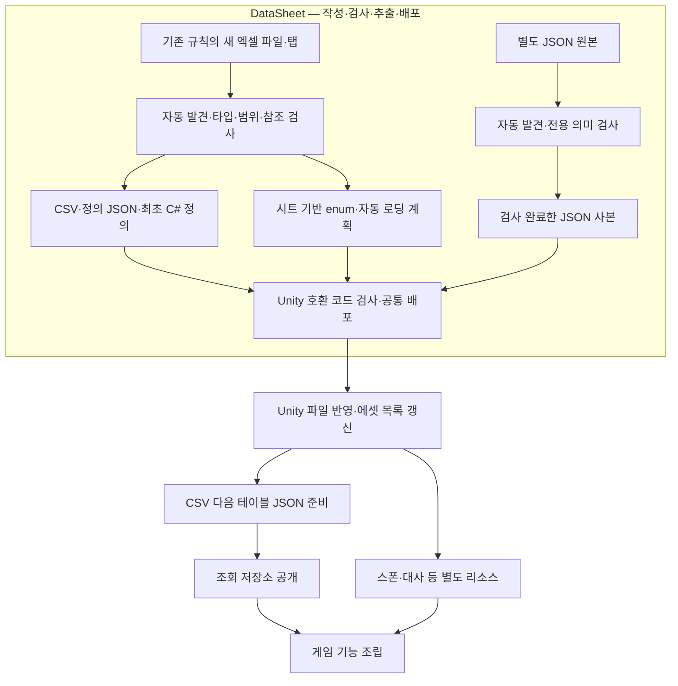
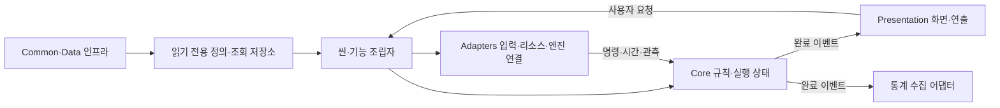
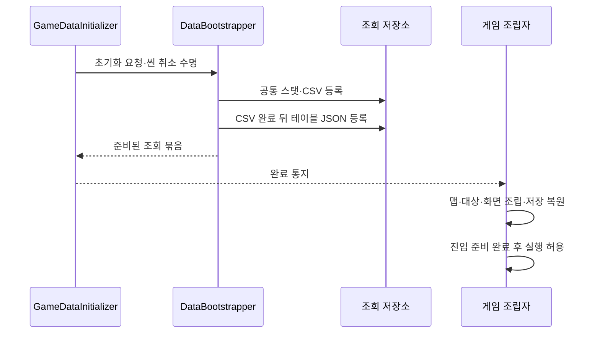
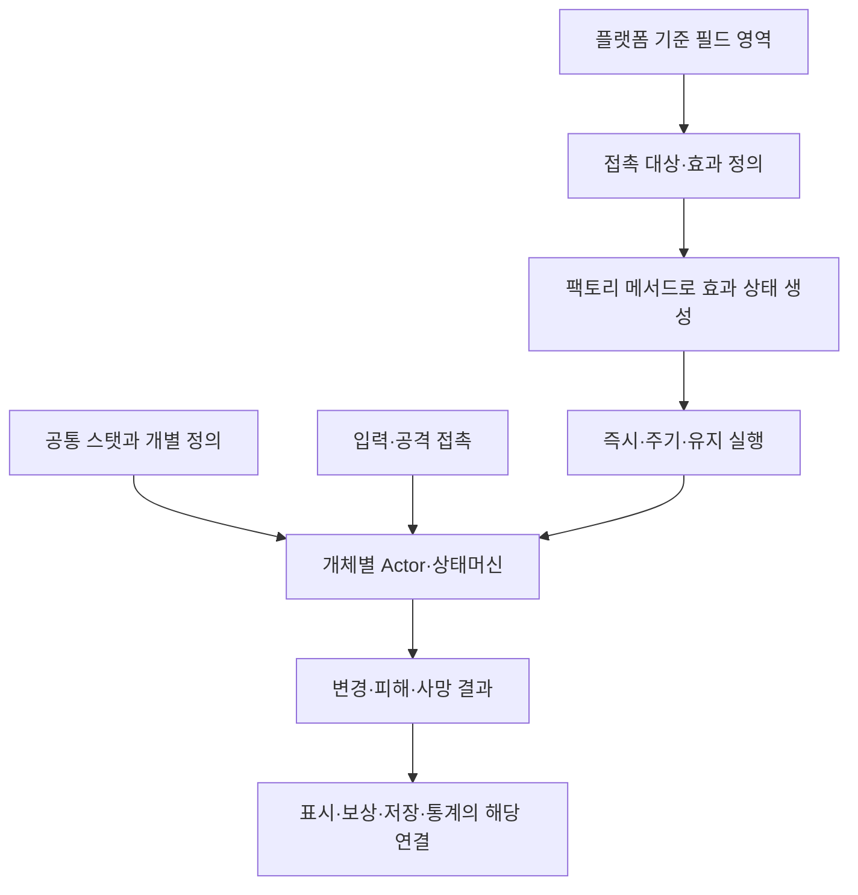
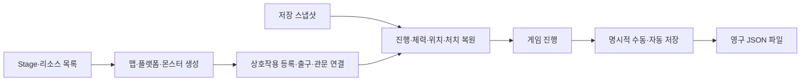
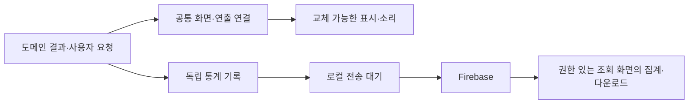
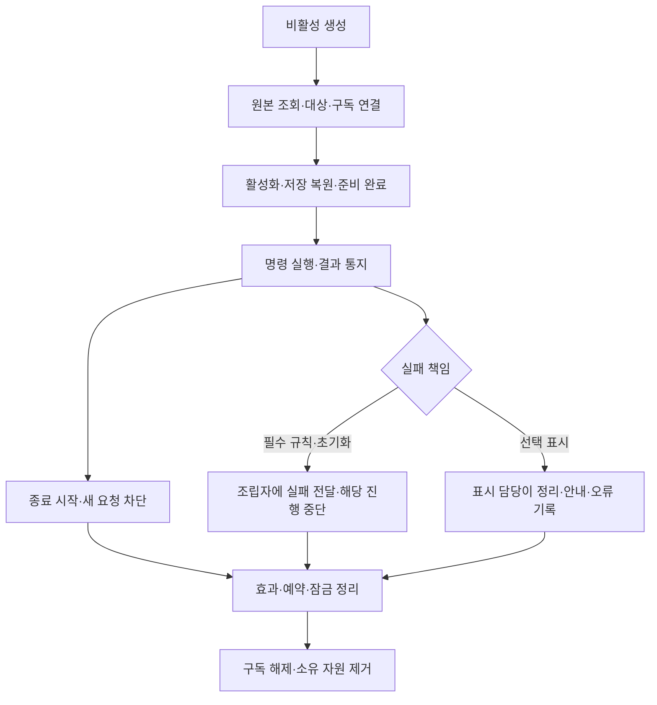
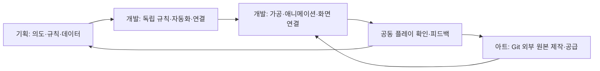

# 프로젝트 전체 아키텍처 — 내부용

기준일: 2026-11-13. 클라이언트 `b4296e3`, DataSheet `bd368a9`와 현재 파일을 대조했습니다. 이 문서는 개발·기획 인수인계용입니다. 외부에는 이 문서를 전달하지 않고 [지스타 출품 개발 현황 소개](../외부%20공개용%20문서/지스타%20출품%20개발%20현황%20소개.md)를 사용합니다.

## 목차

1. [설계 목적과 기본 원칙](#1-설계-목적과-기본-원칙)
2. [두 프로젝트와 자동화 범위](#2-두-프로젝트와-자동화-범위)
3. [클라이언트의 책임과 의존 방향](#3-클라이언트의-책임과-의존-방향)
4. [큰 기능에서 하위 기능으로](#4-큰-기능에서-하위-기능으로)
5. [생성·실행·종료와 오류](#5-생성실행종료와-오류)
6. [새 콘텐츠를 추가하는 순서](#6-새-콘텐츠를-추가하는-순서)
7. [협업과 변경 관리](#7-협업과-변경-관리)
8. [현재 구현과 확장 경계](#8-현재-구현과-확장-경계)

## 1. 설계 목적과 기본 원칙

기획자가 수치·문구·배치를 변경할 때 같은 코드를 반복 수정하지 않고, 개발자가 기능 하나를 교체해도 관계없는 기능까지 다시 만들지 않기 위한 구조입니다. **모든 기능의 독립성과 모듈화가 기본이며, 필요한 의존 관계와 승인된 예외는 명시합니다.** 독립성은 의존 관계가 전혀 없다는 뜻이 아닙니다.

| 원칙 | 선택한 이유 | 적용 범위 |
| --- | --- | --- |
| 데이터 정의와 실행 상태 분리 | 공유 원본 손상과 개체 간 상태 공유 방지 | 정의는 읽기 전용, 체력·타이머·진행은 실행 객체에 보관 |
| 명령과 완료 이벤트 분리 | 실행 순서와 상태 소유자를 명확히 함 | 요청은 호출·명시적 연결, 완료 결과는 독립 소비자에게 알림 |
| 공통화와 상속 | 같은 수명·처리를 재사용 | 공통 캐릭터 스탯, 상태·효과 생성, 표시 기반 등 실제 공통 책임 |
| 정수 단위 | 데이터 의미와 계산 기준 통일 | 시간 ms, 확률·비율 분모 10000, 위치·이동은 정수 단위. Unity 경계의 실수는 변환에 사용 |
| 필요한 진행만 갱신 | 불필요한 탐색·문자열·표시 갱신 감소 | 이동·애니메이션·활성 타이머는 시간 진행, 표시·등록·접촉은 변경 알림 활용 |
| 패턴은 목적에 맞게 선택 | 불필요한 계층·전역 연결 방지 | 상태·팩토리 메서드·전략·옵저버·퍼사드를 필요한 기능에 적용 |

현재는 싱글플레이입니다. 네트워크 전송·권한·동기화는 구현하지 않았습니다. 향후 확장 시 ID·상태 소유권·명령 순서·시간·난수를 별도로 설계해야 하며 정수 사용만으로 결정성을 보장하지 않습니다.

## 2. 두 프로젝트와 자동화 범위



현재 출력은 CSV 29개·정의 JSON 5종, 별도 JSON 15개입니다. 파일 개수는 진행률이 아니라 현재 공급 목록입니다. 기획자가 `DeployData.exe`를 실행하면 이후 과정이 자동입니다. 원본 저장 감시, Git 푸시, 게임 빌드, 새 기능 구현까지 자동 실행되는 구조는 아닙니다.

| 대상 | 자동 처리 | 개발자가 추가로 담당할 일 |
| --- | --- | --- |
| 새 xlsx·새 탭 | tables 재귀 발견·기존 1~5행 규칙 해석·추출·최초 정의·로딩 계획 | 새로운 게임 규칙을 사용하는 소비자 연결 |
| 엑셀에서 추출하는 JSON 표 | 형식·그룹·상속 규칙에 맞춰 생성·등록 | 미지원 개념의 해석·소비 구현 |
| 기존 형식의 별도 JSON | 해당 폴더 규칙으로 발견·검사·배포 | 필요한 최초 리소스·호출 연결 |
| 새 형식·새 폴더의 JSON | 발견 후 검사 규칙이 없으면 중단·안내 | JsonAssetRule 구현·도구 재빌드·필요한 읽기/실행 연결 |
| 일반 정의 C# | 없을 때 최초 생성 | 컬럼 변경 시 기존 정의를 직접 맞춤 |
| 생성 enum·StateKey | 매 배포 갱신, 사용 중인 명시적 참조 확인 | 고정 정수값 관리·새 동작 구현 |

JSON 자동 배포와 런타임 일괄 등록은 다릅니다. 상태·아이템 등 테이블 JSON은 로딩 계획이 처리합니다. 서낭당·갈림길은 전용 읽기 연결이 있으며 스폰은 StageContentSet의 TextAsset을 읽습니다. 대사 원본 배포는 준비됐으나 새 대사 실행 소비자는 아직 미연결입니다. 새 JSON 형식을 넣는 것만으로 이 단계가 자동 구현되지 않습니다.

원본 JSON 탐색은 Tools·Docs·tables·점으로 시작하는 관리 항목과 예시용 stats/item을 제외합니다. stats 접두어는 배포 경로에서 제거합니다. 검사 규칙 중복·없는 규칙·파일명 로딩 키 충돌은 배포 전에 중단합니다. 실패 원복과 삭제는 생성기 소유 목록 기준이며 수동 파일을 임의로 덮어쓰지 않습니다.

## 3. 클라이언트의 책임과 의존 방향



| 구획 | 실제 위치·대표 코드 | 소유 책임 |
| --- | --- | --- |
| 원본 도구 | DataSheet/Tools/DataExporter | 검사·직렬화·생성·배포. 내부 .NET 10·최신 안정 C# |
| 정의 | Assets/3.Script/Data | 읽기 전용 설정·공통 스탯 상속·생성 enum |
| 저장소·초기화 | Data/Storage·Mapping·Infrastructure | 읽기·변환·CSV→JSON 순서·ID 조회·완료 통지 |
| 규칙·실행 상태 | Core | 행동·전투·이동 계산·저장 상태·성장·효과. Unity API 미의존 |
| 엔진 연결 | Adapters | 입력·리소스·저장 파일·화면과 규칙의 접점 |
| 표시 | Presentation | 화면·막대·문구·영상·표현. 도메인 원본을 변경하지 않음 |
| 현재 게임 조립 | Preview/GameplayPreview 및 하위 모듈 | 현재 맵·캐릭터·진행·화면의 연결·실행 순서·정리 |
| 기록·외부 연결 | FireBase·Tools/TelemetryConsole | 게임 이벤트 독립 소비, 보관·전송·조회. 게임 규칙을 소유하지 않음 |

Preview라는 이름이 붙어 있어도 현재 `MapDohwagolTest`의 실행 조립 경로입니다. 별도의 완성된 운영 조립 계층이 있다고 가정하지 않습니다. 기존 큰 조립자와 일부 직접 참조·개발 설정은 남아 있으며, 이 문서는 전면 재구현을 지시하지 않습니다.

## 4. 큰 기능에서 하위 기능으로

### 4.1 데이터 준비와 기능 조립



GameDataAssets는 배포 데이터를 참조합니다. Editor의 GameDataAssetBuilder가 파일 변경·빌드 전에 목록을 갱신하며 런타임에서 Assets 폴더를 직접 열지 않습니다. 값 검사는 DataSheet 책임이며 클라이언트는 읽기·타입 변환·필수 연결의 계약 오류를 보고합니다.

### 4.2 캐릭터·전투·필드 효과



캐릭터는 공통 스탯을 상속하고 개성을 별도 정의에 둡니다. 현재 HP·행동·타이머는 개체별 실행 상태에 있습니다. 캐릭터 전체를 새 팩토리로 만들지 않습니다. 필드 효과는 캐릭터 행동 상태와 분리하며 생성은 EffectStateFactory의 재정의로, 실행 동작은 IEffectAction으로 연결합니다. 팩토리는 생성 중 피해나 이펙트를 실행하지 않습니다.

몬스터별 EffectImmunities를 공통 조회합니다. 불은 기존 무적·사망을 유지한 체력 전용 피해, 얼음은 넉백 시작 시 거리를 확정하는 보정입니다. 모든 개성을 시트만 추가하면 자동 구현되는 구조는 아니며 신규 동작은 실행 코드 등록이 필요합니다. 상세는 [필드 효과 설계](필드%20효과%20상태와%20enum%20배포%20설계.md)를 봅니다.

### 4.3 맵·상호작용·저장



StageContentSet의 실제 프리팹·스폰 참조는 최초 연결이 필요합니다. 일반 프리팹은 지정 앵커를 사용하고 몬스터·필드는 승인된 플랫폼 상대 배치를 사용합니다. 생성 후 초기화를 끝내고 활성화하며 맵 재진입 때 처치 기록을 적용합니다. 현재 맵·몬스터 재사용 풀을 구현했다고 표현하지 않습니다.

진행 중 변경은 임시 상태이며 명시적 저장 성공으로 영구 파일에 반영합니다. 테스트 슬롯·F5·확인 후 최신 슬롯을 삭제하는 F12와 출시 단일 자동 저장 정책을 구분합니다. 삭제·리스폰·출구 정책은 서로 독립된 책임입니다.

### 4.4 화면·컷씬·소리와 운영



타이틀 외형은 승인된 씬 직접 편집 예외입니다. 나머지 지원 콘텐츠 값·문구·주소는 데이터에서 읽습니다. 모든 UI 위치를 데이터화하거나 모든 로컬 호출을 이벤트 버스로 바꾸지 않습니다. 컷씬은 공용 재생 기반과 실제 콘텐츠·호출 연결을 구분합니다. 소리의 주소 준비와 실제 재생도 별개입니다.

오류는 Firebase 수집 대상이지만, 수집 비활성·초기화 실패·보관 한도·강제 종료 시 원격 도착을 보장할 수 없습니다. 오류 보고 자체를 무한 재보고하지 않습니다. Spark 구성의 통계는 조회 화면에서 집계하며 서버 함수 집계·자동 오류 메일은 현재 구현이 아닙니다.

## 5. 생성·실행·종료와 오류



일반 게임 이벤트는 동기이며 게시자가 구독자 예외를 일괄 무시하지 않습니다. 예외적으로 **데이터 준비 완료 통지**는 소비자 실패와 데이터 준비 성공을 구분해 다음 독립 소비자를 계속 알립니다. 필수 의존 순서는 이 통지 순서에 맡기지 않고 조립자가 직접 제어합니다.

게시자·구독자·이벤트 대상·연결 세대의 수명을 구분합니다. SubscriptionScope의 Guard·Dispose·Cleanup을 재사용하되 Invalidate는 수명 종료가 아닌 표시 갱신 예약입니다. 정리 동작은 한 곳의 실패 때문에 나머지가 누락되지 않도록 구성합니다. 기존 모든 종료 경로와 표시 소비자가 이미 이 계약으로 정비됐다는 뜻은 아닙니다.

## 6. 새 콘텐츠를 추가하는 순서


기존 테이블 사용 예시는 다음과 같습니다. 파일을 다시 읽거나 정의의 값을 변경하지 않습니다.

```csharp
IReadOnlyDataTable<Player> players = catalog.GetTable<Player>();
Player definition = players.Get(playerId);
// 현재 체력은 별도 실행 객체에서 관리합니다.
int maximumHealth = definition.HP;
```

실제 배치 예: FieldObjectPlacement 22001은 StageID 8002·PlacementID 101·X 2100·Y 200·Width 600입니다. 이는 해당 플랫폼 기준 위치이며 월드 절대 좌표가 아닙니다. 문서 예시를 새 원본으로 덮어쓰지 않고 항상 최신 시트를 우선합니다.

새 JSON 형식은 검사 규칙 → 생성/읽기 계약 → 실제 사용자를 함께 연결합니다. 새 enum은 코드 이름이 생기는 것이며 동작 구현을 대신하지 않습니다. C# 9 호환 검사는 도구 내부의 최신 문법과 분리합니다.

## 7. 협업과 변경 관리



Git 작성자·실제 작업자·검증 상태는 구분합니다. 사용자 확정에 따라 DataSheet의 Claude 작성 커밋은 Kim Hyun Ho의 작업으로 귀속하고 원래 작성자 표기도 근거로 남깁니다. 아트 담당자는 별도 업로드로 참여했으므로 커밋 유무로 기여를 판단하지 않습니다. 리소스 통합 커밋은 원본 제작자의 기여를 대체하지 않습니다.

기능별 참여 역할·커밋 근거·기획 대비 변경·추가는 [현재 구현과 검증 현황](현재%20구현과%20검증%20현황.md) 한곳에서 관리합니다. 공식 담당 배정이나 일정표를 커밋 수로 추정하지 않습니다.

## 8. 현재 구현과 확장 경계

현재는 주요 모듈을 테스트 맵에 조립한 상태이며 전체 공간·NPC·컷씬·새 보상 콘텐츠·실제 빌드의 검증이 남아 있습니다. GameplayPreview의 큰 조립 책임, 일부 리소스 직접 등록, 보류 기능과 실제 실행 예외는 개선·연결 대상으로 남습니다.

원래 기획과 사용자 확정 변경, 개발을 위해 추가한 기반 시스템을 혼합하지 않습니다. [현황·진행 수치](현재%20구현과%20검증%20현황.md)와 [남은 작업](남은%20구현과%20검증%20작업.md)을 기준으로 읽고 기능별 설명은 하위 문서를 따릅니다. 기획자의 시작점은 [공통 사용 안내](../기획자용%20안내문서/기획자용%20공통%20모듈%20연결과%20확인%20안내.md)입니다.
