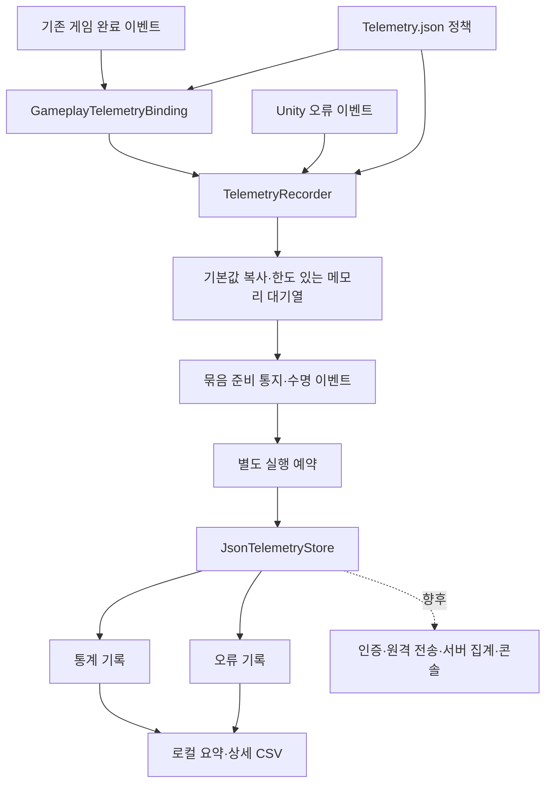
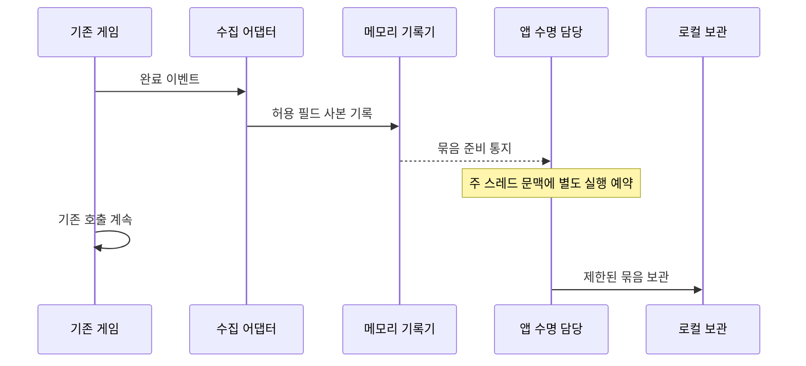

# 플레이 통계와 오류 수집 설계

기준일: 2026-11-12. 이 문서는 첫 단계의 로컬 기록·기존 이벤트 연결을 설명합니다. 후속 Firebase 인증·재전송·조회 집계·실제 xlsx 코드는 [별도 연결 설계](Firebase%20통계%20인증·전송·조회%20설계.md)에 정리했고 운영 배포는 보류입니다. [로컬 확인 안내](../기획자용%20안내문서/플레이%20통계%20수집과%20확인%20안내.md)를 함께 봅니다.

## 1. 목적과 설계 이유

사망·재화·레벨·처치 기록으로 어려운 구간과 경제·성장 흐름을 확인하고, 오류는 별도 묶음으로 조사합니다. 게임은 수집 시스템의 존재를 몰라야 합니다. 수집 요구 변경은 게임 규칙이 아니라 수집 정책·어댑터에서 처리합니다.

기존 FirebaseTestLogger에는 시험용 점수·실수 시간 형식과 잘못된 인증·저장 주소, 전역 토큰, 기다릴 수 없는 async void 전송이 섞여 있었습니다. 호출부가 없는 것을 확인하고 JsonTelemetryStore로 교체했습니다. 기존 프로젝트 키는 코드에서 제거했고 외부 호출은 하지 않습니다. 파일의 메타 식별자는 유지했습니다.

## 2. 책임과 위치

| 위치 | 책임 |
| --- | --- |
| Assets/3.Script/FireBase/TelemetryRecords.cs | 불변 기록, 항목별 허용 필드와 버전, 대기열, 보관 성공 후 제거 |
| 같은 폴더의 GameplayTelemetryBinding.cs | 기존 이벤트 구독·수집 값 변환·해제. 아이템은 호출 계약만 제공 |
| 같은 폴더의 JsonTelemetryStore.cs | UTF-8 JSONL 로컬 보관, 통계·오류 분리, 디스크 한도 |
| 같은 폴더의 TelemetryHost.cs | 앱 수명·정책 로딩·Unity 오류·씬 이벤트·보관 예약 |
| Preview/GameplayPreview.Telemetry.cs | 현재 조립자에서 준비 완료된 플레이어·보상·정수 위치 전달 |
| Assets/StreamingAssets/Telemetry.json | 수집 여부·항목·허용 필드·형식 버전·용량 설정 |
| Tools/Telemetry/Export-Telemetry.py | 로컬 기록 중복 제거·집계·엑셀에서 열 수 있는 CSV 내보내기 |

Core 게임 규칙·데이터 정의는 변경하지 않았습니다. 기존 조립자에 준비 완료 연결과 해제만 추가했습니다. 별도 전역 게임 이벤트 버스·범용 관리자·Unity용 Firebase SDK·상시 Update·폴링·코루틴은 추가하지 않았습니다. 후속 네트워크 I/O는 취소 가능한 앱 수명 전송 작업으로 별도 구현했으며 동기 보관용 ITelemetrySink에 네트워크 대기를 끼워 넣지 않습니다.

## 3. 실제 연결과 미제공 정보

| 항목 | 현재 연결 | 남은 범위 |
| --- | --- | --- |
| 사망 | HealthChanged의 양수→0 전이 1회, 스테이지·정수 위치·레벨 | 공격자·원인은 기존 이벤트에 없어 기록하지 않음 |
| 혼·엽전 | 진입 시 잔액 스냅샷, Wallet.Changed의 전후 차·잔액 | 변경 이유·획득 경로 미제공. 잔액 차만으로 원인을 추정하지 않음 |
| 레벨 | 진입 레벨·경험치, LeveledUp의 전후 레벨 | 상한·저장 복원은 새 레벨업으로 기록하지 않음 |
| 일반 몬스터 | MonsterRewards.Granted의 종류·스테이지·배치·순번 | 보상 지급 완료 기준. 보스·별도 보상 미연결 몬스터는 집계 범위 밖 |
| 아이템 | 획득·소비 정책과 RecordItem 계약만 준비, 기본 비활성 | 현재 버전 미제공이므로 실제 이벤트 미연결 |
| 갈림길 선택 | route_selected 정책·RecordRouteChoice 계약·경로별 집계 준비 | 선택 확정 이벤트·실제 갈림길 ID 공급 후 연결. 도착 보상·일반 이동에서 추정하지 않음 |
| 구간 | 준비 완료 스테이지 진입·연결 해제, 씬 진입·해제 | 세부 구간 ID·정확한 출구 통과 이벤트 미제공 |
| 오류 | Error·Exception·Assert의 종류·문구·스택·최근 로드 씬 | 네이티브 충돌·먹통·로그 없는 버그·이전 행동 목록은 별도 |

stage_leave는 정상 클리어가 아니라 수집 연결의 종료입니다. 사망·수동 종료도 포함하므로 통과 수로 사용하지 않습니다. session_end가 없다고 자발적 이탈로 단정하지 않습니다. 앱 강제 종료·전원 중단도 가능합니다. 세부 폐사율·클리어율과 실제 이탈 원인 분석은 진입·통과 계약 보강 후 확정합니다.

## 4. 추가·수정·삭제 계약

갈림길 선택은 출발 stage_id·junction_id·route_id·destination_stage_id·당시 level을 보존합니다. ID는 양수이며 길 이름이나 왼쪽·오른쪽이라는 화면 위치 대신 안정적인 경로 ID로 구분합니다. 실제 선택 확정 이벤트의 소비자가 `RecordRouteChoice`를 호출해야 하며 아직 호출부는 없습니다. 취소·잠금 거부·이동 준비 실패를 선택으로 세지 않도록 연결 시점을 맞춥니다. 재방문 후 재선택은 별도 선택 횟수로 기록하며, 고유 선택 세션 수와 선택 횟수는 구분합니다. 경로 선택률의 분모는 선택 기록 총수 또는 선택한 고유 세션 수 중 무엇인지 콘솔에서 명시해야 합니다.

항목을 끄거나 정책에서 제거하면 기록하지 않으며, 필요한 게임 이벤트만 구독합니다. 현재 정책은 앱 시작에 사본으로 읽고 다음 실행부터 변경을 반영합니다. 실행 중 파일 감시는 없습니다. 기존 제공 필드는 fields에서 추가·제거합니다. 이름·의미·단위가 바뀌면 version을 올리고 집계에서 SchemaVersion을 구분합니다. 이름만 새로 적는다고 존재하지 않는 게임 이벤트가 생기지는 않습니다. 새 정보는 수집 어댑터의 변환과 명시적인 기존 이벤트 연결이 필요합니다.

공통 봉투는 EventId·EventName·Category·SchemaVersion·AnonymousId·SessionId·BuildVersion·BuildMode·DataVersion·TimestampMs·ElapsedMs입니다. 시간은 UTC Unix 밀리초와 앱 실행 단조 경과 밀리초로 구분합니다. 위치는 IntegerPosition의 타일×1,000,000 단위입니다. 레벨·수량·재화는 정수이며 재화 delta와 위치는 부호를 허용합니다. 필드는 정수·문자열·불리언·null만 사본으로 보존하고 엔진 객체를 보관하지 않습니다. 문자열은 필드당 8192자로 제한합니다.

AnonymousId는 수집 폴더에 저장하는 무작위 설치 ID입니다. 계정·기기 하드웨어 식별자가 아니며 폴더 삭제나 다른 PC에서는 이어지지 않습니다. SessionId는 앱 실행마다 바뀝니다. 데이터 버전은 현재 정책의 dataVersion 값을 사용하며 초기값 unversioned는 미지정이라는 뜻입니다. 실제 버전을 지정하기 전 서로 다른 배포 데이터를 같은 버전으로 오인하지 않도록 합니다. 데이터 지문 자동 주입은 아직 구현하지 않았습니다.

## 5. 수명·실패·성능

기본 32개마다 묶음 보관을 예약하며 사망·오류는 즉시 예약합니다. 예약은 중복 합치고 씬 해제·일시정지·정상 종료에서도 비웁니다. 게임 이벤트 안에서 파일·네트워크 작업을 하지 않습니다. 파일 쓰기는 예약된 주 스레드에서 한 번에 제한된 묶음만 처리하므로 비용이 0은 아니며 실제 성능 확인이 필요합니다. 정상 종료에서는 남은 대기열을 비우되 실패하면 무한 대기하지 않습니다.

기록·보관·문맥 읽기 실패는 수집 경계에서 처리합니다. 게임 이벤트 자체의 예외 정책은 변경하지 않았습니다. 수집 실패를 Debug.LogError로 재발행하지 않아 자기 오류를 다시 수집하는 순환을 막습니다. Recorder.LastFailure·RejectedCount, Host.LastFailure, Binding.ContextFailureCount로 실패를 확인합니다. 수명 종료 시 구독을 해제하고 이미 예약된 작업은 종료된 호스트를 확인한 뒤 중단합니다.

기본 메모리 한도는 512개, 로컬 한도는 20MiB입니다. 메모리 한도에서는 새 기록을 거절하고 횟수를 올립니다. 디스크 한도·쓰기 실패에서는 메모리 기록을 유지하지만 강제 종료하면 사라질 수 있습니다. JSONL 추가 쓰기는 트랜잭션 저장이 아니므로 부분 쓰기·재시도 중 중복·불완전 줄이 남을 수 있습니다. 내보내기는 EventId 중복 제거와 손상 줄 제외 수를 제공합니다. 무손실 영구 전송 대기열·자동 삭제·서버 수신 확인은 아직 아닙니다.

## 6. 조회와 확장 방향

현재 로컬 도구는 통계 요약·상세, 오류 요약·상세 CSV 네 개를 생성합니다. 빌드·데이터 버전 필터를 제공하고 형식 버전·종류·스테이지·재화·아이템·몬스터·레벨별로 나눕니다. 오류는 종류·문구·스택 지문으로 묶어 발생 수와 영향 세션 수를 계산합니다. CSV 문자열은 수식 실행을 막고 UTF-8 BOM으로 저장합니다. 정식 xlsx 파일은 아직 생성하지 않습니다.

후속 구현은 같은 EventId의 Firestore 생성으로 중복을 막고 규칙으로 형식·버전·접근 권한을 검사합니다. 승인된 Spark 구성에 따라 집계는 조회 브라우저에서 수행하며 게임 클라이언트는 통계 순위를 계산하지 않습니다. 상세 변경은 위 연결 설계를 따릅니다. Windows용 Firebase Analytics·Crashlytics SDK 자동 수집으로 오해하지 않도록 합니다. [공식 데스크톱 지원 범위](https://firebase.google.com/docs/unity/setup/)

## 7. 확인 범위

Tools/Locomotion.Checks/TelemetryChecks.cs가 정책 형식·필드 중복, 불변 사본·허용 필드, 비활성 항목, 보관 실패 유지, 메모리 한도, 기존 보상·레벨·사망 이벤트, 해제 후 미수집, 문맥 종료 시 게임 예외 격리, UTF-8 로컬 보관을 검사합니다. 실제 Unity·실행파일에서 수집 활성/비활성·맵 왕복·정상 종료를 확인해야 합니다. 서버 전송과 콘솔은 검증 대상에 포함되지 않습니다.

첫 로컬 기반 검증에서는 데이터 5,529개·코어와 연결 1,320개가 통과했습니다. 기본 수집 구현은 엔진 참조 컴파일도 통과했고 갈림길 계약은 코어 검사에서 컴파일·검증했습니다. 후속 원격 전송·임시 파일 복구를 포함한 최신 검증 결과는 [전후 비교 문서](최신%20Git%20반영과%20코드·리소스%20개선%20비교.md)를 따릅니다. 로컬 내보내기는 중복 제거·통계와 오류 분리·손상 줄 제외·음수 수량 보존·엑셀 수식 방지·버전 필터·경로별 선택 횟수 분리를 확인했습니다. 실제 Unity Play·실행파일 테스트는 아직 수행하지 않았습니다.
