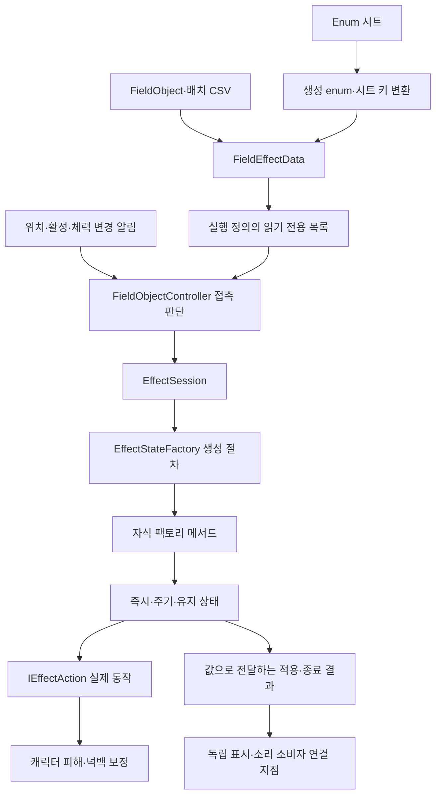
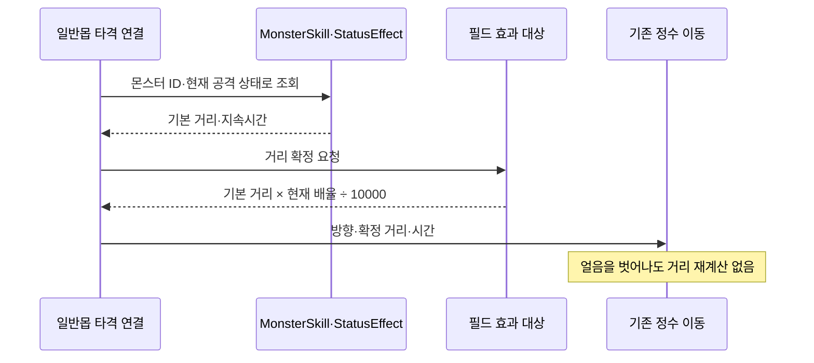
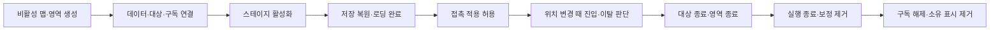
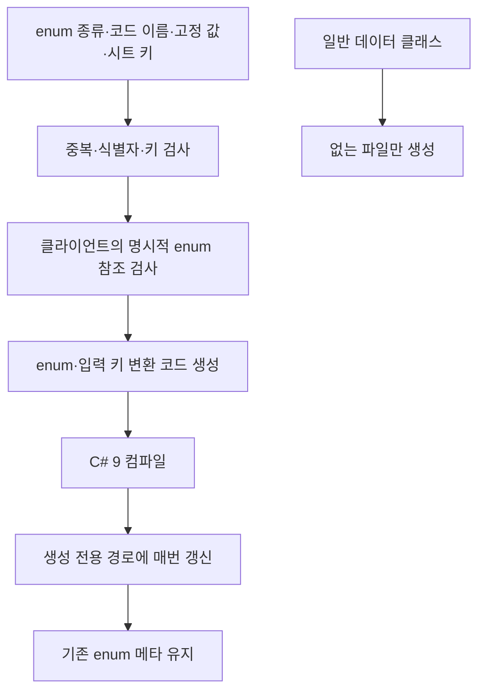

# 필드 효과 상태와 enum 배포 설계

기준일: 2026-11-13. 불·얼음 필드의 데이터 로딩과 현재 테스트 맵 조립 경로를 연결했습니다. 실제 Unity Play·지형 정렬·실행파일의 접촉 검증은 별도입니다. 기획자 절차는 [필드 효과와 enum 시트 사용 안내](../기획자용%20안내문서/필드%20효과와%20enum%20시트%20사용%20안내.md)를 봅니다.

최신 DataSheet c4fe2ea까지 확인했습니다. 산길 첫 잔불 22001의 Y=200, 협곡의 최신 몬스터 위치, 기능 중단 Language 30330·30331~30347을 배포했습니다. 임시 영역 표시 실패는 규칙 조립과 별도 경계에서 정리하고 화면 연출 30333으로 보고합니다. 전체 기능의 안내 연결 완료를 뜻하지 않습니다.

## 목차

1. [왜 이 구조인가](#1-왜-이-구조인가)
2. [코드 위치와 책임](#2-코드-위치와-책임)
3. [실제 데이터와 실행](#3-실제-데이터와-실행)
4. [수명과 호출 순서](#4-수명과-호출-순서)
5. [enum 생성·배포 계약](#5-enum-생성배포-계약)
6. [확장할 때](#6-확장할-때)
7. [자동 검사와 실제 확인의 구분](#7-자동-검사와-실제-확인의-구분)

## 1. 왜 이 구조인가

필드 종류마다 피해·접촉·시간·해제 코드를 복제하면 효과가 늘어날수록 수정 지점과 수명 오류가 늘어납니다. 반대로 모든 동작을 하나의 조건문에 넣으면 상태별 진행과 표시 연결을 추적하기 어렵습니다. **상태 생성, 시간 진행, 실제 규칙, 접촉 연결, 표현**을 분리하고 실제로 같은 책임만 공유했습니다.

캐릭터의 공격·피격 상태머신을 필드 효과로 교체하지 않습니다. 여러 효과가 동시에 존재할 수 있습니다. 게임 규칙은 동기 호출하며 소비자 예외를 전역에서 무시하지 않습니다. 표시 소비자는 자기 표시 오류만 자기 경계에서 정리·보고합니다.

## 2. 코드 위치와 책임

| 위치 | 책임·이 위치인 이유 |
| --- | --- |
| Core/Effects/EffectDefinition | 변경하지 않는 실행 인수, 실행 동작 인터페이스, 값 기반 결과. Unity 의존 없음 |
| Core/Effects/EffectStateFactory | 부모의 생성 절차와 자식의 CreateState 재정의. 팩토리는 실행하지 않음 |
| Core/Effects/EffectState | 공통 시작·종료 계약과 즉시·주기·유지 진행 |
| Core/Effects/EffectTarget | 대상 연결 한 번의 수명, enum 면역 집합, 발생 원인별 넉백 보정 |
| Core/Effects/EffectSession | 영역·대상별 실행 상태 소유, 중복 진입 방지, 시간 진행·전체 종료 |
| Adapters/FieldEffectData | CSV 문자열을 생성 enum과 실행 정의로 해석하는 경계 |
| Adapters/FieldEffectTargetBinding | 기존 캐릭터의 위치·활성·체력 알림을 효과 대상에 연결 |
| Adapters/FieldObjectController | 접촉·실행 모듈을 연결하는 공용 담당. 씬·표시를 생성하지 않음 |
| Preview/GameplayPreview.Fields | 현재 씬의 데이터·영역·대상·임시 표시를 조립. 독립 효과 규칙을 소유하지 않음 |
| Data/Generated/Enums | 시트에서 매번 갱신하는 enum·입력 키 변환. 직접 수정 금지 |

`EffectStateFactory.Create`가 공통 생성 계약을 담당하고, 자식의 `CreateState`가 구체 상태를 만듭니다. 단순한 종류별 생성 switch를 팩토리 메서드라고 부르는 구조가 아닙니다. 실행 동작은 별도로 주입하므로 같은 주기 상태를 다른 동작에 재사용할 수 있습니다. 기존 시트 해석의 분기는 Adapters 한곳에 남깁니다.

## 3. 실제 데이터와 실행

| 데이터 | 현재 소비 |
| --- | --- |
| FieldObject.Kind=FIRE_STATIC | 주기 상태 + 피해 동작 + Fire 분류 |
| FieldObject.Kind=ICE | 유지 상태 + 넉백 배율 동작 + Ice 분류 |
| FieldObjectPlacement | StageID·PlacementID로 생성된 플랫폼 연결, X·Y·Width로 영역 구성 |
| Monster.EffectImmunities | 몬스터별 분류 면역 공통 조회. 예: FIRE는 불만 제외 |
| MonsterSkill → StatusEffect | 실제 유효 타격의 몬스터·상태 ID로 넉백 거리·시간 조회 |

필드 배치 위치는 현행 시트에 이미 있는 **플랫폼 기준 상대 좌표**를 사용합니다. 장면 전체 검색이나 누락 시 원점 생성은 하지 않습니다. PreviewStage가 생성한 플랫폼의 배치 ID별 기준점을 제공합니다. Ground 계열의 기준 높이는 기존 몬스터 배치와 같은 바닥선 규칙입니다. 현재는 생성 후 이동하지 않는 플랫폼 기준이며, 이동 플랫폼을 추가한다면 영역 기준점 갱신 연결도 필요합니다.

불은 접촉 즉시 피해를 요청하고 대상별 TickMs마다 반복합니다. 이탈하면 남는 화상 없이 끝납니다. 기존 무적·사망 판단을 재사용하되 살아 있는 동안 공격 취소·피격 경직·새 피격 무적을 추가하지 않습니다. 체력이 0이면 기존 사망 상태와 체력 변경 이벤트로 이어집니다. 전투의 일반 피격 경로는 그대로 유지합니다.

얼음은 자신의 실행 상태를 토큰으로 넉백 배율을 등록합니다. 같은 보정이 겹치면 가장 높은 배율 하나를 사용하며 곱하지 않습니다. 한 영역을 나가도 다른 영역의 등록은 유지합니다. 이 정책을 바꾸려면 공통 보정 규칙과 검사를 함께 바꿉니다.

유효 타격에만 연결합니다. 회피·패링·무적·이미 사망한 대상에는 새 넉백을 시작하지 않습니다. 일반몹이 플레이어에게 가하는 현재 넉백은 연결했고, 몬스터 자신을 밀어내는 공격 규칙은 기존 호출부가 없어 별도로 만들지 않았습니다. 몬스터도 배율 대상에 등록되므로 향후 해당 이동 명령에서 `ResolveFieldKnockbackDistance(runtime, distance)`를 호출하면 됩니다.

이동은 기존 IntegerMotion의 거리 분할 계산과 플레이어 충돌 경로를 재사용합니다. 이동 중 벽에 막히면 남은 넉백을 중단합니다. 불이 사라지는 연출이나 별도 피격 VFX·소리는 데이터·리소스 연결이 아직 없습니다. 현재 표시되는 색 영역은 확인용입니다.

## 4. 수명과 호출 순서

- 게시자·구독자·대상·연결 한 번의 수명을 구분합니다. 대상은 런타임 ID와 연결 세대로 구분하며 재활성 시 새 효과 대상으로 만듭니다. 이 ID는 저장용 몬스터 데이터 ID가 아닙니다.
- 비활성·사망은 알림을 통해 효과를 정리합니다. 파괴가 지연되더라도 논리 수명은 먼저 닫힙니다. 반복 종료는 안전합니다.
- 여러 콜라이더를 새로 추가하지 않습니다. 기존 SpatialChanged에서 SpriteRenderer의 현재 경계를 관측합니다. 스프라이트 경계와 실제 발 위치가 다른 그림은 Play에서 확인해야 합니다.
- 주기 상태가 있을 때만 ms 시간을 공급합니다. 얼음은 시간 진행이 필요 없습니다. 매 프레임 장면 검색·대상 목록 재생성은 없습니다.
- 주기 진행 중 한 대상이 죽어도 다음 대상의 처리를 건너뛰지 않도록 목록 정리를 진행 후로 미룹니다.
- 다음 피해 예약을 먼저 갱신합니다. 피해 성공 중 대상이 종료되면 적용 결과 뒤 종료 결과를 전달하도록 종료 알림을 미룹니다.
- 결과에는 엔진 객체를 넣지 않습니다. 표현 소비자는 값으로 대상을 식별하고 현재 연결 세대를 확인합니다. 과거 완료 기록은 대상 파괴 뒤에도 통계에 사용할 수 있습니다.
- 현재 영역은 맵 재진입 시 다시 만듭니다. 별도 저장 항목을 추가하지 않습니다.

## 5. enum 생성·배포 계약

원본은 DataSheet `tables/Enum.xlsx`의 EnumDefinition 탭입니다. 기존 StateKey는 기존 State 탭을 계속 사용하며 중복 이동하지 않습니다.

새 enum은 `Assets/3.Script/Data/Generated/Enums`에 배포합니다. 기존 `StateKey.cs`도 매번 갱신하는 예외입니다. 소유 목록에 없는 수동 파일을 임의 덮어쓰지 않으며, 실패하면 기존 배포값으로 복구합니다. 삭제된 생성 enum은 소유 목록 기준으로 제거합니다. 일반 정의 클래스 보존 규칙은 바꾸지 않았습니다.

enum 타입·멤버의 직접 참조는 배포 전에 검사하지만 이 검사가 엔진 전체 컴파일을 대신하지 않습니다. 별칭·외부 어셈블리·리플렉션·문자열 참조는 후속 컴파일과 실제 실행에서 확인합니다. 정수값을 바꾸는 행위는 저장·외부 기록 호환성을 깨뜨릴 수 있으므로 기존 값 재번호 부여는 금지합니다. 네트워크 기능은 추가하지 않았으며 정수 계산만으로 결정성을 보장한다고 주장하지 않습니다.

## 6. 확장할 때

같은 Kind의 새 필드·피해량·주기·자리·면역 변경은 데이터로 처리합니다. 새로운 실행 종류는 enum 행만 넣는다고 구현되지 않습니다. 새 동작은 IEffectAction 구현과 조립 등록, 새 진행 방식은 EffectStateFactory·EffectState 상속, 새 Kind는 FieldEffectData와 배포 전 검사 연결이 필요합니다. 기존 Buff·StatusEffect와 의미가 같은 수치를 별도 표로 복제하지 않습니다.

현재 FieldObject 한 행은 기존 형식 그대로 효과 하나로 해석합니다. 내부 실행 API는 정의 목록을 받아 복합 효과를 지원하지만, 기획자가 한 필드에 여러 효과 ID를 연결하는 원본 컬럼은 아직 없습니다. 이를 실제 제공하려면 기획 데이터 구조부터 확정합니다. 보류한 주기 불·번짐·길불·쉼터를 이번 작업에서 활성화하지 않습니다.

오류 분류·Firebase 수집과 필수 실패 전달은 [필수 기능과 오류 처리 계약](필수%20기능과%20오류%20처리%20계약.md)을 따릅니다. 피해 규칙 실패를 표시 오류로 삼키지 않습니다. 전체 기존 표시 소비자 정비 완료를 의미하지 않습니다.

## 7. 자동 검사와 실제 확인의 구분

도구 검사 193개, 클라이언트 데이터 검사 6,853개·코어 검사 1,377개와 엔진 참조 컴파일을 확인합니다. 새 DeployData.exe를 실제 실행해 34개 탭·별도 JSON 15개를 배포했고, 기존 일반 정의 39개는 배포 전후 해시가 같았습니다. enum 갱신·삭제·메타 보존·잘못된 코드 참조 차단은 격리된 배포 검사로 확인했습니다.

효과 검사는 즉시·주기 피해, 재진입, 이탈, 분류 면역, 겹친 영역 해제, 대상 수명 교체, 알림 실패 뒤 보정 정리, 피해 도중 사망 시 결과 순서를 다룹니다. 실제 지형·캐릭터 그림 경계·넉백 벽 충돌·저장 복원·모달의 화면 동작과 실행파일 완주는 자동 검사 결과에 포함하지 않습니다.
