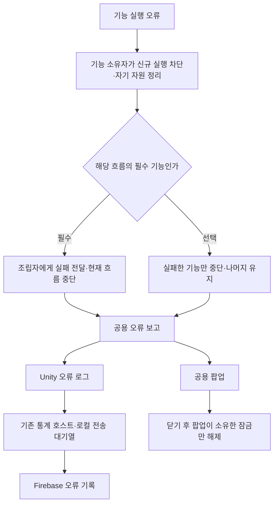
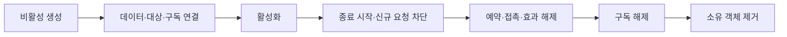

# 필수 기능과 오류 처리 계약

기준일: 2026-11-13. 기능 독립성·모듈화를 기본으로 하며, 필수 의존 관계는 조립자가 명시합니다. 모든 오류는 Firebase 수집 대상입니다. 필수 여부는 수집 여부가 아니라 중단 범위와 복구 책임을 정합니다.

## 왜 구분하는가

화면 표시 실패가 전투 규칙을 중단시키거나, 저장 실패를 성공으로 간주하면 진행 상태를 신뢰할 수 없습니다. 반대로 모든 오류를 무시하면 필수 데이터가 없는 상태로 게임이 실행됩니다. 따라서 기능의 역할에 맞춰 실패를 전달하고, 성공 여부와 무관하게 수명과 잠금을 정리합니다.

닫기는 오류가 난 작업의 성공이나 재시도를 의미하지 않습니다. 필수 실패 뒤 반쯤 생성된 맵에서 플레이를 계속하지 않습니다. 독립 모듈이라는 원칙도 의존 관계가 없다는 뜻은 아닙니다. 저장 복원 전 맵 조립처럼 필요한 순서는 조립자가 보장합니다.

새 창을 여는 잠금 적용에 실패하면 이전 소유권으로 복원합니다. 반대로 닫힌 창의 해제 적용이 실패하면 그 창의 소유권을 되살리지 않고, 모든 대상의 해제를 시도한 뒤 오류를 전달합니다. 실패하는 대상 자체의 정상 복귀까지 보장하는 것은 아닙니다.

## 필수 기능 목록

다음은 **관리 기준 목록**입니다. 모든 항목에 공통 실패 처리가 이미 적용됐다는 뜻은 아닙니다. 필수 범위는 앱 전체가 아니라 표의 흐름에 한정합니다.

| 기능 | 필수인 이유·범위 | 실패 전달·정리 책임 | 현재 확인한 상태 |
| --- | --- | --- | --- |
| CSV 다음 JSON 준비·필수 참조 연결 | 해당 맵 규칙을 구성하는 전제 | 데이터 초기화 → 씬 조립자, 미완성 씬 활성화 금지 | 준비 실패와 소비자 실패 구분 구조 존재 |
| 씬·플랫폼·필수 캐릭터 조립 | 플레이 가능한 공간의 전제 | GameplayPreview, 부분 생성·구독·입력 정리 | 초기화 실패 시 CompleteScene(false)·컴포넌트 중단. 종료 전체의 실패 내성은 추가 점검 필요 |
| 저장 복원·새 게임 최초 기록 | 이어하기와 새 게임 완료의 전제 | 저장 실행 담당 → 진입 조립자, 성공 처리 금지 | 기존 완료 신호 사용, 실제 왕복 검증 필요 |
| 피해·사망·보상 등 게임 규칙 | 진행 상태 일관성의 전제 | 해당 명령 소유자 → 호출 조립자 | 동기 이벤트 실패를 전역에서 무시하지 않음 |
| 씬 이동·진입 완료 신호 | 다음 공간 사용 가능 여부 결정 | 씬 이동 담당·진입 조립자 | 미완료 신호 장기 대기의 복구 정책은 후속 |
| 모달 입력·시간 소유권 | 화면 종료 후 조작 회복의 전제 | ErrorPopupSceneBinding | 이번 변경: 모든 대상 적용 시도, 실패 시 이전 소유권 복원 시도, 복원 실패도 전달 |
| 기능 종료·구독·예약 정리 | 파괴 객체 호출과 잠금 잔류 방지 | 각 기능 소유자 | SubscriptionScope.Cleanup 추가. 오류 팝업 종료에 적용, 전체 호출자 전환은 미완료 |

선택 기능 예: 배경음·효과음, 장식 연출, 독립 표시 갱신, 통계 업로드. 단, 피해 판정 시점을 담당하는 애니메이션 연결처럼 규칙의 전제인 요소는 단순 장식으로 분류하면 안 됩니다. 컷씬도 장식인지 필수 진행 명령인지 조립 시 판단합니다.

## 표시 오류와 기능 오류의 경계

- 게임 규칙의 완료 이벤트는 동기로 전달합니다. 모든 구독자 예외를 일괄 삼키는 게시기를 추가하지 않습니다.
- 표시 소비자는 자신의 Unity 표시 처리만 경계로 잡아 정리하고 보고합니다. 그 경계에서 게임 규칙 명령까지 다시 실행하지 않습니다.
- `ErrorPopupSceneBinding.Report`는 기존 오류 보고 진입점입니다. 정식 빌드에서도 명시적 팝업 보고가 가능하도록 변경했습니다. 자동 Unity 오류 팝업 수집은 기존 테스트 제한을 유지합니다. **Firebase 로그 수집은 이 제한과 무관합니다.**
- `ReportUnavailable(error, messageTextId, featureTextId, context, state)`는 선택 기능 중단 안내용입니다. 두 ID는 Language에 공급된 값이어야 합니다. 아직 새 문구 ID와 각 기능의 호출 연결은 공급·적용 대기입니다.
- 문구 형식: `오류가 발생하여 {0} 기능이 동작하지 않습니다.` 기능명도 Language에서 조회합니다. 복사·닫기와 상세 오류 표시는 기존 Popup 15007을 재사용합니다.

오류 팝업 자체의 표시 오류는 로그에 남기며 같은 팝업으로 재보고하지 않습니다. Firebase는 Unity 로그를 독립적으로 수집하므로 보고 경로를 하나 더 호출해 중복 전송하지 않습니다. 원격 전송 실패는 기존 대기열·실패 상태로 관리하며 자기 오류를 무한 재귀 보고하지 않습니다.

## 생성·소멸과 이벤트 대상

게시자와 구독자뿐 아니라 이벤트가 가리키는 대상과 연결 관계의 수명도 확인합니다. 재사용 객체는 ID만으로 구분하지 않고 현재 연결 또는 세대도 확인해야 합니다. 파괴 후에도 보상·통계에 필요한 완료 기록은 엔진 객체 대신 값의 복사본으로 전달합니다. 사망은 곧바로 모든 완료 기록의 무효화를 뜻하지 않습니다.

`SubscriptionScope.Invalidate()`는 표시 갱신 예약입니다. 수명 종료로 오해하지 않습니다. 실제 종료는 Dispose하고 재사용 시 새 범위를 만듭니다. Cleanup은 정리 동작 전부를 시도한 뒤 AggregateException을 전달합니다. 일반 게임 이벤트 예외 격리에 사용하지 않습니다.

## 이전과 이번 변경의 차이

| 이전 위험 | 변경 | 이유 |
| --- | --- | --- |
| 정식 빌드에서 명시적 오류도 로그만 기록 | 공통 팝업 조립·Report의 테스트 제한 제거 | 사용자가 실패 사실을 인지하도록 함 |
| 팝업 화면 정리가 실패하면 잠금 반환 누락 가능 | 소유권을 먼저 비운 뒤 정리 단계 전부 시도 | 표시 오류와 조작 회복을 분리 |
| 모달 적용 도중 한 대상 실패 시 다른 대상 미처리 | 모든 대상 적용 후 실패 전달·이전 상태 복원 시도 | 입력과 게임 시간의 부분 적용을 줄임 |
| 기능 중단 안내가 일반 오류 제목과 동일 | Language ID 조합 보고 API 준비 | 기능명을 데이터로 관리 |

일반적인 게임 오류까지 완전히 복구된다고 보장하지 않습니다. 반복 Update 오류, 모든 표시 소비자, GameplayPreview 전체 종료 경로의 개선은 별도 점검 대상으로 남습니다. 네트워크 기능은 추가하지 않았으며 원격 오류 기록은 게임 상태 권한을 갖지 않습니다.

기획자 절차는 [오류 안내와 기능 중단 확인 안내](../기획자용%20안내문서/오류%20안내와%20기능%20중단%20확인%20안내.md)를 봅니다.
