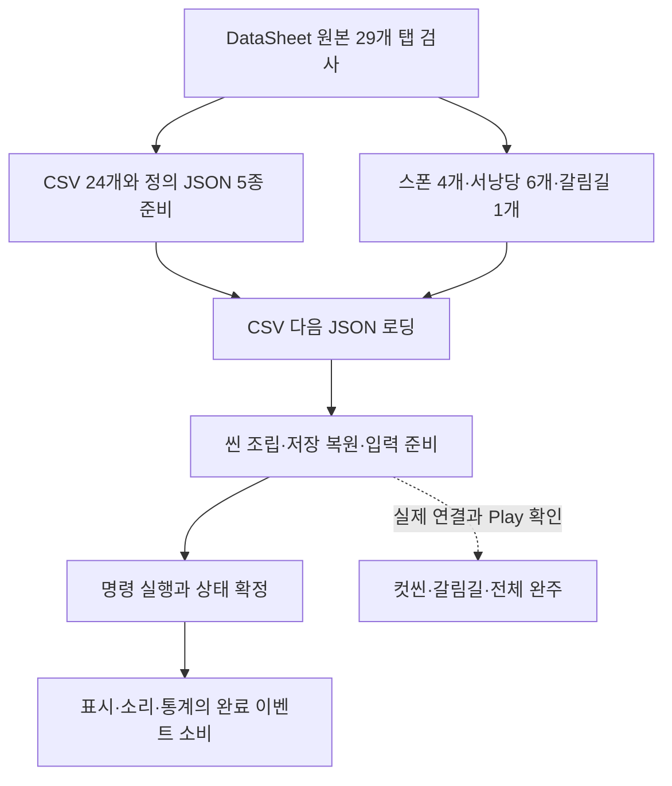
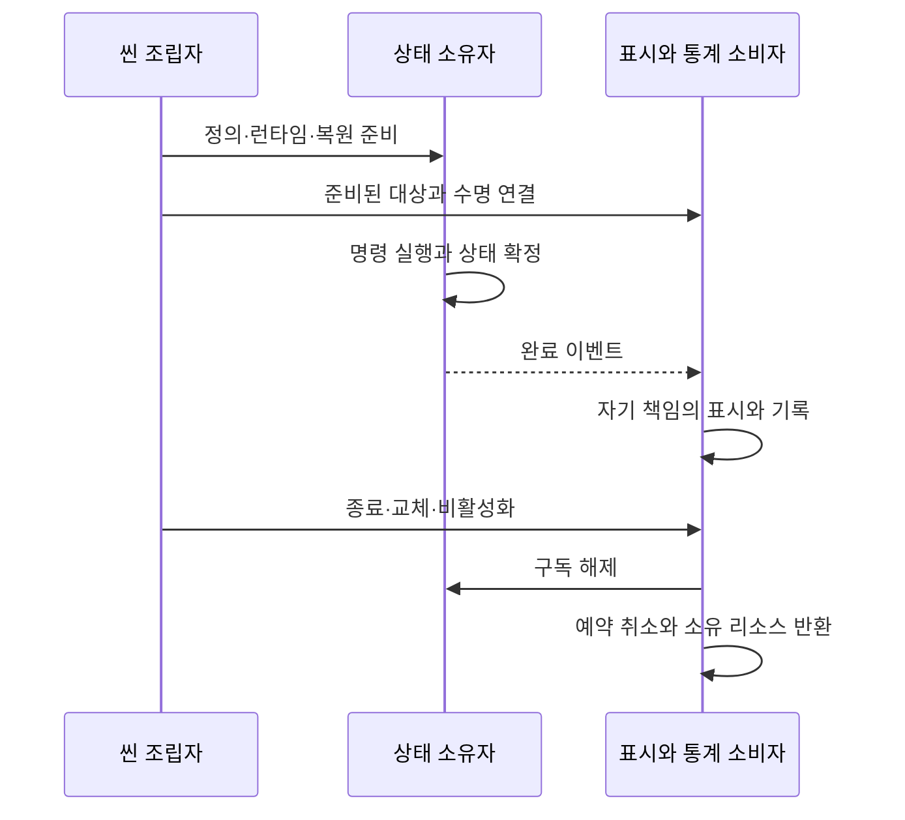

# 현재 구현과 검증 현황

2026-11-13 최신: JSON 자동 발견·검사 클래스 연결·공통 배포와 UnityCodeOutput 경계를 적용했습니다. 도구는 .NET 10·최신 안정 C#, 생성 결과는 C# 9 검사입니다. DataSheet 1de860f 원본의 Npc·Dialogue와 대사 4개를 포함해 31개 탭·별도 JSON 15개를 실제 재추출·배포했습니다. 기존 정의 35개 해시 보존, 도구 185개·클라이언트 데이터 5,847개·코어 1,357개·엔진 참조 컴파일 경고/오류 0개를 확인했습니다. Cutscene.cs의 삭제된 SkipHoldMs와 해당 검사 예제만 시트에 맞춰 별도 수정했습니다. NPC 실행·대사 소비·고정 배치는 미연결입니다. [공통 설계](데이터%20자동%20발견과%20Unity%20배포%20경계%20설계.md)를 우선하며 아래 준비 단계 수치는 이전 기록입니다.

2026-11-13 후속: DataSheet의 NPC·대사 배포 기반을 준비했습니다. 플랫폼 내부 Objects의 참조·중복·구형 필드 검사, dialogue JSON의 파일·대화·Language 참조 검사와 공용 배포를 연결했습니다. 전체 도구 검사 165개와 갱신한 DeployData.exe의 현재 29개 탭 검사 통과, 대사 파일은 0개입니다. 이번 후속에서는 실제 시트·원본 JSON·클라이언트 NPC 생성·대화 실행은 추가하지 않았고 실제 클라이언트 배포도 하지 않았습니다. [구현 경계](NPC%20데이터%20배포%20준비%20설계.md)를 따릅니다. 아래는 11월 12일 전체 점검 기록입니다.

기준일: 2026-11-12. 로컬 클라이언트 `HYT/work · 7d13442`, DataSheet `80bbe65`와 현재 파일을 확인했습니다. 이번 작업은 문서 정비이며 코드·데이터·프리팹 수정이나 원격 배포는 하지 않았습니다. 공유 간트와 Drive 기획서는 이번에 다시 조회하지 않았으므로 일정·완료율을 갱신하지 않습니다.

## 1. 현재 상태를 읽는 기준

구현은 코드가 있다는 뜻이고 연결은 현재 조립 경로가 있다는 뜻입니다. 자동 검사·Unity 격리 검사·실제 Play·출시 빌드 완주는 별개입니다. 과거 검사 숫자를 현재 결과와 합산하지 않습니다. [다음 완료 조건](남은%20구현과%20검증%20작업.md)과 [기획자 공통 안내](../기획자용%20안내문서/기획자용%20공통%20모듈%20연결과%20확인%20안내.md)를 함께 봅니다.

## 2. 영역별 구현과 실제 연결 경계

| 영역 | 확인한 현재 상태 | 남은 작업과 확인 |
| --- | --- | --- |
| 데이터 공급 | DataSheet 검사 모드 29개 탭 통과. 배포 CSV 24개, 상태·아이템 정의 JSON 5종. 기존 클래스는 최초 생성 뒤 자동 덮어쓰기하지 않음 | 원본 검사 성공과 모든 CSV 원본 일치를 같은 뜻으로 보지 않음. 스키마 변경은 기존 정의도 함께 확인 |
| 타이틀·설정 | 메뉴·A/B 조작 선택·볼륨·카메라 흔들림·타이틀 화면 모드·오류 모달 연결 | 장치별 입력·표시·닫기·중첩·재진입 Play. 창모드는 기존 확정 규격 유지 |
| 씬 이동 | 빌드 목록은 Title과 MapDohwagolTest. StageContentSet은 8001~8005 맵 등록 | 같은 테스트 씬의 맵 교체와 별도 씬 추가를 구분. 전체 왕복·사망·재진입·엔딩 검증 |
| 맵·몬스터 | 스폰 8001·8002·8003·8005 참조. 산길 8002는 상한 9·실제 9, 협곡 8003은 상한 30·실제 30 | 8004는 맵만 등록, Spawn 참조 없음. 맵·몬스터의 재사용 풀은 미구현 |
| 관문 | GateConfig는 헤더만 존재. 폐기·미연결 표식은 기존 생략 정책, 임의 저장 ID 생성 없음 | 기획자가 새 관문을 쓸 경우 정식 ID·앵커·저장 복원 확인 |
| 저장 | 테스트 공용 10슬롯·직접 선택·날짜 내림차순·번호 숨김·F5. 출시 단일 자동 슬롯. 위치·처치·재화·강화·갈림길 기록 | 실제 재실행·왕복·사망·파손 파일 수용. F12는 확인 후 최신 슬롯 하나 삭제·타이틀 이동 |
| 재화·성장·서낭당 | 경험치·혼·엽전 자동 보상·레벨·강화·저장과 임시 구매 화면 연결 | 최종 UI·획득 연출·추가 보상 콘텐츠·구매 후 저장 수용 |
| 일반몹 처형 | 노출 대상 선택·양쪽 상태 전환·클립 길이 기준 종료·취소 정리. KILL과 비율 피해 처리 | 새 ExecuteReward의 엽전·회복·오염 보상은 로딩만 연결됨. 일반 사망 보상과 구분 |
| 신규 데이터 | ExecuteReward 4행·CorruptionStep 4행과 정의·자동 CSV 로딩 추가 | 해당 타입을 소비하는 게임 규칙은 검색되지 않음. 오염 누적·단계 표시·추가 보상 미연결 |
| NPC1 | 독립 Animator·Idle 클립·프리팹 공급. 기존 캐릭터 안내에 검사 기록 있음 | 현재 맵 배치·대사·상호작용 자동 연결은 별도. 프리팹 존재만으로 NPC 기능 완료가 아님 |
| 갈림길 | 계산·첫 도착 1회·저장·도착 연결 기반. HIGH 8·MID 5 기준 공급 | 실제 도착 영역과 경로 선택 사건 연결 필요. 지도·보상 표만으로 작동 완료 아님 |
| 컷씬 | Ending 22003과 구간 22101·22102 배포. 공용 화면 프리팹과 타이틀 참조 존재 | Intro·Ledger 행 없음. 현재 MapDohwagolTest의 `_cutscenes`는 비어 있음. 엔딩 주소·미디어와 실행 연결 대기 |
| 사운드·표현 | 기존 데이터 재생 기반과 공급 음원·상태 애니메이션·이펙트·배경 애니메이션 존재 | 최종 청취·반복 전투·카메라·새 로딩 그림의 실제 적용 검증 |
| 통계 | 로컬 대기 파일·Firebase 전송·Spark 조회 화면 집계·xlsx 기반. 원격 활성, Editor 제외 | 실제 새 게임 빌드에서 플레이→원격→표·다운로드 대조. 경로 선택은 호출부 미연결, 아이템 수집은 비활성 |
| 빌드 | GitHub development/release 선택, 기본 development, Windows 64비트, 디스코드 분리 공지 | 이번 점검에서는 원격 CI·게임 빌드 미실행. 두 빌드 설치·테스트 기능 비노출·완주 확인 |

## 3. 이번에 바뀐 데이터 상태

### 원본과 배포 JSON 대조

DataSheet의 스폰 4개·서낭당 6개·갈림길 1개 총 11개와 클라이언트 대응 파일은 바이트 단위로 일치했습니다. 이전 문서의 산길 30마리·갈림길 기준 미배포 설명은 현재 상태가 아닙니다. 8001·8005는 상한 30이지만 몬스터 수량은 0입니다. 상한이 실제 스폰 수를 자동으로 채우는 것은 아닙니다.

현재 StageLayoutRules는 Points를 해석하고 최대 수량 검사는 배포 도구가 맡습니다. 실행 단계에서 MaxMonsterCount를 별도 재검증하는 구조라고 표현하지 않습니다. `Stage.SpawnFile`의 보스 8004 경로와 실제 공급·StageContentSet의 빈 Spawn 참조를 구분합니다.

### 엔딩은 데이터 공급과 재생 완료를 구분

| 항목 | 현재 값과 상태 |
| --- | --- |
| Cutscene | 22003 / Ending / SkipHoldMs 2000 |
| 첫 구간 | 22101 / Video / Cutscene_Ending_Video / DurationMs 0 |
| 둘째 구간 | 22102 / Image / Cutscene_Ending_LastFrame / DurationMs 3000 / TextID 30069 / CanAdvance Y |
| 스킵 | Enter 한 번. SkipHoldMs는 호환 필드이며 현재 길게 누르기에 사용하지 않음 |
| 실행 장애 요인 | 운영 맵의 공용 실행 담당 미할당. Assets에서 Addressables 주소 설정과 위 미디어 연결을 확인하지 못함 |

보스 사망 뒤 TryStartEnding이 실행되는 코드가 있으므로, 이제는 단순히 빈 표로 건너뛰는 상태가 아닙니다. 실행 담당 미연결이면 연결 오류를 기록할 수 있습니다. 이번에는 임의 미디어·ID·객체를 추가하거나 해당 오류를 숨기지 않고 후속 연결 대상으로 남겼습니다. [컷씬 연결 안내](../기획자용%20안내문서/기획자용%20컷씬%20표시와%20씬%20이동%20안내.md)를 따릅니다.

### 신규 표는 자동 로딩과 기능 구현을 구분

`ExecuteReward`는 MonsterID·CoinDrop·HealHP·Corruption·DropItemID, `CorruptionStep`은 Step·MinCorruption·InkAlpha를 공급합니다. 현재 두 타입은 정의 클래스와 GeneratedDataLoadPlan에서만 사용되고 게임 소비자는 없습니다. 데이터 수치를 임의의 고정 보상으로 대체하지 않습니다. 기존 일반 처치 보상은 MonsterReward를 사용합니다.

## 4. 설계 원칙과 현재 주의점

정의·런타임 상태·도메인·표현·인프라를 분리하고 기존 조립자와 공용 표시·저장·구독 계약을 재사용합니다. 게임 이벤트는 동기이며 소비자 예외를 발행자에서 일괄 무시하지 않습니다. 통계와 표시 소비자는 자기 경계에서 실패를 처리합니다.

정수 좌표·밀리초·10000 분모의 게임 규칙과 Unity의 실수 표현 경계를 구분합니다. 원본 정의를 직접 변경하지 않고 런타임·저장 사본을 사용합니다. 정수 사용만으로 네트워크·리플레이 결정성이 보장되지는 않으며 이번 문서 정비에 네트워크 구현은 포함하지 않았습니다.

모든 코드가 테이블만으로 완성되는 것은 아닙니다. 새 기능 종류에는 소비자와 최초 조립이 필요합니다. 신규 데이터 정의의 sealed 여부나 기존 규칙 적합성은 후속 코드 검토 대상이며, 이번 요청에서 코드를 임의 수정하지 않았습니다.

## 5. 이번에 실행한 검증과 한계

| 검사 | 결과 | 검증하지 않은 범위 |
| --- | --- | --- |
| DataSheet DeployData.exe --check | 29개 탭·데이터 29개·정의 33개·로딩 계획 1개·별도 JSON 11개 검사 통과 | 검사 모드이므로 재배포하지 않음 |
| Verify-Project.ps1 -CompileUnity | 데이터 5,720개·코어 1,361개 통과, 엔진 참조 컴파일 경고·오류 0 | Unity 전체 Play·플레이어 빌드와 성능 |
| 통계 집계·xlsx | Node 8개 통과 | 실제 플레이 기록·새 운영 배포 |
| PNG 압축 도구 | 2개 통과 | 이번에는 압축 재실행·성능 측정 없음 |
| 자동화 도구 | 6개 통과 | GitHub 원격 작업 실행 |
| JSON 원본 대조 | 스폰·서낭당·갈림길 11개 일치 | 모든 엑셀 셀과 CSV의 전수 동일성 대조는 미수행 |

Firebase 운영 배포·관리자 권한·실서버 생성과 조회 차단 확인은 앞선 작업 기록입니다. 이번에는 다시 운영 데이터를 쓰거나 배포하지 않았습니다. 에뮬레이터·기존 Unity 격리 결과도 이번 실행 수치와 합산하지 않습니다.

현재 미추적 파일은 CorruptionStep·ExecuteReward 정의와 CSV의 `.meta` 4개입니다. Unity에서 생성된 파일이며 이번에 변경하지 않았습니다. 공유 커밋에 포함할지 확인해야 합니다.

## 6. 리소스와 완료율의 해석

02d887c 기준 PNG 288개의 6,655,401 B 절감은 [당시 전후 비교](최신%20Git%20반영과%20코드·리소스%20개선%20비교.md)의 측정 기록입니다. 이후 NPC·로딩 그림 등이 추가됐으므로 이를 현재 프로젝트 전체 용량이나 새 커밋 대비 절감량으로 확대하지 않습니다. 렌더링·VRAM·최소 사양·60FPS 확정은 미측정입니다. Windows 64비트와 해상도 축소 제외 방침은 유지합니다.

이번에는 간트 분모와 실제 수용 결과를 새로 확보하지 않았으므로 전체 완료율·작업자별 퍼센트를 산출하지 않습니다. 과거 고정 간트 보고서는 당시 기록으로 유지합니다.

## 7. 다음 판단에 필요한 것

현재 엔딩 실행 담당·주소·미디어를 먼저 준비하고, 신규 처형 보상과 오염 표의 소비 규칙·저장 여부를 담당자와 맞춰야 합니다. 산길 배포는 완료됐으므로 같은 배포를 미완료 작업으로 반복하지 않습니다. 갈림길 도착·선택 사건, 저장 왕복, 통계 실제 빌드, 일반 출시 빌드 수용은 [남은 작업](남은%20구현과%20검증%20작업.md)에서 관리합니다.

## 8. 현재 실행과 객체 수명 도식

준비 중 종료·부분 초기화 실패·재활성·왕복을 실제 플레이에서도 확인해야 합니다. 수명 계약이 있다는 사실을 모든 빈 참조의 부재 보장으로 확대하지 않습니다.
