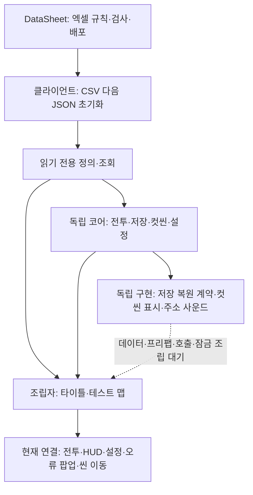
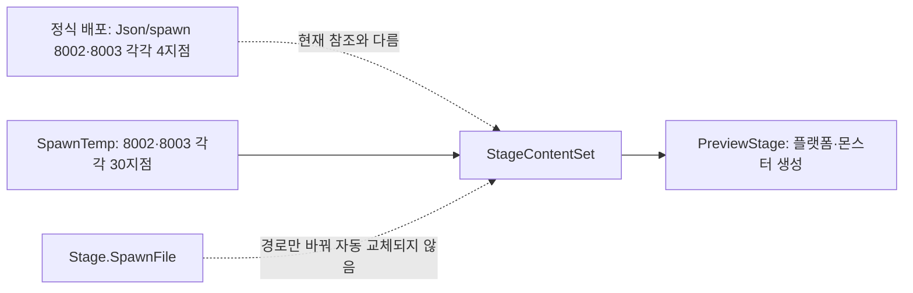

# 현재 구현과 검증 현황

기준일: 2026-11-05. 로컬 커밋 `2299f04` 이후 저장 연결 작업과 현재 코드·배포 데이터·씬/프리팹 참조·빌드 설정을 대조했습니다. 이후 사용자 승인으로 저장·씬 준비 연결과 관문 정수 ID 데이터를 추가했습니다. 원격 기획서·간트의 오늘 변경은 재조회하지 않았습니다. 이전 회의 내용은 기존 기록이며 현재 담당·일정 확정으로 해석하지 않습니다.

## 1. 현재 상태를 읽는 기준

**모듈 구현**, **씬 연결**, **실제 실행 검증**을 구분합니다. 코드가 있어도 데이터·리소스·호출자가 연결되지 않으면 게임에서 자동으로 동작하지 않습니다. 전체 완료율은 이 세 기준과 작업별 가중치가 정해지지 않아 산정하지 않습니다.

## 2. 영역별 실제 경계

| 영역 | 확인한 현재 상태 | 남은 작업 |
| --- | --- | --- |
| 데이터 | CSV 15파일·상위 테이블 JSON 4파일·스폰 JSON 3파일, 데이터 정의 23파일·생성 계획 1파일. CSV 후 JSON 순차 초기화 | 원본 시트의 기존 정의 스키마 변경은 담당자와 동기화. 클라이언트 배포 파일을 임의 수정하지 않음 |
| 전투·일반몹·보스 | 이동·콤보·자원·피격·약초·결박 가르기·체세/해체·패턴 코어와 테스트 표현 | 최종 애니·판정·모션 완료 신호·실행파일 회귀 검사 |
| 맵·스폰 | FormatVersion 2의 플랫폼·다종 몬스터·매복, StageContentSet의 맵/프리팹/JSON 직접 참조 | Instantiate 방식으로 실제 풀 없음. 임시/공식 원본 통합·안정적인 처치 식별자 |
| 임시 진행 | PreviewSession의 HP·약초 이동 유지·보스 기억·도착 앵커 | 정의된 저장 필드의 수집·복원 연결. 몬스터별 처치/리스폰 데이터 연결은 후속 |
| 타이틀 | 새 게임→기존 로딩→MapDohwagolTest, 설정·종료·마우스 선택 | 인트로·최종 시안·장치 수용 검사. 최신 기록/선택 기록 복원은 현재 테스트 맵에 연결 |
| 설정 | 타이틀/일시정지 모두 공용 SettingsScreen. 마스터·배경음·효과음·카메라 흔들림, 사본 편집·미리 적용·저장/취소 | 실제 화면·음량·파일 호환·장치 검사. 언어 선택·키 방식 선택은 후속 |
| 오류 팝업 | Popup15007의 복사·닫기·상세 표시, 자동 로그 수집·중복 억제·모달 입력/시간 차단. TitleScreen과 테스트 맵에 연결 | 실제 오류 재현·닫기·입력 복귀·개발/출시 정책 수용. Firebase/메일은 보류 |
| 저장 | JSON 저장소·슬롯 정책·SaveGameFlow·ManualSaveScreen 프리팹. 빈 칸15001·덮어쓰기15002·기본 아니오 연결 | GameplayPreview.Saves가 실제 상태 수집/복원을 구현. 새 게임·이어하기·F5·기존 서낭당 자동 저장 연결. 개별 몬스터 상태와 실제 Play 검증은 후속 |
| 컷씬 | 기존 코어·테이블 변환·CutsceneScreen의 Sprite/VideoClip/자막 표시·CutsceneInput | 실제 표 0행, 표시/입력 컴포넌트의 씬·프리팹 참조 0개. 주소 등록·호출·입력/피해/시간 잠금·안내 게이지·실제 재생 |
| 사운드 | Sound 조회·타입별 주소 로더·준비 저장소·TableSoundPlayer·시험 창. 준비만 비동기, 재생/정지 동기 | Sound 0행. 주소 설정 에셋 미생성. 실제 음원·상황 조건·기존 문자열 호출 전환. 사용자 요청으로 후속 보류 |
| 씬 이동 | 기존 LoadingScreen에서 Update 기반 정수 ms 진행·중복 이동 거부·종료 시 활성화 대기 해제. 테스트 맵 타이틀 복귀는 BeginFade | 맵 조립/저장 복원 완료 신호 대기 연결. 새 로딩 디자인·BGM 전환·인트로/정식 장부방/엔딩은 후속 |
| 빌드·압축 | GitHub 수동 Windows 개발 빌드·검사·7일 보관·분리 공지. PC BC7 설정 | 특정 리비전 입력·출시 전용 빌드 선택 없음. 실제 빌드 크기·메모리·화질·완주 검사 |

실제 빌드 목록의 활성 씬은 Title과 MapDohwagolTest입니다. SampleScene은 비활성입니다. 맵 여러 개의 연결은 현재 테스트 씬 안에서 StageContentSet으로 구성하며, 정식 공간별 씬 완료로 보지 않습니다.

## 3. 데이터와 실행 참조의 차이

8001에는 몬스터 지점이 없습니다. 현재 8002/8003의 임시 30지점과 정식 4지점은 다른 파일입니다. 협곡 매복 등의 별도 설정까지 위 지점 수에 합산하지 않았습니다. 플랫폼별 Points는 앵커 기준이며 무조건 씬 전체 절대 좌표를 뜻하지 않습니다. 원본과 실행 참조를 맞추기 전에는 정식 배포가 실제 플레이에 반영됐다고 판단하지 않습니다.

## 4. 수명·이벤트·데이터 소유권

- 데이터 정의와 원본 에셋은 읽기 대상으로 유지합니다. 설정·저장 등 변경 상태는 사본으로 소유합니다.
- 게임 규칙의 완료 이벤트는 동기이며 명령과 결과를 분리합니다. 표시 소비자는 표시 오류를 자기 경계에서 기록·정리합니다.
- 준비 저장소는 주소 중복 로드와 리소스 반환을 담당합니다. 비활성화·재연결 뒤 늦게 도착한 리소스를 자동 재생하지 않습니다.
- CutsceneScreen은 준비를 기다린 뒤 자동 재생하지 않습니다. 호출자가 수명·요청 유효성을 확인하고 Play를 호출합니다. 영상 이벤트는 현재 플레이어의 결과만 기록하고 자기 Update에서 처리합니다.
- LoadingScreen의 화면 종료는 씬 이동 취소가 아닙니다. 이미 시작한 Unity 로드는 취소할 수 없으므로 활성화 대기를 풀어 큐가 멈추지 않게 합니다.
- 매 프레임 작업은 이동/판정·활성 재생 시간·페이드·실제 씬 로드 진행처럼 필요한 범위에 남아 있습니다. 프로젝트 전체가 이벤트만으로 움직이거나 정수 위치 시뮬레이션으로 전환된 상태는 아닙니다.

## 5. 검증 근거와 한계

| 구분 | 기록 |
| --- | --- |
| 최신 데이터 검사 | 930개 통과. 최신 기록 삭제의 독립 파일 검사 포함 |
| 직전 기능 작업의 코어/회귀 검사 | 661개 통과. 일반 맵 이동의 저장 미적용·슬롯 미확정 거부·기록 대기를 추가 확인 |
| 직전 편집기 참조 컴파일 | UNITY_EDITOR 분기 통과. 당시 CS0414 경고 제외 속성 사용 |
| 이번 엄격 참조 컴파일 | 편집기/출시 분기 모두 경고 0·오류 0 통과. 데이터913 재확인 |
| 로컬 정적 확인 | 빈 표 행 수·주소 설정 유무·컷씬 참조·빌드 씬 목록·생산 저장 런타임 구현 유무 확인 |
| 실제 Unity Play·영상/음원 청취·플레이어 빌드 | 이번 작업에서 미실행 |

과거 `_exitAnchor` 미사용 오류와 875/600 검사 수치는 현재 결과로 사용하지 않습니다. 현재 해당 필드는 코드에 없습니다. 검사 통과를 영상 코덱·최종 음원·게임 한 판 완주의 성공으로 해석하지 않습니다.

## 6. 다음 판단에 필요한 것

관문은 GateConfig 정수 ID, 현재 맵 상태 소유자는 GameplayPreview로 연결했습니다. 몬스터 배치의 안정적인 개체 식별자는 추가 데이터 작업이 필요합니다. 컷씬은 실제 ID·리소스·호출 장소·정상/취소/실패 시 다음 행동을 받습니다. 사운드는 준비가 될 때까지 보류합니다. 로딩의 보류된 새 시안과 정식 공간 준비 완료 기준은 확정 뒤 반영합니다.

세부 순서는 [남은 구현과 검증 작업](남은%20구현과%20검증%20작업.md), 설계 판단은 [설계 기준 점검과 개선 방향](설계%20기준%20점검과%20개선%20방향.md), 사용 문서는 [문서 안내](../문서%20안내.md)를 기준으로 관리합니다.

## 7. 사용자 확정과 현재 적용 경계

실제 컷씬은 제작 대기로 보류합니다. 몬스터 정책은 기본 리스폰 OFF이며 추후 구간별 ON/OFF를 지원하는 방향입니다. 스폰 데이터가 추가로 필요하므로 개별 몬스터 유지/리스폰 기능은 아직 적용하지 않았습니다. 예전 재생성 기획과의 충돌은 사용자 방향으로 정리됐으며, 현재 테스트 코드의 재생성을 확정 정책으로 보지 않습니다.

GateConfig는 Stage.xlsx 안에 추가했고 기존 Stage 탭 원문·서식을 보존했습니다. 정수 ID 800201/800202/800301을 현재 관문에 연결했으며 기존 도구로 19탭·정의23·계획1·스폰3 배포를 완료했습니다. 저장 파일은 기존 정수 스키마/버전1을 유지합니다.

## 테스트 F12 초기화 연결

타이틀·현재 테스트 맵에 DemoResetHost와 공용 ConfirmationPopupScreen을 연결했습니다. Popup15008·Language30215~30217을 사용하며 최신 슬롯만 삭제합니다. 기존 5초 유지·현재 슬롯 삭제·전체 슬롯 삭제 설명을 대체합니다. 취소/X는 상태를 유지하고 확인 처리 중 중복 명령을 차단합니다. 로딩/오류 창 중 요청은 준비 이후 표시하며 설정은 보존합니다.

슬롯 정렬·이어하기·삭제는 SaveRecord.LatestFirst를 공유합니다. 파일 읽기/쓰기/삭제는 같은 저장소 잠금으로 직렬화하고 모달 잠금은 소유자별로 관리합니다. 출시 분기 컴파일 통과, 실제 F12·화면·출시 실행 검증은 별도입니다. [사용 안내](../기획자용%20안내문서/기획자용%20F12%20초기화%20사용%20안내.md), [설계](테스트%20초기화와%20공용%20확인%20팝업%20설계.md)를 따릅니다.
