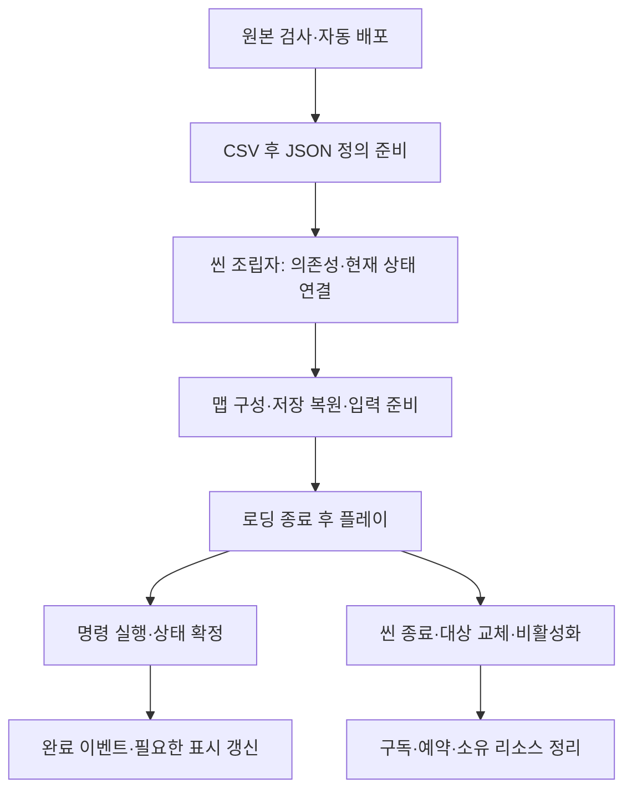
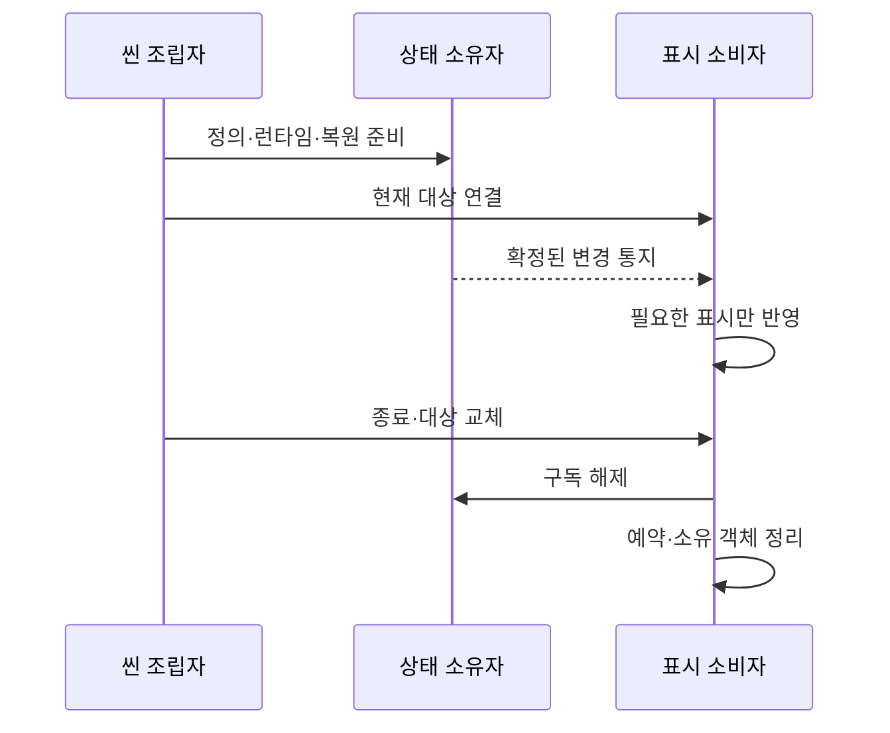

# 현재 구현과 검증 현황

기준일: 2026-11-10. 로컬 `b7c7119`의 코드·배포 데이터·리소스 연결을 대조했습니다. 과거 간트 보고서의 완료율은 바꾸지 않습니다. 원격 기획서·간트는 이번에 다시 조회하지 않았습니다.

> 2026-11-10 도착 초기화 오류: K9맵에 남은 폐기 관문 세 표식은 조립 시 조용히 생략합니다. 최신 Develop의 미연결 관문 경고·통행 허용 정책도 유지하며 임의 ID·개방 기록은 만들지 않습니다. 공급 설정이 있으면 해당 행을 우선합니다. 실제5맵 조립·활성화와 설정 우선·미연결 정책 검사24건을 완료했고 전체 왕복 Play는 후속입니다. [원인·수정 범위](컷씬%20재생%20설계.md#폐기-표식으로-인한-도착-준비-실패--2026-11-10)를 따릅니다.

> 2026-11-10 서낭당 표시 오류: 삭제된 원본 UI 이미지13개와 SongMyung 폰트·라이선스를 기존 GUID로 복구했습니다. 화면 열기·혼/약초 구매·단계 표시·입력 차단·닫기/재열기 격리28건 통과. 구매 규칙·데이터·실제 저장 파일은 수정하지 않았으며 전체 Play 수용은 후속입니다. [복구 범위](재화와%20강화%20구매%20설계.md)를 따릅니다.

> 2026-11-10 인게임 UI: 체력바 표시480×40(논리240×20·앵커2배), 좌상단20px 여백·기력11px 간격을 확인했습니다. 확인용 제목과 플레이어 위 스탯 글자는 표시에서 제거하고 기존 연결은 유지합니다. 씬/프리팹 상속·비활성 상태·체력75% 감소의 격리 렌더 확인, 데이터·게임 코드 변경 없음. 실제 전투 Play는 후속입니다. [표시 구조](체력%20표시%20모듈%20사용과%20설계%20안내.md#인게임-체력바-확대와-확인용-글자-표시-제거--2026-11-10)를 따릅니다.

## 1. 현재 상태를 읽는 기준

구현은 코드가 있다는 뜻이고 연결은 현재 조립 경로가 있다는 뜻입니다. 실제 검증은 Unity Play·실행파일에서 확인한 범위입니다. 컴파일 통과를 전체 게임 완성으로 집계하지 않습니다. [남은 작업](남은%20구현과%20검증%20작업.md)과 [설계 기준](설계%20기준%20점검과%20개선%20방향.md)을 함께 봅니다.

## 2. 영역별 실제 경계

| 영역 | 현재 구현·연결 | 남은 확인·제작 |
| --- | --- | --- |
| 데이터 | 원본 검사·자동 배포, CSV 다음 JSON 초기화·등록 | 새 종류의 동작은 코드 연결 필요. 열 추가만으로 새 기능이 생기지 않음 |
| 타이틀·설정 | 메뉴·키보드 A/B·공용 설정·창모드·오류 모달 | 장치별 입력·표시·취소·재진입 Play |
| 씬 이동 | 맵 로딩·타이틀 암전, 데이터·조립·복원 준비 대기, 로딩 중 이동·출구·일시정지 차단 | 전체 왕복·사망·엔딩, 새 로딩 시안 확정 |
| 맵·스폰 | StageContentSet에 8001~8005 등록. 플랫폼 기준 JSON 생성·개별 처치 제외 | 실제 배치·도착 앵커·공간 수용. 전체 풀링 완료로 표현하지 않음 |
| 관문 | 등록 ID의 생성·개방·저장·복원 | 현재 GateConfig는 빈 표. 미연결 표식은 경고 후 생성 생략하여 통행 가능. 정식 행 연결 필요 |
| 저장 | 테스트 10슬롯·직접 선택·날짜 내림차순·번호 숨김·F5. 출시 단일 자동 슬롯. 위치·처치·재화·강화·갈림길 기록 | 실제 저장·재실행·왕복·사망·파손 파일 확인 |
| 재화·성장 | 경험치·혼·엽전 자동 지급, Lv5 상한·초과분 이월, 강화 효과·사망 손실·저장 | 보스 보상 행·획득 연출·랜덤박스 |
| 서낭당 | 첫 접촉 저장·E 휴식 저장, 임시 구매 UI·지갑·비용·효과 | 구매·닫기·재저장·이어하기 Play, 최종 화면 |
| 갈림길 | JSON 자동 공급·첫 도착 1회 지급 규칙·저장·도착 어댑터 준비 | 실제 도착 영역 미배치. 대상 오브젝트 ID·성공 연결·연출 대기 |
| 전투·표현 | 상태별 표시, 일반몹 패링 취소·경직 확정 뒤 Parried 이벤트와 표시 갱신 | 다른 작업자 담당 변경을 현재 구현으로 기록. 반복 전투·키·청취 수용 |
| 컷씬 | 독립 재생·역할 키·그림/영상·스킵·실패 정리·호출 경로 준비 | Cutscene·CutsceneStep 행과 실제 미디어 대기 |
| 사운드 | 표 기반 주소·재생·정지·볼륨, 플레이어 동작·임시 환경음 | 상황 조건·추가 음원·최종 청취 |
| 빌드·초기화 | GitHub 테스트/정식 선택·결과물 보관·디스코드 공지, F12 최신 슬롯 삭제 확인 | 원격 두 빌드·출시 시험 기능 비노출·실행파일 완주 |

## 3. 스폰 원본·배포·실행 참조 통합

원본은 DataSheet의 `spawn/*.json`, 배포 위치는 `Assets/Data/Json/spawn`입니다. 현재 8002·8003은 각 30마리이며 8001·8005의 배포 JSON에는 몬스터가 없습니다. 네 파일의 MaxMonsterCount는 30입니다. StageContentSet의 8004는 맵 참조만 있고 Spawn은 비어 있습니다. 등록된 맵을 콘텐츠 완성으로 판단하지 않습니다.

갈림길 지도 리소스가 등록돼 있어도 보상 도착 영역이 배치됐다는 뜻은 아닙니다. 현재 씬·프리팹에서 GalimgilArrival 연결은 확인되지 않았습니다. [갈림길 안내](../기획자용%20안내문서/갈림길%20보상%20작성과%20검수%20안내.md)를 봅니다.

## 4. 수명·이벤트·데이터 소유권

읽기 전용 정의와 변경 가능한 런타임·저장 사본을 분리합니다. 게임 이벤트는 동기이며 소비자 예외로 확정 상태를 되돌리지 않습니다. 표시 소비자는 자기 표시 실패를 처리하고 코어 명령을 다시 실행하지 않습니다. MonoBehaviour는 Unity 수명과 연결을 맡습니다. 구독 범위가 파일 작업·Unity 로드를 자동 취소하는 것은 아니므로 각 소유자의 취소·요청 번호·반환 계약도 유지합니다.

## 5. 검증 근거와 한계

이번 문서 대조 중 데이터 **1,023개**, 코어 **868개**, 일반 Unity 참조 컴파일 **경고·오류 0개**를 확인했습니다. 과거 코어 851개 기록 뒤 일반몹 패링 이벤트 검사가 추가된 현재 결과입니다. Unity Play·Windows 실행파일·원격 빌드·성능 측정은 이번에 실행하지 않았습니다. 이번 오류 복구 후 Unity 격리 맵24건·서낭당28건을 추가 확인했습니다. 독립 코어·데이터 검사는 Unity 포함 .NET 6.0.21 런타임에서 같은 소스로 통과했습니다. Mono에서는 임시 파일 교체 오류가 재현돼 해당 결과와 구분합니다. 과거 편집기·격리 검증은 각 기능 문서의 당시 기록으로 구분합니다.

Windows 64비트만 제공하며 해상도 축소는 현재 최적화 범위에서 제외합니다. 60FPS는 목표이며 최소 사양 확정이나 병목 해소를 의미하지 않습니다. 렌더링·리소스 추가 변경은 별도 결정 대상입니다.

## 6. 다음 판단에 필요한 것

관문 정식 행과 표식 정리, 갈림길 도착 영역·대상 오브젝트 ID, 컷씬 ID·미디어, 공간별 도착 앵커, 실제 Play·빌드 수용 결과가 필요합니다. 준비된 모듈을 다시 만들지 않고 기존 조립자에 연결합니다.

## 7. 사용자 확정과 현재 적용 경계

몬스터 기본 리스폰은 OFF이며 개별 처치 기록을 사용합니다. 구간별 ON/OFF 데이터와 초기화 시점은 후속입니다. 관문 ID는 임의 해시로 만들지 않으며 폐기 ID는 저장 원본 대신 복원 사본에서 정리합니다. 표에 없는 관문은 임시로 생성하지 않습니다. [관문 안내](../기획자용%20안내문서/기획자용%20관문%20데이터%20작성과%20확인%20안내.md)를 따릅니다.

## 테스트 F12 초기화 연결

테스트 환경에서 한 번 눌러 Popup 15008 확인 창을 열고 승인하면 최신 슬롯 하나만 삭제한 뒤 타이틀로 이동합니다. 취소·X는 유지, 설정과 다른 슬롯은 보존합니다. 출시에서는 시험 입력·화면을 노출하지 않는 기존 분기를 사용합니다. [F12 안내](../기획자용%20안내문서/기획자용%20F12%20초기화%20사용%20안내.md)를 따릅니다.

## 8. 현재 실행과 객체 수명 도식

수명 계약 구현을 모든 빈 참조의 부재 보장으로 확대하지 않습니다. 준비 중 종료·부분 초기화 실패·재활성·왕복을 실제 플레이에서 확인해야 합니다.
