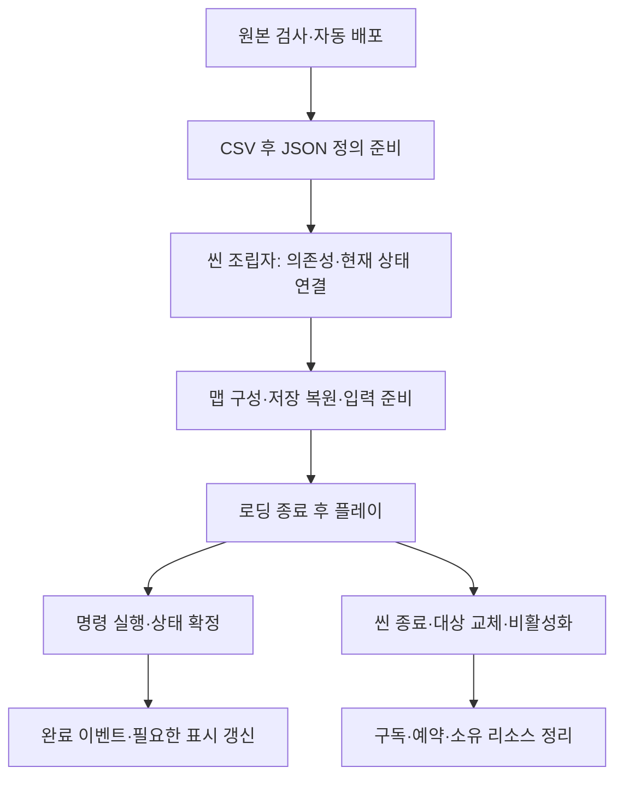
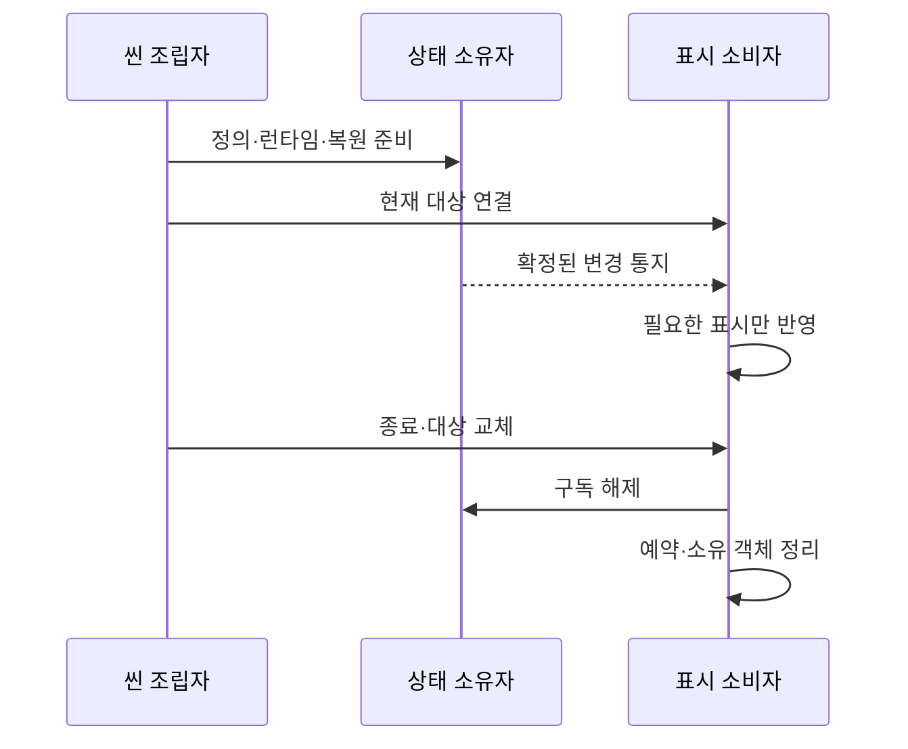

# 현재 구현과 검증 현황

> 2026-11-12 최신: M1 허수귀·M2 지게귀 신규15음원을 각 기본 프리팹과 상속 변형에 연결했습니다. 허수귀 일반/치명 피격은 M1_hit/M1_hit2로 분리하고 발소리만4종 무작위입니다. 기존 테스트 창에 카메라 X/Y 이동·0.1 버튼·초기화를 추가했습니다. Unity 사운드193·카메라26, 코어1208·데이터5529·자동화6건 통과. 데이터/음원 원본·보스 프리팹 보존, 게임 빌드 미실행.

> 2026-11-11 최신: 그림자104%·블러2px. Player_Skill_Final9프레임을 기존 결박가르기에, PlayerClimb의 완전한10프레임 루프를 사다리에 연결했습니다. 신규 표시3151건·구르기21건 통과. Develop 최신 검사 구조 통합 후 코어1148·데이터4745·자동화6건 통과. 구르기 무적은 앞300ms 정상이며 이동 속도는 현재 달리기와 동일한6타일/초로 가속 효과는 없습니다. 데이터 수치는 변경하지 않았습니다.

> 2026-11-11 이전 표시 조정 기록: 그림자110%·외곽 블러2.0px. 프리팹과 공유 머티리얼에 저장하고 현재 Play에도 반영했습니다. 실제 PreviewPlayerSprite 원본·부모 연결 유지, 셰이더 오류 없음. 아래106%/108%·1.25px은 이전 기록입니다.

> 2026-11-11 크기 복원: 사용자 요청으로 그림자108%→106%만 되돌렸습니다. 실제 애니메이션 표시 대상 연결 교정과 블러1.25px은 유지합니다. 아래108% 검사는 복원 전 기록입니다.

> 2026-11-11 실제 표시 연결 보완: 그림자 원본이 비활성 임시 Body를 가리키던 운영 씬 연결을 PreviewPlayerSprite의 실제 렌더러로 교정했습니다. 시작 시 해당 표시 대상의 자식으로 연결하며108%·기존 블러를 유지합니다. 실제 씬 복제본의28클립·285표시 키·고유233프레임 격리1717건 통과. 이전 독립 렌더러 검사와 구분합니다.

> 2026-11-11 표시 시안: 플레이어 뒤108% 검은 실루엣·가장자리1.25px 블러를 독립 모듈/프리팹에 연결했습니다. 원본233프레임의 동기화·반전·숨김·메시 재사용/해제 격리1179건 및 실제 머티리얼 렌더를 확인했습니다. 메인 카메라 시작 Y=4·Size4.3을 최신 맵 설정과 맞췄습니다. [표시 설계](캐릭터%20상태%20애니메이션%20연결%20설계.md#플레이어-검은-실루엣-시안--2026-11-11)를 따릅니다.

> 2026-11-11 최신: 공중공격 착지 즉시 이동, 하단 점프 허용9종(기획7종+사용자 확정 도화골 1/2)/금지4종, 낙사 즉사, 앞/위 카메라, 장부방만 Walk(나머지 Run), 장부방 제외 전 맵 카메라 확대4.3·높이2.8(보스방 추적), 보스 돌진 맵 밖 이탈 수정, 일반몹 Stun 단발, 기획 확정 공격330/550ms의 단계별 비례 축소를 반영했습니다. 코어897·데이터1023·Unity 격리636건 통과. Editor 테스트 메뉴 장부방/보스방 실제 Play 도착 확인. 전체 맵 연속 전투·최종 청취·카메라 체감 수용은 후속입니다.

> 2026-11-11 기획 전체 대조: Drive 현행 DOCX87개·본문과 표285개·로컬1109 제안 MD·현재 코드/리소스를 점검했습니다. DOCX 내부 별도 MD 파일은0개입니다. 변경·누락·충돌과 담당별 우선순위는 [기획 완료 기준 점검표](기획%20완료%20기준%20점검표.md#2026-11-11-현행-기획-전체-대조)에 정리했습니다. 새로 발견한 누락을 구현 완료로 집계하지 않습니다.

> 2026-11-11 플레이어 후속: 4단타 클립·음원 연결, 공격/패링 방향 고정, 공중 평타 수평 이동을 반영했습니다. 코어895·데이터1023·Unity 격리287건과 새4음원 준비 통과. [연결 설계](캐릭터%20상태%20애니메이션%20연결%20설계.md#플레이어-단타-분리와-방향공중-이동--2026-11-11)를 따릅니다.

> 데이터시트819630c 검사 모드24탭 통과. 원본 엑셀24표 중22표는 클라이언트와 일치하며,11/11 추가된 Language32행과 Item6101/6201 TextID 연결2건은 미배포입니다. 별도 JSON11개 중9개 일치·2개 미배포: 산길8002는 원본9마리/클라이언트30마리, 갈림길 HIGH/MID 기준은 원본8/5·클라이언트27/15입니다. 원본11/11 기획자 메모에 산길30→9 변경과 협곡 수 확정 뒤 서낭당 비용 재계산 대기가 명시되어 있습니다. Drive R35·1109 MD의30마리/80% 계산은 이전 기준입니다. 공급 원본·배포 데이터를 수정하지 않았고 데이터 담당 배포 후 재확인이 필요합니다.

> 2026-11-11 회귀 복구: 절벽 오르기 잠금·진행률 표시와 적 판정 시간 소비를 다시 연결했습니다. 패링 이벤트·MD 수치·A/B Shift·LT를 검증하고 누락된 흰 충격 이펙트도 복구했습니다. 코어868·데이터1023, Unity 격리/입력 Play787건 통과. 전체 맵 전투·완주는 미검증입니다. [복구 범위와 검사](캐릭터%20상태%20애니메이션%20연결%20설계.md#머지-회귀-복구--2026-11-11)를 따릅니다.

기준일: 2026-11-11. 로컬 `NYM/Work · bd5206f`와 현재 미커밋 변경, DataSheet `819630c`, Drive 현행 기획을 대조했습니다. 아래11/10 오류 복구는 당시 기록입니다. 공유 간트 값·완료율은 변경하지 않았습니다.

> 2026-11-10 도착 초기화 오류: K9맵에 남은 폐기 관문 세 표식은 조립 시 조용히 생략합니다. 최신 Develop의 미연결 관문 경고·통행 허용 정책도 유지하며 임의 ID·개방 기록은 만들지 않습니다. 공급 설정이 있으면 해당 행을 우선합니다. 실제5맵 조립·활성화와 설정 우선·미연결 정책 검사24건을 완료했고 전체 왕복 Play는 후속입니다. [원인·수정 범위](컷씬%20재생%20설계.md#폐기-표식으로-인한-도착-준비-실패--2026-11-10)를 따릅니다.

> 2026-11-10 서낭당 표시 오류: 삭제된 원본 UI 이미지13개와 SongMyung 폰트·라이선스를 기존 GUID로 복구했습니다. 화면 열기·혼/약초 구매·단계 표시·입력 차단·닫기/재열기 격리28건 통과. 구매 규칙·데이터·실제 저장 파일은 수정하지 않았으며 전체 Play 수용은 후속입니다. [복구 범위](재화와%20강화%20구매%20설계.md)를 따릅니다.

> 2026-11-10 인게임 UI: 체력바 표시480×40(논리240×20·앵커2배), 좌상단20px 여백·기력11px 간격을 확인했습니다. 확인용 제목과 플레이어 위 스탯 글자는 표시에서 제거하고 기존 연결은 유지합니다. 씬/프리팹 상속·비활성 상태·체력75% 감소의 격리 렌더 확인, 데이터·게임 코드 변경 없음. 실제 전투 Play는 후속입니다. [표시 구조](체력%20표시%20모듈%20사용과%20설계%20안내.md#인게임-체력바-확대와-확인용-글자-표시-제거--2026-11-10)를 따릅니다.

## 1. 현재 상태를 읽는 기준

구현은 코드가 있다는 뜻이고 연결은 현재 조립 경로가 있다는 뜻입니다. 실제 검증은 Unity Play·실행파일에서 확인한 범위입니다. 컴파일 통과를 전체 게임 완성으로 집계하지 않습니다. [남은 작업](남은%20구현과%20검증%20작업.md)과 [설계 기준](설계%20기준%20점검과%20개선%20방향.md)을 함께 봅니다.

## 2. 영역별 실제 경계

| 영역 | 현재 구현·연결 | 남은 확인·제작 |
| --- | --- | --- |
| 데이터 | 원본 검사·자동 배포, CSV 다음 JSON 초기화·등록 | 새 종류의 동작은 코드 연결 필요. 열 추가만으로 새 기능이 생기지 않음 |
| 타이틀·설정 | 메뉴·키보드 A/B·공용 설정·창모드·오류 모달 | 장치별 입력·표시·취소·재진입 Play |
| 씬 이동 | 맵 로딩·타이틀 암전, 데이터·조립·복원 준비 대기, 로딩 중 이동·출구·일시정지 차단 | 전체 왕복·사망·엔딩, 새 로딩 시안 확정 |
| 맵·스폰 | StageContentSet에 8001~8005 등록. 플랫폼 기준 JSON 생성·개별 처치 제외 | 실제 배치·도착 앵커·공간 수용. 전체 풀링 완료로 표현하지 않음 |
| 관문 | 등록 ID의 생성·개방·저장·복원 | 현재 GateConfig는 빈 표. 미연결 표식은 경고 후 생성 생략하여 통행 가능. 정식 행 연결 필요 |
| 저장 | 테스트 10슬롯·직접 선택·날짜 내림차순·번호 숨김·F5. 출시 단일 자동 슬롯. 위치·처치·재화·강화·갈림길 기록 | 실제 저장·재실행·왕복·사망·파손 파일 확인 |
| 재화·성장 | 경험치·혼·엽전 자동 지급, Lv5 상한·최대 경험치 제한, 강화 효과·사망 손실·저장 | 보스 보상 행·획득 연출·랜덤박스 |
| 서낭당 | 첫 접촉 저장·E 휴식 저장, 임시 구매 UI·지갑·비용·효과 | 구매·닫기·재저장·이어하기 Play, 최종 화면 |
| 갈림길 | JSON 자동 공급·첫 도착 1회 지급 규칙·저장·도착 어댑터 준비 | 실제 도착 영역 미배치. 대상 오브젝트 ID·성공 연결·연출 대기 |
| 전투·표현 | 상태별 표시, 일반몹 패링 취소·경직 확정 뒤 Parried 이벤트와 표시 갱신 | 다른 작업자 담당 변경을 현재 구현으로 기록. 반복 전투·키·청취 수용 |
| 컷씬 | 독립 재생·역할 키·그림/영상·스킵·실패 정리·호출 경로 준비 | Cutscene·CutsceneStep 행과 실제 미디어 대기 |
| 사운드 | 표 기반 주소·재생·정지·볼륨, 플레이어 동작·임시 환경음 | 상황 조건·추가 음원·최종 청취 |
| 빌드·초기화 | GitHub 테스트/정식 선택·결과물 보관·디스코드 공지, F12 최신 슬롯 삭제 확인 | 원격 두 빌드·출시 시험 기능 비노출·실행파일 완주 |

## 3. 스폰 원본·배포·실행 참조 통합

원본은 DataSheet의 `spawn/*.json`, 배포 위치는 `Assets/Data/Json/spawn`입니다.11/11 원본8002는 MaxMonsterCount9·실제9마리이며 배포본은30·30마리입니다.8003은 양쪽30마리,8001·8005 배포본에는 몬스터가 없습니다.8002·갈림길 HIGH/MID8/5와 새 Language32행·Item TextID2건의 배포가 남았습니다. StageContentSet의8004는 맵 참조만 있고 Spawn은 비어 있습니다. 현재 ResolveMonsters는 Points를 사용하며 MaxMonsterCount를 별도 실행 상한으로 소비하지 않습니다. 등록된 맵을 콘텐츠 완성으로 판단하지 않습니다.

갈림길 지도 리소스가 등록돼 있어도 보상 도착 영역이 배치됐다는 뜻은 아닙니다. 현재 씬·프리팹에서 GalimgilArrival 연결은 확인되지 않았습니다. [갈림길 안내](../기획자용%20안내문서/갈림길%20보상%20작성과%20검수%20안내.md)를 봅니다.

## 4. 수명·이벤트·데이터 소유권

읽기 전용 정의와 변경 가능한 런타임·저장 사본을 분리합니다. 게임 이벤트는 동기이며 소비자 예외로 확정 상태를 되돌리지 않습니다. 표시 소비자는 자기 표시 실패를 처리하고 코어 명령을 다시 실행하지 않습니다. MonoBehaviour는 Unity 수명과 연결을 맡습니다. 구독 범위가 파일 작업·Unity 로드를 자동 취소하는 것은 아니므로 각 소유자의 취소·요청 번호·반환 계약도 유지합니다.

## 5. 검증 근거와 한계

11/11 최종 검사: 코어 **897개**, 데이터 **1,023개**, Unity 격리 **636건** 통과. 격리는 착지/발판/카메라56, Walk/콤보/Stun143, 패링 이벤트150, 단타/방향/공중 이동 회귀287입니다. 자체 Play에서 두 Editor 메뉴의 도착·로딩 완료·장부방 Walk를 확인하고 Title 편집 상태로 복귀했습니다. 검사용 별도 저장 위치를 사용했습니다. 이 결과는 전체 맵 연속 전투·최종 청취·실행파일 완주·성능 측정을 포함하지 않습니다. 게임 빌드와 원격 CI는 실행하지 않았습니다. 이전11/10 맵24건·서낭당28건은 당시 검사 기록입니다. 독립 코어·데이터 검사는 Unity 포함 .NET6 런타임의 동일 소스로 통과했습니다.

Windows 64비트만 제공하며 해상도 축소는 현재 최적화 범위에서 제외합니다. 60FPS는 목표이며 최소 사양 확정이나 병목 해소를 의미하지 않습니다. 렌더링·리소스 추가 변경은 별도 결정 대상입니다.

## 6. 다음 판단에 필요한 것

낙사는 11/11부터 HP 무관 즉사 후 기존 사망 흐름으로 복귀합니다. 담당 내 다음 순서는 투사체 지형 충돌·돌진 수치, HUD 레벨/패링 안내입니다. 컷씬 행·미디어, 산길9마리 배포, 사망 위치 저장 계약은 공급/저장 담당과 연결해야 합니다. 제안 상태인 투사체 패링 예외·Objects/Choices/Portal 계약과 최신 기획 대 기존 F12 정책 차이는 별도 결정 대상으로 남깁니다. 상세 근거와 담당 경계는 기획 완료 기준 점검표를 따릅니다.

## 7. 사용자 확정과 현재 적용 경계

몬스터 기본 리스폰은 OFF이며 개별 처치 기록을 사용합니다. 구간별 ON/OFF 데이터와 초기화 시점은 후속입니다. 관문 ID는 임의 해시로 만들지 않으며 폐기 ID는 저장 원본 대신 복원 사본에서 정리합니다. 표에 없는 관문은 임시로 생성하지 않습니다. [관문 안내](../기획자용%20안내문서/기획자용%20관문%20데이터%20작성과%20확인%20안내.md)를 따릅니다.

## 테스트 F12 초기화 연결

테스트 환경에서 한 번 눌러 Popup 15008 확인 창을 열고 승인하면 최신 슬롯 하나만 삭제한 뒤 타이틀로 이동합니다. 취소·X는 유지, 설정과 다른 슬롯은 보존합니다. 출시에서는 시험 입력·화면을 노출하지 않는 기존 분기를 사용합니다. [F12 안내](../기획자용%20안내문서/기획자용%20F12%20초기화%20사용%20안내.md)를 따릅니다.

## 8. 현재 실행과 객체 수명 도식

수명 계약 구현을 모든 빈 참조의 부재 보장으로 확대하지 않습니다. 준비 중 종료·부분 초기화 실패·재활성·왕복을 실제 플레이에서 확인해야 합니다.
