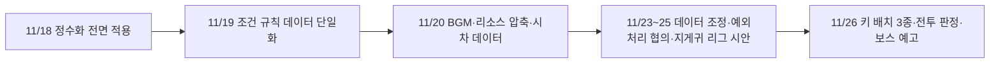

# 현재 구현과 검증 현황

기준일: 2026-11-27 · 클라이언트 `9f453a86`(HYT/work) · DataSheet `a3a0b3c`.
이번 확인은 로컬 코드·Git 이력·데이터 CSV·기존 문서 대조입니다. 원격 CI·공유 간트·외부 기획서·실제 Play·빌드 검사를 새로 실행하지 않았습니다. 11/17 기준표는 아래 [2.2](#22-2026-11-17-기준-반영)에 그대로 둡니다.

## 목차

1. [읽는 기준](#1-읽는-기준)
2. [최근 반영과 검증 경계](#2-최근-반영과-검증-경계)
3. [협업과 다음 확인](#3-협업과-다음-확인)

## 1. 읽는 기준

[전체 개발 문서 통합 안내](전체%20개발%20문서%20통합%20안내.md)에서 구조·설계·사용 안내·개선 검토를 구분합니다. 구현됨, 기록된 자동 검사, 실제 사용 확인은 서로 다른 상태입니다. 임의의 전체 완성률·개인 기여율을 계산하지 않습니다.

이전 날짜별 배치·수치·점검 이력은 [11/17 정리 전 현황 보존본](구버전/2026-11-17/현재%20구현과%20검증%20현황.md)으로 이동했습니다. 당시의 미구현·검증 수치를 현재 상태로 다시 합산하지 않습니다.

## 2. 최근 반영과 검증 경계

### 2.1 2026-11-18 ~ 11-26 반영

커밋 작성자 기준으로 적습니다. "코드 반영"은 저장소에 들어갔다는 뜻이며 실제 Play·실행파일 수용과는 다릅니다. 이 기간 실제 Play로 확인된 것은 각 기능 문서에 기록된 범위뿐입니다.

| 기능 | 현재 소스·Git 근거 | 상태와 문서 |
| --- | --- | --- |
| 정수화 전면 적용 | 11/18 hollowinday `6485bdb2`·`43ce76f8`·`56c91196`·`dc2519aa`·`5679ce5e`, NYM `4bab9c83`·`cd847a2f`·`69ad428b`. 실수 값에 `// [정수화 미적용 이유]` 주석 규칙과 `IntegerPolicyChecks` 검사 추가 | 코드 반영. [정수 단위 감사](정수%20단위%20감사와%20시간·좌표%20경계%20설계.md), [AGENTS 정수화 원칙](../../AGENTS.md#정수화-기본-원칙) |
| 조건 규칙 데이터 단일화 | 11/19 hollowinday: 몬스터 패턴(`54269529`)·보스 2페이즈 선택값(`1c5bdc17`)·보스 스킬 조건(`322454f1`)·맵 역할(`16554717`)·코요테/점프 버퍼(`0fd9ea94`)·맵 배경음(`c0cc30d5`)·콘텐츠 ID 직접 비교 제거(`bc2ef038`) 등 | 코드·검사 반영. [조건 규칙 교차 감사](조건%20규칙%20교차%20감사와%20흐름%20단절%20위험%20분석.md), [데이터 작업자 전달 안내](../기획자용%20안내문서/데이터%20작업자%20전달%20-%20조건%20규칙%20데이터%20이전%20안내.md) |
| 배경음악 | 11/20 hollowinday `2aa75d36`(Sound ID 전환·보스 페이즈 전환)·`105d8431`(4곡 Streaming, 일반 스테이지 BGM 비움), GH `cdffb8aa`. NYM 사운드 미출력·재생 시점 수정 `e5e95ad9`·`9d9b741c`·`eb768d35` | 코드·데이터 반영. 장면별 청취는 별도. [BGM 설정 안내](../기획자용%20안내문서/기획자용%20배경음악(BGM)%20설정%20안내.md), [사운드 설정 설계](사운드%20설정%20설계.md) |
| 리소스 정리·압축 | 11/20 NYM `806fa44a`(미사용 삭제 약 167 MiB)·`7c888833`(보류 123개 `Assets/_Hold`)·`cbc6e3cb`(BC7 96장)·`0c4bf674`(아틀라스 20개), hollowinday `b0e42166` | 반영. 11/23 릴리즈 빌드 실측 메모리는 [빌드 전 점검 7-5](빌드%20전%20정합성과%20테스트%20기능%20점검.md). [텍스처 압축 결과](2026-11-20%20텍스처%20압축과%20스프라이트%20아틀라스%20적용.md), [미사용 리소스 확인](미사용%20리소스%20참조%20확인%20결과.md) |
| 맵 배경 시차 | 11/20 NYM `f265519a`(레이어 배율을 StageLayer 행으로 이전)·`aa7d8e7a`(9003·9033 복구) | 반영. [맵 배경 시차 설계](맵%20배경%20시차와%20StageLayer%20연결%20설계.md) |
| 입력: 마우스 공격 제거 | 11/20 hollowinday `9d3232f7`: Player/Attack의 마우스·터치 연결 삭제(터치패드가 눌린 채 X 공격이 막히던 결함) | 반영. [게임플레이 코어와 프리팹 연결](게임플레이%20코어와%20프리팹%20연결.md#입력이동-경계) |
| 키 배치 3종·새 게임 흐름 | 11/26 NYM `4d085bd2`(새 게임 시 키 선택 팝업·윗키 입장 제거, 상호작용은 Interact만), `c9dae5e3`(A=할로우 나이트·B=블라스퍼머스 응용 배치), `9f453a86`(스컬 배치 추가·기본값) | 코드 반영, 실제 Play 미확인. 키 표는 [타이틀 안내](../기획자용%20안내문서/기획자용%20타이틀%20사용%20안내.md#새-게임-시작과-키-설정--2026-11-26) 한곳. 스컬 배치는 시작 안내 영상으로 `_A` 파일을 재생하므로 영상 속 키가 다를 수 있음(확인 필요) |
| 전투 판정·보스 예고 | 11/26 NYM `9f453a86`: 플레이어·몬스터 발 접촉 구간, 잔불·빙판 판정을 그림에 맞춤, 보스 예고 외곽선·범위 원·돌진 화살표, 1페이즈 근접 패턴 Range 기준, 일반몹 첫 예비 동작 500ms·동시 공격 2마리, 사다리 소리 | 코드 반영, 실제 Play 미확인. [보스 2페이즈 전투](보스%202페이즈%20전투와%20피격%20반응%20연결.md), [일반 몬스터 인공지능](일반%20몬스터%20인공지능.md), [필드 효과 안내](../기획자용%20안내문서/필드%20효과와%20enum%20시트%20사용%20안내.md) |
| 지게귀 신규 리그 시안 | 11/25 NYM `69f9e681`·`19241b71`: 아트 공급 파츠 18개, 돌진 포함 클립 11개, `CharacterAnimationPreview` 시험 씬 | 시안. 게임 프리팹에는 아직 연결하지 않음. [캐릭터 상태 애니메이션](캐릭터%20상태%20애니메이션%20연결%20설계.md#지게귀-신규-리그-시안) |
| 기획 데이터 조정 | Kim Hyun Ho(DataSheet Claude 커밋 포함): 피격 경직·무적 0(`92924804`, DataSheet `3288c65`), 3404·3405 인식 거리 축소(`e392e675`, `ac4f683`), PlayerLevel 6~10 공격·방어 증가량(`8b3b9a59`, `f648d9d`), 산길 첫 지게귀 위치 x17.5(`bf74b8d`), 11/18 AIR 발판 높이·스폰 높이(`0b9573f3`·`2a9690e2`), 처형→해체 용어 통일(`21b282db`) | 데이터 배포 반영. 넉백·다운 반응의 `DownTime`은 그대로 적용됨 |
| UI·아트 수정 | NYM 혼/엽전 획득 UI(`5f319dfe`)·결박 가르기 팝업(`7a94f0f7`, 변경 예정)·서낭당 중 월드 안내 숨김(`cf059c0c`)·아이콘, GH 누끼·장부방·프리팹 | 다른 담당 반영. 이번 문서 작업에서 합격 판정하지 않음 |
| 협의·전달 문서 | hollowinday·NYM [예외처리 협의](예외처리%20협의%20및%20정리사항.md)(결정 전), Kim Hyun Ho 직군별 할 일 R3와 `수정진행 문서` | [문서 안내](../문서%20안내.md#지스타-피드백-직군별-할-일과-기획-전달-112526)에서 연결. 몬스터 패턴 R2의 새 열(`Priority`·`HpBelow` 등)과 연출 초안은 미반영 |
| 배포 대기 | DataSheet `a3a0b3c` Language 30405(체세 첫 안내) | 클라이언트 `Language.csv`에 아직 없음. 소비 코드도 없음 |

### 2.2 2026-11-17 기준 반영

| 기능 | 현재 소스·Git 근거 | 남은 확인·문서 |
| --- | --- | --- |
| NPC 이름표·말걸기 | `4f175859`: 본체 범위 기반 이름표·그림자·공용 표시 위치 계약·정수 설정·수명 정리 | 기존 문서는 컴파일 기록 있음/실제 Play 미확인. [최신 설계 2장](NPC%20이름표와%20말걸기%20안내%20배치%20설계.md#2-현재-구현과-승인-결정)과 [기획 안내](../기획자용%20안내문서/NPC%20데이터%20작성과%20배포%20준비%20안내.md) |
| 일반 몬스터 경사 이동 | `98afeba2`·`2ee0a130`: 정수 경사 규칙·중앙 발 지지·파생 충돌 조회·좌표 한 번 확정 | 플레이어 적용은 보류. 경사 검증 도구와 실제 Play는 별도. [설계 10장](비탈길%20접지와%20이동%20벡터%20개선%20설계.md#10-구현-결과와-원칙-적용) |
| 출시 화면 미리보기 | `f28b5678`: TestFeatureGate와 에디터 설정. 개발/출시 컴파일 경계 유지 | 미리보기는 실제 정식 실행파일 검증의 대체가 아님. [사용 안내](../기획자용%20안내문서/에디터%20출시%20빌드%20미리보기%20사용%20안내.md) |
| 어그로 검사·보스 타격 방어 | `ab6277fc`: 런타임 인식 코드는 바뀌지 않았고, 인식 검사(`MonsterAwarenessChecks`)의 기대값을 `704fde84` 스폰 방향(생성 뒤 첫 관측만 플레이어 쪽을 봄)에 맞춤. `BossCombat.HitPlayer`는 돌진 회피 판정 한 곳에만 `_pattern` null 확인을 추가 | 같은 함수 아래의 `_pattern.Hits` 참조는 그대로이며, 패턴 정리 때 판정 창도 꺼진다는 암묵 규칙 덕분에 지금은 도달하지 않음. 최신 수정 뒤 전체 Play·빌드 성공을 이번 확인만으로 보장하지 않음. [어그로 설계](몬스터%208방향%20인식과%20추적%20설계.md) |
| 사운드·스폰 방향 | `704fde84` NYM 커밋 | 커밋 반영과 실제 장면별 청취·방향 수용은 구분. [동작 사운드 안내](../기획자용%20안내문서/플레이어%20동작%20사운드%20연결%20안내.md) |
| 처형 모션 | `2fdc2f03` NYM 커밋 | 다른 담당의 전투·모션 범위. 이번 문서 작업에서 수정·합격 판정하지 않음 |
| 저장·씬·컷씬·언어·통계·강화 | 기존 기능·사용 안내와 연결이 있음 | 세부 완료 조건은 기능 문서와 [남은 확인](남은%20구현과%20검증%20작업.md). 오래된 공급 대기 내용을 현재로 단정하지 않음 |

원본 단계의 수치·검사 기록은 기능 문서에 보존합니다. 이번 문서 갱신에서 같은 검사를 재실행했다고 기록하지 않습니다. 사용자 로컬 ProjectSettings 변경과 출력 이미지 시안은 이번 문서 수정에서 변경하지 않습니다.

## 3. 협업과 다음 확인

> 다른 문서가 이전의 "5. 작업자별 역할과 Git 근거"·"6.1 다른 담당 확인 요청"·"6.2 빌드 점검에서 수정한 항목"으로 연결하면 이 절로 옵니다. 역할별 변경 파일·대표 커밋·당시 확인 요청 원문은 보존본의 [5. 작업자별 역할과 Git 근거](구버전/2026-11-17/현재%20구현과%20검증%20현황.md#5-작업자별-역할과-git-근거), [6.1](구버전/2026-11-17/현재%20구현과%20검증%20현황.md#61-다른-담당-확인-요청-2026-11-17), [6.2](구버전/2026-11-17/현재%20구현과%20검증%20현황.md#62-2026-11-17-빌드-점검에서-수정한-항목)에 그대로 있습니다. 귀속 기준은 아래 문단이 최신입니다.

사용자는 NPC 표시·일반 몬스터 경사 개선을 진행했고, 패링·보스 판정·패턴 등 다른 담당 기능을 문서 정리를 이유로 임의 변경하지 않습니다. 현재 배정과 과거 Git 기여는 별개입니다.

DataSheet의 Claude 작성 커밋은 사용자 지정에 따라 Kim Hyun Ho의 기여로 구분하며 다른 Git 계정의 실명을 추정하지 않습니다. 아트 담당자는 Git 외부에서 원본 제작·공급에 함께 참여했고, 코드·가공·연결의 Git 작성자와 구분합니다.

다음 확인은 세 키 배치의 실제 입력·HUD 키판·시작 안내 영상, 피격 경직 0에서의 연속 피격 체감, 9f453a86 전투 판정·보스 예고의 실제 Play, NPC KO/EN·겹침, 일반몹 경사 왕복, 테스트/출시 실행파일 완주입니다(2026-11-27 갱신). 구조 문제는 [분리된 개선 검토](개선%20검토/코드%20구조와%20반복·재귀%20개선%20검토.md)에서 우선순위별로 관리합니다.
