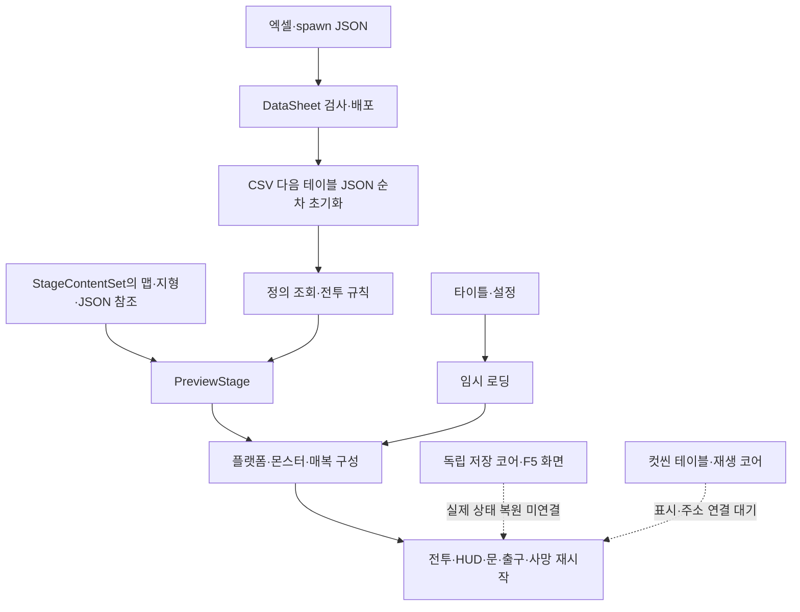

# 현재 구현과 검증 현황

2026-11-05 컷씬 표시 후속: CutsceneScreen과 CutsceneInput을 추가했습니다. 기존 코어·주소 공급자·준비 저장소를 재사용하며, LoadingScreen은 공용 Update 진행과 타이틀 암전 경로를 제공합니다. 테스트 맵의 타이틀 복귀를 연결했습니다. 데이터913·코어658·기존 CS0414 제외 편집기 참조 컴파일 통과입니다. 실제 컷씬 행·프리팹 배치·게임 잠금·인트로/장부방/엔딩 호출과 실제 Unity 검증은 남아 있습니다. [현재 사용·확인 안내](../기획자용%20안내문서/기획자용%20컷씬%20표시와%20씬%20이동%20안내.md)를 따릅니다.

2026-11-05 전체 스크립트 정비: 타이틀 설정 루트 배율·앵커·직접 오류 보고를 수정하고, TitleSceneActions를 제거했습니다. 설정 적용/저장·UI 표시 계약·고정 상태 프레임 부모·시간 변환을 공통화했고 비동기 완료·구독·부분 초기화·파괴된 상호작용 대상 경계를 정리했습니다. 데이터913·코어635 및 기존 CS0414 제외 일반 참조 컴파일 통과입니다. 실제 Play·씬 수명·프리팹 상속 연결 검증은 별도이며 상세 설계와 확인 절차는 공통 모듈과 객체 수명 문서를 따릅니다.

2026-11-05 공용 설정 후속: 현재 타이틀과 일시정지는 같은 SettingsScreen을 사용합니다. 마스터·배경음·효과음·카메라 흔들림, 저장/취소와 모달 입력 차단을 연결했고 마스터 조작부를 추가했습니다. 이전의 임시 빈 타이틀 옵션 설명은 과거 상태입니다. 실제 Unity 표시·입력·소리 확인은 기획자용 사운드 설정 사용 안내를 따릅니다.

2026-11-05 `b8779f7` 후속 상태. 아래 이전 점검 기록보다 이 절을 우선합니다.

- 새 ErrorPopupSceneBinding·IModalInputTarget·MenuInput.SetBlocked·독립 모달 정지는 재사용합니다. 공급된 CSV/JSON/엑셀·데이터 정의/생성 계획은 읽기만 하며 수정·재배포하지 않습니다.
- 타이틀 검은 임시 옵션을 공용 SettingsScreen으로 교체했습니다. 변경 미리 적용·확인/취소 원복·다음 프레임 부모 선택 복귀를 사용합니다. TitleScreen의 오류 잠금 대상에 TitleGameEntry도 연결해 옵션 키보드·포인터 입력을 함께 차단합니다.
- ManualSaveHost는 삭제30203을 조회하지 않습니다. 빈 칸15001·덮어쓰기15002를 각각 확인하고 취소는 목록으로 돌아갑니다. 덮어쓰기 기본아니오·취소아니오·두 버튼을 검증합니다. 실제 ISaveGameRuntime·F5 운영 연결은 후속입니다.
- 포커스 상실·Gamepad Disconnected/Removed는 허용된 게임 상태에서만 자동 정지하며 자동 재개하지 않습니다. 대화·정지·오류 잠금은 각 소유권을 유지합니다. 초기화 전 오류 잠금도 보존해 늦게 준비되는 플레이어 입력에 적용합니다.
- UI 전환 시 공격150ms·점프 버퍼를 지우고 현재 공격은 유지합니다. 대화가 남아 정지 잠금이 계속되는 경우도 닫힘 프레임의 대화 넘김·게임 입력은 폐기합니다.

| 검사 | 결과 |
| --- | --- |
| 기존 공급 데이터 | 911개 통과, 검사 복사본만 사용 |
| 순수 코어 | 610개 통과, 콤보 버퍼 회귀6개 포함 |
| 엔진 참조 | DEVELOPMENT_BUILD 엄격176개 통과, CS0414 우회 제거 |
| Unity 격리 프리팹 | 저장16·타이틀/오류29·게임 입력/정지26 = 71개 통과 |
| 보호 범위 | 데이터/정의/생성계획·씬·meta·설정·패키지·DataSheet 추적파일810개 SHA 보존 |
| 미실행 | 실제 Play·물리 장치·클립보드 복사·사용자 저장 기록·게임 빌드·commit/push |

이전 점검·공급 이력은 아래에 보존합니다.

2026-11-05 씬 연결 후속: TitleScreen 프리팹과 MapDohwagolTest에 ErrorPopupSceneBinding을 연결했습니다. 데이터 준비 후 호스트를 만들고 메뉴·플레이어 입력과 게임 시간을 모달 소유권으로 차단합니다. 다른 정지·대화 잠금은 유지합니다. 새 씬 설정과 Unity 확인 순서는 기획자용 에러 팝업 사용 안내에 추가했습니다. 실제 Unity 표시·복사·입력·씬 수명 검증은 남아 있습니다.

2026-11-05 자동 오류 수집 모듈 추가: 초기화된 에디터/개발 빌드 호스트가 Error·Exception·Assert를 수집하고 메인 스레드에서 합산 표시합니다. 직접 Report 중복·표시 재귀·종료 후 전달을 차단합니다. 데이터911·코어600·기존 CS0414 제외 일반/개발분기 참조 컴파일이 통과했습니다. 실제 씬 초기화·입력/일시정지 연결과 Unity 표시 검사는 별도이며 F9·부스표시·출시 전체 정책은 후속입니다.

2026-11-05 에러 알림 갱신: 사용자 승인으로 Popup15007의 복사·닫기·상세 요약을 연결했습니다. Language30209~30212·30214의 KO/EN을 공용 조회로 읽고 PopupScreen 상속으로 표시 수명을 재사용합니다. 기존 X·확인/로그 전용 설명은 이 변경 이전 기록입니다. 데이터903·코어600, 기존 CS0414 제외 엔진 참조 컴파일이 통과했습니다. 실제 씬 오류 자동 수집·F9·부스/출시 정책은 후속입니다.

2026-11-05 추가: 공용 ErrorPopupHost·ErrorPopupScreen·중첩 PopupButton 프리팹을 준비했습니다. 한국어/영어 LanguageCode와 외부 문구 조회 연결을 지원하며 현재 문구는 임시입니다. 기존 씬 실패 경계 전체 연결·언어 선택·Firebase/메일은 후속입니다. 상세는 [에러 팝업 설계](%EA%B3%B5%EC%9A%A9%20%EC%97%90%EB%9F%AC%20%ED%8C%9D%EC%97%85%20%EC%84%A4%EA%B3%84.md)를 따릅니다.

기준일: 2026-11-04 최신 풀 이후. 클라이언트 `c7100e3`(버그 수정9668a97 포함), DataSheet `5a523cd`를 점검했습니다. 공유 간트·현행 개별 기획서·11/4 회의를 비교했습니다. 코드 반영·테스트 씬 연결·실제 실행파일 검증을 구분합니다.

## 1. 현재 구조

일반 테이블 JSON과 스폰 JSON은 별도입니다. Stage.SpawnFile 값은 공급되지만 현재 실행은 StageContentSet의 직접 TextAsset 참조를 사용합니다. 경로 변경만으로 참조가 자동 교체되지 않습니다.

## 2. 구현과 운영 경계

| 영역 | 현재 구현·연결 | 남은 경계 |
| --- | --- | --- |
| 데이터 | 17탭·CSV13/테이블JSON4·정의21·계획1, spawn3개 자동 배포 | 기존 정의 스키마 동기화, 스폰 의미·참조·형상 검사 |
| 전투 | 지상4타·공중1타·자원·구르기·피격·약초·결박 가르기·보스 체세/해체/패턴·페이즈 | 최종 애니·실제 판정·빌드 회귀 검사 |
| 일반몹 | 기본형·변종·투척·불 코어 | 현재 불붙은 허수귀 사망 불 시간0으로 비활성. 최종 불 연출·피해 복구 판단 |
| 맵·스폰 | 껍데기/지형 분리, JSON2 다종 스폰, Trigger 매복·예정 개체 포함 집계 | Instantiate 방식, 풀 없음. 임시30마리와 공식4마리 원본 통합 |
| 진행·재시작 | 도착 앵커·HP/약초 이동 유지·클리어 출구·보스 처치 기억·체크포인트 | PreviewSession 정적 임시 상태, 저장 연결·정책 충돌 확인 |
| 타이틀·메뉴 | 새 게임→로딩→테스트 맵, 설정·종료·클릭 | 인트로·이어하기 실제 복원·새 시안·장치별 커서 |
| 표현 | 임시 HUD·텍스트박스·설정·일시정지·BGM·히트스톱·진동·발 정렬 | 최종 리소스·튜토리얼·포커스/패드 분리 예외·카메라 기획 |
| 저장 | JSON 안전 기록·슬롯 정책·독립 F5 화면·SaveGameFlow | 실제 ISaveGameRuntime 없음, 관문 키·삭제된 문구/팝업 계약 불일치 |
| 잠금 | Stage/Monster 일부 소비·해금·관문 | Skill/Item을 포함한 전 실행 경계의 기획 잠금 우선 적용 |
| 컷씬 | 빈2탭·검사·조회·순수 재생 코어 | 실제 행·주소 로더·영상/그림·소리·스킵·완료 연결 |
| 자동화·압축 | 수동 GitHub 개발 빌드·검사·결과7일·분리공지, PC BC7맵19개 | 실제 압축 측정·시연 완주·출시 정책·특정 커밋 입력 미구현 |

## 3. 최신 풀의 변경과 검증 상태

9668a97은 해체 완료를 임시900ms 타이머로 전달하고, 클리어 출구 재개방·관문 충돌 확대·안내·맵 끝 차단·복귀 앵커·HP/약초 유지·보스 재등장 방지·명중 카메라 진동·프레임 발 정렬을 추가했습니다. 사용자 보고 버그를 실제 실행파일에서 재검증한 것은 아닙니다.

사망 불은 코어 삭제가 아니라 설정0으로 끈 상태입니다. ‘사망 잔류 피해 근본 해결’과 ‘최종 불 기능 완성’으로 확대하지 않습니다. 해체900ms도 최종 모션 완료 신호를 대체하는 임시 값입니다.

## 4. 실제 검사 결과

| 검사 | 최신 결과 |
| --- | --- |
| 클라이언트 데이터 | 875개 통과 |
| 순수 코어 | 600개 통과. 이전596은 풀 이전 기록 |
| Unity 모듈 참조 컴파일 | 실패: GameplayPreview.cs61 `_exitAnchor` 미사용 CS0414를 오류 처리 |
| DataSheet EXE --check | 17탭·정의21·계획1·스폰JSON3 통과. 이번 배포 없음 |
| 실제 Play·장치·원격 빌드·압축 측정 | 이번 점검에서 미실행 |

첫 검사는 접근 제한으로 중단됐고 허용된 재실행으로 위 결과를 확인했습니다. 코드·씬 수정 없이 결과를 기록합니다. 과거 Play 검사 통과와 현재 회의 버그는 서로 다른 검증 범위입니다.

## 5. 주의할 불일치

- StageContentSet의8002/8003은 Assets/Data/SpawnTemp의30마리 JSON을 사용합니다. DataSheet가 배포하는 Assets/Data/Json/spawn은 각4마리입니다. 두 파일을 같은 최신 데이터로 취급하지 않습니다.
- 저장 관문은 정수 목록, Preview 키는 StageID와BindGate이름, 기획 예시는StageID_PlacementID입니다. 식별 계약이 필요합니다.
- ManualSaveHost는 현재 없는Language30203을 조회합니다. 빈 칸은 즉시 저장하고 덮어쓰기는15001을 재사용합니다. 최신 기획의 빈 칸15001·덮어쓰기15002와 다릅니다.
- StageMonsterSpawn의 목록 전체Sequence는 재정렬에 안정적이지 않습니다. 풀·처치 영구 식별자는 아직 연결되지 않았습니다.
- 앞선 사용자 방향은 재방문 잡몹 처치 유지, K16은 재진입/사망 시 잡몹 재생성입니다. 현재 Preview는 재생성하지만 정책 확정 근거로 삼지 않습니다.
- runInBackground가 켜졌습니다. 최신 UI 기획의 포커스 상실 자동 일시정지가 없으면 창 밖에서도 진행할 수 있으므로 함께 검사해야 합니다.

[잔여 작업](%EB%82%A8%EC%9D%80%20%EA%B5%AC%ED%98%84%EA%B3%BC%20%EA%B2%80%EC%A6%9D%20%EC%9E%91%EC%97%85.md)과 [기획 대조](%EA%B8%B0%ED%9A%8D%20%EC%99%84%EB%A3%8C%20%EA%B8%B0%EC%A4%80%20%EC%A0%90%EA%B2%80%ED%91%9C.md)에서 후속 판단을 관리합니다.

## 6. 최신 로컬 임시 옵션 변경

타이틀 옵션 선택 시 멈춘다는 사용자 보고에 따라 TitleGameEntry가 기존 SettingsScreen 대신 빈 검은 캔버스 TitleSettingsPlaceholder를 엽니다. 원인은 미확정입니다. 키보드·패드 버튼·마우스 클릭 중 새 입력으로 닫고 다음 프레임에 타이틀 선택으로 돌아갑니다. 여는 입력의 즉시 닫기·닫는 입력의 재선택을 방지하고 비활성화 때 구독·화면·대기 상태를 정리합니다. 일시정지의 정식 설정 화면은 변경하지 않았습니다.

기존 CS0414만 환경 속성으로 제외한 분리 검사에서 엔진 참조 컴파일 경고0·오류0, 데이터875·코어600이 통과했습니다. 소스·기본 검사 정책은 바꾸지 않았으므로 기본 엄격 검사 실패는 유지됩니다. 실제 Unity 화면·실행파일 검사는 미실행입니다.
