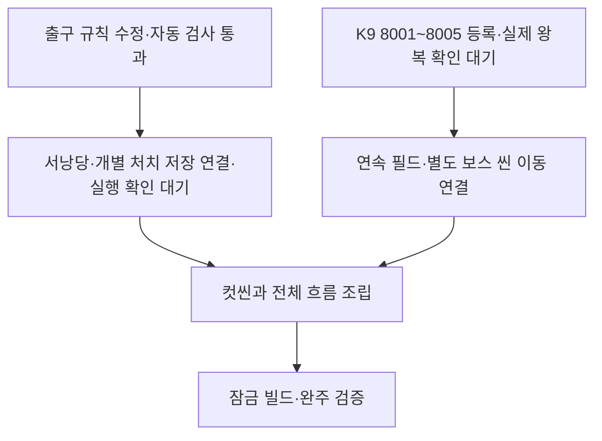
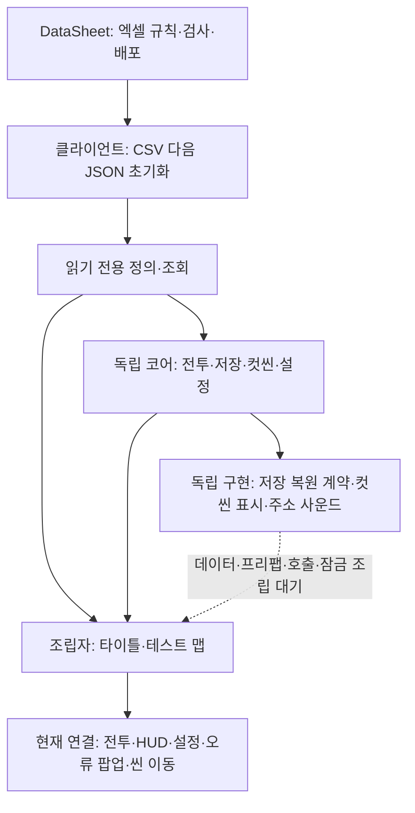
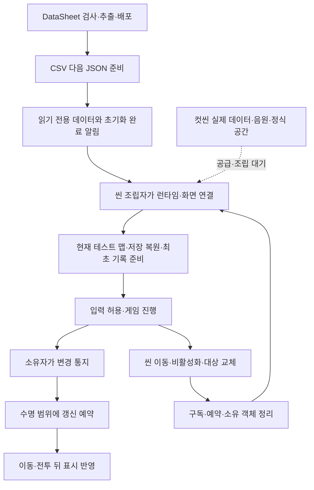
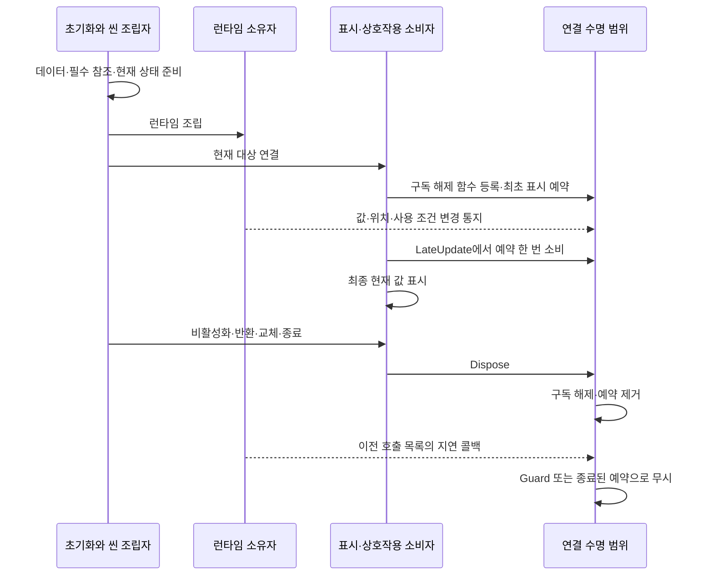

# 현재 구현과 검증 현황

2026-11-10 통합 검수: 보스 타격 인자·결과·공용 정의/구매 기반·분할 클래스·저장 사본과 폐기 관문 복원 누락을 수정했습니다. 갈림길 첫 도착1회 지급 규칙·자동 JSON 공급·기록 저장을 준비했습니다. 실제 공간과 보상 대상 오브젝트 데이터는 대기입니다. 패링 흐름과 새 단계 이벤트·연출은 다른 작업자 담당입니다. [원인과 개선 도식](병합%20누락%20복구와%20갈림길%20보상%20설계.md)을 따릅니다.

> 2026-11-10 임시 서낭당 화면: 제공된 ShrineScreen을 MapDohwagolTest의 E 상호작용에 연결했습니다. 혼·약초 구매 화면은 같은 목록·상세 표시를 재사용하고 기존 세션·입력·모달 소유권을 사용합니다. 데이터1017·코어847 검사와 일반·편집기 Unity 참조 컴파일을 통과했습니다(경고·오류0). 실제 Play의 표시·클릭·닫기·입력 복구는 확인 전입니다. [사용 안내 7절](../기획자용%20안내문서/기획자용%20재화와%20강화%20준비%20안내.md#7-임시-서낭당-화면-사용법)·[설계 8절](재화와%20강화%20구매%20설계.md#8-임시-서낭당-화면의-조립)을 따릅니다.

> 2026-11-10 재화 후속: 일반 몬스터 처치의 경험치·혼·엽전 자동 지급, 5레벨 상한·초과 경험치 이월·HP 증가분 회복, 강화 효과·보상/강화 저장 사본·사망 재화 손실을 기존 세션에 연결했습니다. UI·획득 연출·랜덤박스·보스 보상 행·갈림길 보상 호출은 남아 있습니다. 설계와 사용 절차는 [재화·강화 설계](재화와%20강화%20구매%20설계.md#7-자동-보상레벨강화의-실행-연결)와 [기획자 안내](../기획자용%20안내문서/기획자용%20재화와%20강화%20준비%20안내.md#6-몬스터-보상과-플레이어-레벨-설정)를 따릅니다. 이전 항목의 미연결 표시는 당시 기록입니다. 최신 연결 검사: 데이터 1017개·코어 834개 통과, 일반/편집기 Unity 참조 컴파일 경고·오류 0개입니다. 실제 Unity Play·Windows 빌드는 실행하지 않았습니다.

> 2026-11-10 최신 원격 재적용: 클라이언트 24f82dc·DataSheet 8470b2e로 리베이스하고 로딩·재화·강화 작업을 복원했습니다. 최신 전투·애니메이션을 보존했으며 배포 데이터는 최신 기획 원본으로 다시 생성했습니다. 혼·엽전 공용 지갑, 공통 구매 부모, 서낭당·Upgrade 표 강화와 최신 비율식의 정수 계산 코어를 준비했습니다. 게임 세션·UI·효과·파일 저장·사망 손실은 연결 전입니다. 데이터 1007개·코어 810개 및 Unity 참조 컴파일을 통과했습니다. [개발자 도식](재화와%20강화%20구매%20설계.md)·[기획자 안내](../기획자용%20안내문서/기획자용%20재화와%20강화%20준비%20안내.md)를 따릅니다.

도화골 K9·Map_ME가 공유하는 불타는 초가와 일반 초가 스프라이트를 교체했습니다. 기존 참조 GUID를 유지하고 새 이미지의 본체 너비와 바닥선을 기준으로 임포트 크기와 피벗을 맞췄습니다.

도화골 K9·Map_ME의 불타는마을 A/B는 원본 중경과 지붕선에 맞춘 불꽃을 합성한 9프레임을 초당 10프레임으로 반복합니다. 기존 SpriteRenderer의 타일링과 정렬을 사용하며 Animator는 스프라이트만 교체합니다.

도화골 K9의 SmokeColumn_01~03은 같은 SmokeColumn.controller로 9프레임을 초당 10프레임으로 반복합니다. 클립은 SpriteRenderer의 스프라이트만 교체하며 배치 Transform과 FlipX는 프리팹이 관리합니다.

도화골의 K9·Map_ME 프리팹은 기존 모닥불 위치의 `Campfire` 오브젝트에 동일한 `Campfire.controller`를 연결합니다. Animator는 같은 오브젝트의 SpriteRenderer에서 `Campfire_01`~`Campfire_09`를 초당 10프레임으로 반복합니다.

> 2026-11-09 후속: 하단 점프 콜백 연결, Map/Map_ME 허용 발판14프리팹, Map_ME 사다리27곳의 이동/루프/정지/이탈, 신규 UI4프리팹을 반영했습니다. 실제 실행 맵 K9와 데이터 원본은 유지합니다. 실제 재생 이동 검사32건, 추가 격리 검사와 UI 비율/표시 확인을 구분합니다.

> 2026-11-09 캐릭터 애니메이션: 플레이어·허수귀·지게귀·쇄문아비의 클립52개와 CSV 상태 연결을 적용했습니다. 독립 순환 확인 씬은 `Assets/5.Animation/Characters/CharacterAnimationPreview.unity`입니다. 격리1,552·코어718·데이터940 통과, 실제 미리보기 Play/화면 확인. 원본 PNG·데이터는 보존했고 일반몹 변형은 상속 적용입니다. 본게임 전체 전투/최종 음원 동기는 후속입니다.

> 2026-11-09 타이틀·표 사운드 후속(`9ba804e`): HG_BackGround 반복 영상·HG_TitleSound, 최신 로고20% 확대·메뉴40px 하단/10% 축소를 반영했습니다. 기존 동작 키는 공급 Sound 3001~3023의 설정을 소비하며 원본 데이터는 보존했습니다. 코어718·데이터940·격리 사운드33건 통과. 실제 Title Play 영상/음원/화면 확인, 원본 첫 프레임0.1초 경고는 남습니다. 인게임 전체 청취·최종 애니 동기는 후속입니다. 과거 숫자는 아래 당시 기록입니다.

> 2026-11-09 사운드 추가: 병합본 `b7361ec` 이후 플레이어 동작 소리·Walk3/Run2 무작위 묶음·인게임 불 환경음 반복을 연결했습니다. 병합 후 데이터940·코어711·격리 사운드55건 통과. Run/신규 변형 선택·최종 애니 이벤트·실제 청취/Play 수용은 후속입니다. Sound 표·원본 데이터·음원은 수정하지 않았습니다. [적용 범위와 호출](../기획자용%20안내문서/플레이어%20동작%20사운드%20연결%20안내.md)을 따릅니다.

> 2026-11-09: 스폰 원본·실행 참조 통합, JSON별 최대 수 검사, 영문 체력 앵커 배포와 새 게임 키 선택을 추가했습니다. 기존 생성 수명·정수 이동·스킬 잠금·도착 오류·세션 소유·안전한 파일 교체를 반영했습니다. 자동 검사: 데이터 940개·코어 711개, 일반/에디터 전용 Unity 참조 컴파일 통과(경고·오류 0개). 실제 Play·실행파일 빌드·완주 검증은 별도입니다. 상세 계약은 [설계 기준 점검과 개선 방향](설계%20기준%20점검과%20개선%20방향.md), 확인 순서는 [기획자 공통 안내](../기획자용%20안내문서/기획자용%20공통%20모듈%20연결과%20확인%20안내.md#7-이번-변경-이후-기획자가-확인할-내용--2026-11-07)를 따릅니다.

표현의 반복 갱신 개선은 [반복 갱신과 임시 표시 최적화 설계](반복%20갱신과%20임시%20표시%20최적화%20설계.md)에 정리했습니다. 문구 생성·UI 반복 대입을 줄이고 사망 후 처리와 회피 표시 재사용을 보완했습니다. 표시 값의 변경 통지·상호작용 자동 등록/해제·구독과 갱신 예약의 공통 수명 정리를 연결했습니다. 실제 플레이 회귀와 전체 성능 측정은 남아 있으며 렌더링·리소스 변경은 보류입니다.

기준일: 2026-11-07, 로컬 `caba1f0` 이후 이번 구현·배포 변경까지 반영했습니다. 이전 CS0649는 DropThroughPlatform의 기본값을 명시해 해결했습니다. 11월 6일 간트·작업자 집계는 [통합 진행 현황](간트와%20프로젝트%20통합%20진행%20현황.md)의 당시 고정 기록으로 유지합니다.

### 이번 맵 단계의 완료 경계

일반 맵의 전멸 출구 조건 제거와 이동 직전 목적지 콘텐츠 접근 판단은 구현했습니다. 마을 장부 조사 조건은 유지합니다. 전멸 클리어 기록은 출구 판단에서 분리했고, 저장 지점은 서낭당 접촉·휴식 규칙으로 교체했습니다. 설계 이유와 책임은 [게임플레이 모듈 구조](게임플레이%20모듈%20구조.md#맵-출구-규칙과-공간-연결-준비-2026-11-06)에 정리했습니다.

현재는 한 맵씩 기존 테스트 씬을 다시 읽습니다. 연속 필드의 무로딩 이동·장부방 암전 이동·별도 보스 씬 로딩이 완료된 상태는 아닙니다. 공간이 준비되기 전까지 실제 공간 연결은 보류하고 연결 기반을 우선합니다.

## 1. 현재 상태를 읽는 기준

**모듈 구현**, **씬 연결**, **실제 실행 검증**을 구분합니다. 코드가 있어도 데이터·리소스·호출자가 연결되지 않으면 게임에서 자동으로 동작하지 않습니다. 전체 완료율은 이 세 기준과 작업별 가중치가 정해지지 않아 산정하지 않습니다.

## 2. 영역별 실제 경계

| 영역 | 확인한 현재 상태 | 남은 작업 |
| --- | --- | --- |
| 데이터 | CSV 15파일·상위 테이블 JSON 4파일·클라이언트 스폰 JSON 4파일, 데이터 정의 23파일·생성 계획 1파일. CSV 후 JSON 순차 초기화 | 원본 시트의 기존 정의 스키마 변경은 담당자와 동기화. 클라이언트 배포 파일을 임의 수정하지 않음 |
| 전투·일반몹·보스 | 이동·콤보·자원·피격·약초·결박 가르기·체세/해체·패턴 코어와 테스트 표현 | 최종 애니와 게임 시간·판정의 일치, 실제 실행파일 회귀 검사 |
| 맵·스폰 | FormatVersion 2의 플랫폼·다종 몬스터·매복, StageContentSet의 맵/프리팹/JSON 직접 참조 | 비활성 준비·생성 범위 정리 반영, 실제 풀 없음. 임시/공식 원본 통합과 실패·재활성 Play 확인 |
| 임시 진행 | GameSaveContext가 소유한 GameProgressState의 HP·약초 이동 유지·클리어·도착 앵커. 현재 테스트 맵의 저장 수집·복원 연결 | 개별 처치 기록·재방문·사망 복원은 구현됨. 실제 왕복 검증과 구간별 리스폰 ON/OFF 데이터는 후속 |
| 타이틀 | 새 게임→기존 로딩→MapDohwagolTest, 설정·종료·마우스 선택 | 인트로·최종 시안·장치 수용 검사. 최신 기록/선택 기록 복원은 현재 테스트 맵에 연결 |
| 설정 | 타이틀/일시정지 모두 공용 SettingsScreen. 마스터·배경음·효과음·카메라 흔들림·키보드 A/B, 사본 편집·미리 적용·임시 파일 교체 저장/취소 | 실제 화면·음량·파일 호환·장치 검사. 키보드 A/B 옵션과 새 게임 선택 호출을 연결했으며 실제 장치 확인은 후속. 언어 선택은 후속 |
| 오류 팝업 | Popup15007의 복사·닫기·상세 표시, 자동 로그 수집·중복 억제·모달 입력/시간 차단. TitleScreen과 테스트 맵에 연결 | 실제 오류 재현·닫기·입력 복귀·개발/출시 정책 수용. Firebase/메일은 보류 |
| 저장 | JSON 저장소·슬롯 정책·SaveGameFlow·ManualSaveScreen 프리팹. 빈 칸15001·덮어쓰기15002·기본 아니오 연결 | GameplayPreview.Saves가 실제 상태 수집/복원을 구현. 새 게임·이어하기·F5·기존 서낭당 자동 저장 연결. 개별 처치 기록 연결. 실제 Play 검증은 후속 |
| 컷씬 | 공용 CutsceneHost·역할 Key 자동 조회·인트로/장부/엔딩 호출 준비·모달/일반 소리 수명 | 실제 표는 비어 있으며 화면·입력·주소 배치 대기. 실제 영상·오류·스킵·씬 이동 검증과 안내 게이지는 후속 |
| 사운드 | 기존 주소 재생 기반 + 플레이어 동작 소리·Walk3/Run2 무작위 묶음·인게임 불 환경음 임시 반복 연결 | Sound 0행·주소 설정 공급은 별도. 신규 동작 선택·최종 애니 이벤트·실제 청취/전체 Play는 후속 |
| 씬 이동 | 기존 LoadingScreen에서 Update 기반 정수 ms 진행·중복 이동 거부·종료 시 활성화 대기 해제. 테스트 맵 타이틀 복귀는 BeginFade | 맵 조립/저장 복원 완료 신호 대기 연결. 새 로딩 디자인·BGM 전환·인트로/정식 장부방/엔딩은 후속 |
| 표시·상호작용 수명 | PlayerActor.DisplayChanged·쿨타임 초 변경 통지, 대상 자동 등록/해제, SubscriptionScope의 예약 병합·해제·Guard. 표시 LateUpdate 순서1100 | 실제 씬의 재활성화·부모 이동·대상 교체·씬 종료 경로 검증 |
| 회피 글자 재사용 | PreviewCombatFeedback의 600ms 표시·회수·대기 최대16개·기능 종료 시 정리 | 실제 전투·일시정지·씬 전환 확인. 몬스터 풀과 별개 |
| 빌드·압축 | GitHub 수동 Windows 테스트·정식 선택과 종류별 결과물·공지 연결, 검사·7일 보관 유지. PC BC7 설정 | 특정 리비전 입력 미구현. 새 설정 반영 후 두 종류의 원격 빌드·테스트 기능 제외 확인 필요. 실제 빌드 크기·메모리·화질·완주 검사 |

실제 빌드 목록의 활성 씬은 Title과 MapDohwagolTest입니다. K9 맵 프리팹 5개가 공급됐으며 실행 목록은 8001~8005를 참조합니다. 장부방은 Map_Jangbubang_K9와 Map_ME/spawn/L8005_Jangbubang.json을 직접 참조합니다. SampleScene은 비활성입니다. 맵 여러 개의 연결은 현재 테스트 씬 안에서 StageContentSet으로 구성하며, 정식 공간별 씬 완료로 보지 않습니다.

## 3. 스폰 원본·배포·실행 참조 통합

현재 전투 맵 8002·8003은 각 30마리, 최대 수 30입니다. 협곡 매복 4마리도 30마리 안에 포함합니다. 최대 수는 JSON 값이며 실제 수량은 Monsters·MonsterCount·Points로 조정합니다. 8001·8005에는 일반 몬스터가 없습니다. 기존 위치·개체 순서를 유지했고 더 이상 참조하지 않는 SpawnTemp 두 파일은 정리했습니다. 8005의 Map_ME 직접 참조도 배포 파일로 변경했습니다. 실제 풀·동적 추가 스폰·리스폰 ON/OFF는 후속입니다.

## 4. 수명·이벤트·데이터 소유권

- 데이터 정의와 원본 에셋은 읽기 대상으로 유지합니다. 설정·저장 등 변경 상태는 사본으로 소유합니다.
- 게임 규칙의 완료 이벤트는 동기이며 명령과 결과를 분리합니다. 표시 소비자는 표시 오류를 자기 경계에서 기록·정리합니다.
- 준비 저장소는 주소 중복 로드와 리소스 반환을 담당합니다. 비활성화·재연결 뒤 늦게 도착한 리소스를 자동 재생하지 않습니다.
- CutsceneScreen은 준비를 기다린 뒤 자동 재생하지 않습니다. 호출자가 수명·요청 유효성을 확인하고 Play를 호출합니다. 영상 이벤트는 현재 플레이어의 결과만 기록하고 자기 Update에서 처리합니다.
- LoadingScreen의 화면 종료는 씬 이동 취소가 아닙니다. 이미 시작한 Unity 로드는 취소할 수 없으므로 활성화 대기를 풀어 큐가 멈추지 않게 합니다.
- 매 프레임 작업은 이동/판정·활성 재생 시간·페이드·실제 씬 로드 진행처럼 필요한 범위에 남아 있습니다. 캐릭터 이동의 기준은 정수 위치로 전환했습니다. Unity 물리·표현은 실수 경계이며 프로젝트 전체가 이벤트만으로 움직이거나 결정적 시뮬레이션이 된 것은 아닙니다.

## 5. 검증 근거와 한계

| 구분 | 기록 |
| --- | --- |
| 최신 데이터 검사 | 940개 통과. 공통 파일 교체의 정상·인코딩·잠금 실패 검사 포함(최근 코드 작업 이력) |
| 최신 코어/회귀 검사 | 710개 통과. 정수 이동·세션 분리 및 기존 전투·저장·구독 회귀 포함(최근 코드 작업 이력) |
| 편집기·출시 참조 컴파일 | 직전 기능 작업에서 일반·UNITY_EDITOR 경로가 통과. 경고 0·오류 0. 검사 제외 속성에 의존한 과거 기록과 구분 |
| Unity 격리 검사 | HUD 예약 반영·재연결, 대상 등록/해제·이동·조건 변경, 이전 초기화 콜백 차단·플레이어 파괴 해제 확인. 변경 없는100회 갱신에서 상호작용 재탐색 없음 |
| 로컬 정적 확인 | 빈 표 행 수·주소 설정 유무·컷씬 참조·빌드 씬 목록·생산 저장 런타임 구현 유무 확인 |
| 실제 Unity Play·영상/음원 청취·플레이어 빌드 | 이번 작업에서 미실행 |

과거 `_exitAnchor` 미사용 오류와 875/600 검사 수치는 현재 결과로 사용하지 않습니다. 현재 해당 필드는 코드에 없습니다. 검사 통과를 영상 코덱·최종 음원·게임 한 판 완주의 성공으로 해석하지 않습니다.

## 6. 다음 판단에 필요한 것

관문은 GateConfig 정수 ID, 현재 맵 상태 소유자는 GameplayPreview로 연결했습니다. 몬스터 개체 식별·처치 기록·사망 복원을 연결했습니다. 컷씬은 실제 ID·리소스·호출 장소·정상/취소/실패 시 다음 행동을 받습니다. 플레이어·불 환경음 외 사운드의 데이터/주소·상황 조립은 준비 후 진행합니다. 로딩의 보류된 새 시안과 정식 공간 준비 완료 기준은 확정 뒤 반영합니다.

세부 순서는 [남은 구현과 검증 작업](남은%20구현과%20검증%20작업.md), 설계 판단은 [설계 기준 점검과 개선 방향](설계%20기준%20점검과%20개선%20방향.md), 사용 문서는 [문서 안내](../문서%20안내.md)를 기준으로 관리합니다.

## 7. 사용자 확정과 현재 적용 경계

실제 컷씬은 제작 대기로 보류합니다. 몬스터 정책은 기본 리스폰 OFF이며 추후 구간별 ON/OFF를 지원하는 방향입니다. 개별 몬스터 처치 유지와 마지막 저장 상태 복원은 연결했습니다. 구간별 리스폰 ON/OFF는 아직 적용하지 않았습니다. 예전 재생성 기획과의 충돌은 사용자 방향으로 정리됐으며, 현재 일반 몬스터는 임시·저장 처치 기록에 있으면 생성에서 제외합니다.

GateConfig는 Stage.xlsx 안에 추가했고 기존 Stage 탭 원문·서식을 보존했습니다. 정수 ID 800201/800202/800301을 현재 관문에 연결했으며 기존 도구로 19탭·정의23·계획1·스폰3 배포를 완료했습니다. 저장 파일은 기존 정수 스키마/버전1을 유지합니다.

## 테스트 F12 초기화 연결

타이틀·현재 테스트 맵에 DemoResetHost와 공용 ConfirmationPopupScreen을 연결했습니다. Popup15008·Language30215~30217을 사용하며 최신 슬롯만 삭제합니다. 기존 5초 유지·현재 슬롯 삭제·전체 슬롯 삭제 설명을 대체합니다. 취소/X는 상태를 유지하고 확인 처리 중 중복 명령을 차단합니다. 로딩/오류 창 중 요청은 준비 이후 표시하며 설정은 보존합니다.

슬롯 정렬·이어하기·삭제는 SaveRecord.LatestFirst를 공유합니다. 파일 읽기/쓰기/삭제는 같은 저장소 잠금으로 직렬화하고 모달 잠금은 소유자별로 관리합니다. 출시 분기 컴파일 통과, 실제 F12·화면·출시 실행 검증은 별도입니다. [사용 안내](../기획자용%20안내문서/기획자용%20F12%20초기화%20사용%20안내.md), [설계](테스트%20초기화와%20공용%20확인%20팝업%20설계.md)를 따릅니다.

## 8. 현재 실행과 객체 수명 도식

이 절은 현재 로컬 구현의 전체 흐름입니다. 모든 기능이 연결됐거나 모든 수명 오류가 재현 검증됐다는 의미는 아닙니다. 동작별 세부 계약은 관련 설계 문서에서 관리합니다.

### 준비 전 호출과 종료 후 호출을 막는 경계

현재 HUD·몬스터 이름표·상호작용 안내는 실행 순서1100의 LateUpdate로 모읍니다. 이동·전투·카메라와의 현재 선후 관계이며 모든 객체의 Awake/OnEnable 호출 순서를 보장하는 장치는 아닙니다. 필수 연결이 없으면 초기화·조립 단계에서 실패를 보고해야 합니다.

### 구현과 검증을 구분한 현재 판단

| 구분 | 현재 상태 |
| --- | --- |
| 변경 통지·등록/해제·이전 수명 차단 | 코드와 격리 검사에 반영 |
| 초기화 준비 전 호출 방지 | 기존 데이터 완료·명시적 Connect/Initialize 계약 유지. 생성·활성화 방식 전체의 수용 검사는 남음 |
| 비동기 작업 종료 | 각 소유자의 취소 토큰·요청 번호·리소스 반환 계약 유지. SubscriptionScope가 파일 작업이나 Unity 로드를 취소하는 것은 아님 |
| 빈 객체·조기 호출이 전혀 없다는 보장 | 하지 않음. 비활성화·부분 실패·씬 종료·재연결을 실제 플레이에서 추가 확인 |
| 최소 사양 | Windows64 전용, 목표 후보4코어2.5GHz·RAM4GB·VRAM2GB·여유2GB. 실제 장비 검증 전 |
| 성능 기준 | 현재1920×1080 유지·안정적인60FPS 목표. FPS·전체 메모리 측정과 렌더링/리소스 변경은 보류 |

### GitHub 빌드 종류 선택 — 2026-11-07

build_mode의 development/release를 기존 Unity 빌드 함수에 전달하도록 추가했습니다. 정식은 기존 컴파일 조건·씬 사본 제거·자동 저장 단일 슬롯을 사용합니다. 공지 구성 검사 6개와 데이터 940개·Unity 에디터 참조 컴파일을 통과했습니다. 실제 원격 두 종류 빌드와 실행파일 검증은 아직 수행하지 않았습니다. 책임과 반영 절차는 [빌드 선택 설계](테스트와%20정식%20빌드%20선택%20설계.md)를 따릅니다.

### 2026-11-09 공급·선택 연결 검증

DataSheet 검사 75개, 배포 전 19탭·정의23·자동 계획1·스폰4 검사를 통과했습니다. 클라이언트 데이터 940·코어 711 및 일반/에디터 Unity 참조 컴파일을 통과했습니다. 실제 Unity Play·새 게임 A/B·취소·패드·맵별 배치 수용은 별도입니다. 체력 앵커 원본 셀만 수정하고 나머지 엑셀 패키지 내용은 보존한 것을 확인했습니다.

## 2026-11-09 병합 후 확인

받아오는 변경의 플레이어 애니메이션·사운드와 공격 한 타 소모 10·4타 합계 40을 보존했습니다. 새 게임 조작 선택은 공용 메뉴 입력과 설정 저장 경계로 통합했습니다. 키보드·마우스는 선택 화면을 열고 게임패드는 선택을 생략합니다. 선택 화면의 C·K 확인 입력을 유지하며 메뉴 재활성 시 최신 키 설정을 적용합니다.

데이터 940개·코어 711개 및 Unity 참조 컴파일을 통과했습니다. 실제 Play·패드·실행파일 검증은 별도입니다.

Map_ME에 들어온 새 맵의 25·23마리 구성으로 전환하는 작업은 이번 스폰 공급 통합과 별개입니다. 새 맵의 발판 14~18 등록과 PlayerStart·Spawn_FromDohwagol·Spawn_FromSangil·Spawn_FromHyeopgok 진입·복귀 연결을 먼저 맞춰야 합니다. 현재 실행은 배포된 30·30마리 구성을 유지합니다.

### 2026-11-10 통합 검수 최종 결과

생성기129·데이터1023·코어851 검사와 일반·편집기 참조 컴파일을 통과했습니다. 최신 실행파일을 재생성하고 갈림길1개·서낭당6개의 자동 배포를 확인했습니다. 실제 Play·최소 사양 성능·완주 검증은 수행하지 않았습니다. 원인·현재 구조·수정 이유·담당 경계는 [통합 설계](병합%20누락%20복구와%20갈림길%20보상%20설계.md)를 기준으로 봅니다.
