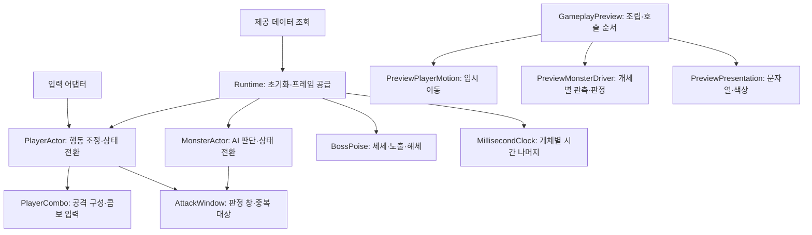

# 게임플레이 모듈 구조

플레이어·일반몹·보스의 공개 진입점과 기존 프리팹 참조를 유지하면서, 자주 함께 바뀌는 책임을 내부 모듈로 나눕니다.

화살표는 호출 관계입니다. 두 Actor의 AttackWindow와 세 Runtime의 시계는 각각 별도 인스턴스입니다.

| 모듈 | 소유하는 값·책임 | 호출 경계 |
| --- | --- | --- |
| Core/Characters/PlayerActor | HP·행동 시간·무적·구속·해체, 상태 전환·소모 순서 | 기존 TryAttack/TryRoll/ReceiveHit/Tick 및 결과 이벤트 유지 |
| Core/Combat/PlayerCombo | 읽기 전용 공격 배열 스냅샷·현재 타수·예약 입력 | Actor가 검증된 시간/버퍼로 요청. 다음 타 진입 때 Actor가 비용 지불 |
| Core/Combat/AttackWindow | 활성 여부·창마다 맞은 양수 개체 ID·창 변경 이벤트 | 피해 계산·거리·상태 전환은 소유하지 않음. 회피한 대상도 기존처럼 그 창의 등록은 소비 |
| Core/Characters/MonsterActor | 목표·패턴·대기·경직·잡고 있는 플레이어·AI 상태 전환 | Observe/ClearTarget/NotifyWallHit/TryHitPlayer/Release 유지 |
| Core/Characters/BossPoise | 보스 HP·체세·노출·해체 | 페이즈/AI·범위·연출 종료 정책은 호출자 책임 |
| Core/Timing/MillisecondClock | 한 Runtime의 소수 ms 나머지 | 초→정수 ms 변환. 음수·비유한 입력 거부, int 상한 뒤 나머지 보존 |
| Adapters/*Runtime | 제공 데이터로 코어 조립·Update 시간 전달·활성 수명 | 기존 초기화 계약/직렬화 필드 유지. 전역 시계·추가 Bootstrapper 없음 |
| Preview/GameplayPreview | Inspector 참조·초기화·구독/해제·프레임 실행 순서·검사 전용 키 | 일반 C# 내부 모듈을 직접 조립. 새 MonoBehaviour를 프리팹에 추가할 필요 없음 |
| Preview/PreviewPlayerMotion | 임시 점프/구르기 진행·Transform 표시 | 코어 요청 수신, 완료 시 기존 SetGrounded 전달. 운영 물리 정책 아님 |
| Preview/PreviewMonsterDriver | 일반몹 한 개체의 임시 이동·거리/벽 관측·타격·확인 색상 | 개체별 참조·판정 ID를 초기화 때 공급. 운영 스폰/풀링 아님 |
| Preview/PreviewPresentation | 플레이어/보스 확인 텍스트·색상·공통 상태 이름 | 게임 상태를 읽기만 함. MonsterPreviewLabel도 같은 상태 이름 사용 |

## 변경할 위치

- 콤보 입력 창/타수 구성은 PlayerCombo, 공격 수치·비용은 기존 PlayerCombatSettings와 제공 정의에서 관리합니다.
- 행동 우선순위·피격/구속/해체 전이는 Actor에서 조정합니다. 다른 모듈이 별도 상태 머신을 만들지 않습니다.
- 판정 창의 대상 중복 규칙은 AttackWindow, 실제 접촉·회피/치명 공급은 판정 어댑터에서 다룹니다.
- 임시 이동·몬스터 관측 방식·표시를 바꿀 때는 각각 해당 Preview 모듈을 수정합니다. GameplayPreview의 조립 순서와 구독 수명을 함께 확인합니다.
- Core는 Unity API를 참조하지 않습니다. 이번 분리는 클래스 책임 단위이며 새 asmdef·범용 DI·전역 이벤트 버스·상태 팩토리를 도입하지 않습니다.
- 데이터 공급/생성 코드·운영 물리·보스 페이즈·기획 미정 수치는 이 구조 변경으로 확정하지 않습니다.

검사는 기존 이동·전투·몬스터 경계와 모듈 간 독립성/이벤트 정리·프레임 나머지 보존을 함께 확인합니다. 실행 방법은 [검사 자동화](검사%20자동화와%20데이터%20오류%20경계.md), 기능 계약은 [게임플레이 코어](게임플레이%20코어와%20프리팹%20연결.md)를 따릅니다.
