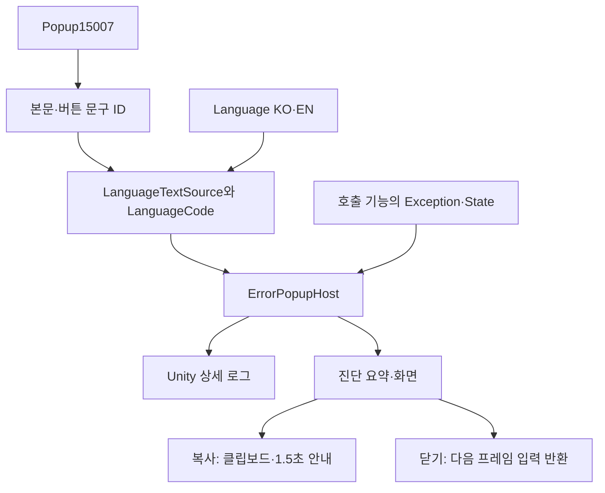

# 공용 에러 팝업 설계

2026-11-05. 사용자가 Popup15007의 새 기획을 승인해 기존 X·확인/일반 문구 전용안에서 **복사·닫기·상세 오류 표시**로 변경했습니다. Popup·Language를 검사·배포하고 데이터 조회를 연결했습니다. 실제 씬의 실패 지점 전체 자동 수집, F9·부스 표시·출시 제외 정책과 Firebase·메일은 이번 연결 범위가 아닙니다.

## 1. 목적과 구조

오류 화면을 저장·맵·컷씬마다 다시 만들지 않으면서 오류 문구는 기획 데이터로 관리합니다. 상세 원본은 Unity 로그에 유지하고 화면에는 진단 요약을 표시해 복사할 수 있게 합니다.



## 2. 상속과 책임

| 위치 | 책임 |
| --- | --- |
| Presentation/PopupScreen | 공통 표시·선택·이전 선택 복귀·닫기 요청을 제공하는 추상 부모 |
| Presentation/ErrorPopupScreen | PopupScreen 상속. 오류 문구·상세·복사/닫기 라벨·복사 요청 추가 |
| Adapters/ErrorPopupHost | 데이터 연결·로그·생성·메뉴 입력·복사·소유권 정리 |
| Adapters/LanguageTextSource | 문구ID·언어코드를 KO/EN으로 해석하는 공용 조회. Read는 확장 가능 |
| Core/Feedback/ErrorPopupDetails | 예외·횟수·씬·상태·시각·기록 경로를 표시용 문자열로 구성 |
| Core/Settings/LanguageCode | Korean=0·English=1. 추가 언어·언어 선택 UI는 후속 |
| UI/PopupButton.prefab | 기본 Button·Image·Label. 오류 전용 동작 없이 두 버튼이 중첩 재사용 |
| UI/ErrorPopupScreen.prefab·ErrorPopupHost.prefab | 처음 비활성 화면과 명시적 초기화가 필요한 호스트 |

같은 표시 수명은 부모에 두고 오류 전용 동작만 자식에 둡니다. 버튼 자체를 감싸는 새 클래스를 늘리지 않습니다. 기존 다른 메뉴를 일괄 상속 전환하지 않습니다.

## 3. 실제 데이터 연결

| 항목 | 실제 참조 |
| --- | --- |
| Popup | 15007 |
| 본문 | BodyTextID→30209: 오류가 발생했습니다 / An error occurred |
| 첫 버튼 | Button1TextID→30210: 복사 / Copy |
| 둘째 버튼 | Button2TextID→30211: 닫기 / Close |
| 초기 선택·취소 | DefaultButton=1, CancelButton=2 |
| 기록 경로 라벨 | 30212: 기록 파일 / Log file |
| 복사 안내 | 30214: 복사했습니다 / Copied, 1500ms 실제 경과시간 |

30213은 F9 안내용이므로 이번 팝업에는 사용하지 않습니다. 버튼 의미는15007의 첫 버튼=복사·둘째=닫기라는 계약이며 시트 순서를 임의 교환하면 안 됩니다. 예외 메시지·스택 원문은 번역하지 않습니다. 진단 항목명은 현재 한국어이며 별도 번역ID는 아직 공급되지 않았습니다.

```csharp
// 세 참조는 호출 조립자가 명시적으로 소유합니다.
popup.Initialize(sceneEvents, SetErrorModalState, catalog, LanguageCode.Korean);
// 실제 오류 경계에서 호출합니다. state는 오류 순간의 호출 기능 상태를 전달합니다.
popup.Report(error, OnErrorDismissed, this, state);
```

초기화가 Popup·Language 연결을 함께 수행합니다. 언어를 바꿀 때는 팝업을 닫은 상태에서 Configure(catalog, LanguageCode.English)를 호출합니다. Initialize는 한 번, Configure는 언어 변경 시 재호출할 수 있습니다. 전역 언어 선택·저장은 아직 없습니다. 생성 데이터 정의를 임의 수정하지 않습니다.

## 4. 표시·복사·수명 계약

- Report는 상세 예외를 Debug.LogException으로 기록하고 종류·호스트 누적 보고 횟수·메시지·스택3줄·씬·State·현지시각·Application.consoleLogPath를 요약합니다. State는 호출자가 전달하고 미전달 시 빈 값입니다. 로그 경로는 플랫폼에 따라 비어 있을 수 있습니다.
- 표시 중 새 오류가 오면 중첩 화면 없이 최신 요약·횟수로 갱신합니다. 원본 예외는 각각 로그에 남고 처음 호출의 닫힘 콜백은 유지합니다. true는 새 표시 인수, false는 기존 화면이 있어 새 팝업을 만들지 않았다는 뜻입니다.
- 복사는 현재 표시 문구와 진단 요약을 GUIUtility.systemCopyBuffer에 넣고 창을 유지합니다. 복사 안내는 멈추지 않는1500ms로 지웁니다.
- 화면의 닫기·취소는 같은 닫기 요청을 씁니다. 여는 프레임의 입력은 무시하며 닫는 입력이 뒤쪽으로 새지 않도록 다음 프레임에 소유권을 돌려줍니다.
- Initialize의 콜백은 팝업 동안 뒤쪽 UI·게임 입력과 게임 일시정지를 조립자가 연결하는 지점입니다. 다른 일시정지/로딩 소유권을 무조건 해제하면 안 됩니다. 모듈은 Time.timeScale을 직접 덮어쓰지 않습니다.
- 비활성화/씬 종료 때 표시·입력·코루틴·소유 잠금을 정리하고 닫힘 콜백을 호출하지 않습니다. 외부 EventSystem·원본 InputAction을 파괴하지 않습니다.
- 전역 로그 구독은 아직 하지 않습니다. Report로 전달되지 않은 Error·Assert가 자동으로 팝업을 여는 상태는 아닙니다. QA/부스/출시 정책을 무시해 모든 빌드에 전역 수집기를 연결하지 않습니다.

## 5. 검증과 후속

실제 배포 CSV에서15007의 참조·KO/EN·기본/취소 버튼, 지원하지 않는 언어 거부, 요약 스택3줄·시각·경로를 검사했습니다. 데이터903·코어600 통과, 기존 CS0414를 제외한 분리 엔진 참조 컴파일 통과했습니다. 최종 초기화 API 변경 뒤 데이터903·참조 컴파일도 다시 통과했습니다. 기본 엄격 검사 문제는 변경하지 않았습니다.

실제 Unity 임포트·상세 글자 넘침·복사·키보드/마우스·일시정지·입력 반환은 별도 확인이 필요합니다. [기획자 안내](기획자용%20에러%20팝업%20사용%20안내.md)를 참고합니다. 시트의 K17add 빌드 정책·F9·자동 로그 수집은 별도 기능 단위로 구현하며 이번 연결로 완료 처리하지 않습니다.
