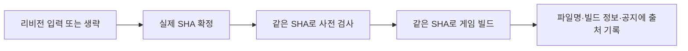
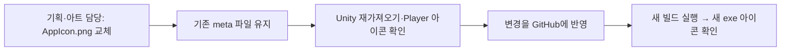
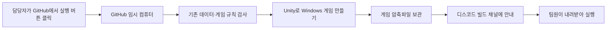
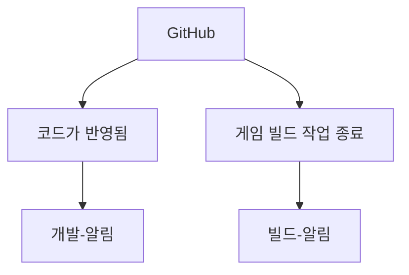
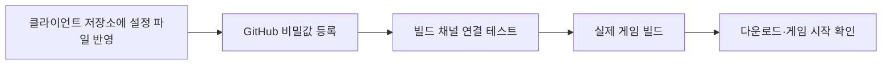
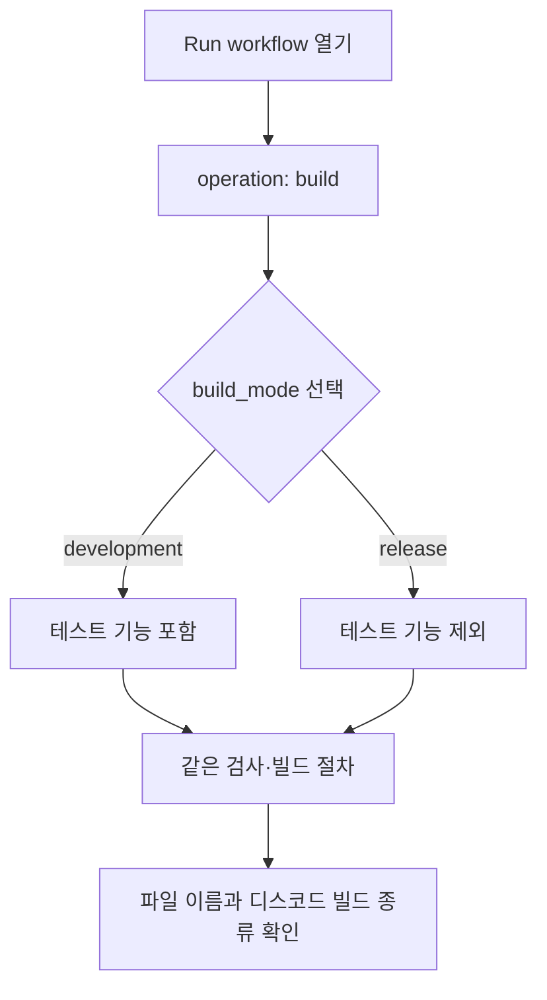
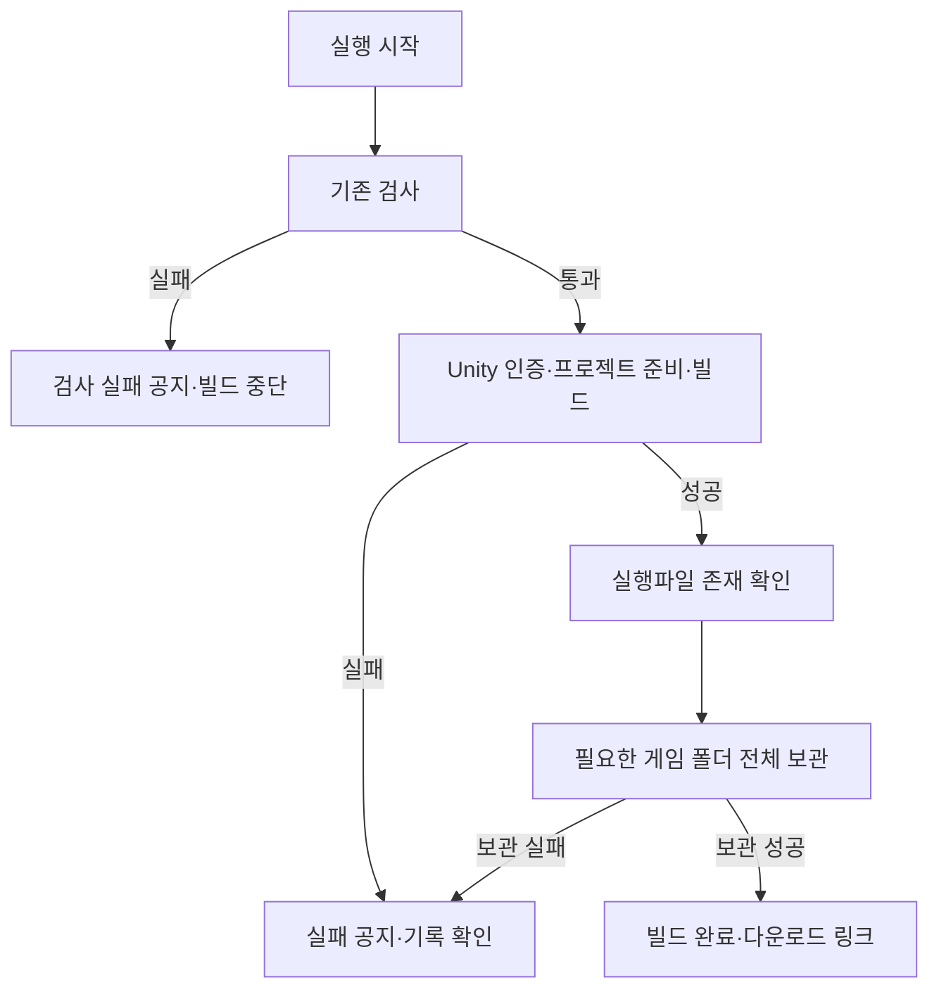
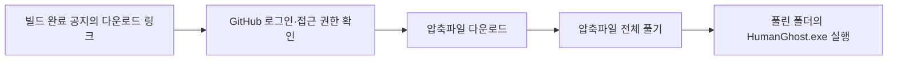

# GitHub 빌드와 디스코드 공지 사용 안내

> 2026-11-07 갱신: build_mode에서 development(테스트)·release(정식)를 선택합니다. 기본값은 테스트이며 결과물은 7일 보관합니다. 변경 파일을 GitHub에 반영한 뒤 새 실행부터 적용됩니다. 기존 실행 기록을 다시 실행하는 것은 새 설정 반영 방법이 아닙니다.

## 목차

1. [실행파일 아이콘 교체 — 2026-11-09](#실행파일-아이콘-교체--2026-11-09)
2. [자동 빌드를 사용하는 이유](#자동-빌드를-사용하는-이유)
3. [공지 채널은 두 개입니다](#공지-채널은-두-개입니다)
4. [최초 한 번: 개발자와 준비](#최초-한-번-개발자와-준비)
5. [어디를 눌러 실행하나요?](#어디를-눌러-실행하나요)
6. [실행 중에는 무엇을 하나요?](#실행-중에는-무엇을-하나요)
7. [결과를 어떻게 구분하나요?](#결과를-어떻게-구분하나요)
8. [게임을 내려받아 실행하기](#게임을-내려받아-실행하기)
9. [실패했을 때 전달할 내용](#실패했을-때-전달할-내용)
10. [개발자에게 전달할 문서](#개발자에게-전달할-문서)
11. [결과물 보관·압축 설정·이번 빌드 확인](#결과물-보관압축-설정이번-빌드-확인)

## 실행파일 아이콘 교체 — 2026-11-09

### 특정 리비전으로 빌드 — 2026-11-13

1. 변경된 빌드 설정을 GitHub에 반영한 뒤 Actions → Windows 게임 빌드 → Run workflow를 엽니다.
2. 실행 브랜치는 새 빌드 설정이 반영된 브랜치를 선택합니다. 이것은 빌드 절차를 가져올 브랜치입니다.
3. `revision`에 게임 소스의 **전체 커밋 SHA**, 태그 또는 브랜치를 입력합니다. 비우면 실행 브랜치의 이번 실행 커밋을 사용합니다. 정확한 재현은 전체 SHA 사용을 권장합니다.
4. build_mode의 development/release와 scene을 선택하고 실행합니다. 대상 소스를 하나의 SHA로 확정한 뒤 같은 SHA로 검사·빌드합니다.
5. 실행 기록의 리비전 확정 요약, 디스코드의 게임 소스 커밋, 다운로드 파일명 끝 12자리, 압축 안의 `빌드 정보.txt`를 확인합니다.



실행 기록 상단의 커밋은 빌드 절차의 커밋일 수 있으므로 게임 소스 커밋과 구분합니다. 브랜치·태그도 해당 실행에서 SHA로 고정하며 이후 이동해도 진행 중인 빌드 대상은 바뀌지 않습니다. 이전 실행 재실행은 기존 실행 입력을 사용하므로 다른 리비전은 새 실행에서 지정합니다.

과거 소스에 현재 빌드 메서드·검사 도구·영상 연결이 없다면 실패할 수 있습니다. 이 기능은 과거 소스를 현재 구조로 자동 변환하지 않습니다. 별도 DataSheet 저장소를 다시 배포하지 않으며 **대상 클라이언트 커밋에 들어 있는 데이터**로 빌드합니다. `notice-test`는 리비전 확인·게임 빌드를 하지 않습니다. 게임 화면에 리비전을 표시하는 기능은 추가하지 않았습니다.

### 플레이어 공격 범위 표시 확인 — 2026-11-13

| 실행 환경 | 노란 공격 범위 | 실제 공격 판정 |
| --- | --- | --- |
| Unity 에디터 | 공격 중 표시 | 유지 |
| development 테스트 빌드 | 공격 중 표시 | 유지 |
| release 정식 빌드 | 표시하지 않음 | 유지 |

별도 화면 설정은 필요 없습니다. 변경 코드를 GitHub에 반영한 뒤 원하는 build_mode로 새로 빌드합니다. 두 종류에서 같은 공격을 시도하여 테스트에는 노란 범위가 나오고 정식에는 나오지 않는지 확인하세요. 두 빌드 모두 몬스터·보스 피해와 해당 공격으로 여는 관문은 기존대로 동작해야 합니다. 히트 이펙트와 불·얼음 위험 구역 표시는 이번 변경 대상이 아닙니다. 공격 범위 객체를 수동 삭제하거나 크기를 바꾸지 마세요.

현재는 기존 타이틀 로고를 복사한 임시 이미지를 실행파일 아이콘으로 연결했습니다. 최종 아이콘은 아직 준비되지 않았으며 작은 크기에서의 식별성은 최종 그림으로 확인해야 합니다. 타이틀 로고와 실행파일 아이콘은 별도 파일이므로 서로 영향을 주지 않습니다.



1. 프로젝트의 **Assets/4.Sprite/AppIcon.png**를 새 그림으로 덮어씁니다. 파일 이름·경로·PNG 형식은 유지합니다. 최종 그림은 투명 배경을 지원하는 512×512 또는 1024×1024 정사각형 PNG를 권장합니다. 지금은 기존 로고 원본을 그대로 복사한 임시 파일입니다.
2. **AppIcon.png.meta는 삭제하거나 다른 파일로 교체하지 마세요.** 이 파일의 GUID로 빌드 설정과 연결되어 있어 이미지 내용만 바꾸면 연결을 다시 할 필요가 없습니다. Unity에서 기존 에셋을 삭제한 뒤 새로 만드는 방법 대신 파일 내용을 덮어씁니다.
3. Unity의 Edit → Project Settings → Player → Default Icon에 새 이미지가 보이는지 확인합니다. Windows용 별도 아이콘 덮어쓰기 설정은 추가하지 않습니다.
4. 이미지 변경을 커밋·푸시한 다음 해당 변경이 반영된 브랜치에서 **새 빌드**를 실행합니다. 테스트·정식 빌드 모두 같은 아이콘을 사용합니다. 기존에 받은 exe 파일은 자동으로 변경되지 않습니다.
5. 새 압축파일을 풀고 게임 실행파일과 실행 중 작업 표시줄 아이콘을 확인합니다. 탐색기에 이전 아이콘이 남으면 우선 새 폴더에 풀어 확인합니다. Windows 아이콘 캐시 때문에 이전 표시가 남을 수 있습니다.

## 자동 빌드를 사용하는 이유

빌드는 Unity 프로젝트를 다른 사람이 실행할 수 있는 게임 파일로 만드는 작업입니다.
내 PC를 계속 켜두거나 별도 빌드용 PC를 준비하지 않고 GitHub가 제공하는 임시 컴퓨터에서 실행합니다.
기획·아트 담당자는 완성된 압축파일을 받아 게임을 확인할 수 있습니다.



현재는 **버튼으로 시작하면 검사부터 공지까지 자동 진행**합니다.
코드를 푸시할 때마다 게임 빌드를 실행하도록 연결한 상태는 아닙니다.
최초 인증·다운로드·실행을 확인한 뒤 푸시 연동을 추가하는 순서입니다.
GitHub 사용 시간·저장 공간은 계정 요금제의 한도를 사용하며 별도 무료 무제한 서비스를 의미하지 않습니다.

## 공지 채널은 두 개입니다



| 채널 | 알려주는 내용 | GitHub 비밀값 |
| --- | --- | --- |
| 개발-알림 | 코드 반영·개발 채널 연결 테스트 | DISCORD_WEBHOOK_URL |
| 빌드-알림 | 빌드 완료·검사 실패·빌드 실패·연결 테스트 | DISCORD_BUILD_WEBHOOK_URL |

개발 채널에 메시지가 왔다고 게임 파일이 만들어진 것은 아닙니다.
빌드 채널에 '빌드 완료'와 다운로드 링크가 도착했는지 확인합니다.
비밀값은 웹훅 주소나 인증 내용을 숨겨 보관하는 GitHub의 저장 공간입니다.

## 최초 한 번: 개발자와 준비



이 설정은 **Human_Ghost- 클라이언트 저장소**에서 사용합니다. DataSheet에 Unity 인증 정보를 추가할 필요는 없습니다.
아래 비밀값을 Settings → Secrets and variables → Actions → Secrets에 등록합니다.

| 이름 | 넣을 내용 |
| --- | --- |
| UNITY_EMAIL | Unity 계정 이메일 |
| UNITY_PASSWORD | Unity 계정 비밀번호. Google 비밀번호를 대신 넣지 않음 |
| UNITY_LICENSE | 해당 계정으로 활성화한 Personal 라이선스 파일의 전체 내용 |
| DISCORD_BUILD_WEBHOOK_URL | 빌드-알림 채널에서 만든 웹훅 주소 |
| DISCORD_WEBHOOK_URL | 기존 개발-알림 채널의 웹훅 주소 |

일반 변수인 Variables에 넣지 않습니다. 등록 내용·비밀번호·라이선스 원문은 채팅이나 화면으로 공유하지 않습니다.
라이선스 파일은 일반적으로 C:\ProgramData\Unity\Unity_lic.ulf에 있습니다.
파일이 존재한다고 GitHub의 인증 성공까지 보장되는 것은 아닙니다. 실제 첫 빌드에서 확인합니다.
Google 로그인 계정의 별도 Unity 비밀번호 설정과 라이선스 계정 일치는 개발자와 확인합니다.

## 어디를 눌러 실행하나요?

1. 브라우저에서 클라이언트 GitHub 저장소를 엽니다.
2. **화면 맨 위 Actions**를 누릅니다. Settings 안의 Actions 메뉴와 다릅니다.
3. 왼쪽 목록에서 **Windows 게임 빌드**를 선택합니다.
4. 오른쪽 **Run workflow** 버튼을 누릅니다.
5. 실행할 브랜치를 고릅니다. 처음에는 개발자가 설정을 반영한 **Develop**을 선택합니다.
6. 아래 표를 보고 operation·build_mode·scene을 선택합니다.
7. 초록색 **Run workflow**를 누르고 실행 기록이 생길 때까지 기다립니다.

```text
클라이언트 GitHub 저장소
  → 맨 위 Actions
    → 왼쪽 Windows 게임 빌드
      → 오른쪽 Run workflow
        → 브랜치·operation·build_mode·scene 선택
          → 초록색 Run workflow
```

| 선택 칸 | 선택 값 | 의미 |
| --- | --- | --- |
| operation | notice-test | 빌드 채널로 테스트 메시지만 보냄. 게임은 만들지 않음 |
| operation | build | 검사 후 실제 Windows 게임을 만들고 결과를 공지 |
| build_mode | development | 테스트 빌드. F5 저장·저장 기록 선택·F12 초기화 사용. 기본값 |
| build_mode | release | 정식 빌드. 테스트 전용 기능 제외·자동 저장 단일 슬롯 |
| scene | dohwagol | R3c 도화골 전투 테스트(MapDohwagolTest)만 |
| scene | preview | 독립 게임플레이 검사 장면(GameplayPreview) |
| scene | build-settings | Unity 빌드 설정의 활성 씬. 현재 Title→MapDohwagolTest. 기본값 |

평소 시연·검사는 **build / development / build-settings**, 정식 설정 확인은 **build / release / build-settings**를 선택합니다. notice-test는 공지만 확인하며 게임 파일을 만들지 않습니다.
notice-test에서는 scene으로 게임을 만들지 않습니다. 공지의 빌드 종류는 선택값을 보여줄 뿐 실제 빌드 완료를 뜻하지 않습니다.
현재 build-settings는 Title·MapDohwagolTest 활성, SampleScene 비활성입니다. 명령줄 -humanGhostScene 생략 시에도 build-settings를 사용합니다.
버튼이나 목록이 없으면 개발자에게 설정의 기본 브랜치 반영과 계정 실행 권한을 확인해달라고 요청합니다.


### 테스트와 정식을 어떻게 구분하나요?



| 구분 | development: 테스트 | release: 정식 |
| --- | --- | --- |
| F5 수동 저장 | 사용 가능 | 사용 안 함 |
| 타이틀의 저장 기록 선택 | 테스트 화면 사용 | 제외 |
| F12 초기화 | 사용 가능 | 사용 안 함 |
| 저장 정책 | 테스트용 슬롯 최대 10개 | 자동 저장 슬롯 1개 |
| 저장 위치 | 기존 테스트 저장 폴더 | 별도의 Saves/Release 폴더 |
| 내려받는 파일 이름 | HumanGhost-Windows-development-실행번호-시도번호 | HumanGhost-Windows-release-실행번호-시도번호 |

정식 빌드를 처음 켰을 때 테스트 저장 기록이 보이지 않는 것은 폴더가 분리되어 있기 때문입니다. 기존 테스트 저장을 삭제하거나 자동으로 옮기지 않습니다. 게임을 수정한 뒤에는 새 실행을 시작하고, 내려받은 폴더도 테스트·정식을 나누어 보관하세요. 두 종류 모두 Windows 64비트입니다.

정식 설정 선택은 미완성 콘텐츠를 자동으로 완성하거나 출시 승인을 처리하지 않습니다. 파일을 내려받아 타이틀에 테스트 기록 선택이 없는지, F5·F12가 동작하지 않는지, 자동 저장 후 이어하기가 되는지 확인해야 합니다. 실제 씬에 연결하지 않은 기능은 테스트 빌드에서도 자동 연결되지 않습니다.

선택 칸이 보이지 않으면 변경이 기본 브랜치와 실행할 브랜치에 반영됐는지 개발자에게 확인해 주세요. 비밀값을 다시 만들 필요는 없습니다.

## 실행 중에는 무엇을 하나요?



작업은 GitHub에서 계속 실행되므로 내 PC의 Unity를 열어둘 필요가 없습니다.
처음에는 Unity 도구와 프로젝트 파일을 준비하느라 오래 걸릴 수 있습니다.
실제 빌드 작업의 제한 시간은 60분이고, 기존 검사와 공지 시간이 별도로 추가됩니다.
동시 실행을 제한하지만 여러 번 버튼을 누르면 불필요한 대기·실행이 생길 수 있으니 한 번 누르고 기다립니다.

## 결과를 어떻게 구분하나요?

| 표시·공지 | 의미 | 할 일 |
| --- | --- | --- |
| 빌드 채널 연결 테스트 | 공지 전송만 성공 | 실제 게임 빌드는 따로 실행 |
| Windows 빌드 완료 | 이번 검사·게임 생성·결과물 보관 성공 | 다운로드 링크 열기 |
| 빌드 전 검사 실패 | 검사에 실패해 Unity 빌드를 실행하지 않음 | 실행 기록을 개발자에게 전달 |
| 빌드·결과물 보관 실패 | 인증·Unity 빌드·게임 파일 확인·보관 중 실패 | 실패한 단계의 기록 전달 |
| 빌드 작업 취소 | 작업이 취소됨 | 새 게임 완성으로 판단하지 않음 |
| 공지가 오지 않음 | 진행 중이거나 공지 전송 단계 실패 가능 | GitHub 실행 기록 확인 |

공지를 누르면 해당 GitHub 실행 기록을 엽니다.
전체 실행이 실패해도 빌드 자체와 공지 전송 중 어느 단계가 실패했는지 구분합니다.
사용자가 전체 작업을 강제로 취소하거나 GitHub 장애가 발생하면 취소 공지가 오지 않을 수 있습니다.
공지 실패는 완성된 게임 파일을 삭제하지 않습니다. GitHub 기록에서 보관된 결과물을 확인할 수 있습니다.

## 게임을 내려받아 실행하기



1. 디스코드의 **게임 파일 다운로드** 링크를 누릅니다.
2. GitHub 로그인이나 저장소 접근 권한이 필요하면 개발자에게 요청합니다.
3. 받은 압축파일을 우클릭하고 **모두 압축 풀기**를 선택합니다.
4. 압축이 풀린 폴더 안의 **HumanGhost.exe**를 실행합니다.

압축파일 안에서 바로 실행하거나 exe만 다른 폴더로 옮기지 않습니다.
같이 들어 있는 HumanGhost_Data·UnityPlayer.dll 등도 실행에 필요합니다.
보관 기간은 **7일**입니다. 기간이 지났거나 결과물이 삭제되면 빌드를 다시 실행해야 합니다.
비공개 저장소 파일은 링크가 있다고 누구나 내려받을 수 있는 것이 아닙니다.
확인 장면의 조작은 [임시 게임플레이 확인 안내](%EC%9E%84%EC%8B%9C%20%EA%B2%8C%EC%9E%84%ED%94%8C%EB%A0%88%EC%9D%B4%20%ED%99%95%EC%9D%B8%20%EC%95%88%EB%82%B4.md)를 참고합니다.
빌드 성공과 실제 게임 기능·플레이 성공은 다르므로 실행 후 동작도 확인합니다.

## 실패했을 때 전달할 내용

```text
빌드를 실행했는데 확인이 필요해요.
실행한 날짜·시간:
선택한 브랜치:
operation / build_mode / scene:
GitHub 실행 기록 주소:
실패한 단계 이름 또는 화면:
디스코드 공지가 도착했나요?:
다운로드·게임 실행 결과:
```

모르는 항목은 비워두거나 '모르겠음'으로 적어도 됩니다.
화면 캡처는 Windows 키 + Shift + S로 하고, 계정 비밀번호·라이선스·웹훅 원문은 포함하지 않습니다.
실패 기록 전체에 비밀값이 없는지 확인한 뒤 공유합니다. 원인을 모르겠다면 코드를 직접 수정하지 말고 개발자에게 전달합니다.
재실행하면 새 공지가 다시 전송될 수 있습니다.

## 개발자에게 전달할 문서

설계 이유·파일별 책임·명령줄 인자·테스트 기능 제외 계약은 [테스트·정식 빌드 선택 설계](../개발자용%20설계문서/테스트와%20정식%20빌드%20선택%20설계.md)에 분리했습니다. 기획자는 위 실행 절차와 결과 확인을 따르면 됩니다.

## 결과물 보관·압축 설정·이번 빌드 확인

결과물은 현재7일 보관합니다. Actions에서 해당 실행을 열고 Artifacts의휴지통으로 결과물만 삭제할 수 있으며 내려받은PC파일과 소스코드는 남습니다. 삭제 뒤 기존 공지의 다운로드 링크는 사용할 수 없습니다.

빌드 종류는 매번 build_mode에서 선택합니다. development가 기본값이며 release를 선택해야 정식 설정으로 빌드됩니다. 특정 리비전 입력란은 아직 없으며 실행 시작 커밋을 기준으로 빌드합니다. 로컬 수정을 반영하려면 커밋·푸시 후 새 실행이 필요합니다.

Assets/4.Sprite/Map/Art_New/Maps의19개이미지는 Standalone BC7·해상도 유지로 설정됐습니다. 원본PNG·피벗은 유지합니다. 이론상 원본RGBA32 전체 약902MiB와 BC7약226MiB의비교는 실제 동시메모리·빌드 절감량이 아닙니다. Unity재임포트 후 지형경계·반투명·그라데이션과 빌드 크기를 확인해야 합니다. 긴 음원 스트리밍과 중복이미지 통합은 미적용입니다.

이번 선택 기능은 로컬 공지 검사와 Unity 참조 컴파일로 확인합니다. 실제 GitHub의 두 종류 빌드 성공·파일 다운로드·게임 실행은 새 실행에서 확인해야 합니다. 현재 검증 결과는 [현재 구현과 검증 현황](../개발자용%20설계문서/현재%20구현과%20검증%20현황.md)을 따르며 코드 컴파일 성공과 게임 완주 검증을 구분합니다.
