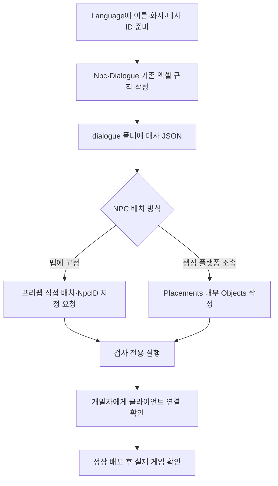

# NPC 데이터 작성과 배포 준비 안내

기준일: 2026-11-13. Npc·Dialogue 시트와 대사 JSON 4개를 읽어 실행하는 연결을 추가했습니다. 고정 피난민과 플랫폼 내부 Objects, 줄별 화자·반복·정지·목표 안내 및 보스 대화 사건을 지원합니다. 실제 게임 확인은 아래 절차를 따릅니다. SHOP·조건 선택지·영구 대화 이력·언어 선택 옵션은 별도입니다. [개발자 설계](../개발자용%20설계문서/NPC%20데이터%20배포%20준비%20설계.md)를 함께 봅니다.

## 목차

- [실제 NPC 사용과 확인](#실제-npc-사용과-확인--2026-11-13)

1. [지금 준비된 것](#1-지금-준비된-것)
2. [파일을 준비하는 순서](#2-파일을-준비하는-순서)
3. [대사 JSON 예시](#3-대사-json-예시)
4. [플랫폼 내부 Objects 예시](#4-플랫폼-내부-objects-예시)
5. [검사와 실제 배포](#5-검사와-실제-배포)
6. [자주 확인할 오류](#6-자주-확인할-오류)

## 실제 NPC 사용과 확인 — 2026-11-13


| 기획자가 바꿀 것 | 수정 위치 |
| --- | --- |
| 이름·기본 대화·사용 여부 | Npc 탭의 NameTextID·DialogueID·ContentEnabled |
| 반복·정지·첫 완료 목표 | Dialogue의 RepeatMode·PauseGame·ObjectiveTextID |
| 화자·말하는 순서 | dialogue 파일 Lines의 SpeakerTextID·TextID와 배열 순서 |
| 실제 문장·번역 | Language 탭 |
| 생성 플랫폼과 위치 | 해당 Placements 안 Objects의 NpcID·Anchor |
| 고정 NPC | 맵에 NpcTalk를 연결하고 NpcID 지정. 별도 배치 JSON 불필요 |

현재 도화골의 기존 NPC_Refugee 표식은 NpcID 25001을 사용합니다. Npc.Prefab의 NPC_Refugee는 StageContentSet에서 기존 NPC1 프리팹으로 연결했습니다. 새 종류는 처음 한 번 개발자에게 프리팹 매핑을 요청합니다. 같은 종류를 다른 플랫폼에 추가하는 경우는 기존 매핑을 재사용합니다. 현재 NPC1은 공격·물리 몸통이 없는 기존 표시를 사용하며 원본 아트·애니메이션은 기존 공급 작업입니다.

확인 순서:

1. 도화골에서 피난민에게 말 걸어 이름과 줄별 화자가 바뀌는지 확인합니다.
2. Enter를 한 번 누르면 현재 줄을 끝내고 다음 줄로 넘어가야 합니다. 마지막 줄 뒤에는 대화가 닫혀야 합니다.
3. 첫 정상 완료 후 목표 안내를 확인합니다. 현재 피난민은 다시 말 걸면 LAST_LINE에 따라 마지막 줄만 표시합니다.
4. ALL은 매번 전체, ONCE는 같은 실행 수명에서 정상 완료 후 재생하지 않아야 합니다. 중단을 완료로 기록하지 않습니다. 현재 대화 이력은 영구 저장하지 않습니다.
5. PauseGame=Y일 때 전투는 멈추되 글자·Enter 진행은 가능해야 합니다. 닫으면 이 대화의 정지만 해제합니다.
6. 보스 진입·페이즈 전환·처치 대사를 확인합니다. 해체가 끝난 뒤 처치 대사 → 엔딩 영상 순서로 진행합니다. F8 보스 시험은 [보스 시험 안내](보스%20시험%20기능%20사용%20안내.md)를 따릅니다.
7. 대상 비활성·맵 이동·오류 뒤 입력이나 시간이 잠긴 채 남지 않는지 확인합니다.

현재 맵은 한국어를 공급합니다. 이름·대사는 Language ID로 조회하지만 옵션 언어 선택 전체 연결을 완료했다는 뜻은 아닙니다. 새 UI_Lang은 배포하지 않았습니다. 아래 원본 작성·검사 규칙은 유지하고 ‘Unity 연결 후속’이라는 과거 설명은 이번 절의 연결 상태를 우선합니다.

## 1. 지금 준비된 것

| 준비된 것 | 아직 해야 할 것 |
| --- | --- |
| 공급된 Npc·Dialogue의 CSV 추출·자동 로딩 계획 | 실제 NPC 위치·표시·상호작용 확인 |
| 플랫폼 내부 Objects 검사·실행 지원 | 신규 배치의 실제 앵커·프리팹 확인 |
| dialogue JSON 검사·배포·실행 연결 | 전체 대화·중단·보스 연속 흐름 확인 |
| 기획자용 DeployData.exe 갱신 | 소스와 실행파일을 함께 최신화해서 사용 |

현재 대사 JSON은 4개입니다. UI_Lang 빈 원본 추가 후 검사 대상은 35개 탭이며 현재 클라이언트에 UI_Lang은 배포하지 않았습니다. 피난민은 고정 NPC로 지정해 스폰 Objects에 넣지 않았습니다. 실제 Play·실행파일 수용은 후속입니다.

## 2. 파일을 준비하는 순서



1. 기존 Npc·Dialogue 원안의 열 이름과 B1 규칙을 사용합니다. 새 규칙 전용 탭이나 별도 스키마 JSON은 만들지 않습니다.
2. Dialogue.LineFile에 대화 ID와 같은 파일명을 씁니다. 예를 들어 대화 24001은 `24001.json`입니다.
3. DataSheet 바로 아래 `dialogue` 폴더에 파일을 둡니다. `stats/dialogue`나 중첩 폴더에 두지 않습니다.
4. 화자·대사 ID가 Language에 실제로 있는지 확인합니다. 파일에 한글 대사를 직접 쓰는 대신 ID를 넣습니다.
5. 플랫폼에 생성하는 NPC만 해당 Placements의 Objects에 넣습니다. 맵 고정 NPC는 별도 JSON 위치를 만들지 않습니다.

## 3. 대사 JSON 예시

다음은 형식 예시입니다. ID는 기획자가 공급한 실제 표와 함께 맞춰야 하며 지금 이 파일을 만들라는 뜻은 아닙니다.

```json
{
  "DialogueID": 24001,
  "Lines": [
    { "SpeakerTextID": 30263, "TextID": 30264 },
    { "SpeakerTextID": 30001, "TextID": 30266 }
  ],
  "_note": "대사 순서 확인용 메모"
}
```

Lines의 순서가 대사 순서입니다. 파일명은 24001.json, Dialogue.ID는 24001, Dialogue.LineFile은 24001.json이어야 합니다. 한 줄이라도 있어야 하며 화자 이름과 대사 모두 Language ID를 사용합니다. 입력·스킵·완료 후 진행은 게임 연결 단계에서 확인합니다.

## 4. 플랫폼 내부 Objects 예시

아래 항목은 기존 Placements 안의 플랫폼 하나에 추가하는 내용입니다. 기존 플랫폼·몬스터 목록을 이 예시로 덮어쓰지 않습니다.

```json
{
  "PlacementID": 101,
  "Objects": [
    {
      "ObjectID": 901,
      "Type": "NPC",
      "NpcID": 25001,
      "Anchor": "Anchor_NPC_Refugee"
    }
  ]
}
```

같은 스테이지에서 ObjectID는 플랫폼이 달라도 중복되면 안 됩니다. NpcID는 Npc 표에 있어야 합니다. Anchor는 영문·숫자·밑줄을 쓰며 첫 글자는 영문 또는 밑줄입니다. 실제 플랫폼 안에 그 앵커가 있는지는 Unity에서 확인합니다. 다른 플랫폼에서 같은 NPC 종류와 앵커 이름을 쓰는 것은 가능합니다.

최상위 Objects 또는 ParentPlacementID를 넣으면 검사에 실패합니다. 부모는 목록이 들어 있는 플랫폼으로 결정합니다. 배치 Type은 현재 NPC만 사용합니다. 상점 기능의 종류 값과 혼동하지 않습니다.

## 5. 검사와 실제 배포

현재는 개발자 연결을 준비하는 단계이므로 먼저 검사 전용으로 실행합니다. DataSheet 폴더에서 다음을 사용합니다.

```powershell
.\DeployData.exe --check
```

이 명령은 원본을 검사하고 클라이언트 파일을 바꾸지 않습니다. 알 수 없는 JSON 구조도 자동으로 발견하지만 전용 검사 규칙이 없으면 파일을 안내하고 중단합니다. 오류가 나오면 표시된 파일·대화 ID·배치 ID·필드부터 확인합니다.

개발자가 클라이언트의 새 구조 지원을 확인한 뒤에는 기존처럼 `DeployData.exe`를 더블클릭하면 검사 성공 후 자동 배포됩니다. 대사는 `Human_Ghost-/Assets/Data/Json/dialogue`에 같은 파일명으로 복사됩니다. 파일을 별도로 수동 복사하지 않습니다.

| 상황 | 해야 할 일 |
| --- | --- |
| 대화 추가 | Dialogue 행과 같은 번호의 JSON, Language 문구를 함께 준비 |
| 대사 수정 | 원본 JSON 수정 후 검사·배포. 기존 배포 파일은 갱신됨 |
| 대화 삭제 | Dialogue 행·관련 참조·JSON 원본을 함께 정리. 이전 도구 소유 배포 파일만 삭제 반영 |
| 검사 실패 | 기존 배포 파일은 바뀌지 않음. 오류 수정 후 다시 실행 |
| 기존 정의에 열 추가 | 개발자에게 정의 클래스 갱신 요청. 배포로 기존 C#가 자동 덮어써지지 않음 |

## 6. 자주 확인할 오류

- 대사 JSON만 먼저 올렸는데 Dialogue 표가 없으면 실패합니다. 관련 파일을 함께 준비합니다.
- Dialogue 행이 있는데 파일이 없으면 실패합니다. LineFile과 파일명을 확인합니다.
- TALK의 TriggerTargetID는 0입니다. 보스 상태 진입은 BossState ID, 보스 처치는 UnitStat ID를 사용합니다.
- DialogueID·NpcID·화자·대사 ID는 정수이며 참조 대상이 있어야 합니다. 소수나 임의 번호로 우회하지 않습니다.
- 다른 폴더의 JSON과 파일명이 같아 로딩 키가 겹치면 실패합니다.

NPC·대사 파일이 배포됐어도 실제 생성·대화 기능 연결 전에는 화면에 나타나지 않습니다. 생성 위치·이름·대화·반복·정지·재진입을 실제 게임에서 확인한 뒤 완료로 기록합니다.
