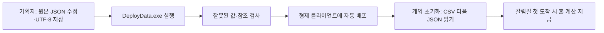
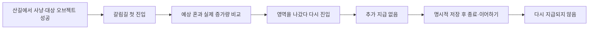

# 갈림길 보상 작성과 검수 안내

## 목차

1. [GitHub의 갈림길 검사 실패 — 2026-11-11](#github의-갈림길-검사-실패--2026-11-11)
2. [현재 어디까지 됐나요](#1-현재-어디까지-됐나요)
3. [어느 파일을 수정하나요](#2-어느-파일을-수정하나요)
4. [배포 순서와 오류 확인](#3-배포-순서와-오류-확인)
5. [공간이 준비됐을 때 연결하기](#4-공간이-준비됐을-때-연결하기)
6. [플레이 확인 순서](#5-플레이-확인-순서)
7. [이번 검수 뒤 함께 확인할 것](#6-이번-검수-뒤-함께-확인할-것)

## GitHub의 갈림길 검사 실패 — 2026-11-11

산길 마릿수 변경에 따라 등급 기준이 27·15·0에서 8·5·0으로 바뀌었지만 자동 검사가 이전 숫자를 고정해 실패했습니다. 검사 코드를 수정했으므로 검사를 통과하려고 기획 수치를 예전 값으로 되돌릴 필요는 없습니다. 현재는 JSON에 적은 값이 클라이언트에 같은 값으로 읽히는지 확인합니다.

이 오류는 갈림길에서 플레이하다 발생한 오류와 다릅니다. 데이터 검사 이후에도 다른 코어 검사가 실패할 수 있으므로 GitHub 전체 작업이 성공했는지 확인합니다. 실제 도착·지급·저장은 기존 아래 시험 절차를 따릅니다.

갈림길에서 산길 탐색 결과에 따라 혼을 한 번 주기 위한 기능입니다. 보상 숫자는 기획자가 JSON에서 바꾸고, 검사·복사·클라이언트 읽기는 기존 도구가 처리합니다. [개발자 설계와 문제 원인](../개발자용%20설계문서/병합%20누락%20복구와%20갈림길%20보상%20설계.md)을 함께 볼 수 있습니다.

## 1. 현재 어디까지 됐나요

| 항목 | 현재 상태 |
| --- | --- |
| JSON 검사·자동 배포·로딩 | 구현 |
| 산길 처치 집계·중복 방지·일회 지급 | 구현·자동 검사 |
| 지급 여부·상호작용 기록 저장과 이어하기 | 구현·자동 검사 |
| 지급 시점 | 갈림길 첫 도착에1회로 확정 |
| 실제 갈림길 도착 영역 배치 | 지도 리소스 등록과 별개로 GalimgilArrival 배치·연결은 후속 |
| 보상에 포함할 오브젝트와 고유 ID | 데이터가 정해지면 성공 처리에 연결 |
| 보상 연출·등급별 아이템 | 후속 |

현재 일반 맵을 지나갔다고 임의로 갈림길 보상을 주지는 않습니다. 지금 숫자가 늘지 않는다는 이유로 같은 지급 코드를 여러 곳에 붙이지 않습니다.

## 2. 어느 파일을 수정하나요

원본은 DataSheet의 `stats/galimgil/galimgil_reward.json`입니다. 배포 결과는 클라이언트의 `Assets/Data/Json/galimgil/galimgil_reward.json`입니다. 클라이언트 파일은 직접 수정하지 않습니다.

| 항목 | 뜻 | 현재 값 |
| --- | --- | --- |
| soulCurrencyId | 지급할 재화 ID | 1, 혼 |
| baseSoul | 기본 지급량 | 0 |
| soulPerKill | 집계한 몬스터 한 마리당 혼 | 3 |
| soulPerInteraction | 성공한 보상 대상 오브젝트 하나당 혼 | 3 |
| countStages | 몬스터 처치를 집계할 스테이지 | 8002, 산길 |
| rounding | 계산 마무리 방식 | floor만 지원 |
| showGrade | 등급 표시를 위한 예약 값 | false, 현재 표시 화면 없음 |
| grades | 내부 등급 이름·최소 처치 수 | HIGH27·MID15·LOW0 |

**혼 = 기본량 + 처치 수×처치당 혼 + 성공 오브젝트 수×오브젝트당 혼**입니다. 현재 산길30마리·오브젝트0개라면90, 산길10마리·오브젝트2개라면36입니다. 계수는 정수이므로 소수점 계산은 쓰지 않습니다.

countStages에 협곡8003을 추가하면 그 맵의 처치도 포함합니다. 이 항목은 도착 장소를 지정하는 항목이 아닙니다. 같은 몬스터 배치나 오브젝트를 반복 처리해도 두 번 세지 않습니다. 별도 누적 킬 횟수를 적지 않습니다.

등급 기준은 큰 처치 수부터 쓰고 마지막은0으로 둡니다. 이름과 기준을 중복하지 않습니다. 등급은 현재 내부 계산용이며 showGrade를 켜도 표시 화면이나 아이템이 자동 생성되지는 않습니다.

## 3. 배포 순서와 오류 확인

1. 원본 JSON을 수정하고 UTF-8로 저장합니다.
2. DataSheet와 Human_Ghost-가 같은 부모 폴더에 있는지 확인합니다.
3. 최신 DeployData.exe를 실행합니다. 별도 .NET 설치나 추가 복사 작업은 필요하지 않습니다.
4. 완료 문구의 갈림길 JSON1개를 확인합니다. `--check`는 검사만 하며 배포하지 않습니다.
5. Unity에서 Play를 끄고 코드·데이터 반영을 기다립니다. 데이터 에셋 목록은 자동 갱신되고 빌드 전에도 갱신합니다.
6. 오류가 나면 원본을 고쳐 다시 실행합니다. 계수 음수·소수, 없는 재화/스테이지, 중복 스테이지, 잘못된 등급 순서를 확인합니다.

검사에 실패하면 이전 클라이언트 파일은 유지합니다. 파일명이나 폴더를 임의로 바꾸거나 삭제하지 않습니다. 새 계산 방식을 원하면 먼저 개발자에게 문의합니다.

## 4. 공간이 준비됐을 때 연결하기

실제 갈림길 맵의 도착 영역에 `GalimgilArrival`을 붙입니다. 오브젝트 이름은 영문으로 쓰고 BoxCollider2D의 Is Trigger를 켜서 플레이어가 지나갈 영역을 잡습니다. 플레이어 쪽에는 기존 물리 콜라이더와 Rigidbody2D가 필요합니다.

현재 맵 조립자는 맵 프리팹 내부의 이 컴포넌트를 자동으로 찾아 데이터·세션·플레이어를 연결합니다. 별도 혼 수량이나 지급 완료 체크를 Inspector에 적지 않습니다. 다른 독립 씬에서는 담당 개발자가 같은 연결 계약을 사용해야 합니다. 현재 지도 리소스 등록과 별개로 이 도착 컴포넌트 배치는 확인되지 않았습니다.

보상에 포함할 상호작용 오브젝트는 담당자와 대상·고유 정수 ID를 정해야 합니다. 성공한 뒤 한 번 기록하며, 문 열기·대화·저장 키 누름을 전부 보상으로 세지 않습니다. 이름·좌표·실행 중 임시 번호를 저장 ID 대신 쓰지 않습니다.

## 5. 플레이 확인 순서

- 산길만30마리를 기록하면90입니다. 다른 맵의 처치가 잘못 포함되지 않아야 합니다.
- 오브젝트 하나를 반복 사용해도 집계는 하나여야 합니다.
- 지급량이0이어도 첫 도착은 완료로 기록합니다. 이후 사냥하고 다시 와서 추가 청구할 수 없습니다.
- 지급받은 뒤 사망해도 지급 여부를 초기화하지 않습니다. 재화 손실은 기존 사망 규칙이 따로 적용됩니다.
- 지급 자체가 파일 저장을 실행하지 않습니다. 기존 서낭당 저장 또는 테스트용 F5로 저장해야 종료 후에도 남습니다.
- 이전 저장을 선택하면 그 시점의 지급 여부·재화·집계로 돌아갑니다. 새 게임은 새로 시작합니다.

현재 도착 컴포넌트가 배치되지 않아 이 Play 확인은 배치 후 진행해야 합니다. 개발자 자동 검사 통과를 실제 도착 검증으로 기록하지 않습니다.

## 6. 이번 검수 뒤 함께 확인할 것

최신 양쪽 프로젝트와 새 DeployData.exe를 함께 받습니다. 이전 저장의 재화 ID6301·6302는 읽을 때 현재1·2로 바꿔 수량을 유지합니다. 원본 파일을 읽기만 해서 덮어쓰지 않습니다. 이전·현재 ID가 동시에 들어 있는 기록은 임의로 합치지 않으므로 오류 전문을 개발자에게 전달합니다.

일반 맵에서는 새 게임·이동·사냥·서낭당 구매·저장·이어하기와 오류창 뒤 입력 복구를 확인합니다. 실제 공격·사망·매달리기·사다리 표시도 확인합니다. 일반몹 패링 이벤트 연결은 다른 작업자가 반영했으며 실제 전투 수용은 [캐릭터 표시 안내](캐릭터%20스프라이트%20애니메이션%20확인%20안내.md)를 따릅니다.
