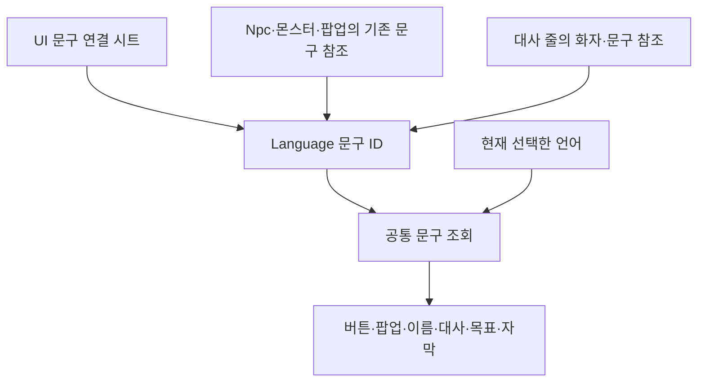
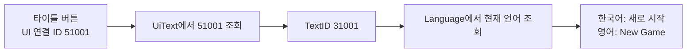
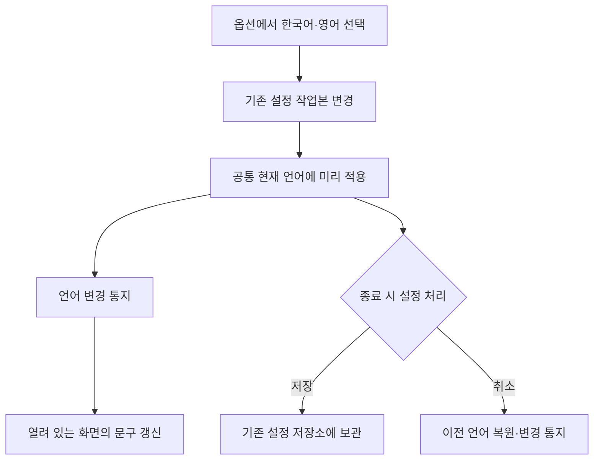
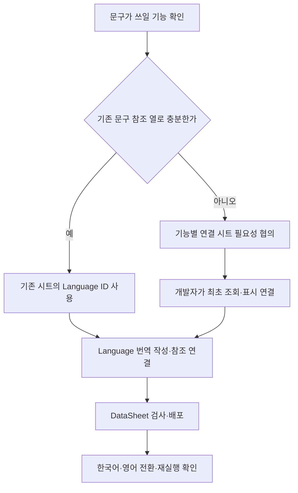

# 공통 언어와 기능별 문구 연결 시트 제안

작성일: 2026-11-13 · 대상: 기획자와 기능 연결 담당 개발자

**상태: 협의용 설계 제안입니다.** 기존 Language의 KO·EN 조회 기반은 존재하지만, 이 문서의 UI 문구 연결 시트·전체 화면 자동 갱신·옵션 언어 선택까지 구현됐다는 뜻은 아닙니다. 이번 작업은 문서 작성이며 엑셀·게임 데이터·코드는 변경하지 않았습니다.

## 목차

1. [왜 이 구조가 필요한가](#1-왜-이-구조가-필요한가)
2. [전체 구성과 용어](#2-전체-구성과-용어)
3. [시트 작성 예시](#3-시트-작성-예시)
4. [어떤 기능에 별도 시트가 필요한가](#4-어떤-기능에-별도-시트가-필요한가)
5. [언어 선택과 화면 반영](#5-언어-선택과-화면-반영)
6. [기획자의 작성과 확인 순서](#6-기획자의-작성과-확인-순서)
7. [실수를 막는 검사와 주의점](#7-실수를-막는-검사와-주의점)
8. [담당 구분과 도입 조건](#8-담당-구분과-도입-조건)

## 1. 왜 이 구조가 필요한가

NPC 대사뿐 아니라 버튼·팝업·몬스터 이름·목표·자막도 사용자가 선택한 언어로 보여야 합니다. 번역문을 각 기능에 따로 복사하면 같은 문구를 여러 곳에서 수정해야 하고, 일부만 번역되거나 잘못 연결하기 쉽습니다.

따라서 **번역문은 Language에 모으고, 각 기능에서는 사용할 문구의 번호를 연결**합니다. UI처럼 사용처가 많아 별도 관리가 필요한 경우에는 기능별 연결 시트를 둡니다. 이를 통해 기획자는 번역 내용과 사용 위치를 구분해 관리할 수 있습니다.

| 비교 | 화면마다 문구를 직접 작성 | Language 직접 참조 | 기능별 연결 시트 경유 |
| --- | --- | --- | --- |
| 번역 원문 위치 | 프리팹·코드 등에 흩어짐 | Language 한곳 | Language 한곳 |
| 기능별 사용처 관리 | 연결된 화면을 찾아야 함 | 기존 기능 정의에서 확인 | 기능별 시트에 모아 확인 |
| 문구 변경 | 여러 곳 수정 가능성 | Language 수정 | 번역은 Language, 사용 문구 교체는 연결 시트 수정 |
| 적합한 상황 | 이번 설계의 기본 방식으로 사용하지 않음 | 이름 등 기존 참조 열이 충분한 기능 | 여러 UI 문구의 역할을 묶어 관리할 때 |

## 2. 전체 구성과 용어

| 용어 | 뜻 | 예시 |
| --- | --- | --- |
| 언어 코드 | 어떤 언어로 보여줄지 결정 | Korean=0, English=1 |
| Language ID | 번역할 문구 자체의 번호 | 31001 = 새로 시작 / New Game |
| 기능별 연결 ID | 특정 기능의 문구 사용처를 가리키는 번호 | 51001 = 타이틀 새 게임 버튼 |
| Key | 사람이 용도를 구분하기 위한 식별자 | Title.NewGame |

기능별 연결 ID와 Language ID는 다른 번호입니다. 언어를 영어로 바꾼다고 문구 ID가 바뀌지는 않습니다. 아래 ID와 시트 이름은 모두 설명용 제안이며 실제 번호 대역·탭 이름·열 추출 여부는 도입 전에 합의합니다.

## 3. 시트 작성 예시

### 3.1 Language — 실제 번역문

| ID | KO | EN |
| ---: | --- | --- |
| 31001 | 새로 시작 | New Game |
| 31002 | 옵션 | Options |
| 31003 | 체력 | Health |

각 행은 한 문구입니다. 같은 문구의 한국어와 영어를 같은 행에 작성합니다. 현재 지원 범위는 한국어·영어이며 다른 언어는 확정 후 추가합니다.

### 3.2 UI 문구 연결 — 어떤 역할에 사용할지

탭 이름 `UiText`, 열 `ID·Key·TextID`는 제안입니다. 새 엑셀 파일을 만들 필요 없이 적합한 기존 파일 안의 탭으로 둘 수도 있습니다.

| ID | Key | TextID |
| ---: | --- | ---: |
| 51001 | Title.NewGame | 31001 |
| 51002 | Title.Settings | 31002 |
| 51003 | HUD.Health | 31003 |

- `ID`: UI 문구 연결 번호입니다. 프리팹 등 표시 대상에서 이 번호를 지정합니다.
- `Key`: 사용처를 알아보기 위한 이름입니다. 실행 조회는 정수 ID를 기준으로 하며, Key를 두 번째 실행 키로 중복 사용하지 않습니다. 메모 전용으로 둘지 추출할지는 시트 규칙 확정 시 결정합니다.
- `TextID`: 실제 문구가 있는 Language의 ID입니다. 이 시트에 KO·EN을 다시 복사하지 않습니다.

### 3.3 수정하는 곳을 고르는 예시

| 하고 싶은 일 | 수정 위치 | 유지할 것 |
| --- | --- | --- |
| New Game 번역만 교정 | Language의 해당 EN 칸 | 문구 ID·UI 연결 ID |
| 기존 버튼이 다른 문구를 사용 | UiText의 TextID | 해당 버튼의 UI 연결 ID |
| 새로운 버튼 추가 | 필요 문구와 UI 연결 행 추가 후 화면 연결 | 기존 행의 ID |
| NPC 이름 변경 | 기존 이름 Language 행 또는 Npc.NameTextID | NPC 종류 ID와 다른 기능의 연결 |

같은 문구 ID를 여러 곳이 공유하면 번역 수정도 모든 사용처에 반영됩니다. 앞으로 서로 다르게 바뀔 문구는 현재 글자가 같더라도 별도 문구 ID로 관리할 수 있습니다.

## 4. 어떤 기능에 별도 시트가 필요한가

| 대상 | 권장 연결 위치 | 별도 연결 시트 |
| --- | --- | --- |
| 타이틀·공용 UI 버튼 | UI 문구 연결 시트 | 사용처를 모아 관리할 필요가 있으면 도입 |
| NPC 이름 | 기존 Npc.NameTextID | 현재는 불필요 |
| 몬스터 이름 | 해당 정의의 이름 참조 위치 확인 후 연결 | 이미 참조가 있으면 중복 추가하지 않음 |
| 대사·화자 | 대사 줄의 TextID·SpeakerTextID | 기존 구조 재사용 |
| 목표 안내 | 기존 ObjectiveTextID | 기존 구조 재사용 |
| 팝업 본문·버튼 | 기존 Popup의 문구 참조 | 기존 구조 재사용 |

모든 기능에 새 시트를 만드는 것이 목적은 아닙니다. 기존 기능 시트만으로 담당과 사용처가 분명하면 그대로 사용합니다. 기능별 연결 시트는 번역 원문을 분리하는 추가 언어 시스템이 아니라, 같은 Language를 쓰기 위한 사용처 목록입니다.

## 5. 언어 선택과 화면 반영

- 현재 언어는 프로젝트 공통 상태 한곳에서 관리합니다. NPC와 UI가 각각 언어를 선택하지 않습니다.
- 화면은 처음 열릴 때와 표시 ID·언어가 바뀔 때 갱신합니다. 매 프레임 시트를 다시 찾지 않습니다.
- 닫힌 화면은 다음에 열릴 때 현재 언어를 사용합니다. 해제된 화면은 변경 통지를 받지 않도록 구독을 정리합니다.
- 언어 설정은 플레이 저장 슬롯과 분리합니다. 새 게임이나 최신 플레이 슬롯 삭제로 언어 설정을 초기화하지 않습니다.
- 대화 중 언어 변경은 현재 대화·줄 위치를 유지하고 그 줄을 새 언어로 처음부터 표시하는 안입니다. 대화 완료 이력을 초기화하지 않습니다.
- 글자가 그려진 이미지·영상은 문자열 변경만으로 번역되지 않습니다. 언어별 자산 연결이 필요하면 별도 요구로 전달합니다. 글꼴의 영문 표시와 긴 문구의 줄바꿈·잘림도 확인합니다.

## 6. 기획자의 작성과 확인 순서

1. 버튼·이름·대사 중 어떤 기능의 문구인지 정합니다.
2. 기존 Language ID와 기능 시트를 확인합니다. ID를 임의로 재사용하거나 기존 문구를 다른 의미로 덮어쓰지 않습니다.
3. 필요한 한국어·영어를 Language에 작성합니다.
4. 기존 참조 열 또는 합의된 기능별 연결 시트에서 문구 ID를 연결합니다.
5. 새 탭이라면 기존 README·B1 규칙과 첫 5행·헤더 규칙을 유지합니다. 별도 규칙 전용 탭이나 스키마 JSON을 새로 만들지 않습니다.
6. 개발자에게 최초 연결 완료를 확인받은 뒤 기존 DeployData 도구로 검사·배포합니다. 최초 도입 전에는 이 문서 예시를 실제 시트에 그대로 추가하지 않습니다.
7. 게임에서 두 언어·설정 취소·저장 후 재실행·화면 재진입을 확인합니다.

새 파일·탭의 추출과 배포는 기존 자동 발견 구조를 사용합니다. **새 시트가 자동 배포되는 것과 화면이 그 시트를 자동으로 이해하는 것은 다릅니다.** 새 연결 종류는 개발자가 최초 소비 기능과 검사 규칙을 연결해야 합니다. 이후 지원된 구조의 문구 행을 추가·수정할 때는 연결된 화면이 데이터를 읽도록 구성합니다. 행 추가만으로 새로운 버튼이나 새 게임 기능이 생기지는 않습니다.

관련 절차: [새 시트와 JSON 자동 배포 사용 안내](새%20시트와%20JSON%20자동%20배포%20사용%20안내.md), [NPC 데이터 작성과 배포 준비 안내](NPC%20데이터%20작성과%20배포%20준비%20안내.md).

## 7. 실수를 막는 검사와 주의점

아래는 도입 시 마련할 검사 조건입니다. UI 전용 시트의 검사가 현재 모두 구현됐다는 뜻은 아닙니다. 데이터 검사는 DataSheet에서 배포 전에 수행하며 클라이언트에 중복 데이터 검사기를 넣지 않습니다.

| 확인 대상 | 필요한 검사·확인 | 잘못됐을 때 |
| --- | --- | --- |
| ID | 양의 정수·중복 없음 | 배포 전 수정 |
| Key | 사용 시 중복·표기 기준 확인 | 역할이 겹치는 행 정리 |
| TextID | 실제 Language 행 참조 | 번호·참조 대상 수정 |
| 번역 | 필수 문구의 KO·EN 공란 확인 | 번역 보완 |
| 기능별 참조 | UI 연결 ID와 직접 Language ID 혼용 방지 | 올바른 참조 열·입력 필드 사용 |
| 프리팹·씬 | 실제 표시 대상과 연결 ID 확인 | 개발자와 연결 확인 |
| 변경·삭제 | 해당 ID의 모든 사용처 확인 | 참조를 먼저 변경한 뒤 삭제 |

프리팹 연결은 시트 검사만으로 전부 확인할 수 없습니다. Unity의 편집·빌드 확인과 실제 화면 확인을 함께 사용합니다. 런타임에서 필수 연결이 빠진 경우에는 기존 오류 보고 경계로 전달하고 잠금·구독을 정리합니다. 번역 누락을 빈칸이나 한국어 자동 대체로 조용히 숨기는 정책은 이번 안에 포함하지 않습니다. 대체 표시가 필요하면 별도로 합의합니다.

수량 같은 동적 값은 번역문과 게임 상태를 구분합니다. 치환 문구가 필요하면 자리표시자 이름·타입을 추가 설계하고, 기획자가 임의의 기호를 넣으면 자동 지원된다고 간주하지 않습니다.

## 8. 담당 구분과 도입 조건

| 담당 | 할 일 |
| --- | --- |
| 기획자 | 사용처 분류·문구와 번역 작성·ID 관리·실제 화면 검수 |
| 공통 언어 개발 담당 | 현재 언어 상태·조회·변경 통지·설정 저장 계약·검사 연결 |
| 옵션 담당 개발자 | 기존 옵션 흐름에서 공통 언어 계약 호출·저장/취소 조작 연결 |
| NPC·UI 등 기능 담당 | 기존 모듈에서 문구 참조 사용·표시 갱신·구독 수명 관리 |

현재 확인한 Language는 ID·KO·EN이며, 기존 LanguageTextSource가 언어별 열을 선택합니다. 일부 화면은 한국어 열을 직접 읽기 때문에 공통 조회로 전환할 작업이 필요합니다. 새로운 언어 시스템을 기능마다 복제하지 않고 이 기반을 확장합니다.

다른 개발자의 기능 내부는 임의로 변경하지 않습니다. 공통 클래스 수정이 필요하면 사용처와 영향 범위를 확인하고 기존 호출 계약을 보존합니다. 계약 변경이 불가피하면 먼저 설명하고 협의합니다.

이번 문서는 사용자와 합의한 프로젝트 공통 언어 방향과 기능별 연결 시트 제안을 정리한 것입니다. 새 시트 명칭·번호 대역·Key 정책·적용할 UI 범위를 확정하고, 개발자가 최초 연결한 뒤 실제 사용 안내로 갱신합니다. 아직 없는 기능의 완료 이력이나 특정 작업자의 구현 성과로 기록하지 않습니다.
