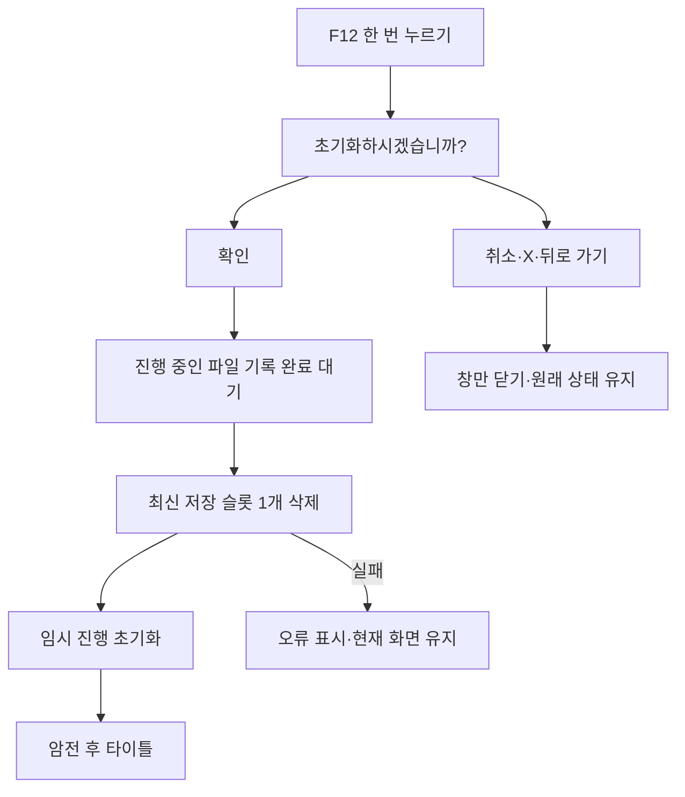

# 기획자용 F12 초기화 사용 안내

## 목차

1. [어떤 기능인가요?](#1-어떤-기능인가요)
2. [기획자가 바꿀 문구](#2-기획자가-바꿀-문구)
3. [화면과 조작](#3-화면과-조작)
4. [시험 순서](#4-시험-순서)
5. [문제가 생겼을 때](#5-문제가-생겼을-때)

## 1. 어떤 기능인가요?

테스트·시연 중 가장 최근 저장 기록 하나를 지우고 타이틀로 돌아가는 기능입니다. 현재 타이틀과 MapDohwagolTest에 연결했습니다. Unity 편집기와 개발 빌드에서만 사용할 수 있습니다. 출시 빌드에는 F12 실행 담당을 제거합니다.

기존의 5초 유지 방식은 사용하지 않습니다. F12를 한 번 누르면 확인 팝업이 열리고 기본 선택은 취소입니다.

현재 선택한 슬롯을 지우는 기능이 아닙니다. 날짜가 가장 최근인 기록을 삭제하고, 저장 시각이 같으면 저장 순서가 나중인 기록을 선택합니다. 나머지 슬롯·음량·카메라 등 사용자 설정은 유지합니다. 저장 기록이 없으면 파일 삭제 없이 임시 진행만 초기화하고 타이틀로 돌아갑니다.

## 2. 기획자가 바꿀 문구

문구 원본은 DataSheet/tables의 Popup.xlsx와 Language.xlsx입니다. 클라이언트 CSV를 직접 수정하지 않습니다.

| 원본 | ID | 현재 역할 |
| --- | --- | --- |
| Popup | 15008 | 초기화 확인 팝업 설정 |
| Language | 30215 | 초기화하시겠습니까? |
| Language | 30216 | 확인 |
| Language | 30217 | 취소 |

Popup15008은 본문30215·첫 버튼30216·두 번째 버튼30217을 참조합니다. 세 번째 데이터 버튼은0이고 DefaultButton=2·CancelButton=2입니다. X는 세 번째 선택지가 아니라 창을 닫는 공용 버튼이며 취소와 같은 결과입니다.

1. Language에서 해당 ID의 KO·EN 문구를 수정합니다. ID는 유지합니다.
2. Popup의 본문·버튼 연결을 유지합니다. 취소 기본 선택을 권장합니다.
3. 엑셀을 저장한 뒤 기존 DeployData.exe로 검사·배포합니다.
4. Unity 반영을 기다린 뒤 Play에서 확인합니다. 배포한 실행파일은 새로 빌드해야 바뀝니다.

Popup15008·Language30215는 기획자가 원본에 먼저 추가해 둔 항목을 재사용했습니다. 원본의 예전 ‘5초·현재 슬롯’ 메모는 사용자 최종 지시인 ‘한 번·최신 슬롯’으로 갱신했습니다. 확인·취소 문구30216·30217은 다른 공용 팝업에서도 재사용할 수 있습니다.

## 3. 화면과 조작

공용 패널은 Assets/2.Model/Prefabs/UI/ConfirmationPopupScreen.prefab입니다. 확인·취소·X와 문구 표시를 연결했으며 버튼은 기존 PopupButton 프리팹을 재사용합니다. 삭제 기능은 이 프리팹 안에 들어 있지 않습니다.

F12로 연 뒤 확인·취소를 클릭하거나 기존 메뉴 조작으로 선택·결정합니다. X 또는 뒤로 가기는 취소합니다. 실제 삭제 처리 중에는 확인·취소·X와 추가 F12를 막아 두 번 삭제하지 않습니다.

로딩 중에는 요청을 보관했다가 이동한 공간의 준비가 끝난 뒤 팝업을 엽니다. 오류 창이 열려 있을 때도 오류 창이 끝난 뒤 엽니다. 초기화 확인 중 새 오류 창이 나타나면 오류 창이 우선하며, 오류를 닫아도 초기화 팝업의 잠금은 유지합니다. 기존 일시정지·설정·수동 저장 위에 열었다가 취소하면 원래 상태로 돌아갑니다.

## 4. 시험 순서

실제 보존할 기록 대신 시험용 기록으로 확인합니다.

1. 개발 빌드 또는 편집기에서 저장 기록을 여러 개 만듭니다. 날짜 순서를 확인합니다.
2. 타이틀에서 F12를 한 번 누릅니다. 질문·확인·취소·X가 표시되는지 확인합니다.
3. 취소와 X를 각각 눌러 기록·현재 진행이 그대로인지 확인합니다.
4. 다시 열고 확인합니다. 타이틀로 이동한 뒤 최신 기록 하나만 사라지고 나머지 기록은 남는지 확인합니다.
5. 오래된 기록을 선택해 게임에 들어간 뒤 반복합니다. 현재 선택한 오래된 기록이 아니라 가장 최근 기록이 삭제돼야 합니다.
6. 일시정지·설정·F5 화면 위에서 취소하고 원래 화면과 정지 상태가 유지되는지 확인합니다.
7. 로딩 중 F12를 눌러 다음 공간 준비 후 질문이 열리는지 확인합니다.
8. 기록이 없는 상태에서도 타이틀로 돌아가며 설정은 유지되는지 확인합니다.
9. 출시용 비개발 빌드에서는 F12 입력·초기화 팝업이 나타나지 않아야 합니다.

현재 자동 검사는 별도 임시 저장 폴더에서 수행했습니다. 실제 플레이 기록의 삭제와 전체 화면 조작은 아직 실행 확인 대기입니다. 파일 삭제 성공 뒤 외부에서 화면을 강제로 종료해도 삭제를 되돌리지는 않습니다.

## 5. 문제가 생겼을 때

삭제 실패 시 오류 창의 상세 내용을 확인합니다. 기존 파일을 강제로 지우거나 전체 폴더를 삭제하는 우회는 하지 않습니다. 현재 씬·타이틀/게임 중 어느 화면인지·저장 목록 날짜·선택했던 기록·Console 첫 오류를 개발자에게 전달합니다.

팝업 위치·크기를 바꾸려면 공용 확인 프리팹을 편집합니다. 기획자는 DemoResetHost의 확인 팝업 화면과 팝업 데이터 ID만 설정합니다. 데이터 준비 객체·저장소·입력·타이틀 이동을 이 컴포넌트에 할당하지 않습니다. 새 씬은 개발자가 공통 씬 조립자인 ErrorPopupSceneBinding과 같은 오브젝트에 DemoResetHost를 배치합니다. 공통 조립자의 기존 데이터·입력·모달 연결과 타이틀 복귀 화면은 개발자가 한 번 구성하며, 데이터 준비 뒤 실행 담당에 전달됩니다. 현재 두 씬 외에는 컴포넌트가 자동으로 추가되지 않습니다.
