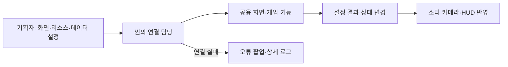
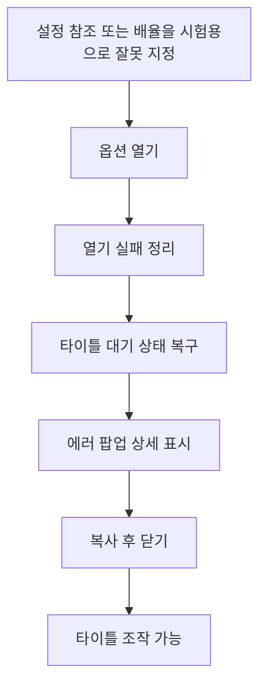
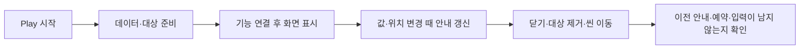

# 기획자용 공통 모듈 연결과 확인 안내

기준일: 2026-11-06. 코드 연결과 사용 절차를 갱신한 문서이며 실제 전체 플레이 통과 기록은 아닙니다.

## 1. 무엇이 달라졌나요?

타이틀 옵션이 보이지 않아 조작이 멈춘 것처럼 느껴지는 문제를 막기 위해 화면 배율·배치와 오류 전달을 수정했습니다. 같은 기능을 타이틀용·맵용으로 복제하지 않고 공용 화면과 연결 모듈을 사용합니다. 기존 데이터 행·사운드 원본·게임 저장 파일은 이번 정비에서 바꾸지 않았습니다.

## 2. 연결할 위치

| 작업 | 위치와 주의점 |
| --- | --- |
| 타이틀 옵션 | TitleScreen 프리팹의 TitleGameEntry: 호스트·설정 프리팹·입력 연결 |
| 타이틀 요청과 오류 | TitleSceneHost: 데이터·화면·입력·에러 팝업 연결. 별도 TitleSceneActions는 제거됐으므로 추가하지 않습니다 |
| 공통 설정 외형 | SettingsScreen 프리팹. 루트 배율은1, 화면 전체로 늘어나는 앵커 유지, 기본 비활성 |
| 오류 팝업 배치 | ErrorPopupSceneBinding의 명시적 참조 사용. ErrorPopupHost는 화면 크기를 전달하는 RectTransform 구조 유지 |
| 플레이어·일반몹 고정 프레임 | 기존 PreviewPlayerSprite·PreviewMonsterSprite 사용. 공통 표시 필드는 부모 PreviewStateSprite에서 보이므로 같은 필드를 자식에 추가하지 않습니다 |
| 보스 다중 프레임 | 기존 PreviewBossSprite 유지. 고정 프레임 부모를 직접 붙이지 않습니다 |
| 맵 상호작용 | 기존 대상 묶음을 사용합니다. 대상 컴포넌트가 등록·해제하므로 기획자가 등록 이벤트를 추가 연결하지 않습니다 |
| 테스트 F12 확인 | 확인 팝업 화면과 Popup ID만 설정합니다. 저장소·데이터 준비·타이틀 복귀 연결은 공통 조립자가 담당합니다 |

기능별 연결과 설정 항목의 자세한 작성법은 [사운드 설정 사용 안내](기획자용%20사운드%20설정%20사용%20안내.md), [에러 팝업 사용 안내](기획자용%20에러%20팝업%20사용%20안내.md)를 참고합니다. 기능을 조립하는 코드는 개발자가 연결하며 빈 오브젝트를 추가하기만 해서 자동으로 모든 기능이 동작하는 방식은 아닙니다.

## 3. 먼저 확인할 재시험 순서

Play 중에는 코드를 반영한 뒤 바로 같은 상태를 이어서 시험하지 말고, Play를 멈추고 코드 반영이 끝난 뒤 저장된 Title 씬을 다시 열어 시작합니다. 저장하지 않은 씬 편집이 있다면 먼저 담당자와 확인합니다. Console의 Error Pause를 꺼야 의도적으로 오류를 낸 뒤에도 팝업을 조작할 수 있습니다.

1. 타이틀 옵션을 엽니다. 마스터·배경음·효과음·카메라 흔들림이 화면 안에 보이고 조작돼야 합니다.
2. 적용·취소를 각각 시험합니다. 닫은 뒤 타이틀 입력이 돌아오고 같은 입력이 새 게임으로 새지 않아야 합니다.
3. 데이터 초기화 뒤 Hierarchy의 ErrorPopupHost에서 Inspector 컴포넌트 메뉴 → 테스트 → 자동 오류 수집 확인을 실행합니다. 복사·닫기와 상세 진단을 확인합니다.
4. 맵에서 일시정지→설정→오류 팝업 순서로 엽니다. 오류 팝업만 닫으면 설정과 일시정지가 유지돼야 합니다.
5. 설정을 열었다 닫는 동작과 타이틀↔맵 이동을 반복합니다. 중복 창·중복 입력·이전 화면의 팝업이 남으면 안 됩니다.
6. 플레이어·일반몹의 상태별 이미지와 발 높이, 보스 애니메이션, 기력·보스 게이지·약초·기술 문구를 확인합니다. 기존 프리팹 연결이 Inspector에 그대로 남아 있어야 합니다.

### 개발자와 함께 확인할 실패 시험

실제 원본을 잘못 바꾸지 않도록 Play 중 생성된 시험 객체나 별도 시험 사본에서 개발자가 진행합니다. 설정의 배율0·필수 문구 참조 누락 시 어떤 항목이 잘못됐는지 오류에 나와야 합니다. 시험 후에는 변경을 원복하고 실제 배포 프리팹을 잘못 저장하지 않습니다.

개발자는 준비 중 컴포넌트 비활성화→재활성화, 조회 중 씬 종료, 맵 초기화 중 실패, 상호작용 대상 삭제, 일시정지 메뉴 비활성화를 추가로 확인합니다. 삭제된 객체를 호출하는 오류와 입력 잠금이 남지 않아야 합니다. 오류가 나면 팝업 내용을 복사하고 시험한 순서·씬·오브젝트 이름을 함께 전달해 주세요.

## 4. 현재 한계와 보존할 원본

이 문서는 실제 Unity 실행 통과 기록이 아니라 변경 후 확인 절차입니다. 자동 검사·컴파일이 통과해도 실제 화면·마우스·패드·씬 수명은 별도로 확인합니다. 데이터 초기화 전이나 오류 표시 기능 자체가 잘못 연결된 경우까지 팝업을 보장하지 않으며 Console의 전체 로그를 확인해야 합니다.

기획 데이터와 설정 에셋은 원본입니다. 실행 중 시험값을 바꿀 때 원본을 수정하는 기능을 만들지 않습니다. 설정 편집은 복사본에서 진행하며 저장을 선택했을 때만 별도 설정 파일에 기록합니다. 프리팹의 객체 이름은 영어 식별자를 유지하고 화면 문구·Inspector 설명은 한글로 작성합니다. 더 자세한 책임과 이유는 [공통 모듈과 객체 수명 설계](../개발자용%20설계문서/공통%20모듈과%20객체%20수명%20설계.md)를 참고합니다.

## 5. 데이터에서 설정하는 항목과 예외

문구는 Language, 팝업 구성은 Popup, 소리 정의는 Sound 등 기존 테이블을 우선 사용합니다. Unity 객체를 조립하기 위한 화면·입력·렌더러 참조는 Inspector 연결이 필요합니다. 이전에 정한 타이틀 이미지·배치의 씬 직접 편집 예외는 유지합니다. 사운드는 아직 실제 주소 재생 연결 전이고, 마스터 문구 ID도 공급 전이므로 데이터만 입력하면 모든 소리가 즉시 바뀌는 상태는 아닙니다.

로딩 준비가 실패하면 진행 상태를 먼저 지우거나 입력을 잠그지 않도록 수정했습니다. 이미 시작된 Unity 씬 로드는 취소할 수 없어 로딩 화면을 끄더라도 이동은 계속됩니다. 로딩 화면을 끄는 동작을 이동 취소 버튼처럼 사용하지 않습니다. 개발자는 로딩 중 화면 비활성화와 암전 콜백 실패 후에도 다음 이동을 시작할 수 있는지 확인해야 합니다.

## 6. 화면이 너무 일찍 열리거나 이전 객체를 부르는지 확인하기

기획자는 기존 씬과 프리팹으로 확인하면 됩니다. 별도의 구독 컴포넌트나 이벤트 연결을 추가하지 않습니다. 데이터가 준비되기 전에는 진행 기능을 강제로 호출하지 말고, Console에 준비 실패가 있는지 확인합니다. 화면이 없거나 입력이 잠긴 현상을 정상 로딩으로 추정하지 않습니다.

개발자와 함께 준비 도중 비활성화·재활성화, 대상 삭제 후 재생성, 화면을 열던 중 씬 이동을 확인합니다. 이전 안내가 남거나 입력이 두 번 실행되면 빌드 번호·씬·대상 이름·재현 순서와 첫 오류를 전달합니다. 기능별 상세 확인은 [표시 갱신 최적화 확인 안내](표시%20갱신%20최적화%20확인%20안내.md), [F12 초기화 사용 안내](기획자용%20F12%20초기화%20사용%20안내.md)를 따릅니다.
