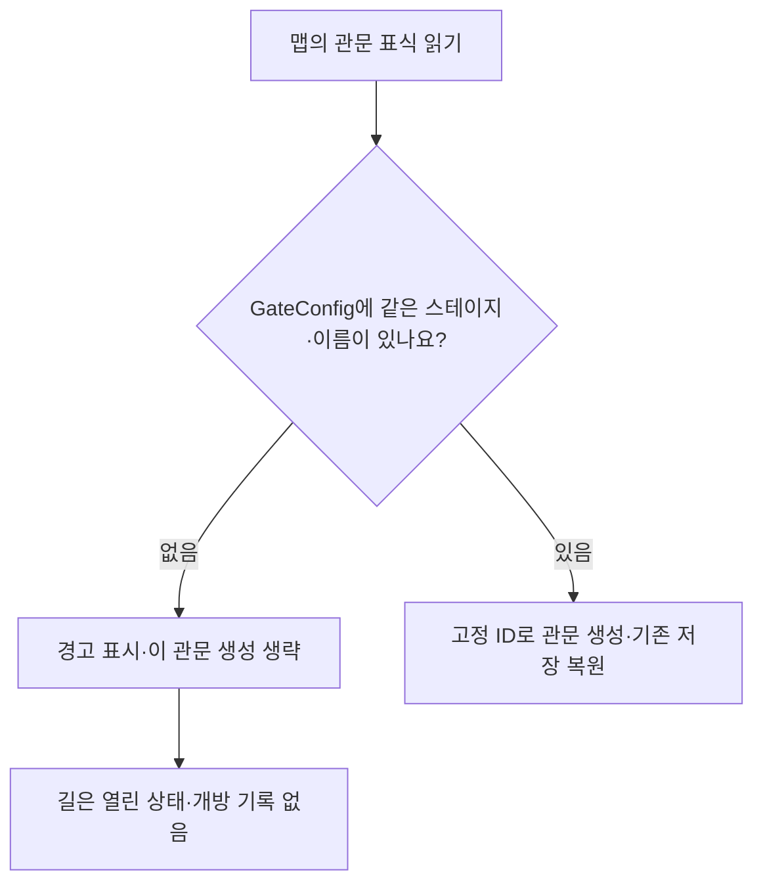
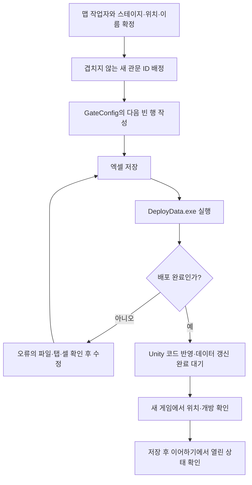

# 기획자용 관문 데이터 작성과 확인 안내

## 현재 임시 처리 — 2026-11-10

현재 배포된 GateConfig에는 관문 행이 없지만, 산길 맵에는 `BindGate_1` 등의 위치 표식이 남아 있습니다. 이전에는 이 차이 때문에 맵 진입이 중단됐습니다. 지금은 **표에 없는 관문만 만들지 않고 Unity 콘솔에 경고를 남깁니다.** 해당 길은 열려 있으며, 임시 ID나 관문 개방 저장 기록은 만들지 않습니다. 표에 등록된 다른 관문은 기존대로 동작합니다.



정식으로 길을 막으려면 아래 안내에 따라 **Stage.xlsx의 GateConfig**에 고정 ID·StageID·AnchorName을 작성하고 DeployData.exe로 배포한 뒤 게임을 다시 실행합니다. 스테이지 8002의 `BindGate_1`이라면 StageID는 `8002`, AnchorName은 `BindGate_1`입니다. 관문 ID는 데이터 담당자와 정하며 이름에서 자동으로 만들지 않습니다.

확인 순서는 **배포 → 맵 진입 → 경고 유무 → 관문 개방 → 저장 → 이어하기**입니다. 임시 처리 상태에서 길을 통과한 것만으로 ‘관문 개방·저장 검증 완료’로 판단하지 않습니다. 이후 표에 행을 추가하면 이전 임시 통행은 개방 기록이 아니므로 관문이 닫혀 나타날 수 있습니다.

## 1. 이 문서는 언제 읽나요?

맵에 결박 관문을 추가하거나, 기존 관문 이름을 바꾸거나, 저장 후에도 열린 관문이 유지되는지 확인할 때 읽습니다. 프로그래밍 지식은 필요하지 않습니다.

수정할 파일은 **DataSheet → tables → Stage.xlsx**, 선택할 탭은 **GateConfig**입니다. 기존 **Stage** 탭은 스테이지 정보이며 이번에 수정할 관문 목록과 구분합니다.

**가장 중요한 규칙은 ‘같은 관문이면 ID를 유지한다’입니다.** 이름과 위치는 바뀔 수 있지만, 게임은 ID로 이전에 열었던 관문인지 기억합니다.

## 2. 왜 관문 목록이 필요한가요?

맵의 위치 표시와 저장 기록을 연결하기 위해 필요합니다. 여기서 앵커는 **관문을 놓을 자리를 표시하는 빈 오브젝트**입니다.


관문을 열었어도 명시적인 수동·자동 저장이 성공하기 전에는 임시 진행 상태입니다. 이 탭의 행을 추가하는 동작 자체가 게임 저장을 실행하지는 않습니다.

## 3. 엑셀의 어느 부분을 수정하나요?

| 위치 | 내용 | 기획자 작업 |
| --- | --- | --- |
| 1~5행 | 도구가 읽는 설명·추출 규칙 | 일반적인 관문 추가 작업에서는 수정하지 않습니다. |
| 6행 | ID·StageID·AnchorName·Note 제목 | 이름과 순서를 그대로 유지합니다. |
| 7행부터 | 실제 관문 목록 | 여기에 값을 작성합니다. 한 행이 관문 하나입니다. |

| 칸 | 쉬운 뜻 | 작성 방법 |
| --- | --- | --- |
| ID | 이 관문만의 고정 번호 | 중복되지 않는 양의 정수입니다. 새 번호는 데이터 담당자와 배정하고 기존 번호를 재사용하지 않습니다. |
| StageID | 관문이 있는 스테이지 번호 | 같은 파일의 Stage 탭에 있는 ID를 사용합니다. 스테이지 이름을 입력하지 않습니다. |
| AnchorName | 맵에서 관문 위치를 표시한 오브젝트 이름 | 맵 작업자가 알려 준 이름을 정확히 복사합니다. 현재 관문 이름은 `BindGate_`로 시작합니다. |
| Note | 사람이 읽는 설명 | ‘산길 첫 관문’처럼 적습니다. 게임으로 추출하지 않습니다. |

아래는 작성 예시입니다. 현재 배포된 표는 비어 있으므로 아래 값이 실제 등록됐다고 판단하지 않습니다.

| 엑셀 행 | ID | StageID | AnchorName | Note |
| --- | --- | --- | --- | --- |
| 7행 | 800201 | 8002 | BindGate_1 | 산길 첫 결박 관문 |
| 8행 | 800202 | 8002 | BindGate_2 | 산길 두 번째 결박 관문 |
| 9행 | 800301 | 8003 | BindGate_3 | 협곡 결박 관문 |

예를 들어 첫 행은 **‘8002번 스테이지의 BindGate_1 위치에 있는 관문을 800201번으로 기억한다’**는 뜻입니다. ID를 StageID나 이름의 숫자로 자동 계산하는 규칙은 아닙니다.

## 4. 새 관문을 추가하는 순서



1. **맵 작업자에게 두 값을 받습니다.** 관문이 들어갈 StageID와 빈 오브젝트의 정확한 이름입니다. 엑셀에 이름만 적으면 맵에 새 위치가 만들어지는 방식은 아닙니다.
2. **새 ID를 배정받습니다.** 기존 관문 행을 복사했다면 복사된 ID를 반드시 새 번호로 바꿉니다. 삭제한 관문의 번호도 다른 관문에 쓰지 않습니다.
3. **7행 이후의 다음 빈 행에 네 칸을 작성합니다.** ID·StageID·AnchorName은 필수이며 Note는 설명입니다.
4. **엑셀을 저장합니다.** 내용이 저장됐는지 확인한 뒤 배포합니다. 파일 사용 중 오류가 나면 엑셀을 닫고 다시 실행합니다.
5. **DataSheet 폴더의 DeployData.exe를 실행합니다.** ‘배포 완료’를 확인합니다. 실패한 상태에서 클라이언트 CSV를 직접 고치지 않습니다.
6. **Unity 반영을 기다립니다.** 코드 반영과 데이터 목록 갱신이 끝난 뒤 Play를 실행합니다. 이미 배포한 실행파일이 자동으로 바뀌지는 않으므로 팀에 전달할 게임은 다시 빌드합니다.

### 맵 작업자에게 전달할 배치 조건

관문 표식은 해당 맵 프리팹의 **Markers 바로 아래**에 둡니다. 현재 구현은 그 자식 중 `BindGate_`로 시작하는 오브젝트를 관문 위치로 읽습니다. 다른 폴더 아래에 넣거나 이름의 접두사를 바꾸면 같은 방식으로 연결되지 않습니다.

```text
맵 프리팹
└─ Markers
   ├─ BindGate_1
   └─ BindGate_2
```

오브젝트 이름은 영문·숫자·밑줄을 사용하고 대소문자까지 일치시킵니다. 게임 실행 중 생성된 복사본 대신 원본 맵 프리팹을 수정·저장합니다. 기획자가 Unity 배치를 담당하지 않는다면 위 조건과 엑셀 값을 맵 작업자에게 전달하면 됩니다.

## 5. 기존 관문을 수정할 때

| 하고 싶은 작업 | 바꿀 것 | 유지하거나 확인할 것 |
| --- | --- | --- |
| 설명만 수정 | Note | ID·StageID·AnchorName 유지 |
| 위치만 이동 | 원본 맵의 관문 표식 위치 | ID·이름 유지. 엑셀 행을 새로 만들지 않음 |
| 같은 관문 이름 변경 | 맵 오브젝트 이름과 AnchorName을 함께 수정 | ID 유지. 이전 저장에서도 같은 관문으로 인식 |
| 행 정렬 | 관문 목록의 행 순서 | 각 행의 값 묶음과 ID 유지. 행 번호는 저장 번호가 아님 |
| 같은 맵에 관문 추가 | 새 위치 표식·새 행·새 ID | 같은 StageID 안에서 AnchorName 중복 금지 |
| 다른 스테이지로 이동 | 데이터 담당자·개발자와 먼저 협의 | 관문 이동인지 새 관문인지에 따라 기존 저장의 의미가 달라짐 |
| 관문 제거 | 맵 작업자·개발자와 먼저 협의 | 임시 정책에서는 남은 표식에 경고를 남기고 관문을 만들지 않음. 의도한 제거라면 표식도 정리 |

**기존 관문 ID를 임의로 삭제하거나 변경하지 마세요.** 저장 파일이 그 ID를 보관하고 있을 수 있습니다. 현재는 표에서 사라진 관문을 복원 사본에서 제외하지만, 잘못 삭제한 행인지 의도한 제거인지 자동으로 알 수는 없습니다. ID를 없애거나 다시 배정하는 작업은 개발자와 저장 호환을 확인합니다.

## 6. 배포 성공과 게임 연결 성공은 다릅니다

| 확인 단계 | 확인하는 것 | 여기서 끝났다고 볼 수 없는 것 |
| --- | --- | --- |
| 배포 도구 | ID 중복·필수값·StageID 참조·같은 스테이지의 앵커 이름 중복 | 실제 맵에 그 이름의 표식이 있는지, 위치가 맞는지 |
| 게임 실행 | 맵 표식과 데이터 연결·현재 관문 구성 | 실제 저장 후 이어하기의 결과 |
| 저장·이어하기 | 정수 ID로 열린 관문이 복원되는지 | 모든 맵·모든 저장 기록의 최종 검증 |

확인할 때는 **관문이 있는 맵의 현재 연결 경로**로 이동합니다. 현재 테스트 맵의 스테이지 원본과 리소스 참조는 개발자가 관리하므로, 다른 맵을 수정했다면 실제 실행 대상이 그 원본을 사용하는지도 확인해 달라고 요청합니다.

## 7. 기획자가 확인할 시험 순서

1. 배포와 Unity 반영을 끝낸 뒤 새 게임을 시작합니다. 예전에 관문을 열었던 기록으로 시작하면 처음부터 열려 있을 수 있습니다.
2. 해당 스테이지에서 관문이 의도한 위치에 있고 길을 막는지 확인합니다.
3. 현재 연결된 결박 가르기로 관문을 열고 통과합니다. 이 탭은 개방 스킬이나 피해량을 정하는 표가 아닙니다.
4. 테스트·시연 환경에서 F5로 저장하고 성공을 확인합니다. **관문을 연 뒤 저장해야 합니다.**
5. 일시정지 메뉴로 타이틀에 돌아가 방금 저장한 기록을 불러옵니다.
6. 같은 관문이 다시 막히지 않는지 확인합니다. 다른 저장 기록을 골랐다면 당시 관문 상태가 다른 것은 정상일 수 있습니다.

슬롯 선택과 저장 확인 화면의 자세한 조작은 [수동 저장 사용 안내](기획자용%20수동%20저장%20사용%20안내.md)를 따릅니다. 현재 실제 Unity 실행 확인은 담당자가 수행해야 하며, 위 절차가 이미 모두 통과했다는 뜻은 아닙니다.

## 8. 문제가 생기면

| 보이는 상황 | 먼저 확인할 것 |
| --- | --- |
| ID 중복 오류 | 행을 복사하면서 ID까지 복사했는지 확인합니다. |
| StageID 참조 오류 | Stage 탭의 ID인지 확인합니다. 이름이나 순서 번호를 넣지 않습니다. |
| 앵커 조합 중복 오류 | 같은 StageID에 같은 AnchorName이 두 번 있는지 확인합니다. |
| ‘관문 ID 연결이 없습니다’ | 오류의 StageID·오브젝트 이름과 GateConfig를 비교합니다. 이름만 바꾸고 배포하지 않았는지도 확인합니다. |
| 배포 성공인데 관문이 안 보임 | 실제 사용하는 맵인지, Markers 바로 아래에 표식이 있는지, 이름이 BindGate_로 시작하는지 맵 작업자에게 확인합니다. |
| 이어하기에서 다시 막힘 | 관문 개방 후 저장이 성공했는지, 같은 기록을 불러왔는지, ID를 변경하지 않았는지 확인합니다. |
| 예전 기록 불러오기 실패 | 기존 ID를 삭제·변경했는지 확인하고 개발자에게 기록을 전달합니다. 원본 저장 파일을 먼저 삭제하지 않습니다. |

개발자에게는 **StageID·관문 ID·AnchorName·바꾼 내용·저장/불러오기 순서·Console 첫 오류**를 함께 전달합니다. Console은 Unity의 오류·실행 기록 창입니다.

## 9. 이 탭에서 설정하지 않는 것

관문 위치 좌표, 개방에 필요한 스킬, 피해량, 몬스터 배치와 리스폰 ON/OFF를 설정하는 탭은 아닙니다. 현재 추가된 기능은 **맵의 관문과 저장용 정수 ID를 연결하는 것**입니다. 리스폰 데이터는 별도 작업 대기입니다.
