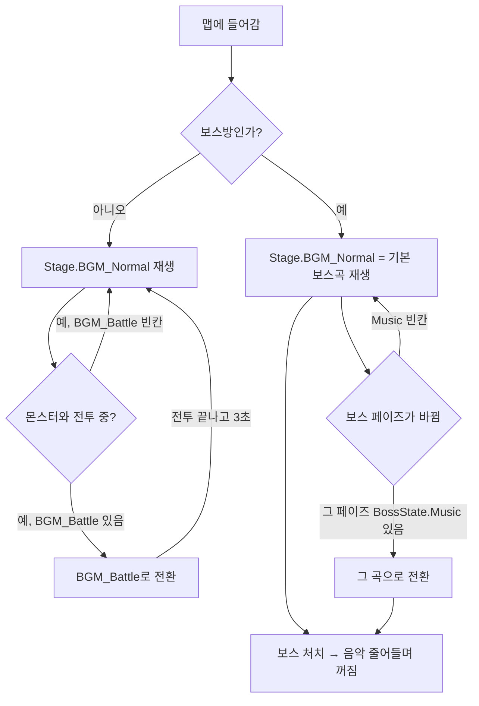

# 기획자용 배경음악(BGM) 설정 안내

2026-11-20 기준. 맵과 보스 페이즈의 배경음악을 **시트만으로** 정하는 방법입니다. 이전에는 `BGM_VILLAGE` 같은 이름(키)을 적고 실제 음원은 개발자가 프리팹에서 연결했지만, 이제는 **Sound 표의 ID 번호**를 적습니다.

## 목차

1. [한눈에 보기](#1-한눈에-보기)
2. [어디에 무엇을 적나요?](#2-어디에-무엇을-적나요)
3. [현재 들어 있는 값](#3-현재-들어-있는-값)
4. [자주 하는 작업](#4-자주-하는-작업)
5. [검사·배포와 확인](#5-검사배포와-확인)
6. [자주 묻는 질문](#6-자주-묻는-질문)
7. [이전 방식과 달라진 점](#7-이전-방식과-달라진-점)

## 1. 한눈에 보기

- **맵의 기본 곡**은 Stage 시트에서 정합니다.
- **보스 페이즈가 바뀔 때 곡을 바꾸려면** BossState 시트의 그 페이즈 행에 곡 번호를 적습니다.
- 곡이 바뀔 때 페이드(서서히 커지고 작아지는 시간)는 **Sound 행의 FadeInMs·FadeOutMs**를 따릅니다.

## 2. 어디에 무엇을 적나요?

| 파일 / 탭 | 칸 | 넣는 값 | 빈칸이면 |
| --- | --- | --- | --- |
| `Sound.xlsx` / Sound | 새 행 | 음원 주소, **Category = 6**(배경음악), Loop = Y, 페이드 시간 | — |
| `Stage.xlsx` / Stage | `BGM_Normal` | 이 맵의 기본 곡 Sound ID | 음악 없음(환경음만) |
| `Stage.xlsx` / Stage | `BGM_Battle` | 일반 맵에서 몬스터와 싸우는 동안의 곡 Sound ID | 전투 중에도 `BGM_Normal`이 계속 나옴 |
| `UnitState.xlsx` / BossState | `Music` | 이 페이즈가 되면 바꿀 곡 Sound ID | 보스방의 `BGM_Normal`을 그대로 씀 |

Sound 행 작성 규칙:

| 칸 | 배경음악에 넣는 값 |
| --- | --- |
| Category | `6` (배경음악). 다른 번호를 넣으면 Stage·BossState에서 쓸 수 없다고 검사에서 막습니다 |
| Loop | 보통 `Y`(반복) |
| FadeInMs | 이 곡이 시작될 때 커지는 시간(ms). 1000 = 1초 |
| FadeOutMs | 이 곡이 다른 곡으로 바뀌거나 꺼질 때 작아지는 시간(ms) |
| RefIndex | **빈칸** |

> 곡이 A에서 B로 바뀌면 A는 **A의 FadeOutMs**로 줄어들고 B는 **B의 FadeInMs**로 커집니다(겹쳐서 자연스럽게 넘어감).

## 3. 현재 들어 있는 값

Sound 행(배경음악):

| ID | 음원 | FadeIn / FadeOut | 쓰는 곳 |
| --- | --- | --- | --- |
| 3082 | HG_Lobby_BGM | 1000 / 1000 | 현재 사용 안 함(나중에 일반 맵에 넣을 때 쓸 수 있게 등록만 유지) |
| 3083 | HG_Boss_Phase1 | 2000 / 3000 | 보스방(8004) 기본 곡 = 1페이즈 |
| 3084 | HG_Boss_Phase2 | 2000 / 3000 | 보스 2페이즈(분노, BossState 4002) |
| 3085 | HG_TitleSound | 1000 / 1000 | 타이틀 화면(개발 Inspector에서 지정) |

Stage:

| Stage | 이름 | BGM_Normal | BGM_Battle |
| --- | --- | --- | --- |
| 8001 | 마을(도화골) | 빈칸(음악 없음, 환경음만) | 빈칸 |
| 8002 | 산길 초입구 | 빈칸(음악 없음, 환경음만) | 빈칸 |
| 8003 | 산길 위 바위 협곡 | 빈칸(음악 없음, 환경음만) | 빈칸 |
| 8004 | 관문(보스방) | **3083** | 빈칸 |
| 8005 | 장부방 | 빈칸(음악 없음, 환경음만) | 빈칸 |
| 8006 | 옹기 가마터 길 | 빈칸(음악 없음, 환경음만) | 빈칸 |
| 8007 | 갈림길 | 빈칸(음악 없음, 환경음만) | 빈칸 |

BossState(쇄문아비):

| ID | 페이즈 | Music | 결과 |
| --- | --- | --- | --- |
| 4001 | 0 평상 | 빈칸 | 보스방 기본 곡 3083이 계속 나옴 |
| 4002 | 1 분노(HP 50% 이하) | **3084** | 분노 페이즈로 바뀌는 순간 3084로 전환 |

> 11/20 결정: 일반 스테이지는 배경음악을 넣지 않고 환경음만 나옵니다(기능은 있으므로 칸에 ID만 적으면 바로 켜집니다). 배경음악은 보스방에서만 나옵니다. 이전에 필드 전투 때 나오던 `Test_Boss_BGM`은 프로젝트에서 삭제했습니다.

## 4. 자주 하는 작업

### 4-1. 어떤 맵의 곡을 바꾸고 싶다

1. 이미 Sound 표에 있는 곡이면 그 ID를, 없으면 아래 4-3처럼 Sound 행을 먼저 추가합니다.
2. `Stage.xlsx` Stage 탭에서 그 맵 행의 `BGM_Normal`에 ID를 적습니다.
3. 저장 → `DeployData.exe` 실행.

### 4-2. 일반 맵에 전투 곡을 넣고 싶다

그 맵의 `BGM_Battle`에 곡 ID를 적습니다. 몬스터가 플레이어를 인식하면 전투 곡으로 바뀌고, 모든 몬스터의 인식이 풀린 뒤 3초가 지나면 평상 곡으로 돌아옵니다. 빈칸이면 전투 중에도 평상 곡이 그대로 나옵니다.

### 4-3. 새 곡을 추가하고 싶다

1. 음원 파일을 개발자에게 전달하고 프로젝트 안 경로(예: `Assets/8.Audio/BGM/새곡`)를 정합니다.
2. Sound 탭 마지막 행 아래에 새 ID로 한 행을 추가합니다: Address, Category `6`, Volume `10000`, Loop `Y`, FadeInMs·FadeOutMs, RefIndex 빈칸.
3. Stage나 BossState에 그 ID를 적습니다.
4. **개발자 연결이 한 번 필요합니다.** 현재 음원 파일은 GameAudio 프리팹의 소리 목록에 Sound ID와 함께 등록돼야 들립니다. 새 ID를 쓰면 개발자에게 "Sound ID ○○○ 클립 연결"을 요청해 주세요. 등록이 빠지면 개발 검사(`ResourceConnectionChecks`)가 실패로 알려 줍니다. 개발자는 이때 음원 임포트 설정 Load Type을 **Streaming**으로 맞춥니다(긴 곡이 메모리를 많이 쓰지 않도록, 11/20).

### 4-4. 보스 페이즈마다 다른 곡을 쓰고 싶다

- 보스방 Stage의 `BGM_Normal`에 **첫 페이즈 곡**을 넣습니다(맵에 들어가자마자 재생).
- 곡을 바꾸고 싶은 페이즈의 BossState 행 `Music`에 곡 ID를 넣습니다.
- 바꾸지 않을 페이즈는 `Music`을 비웁니다. 비워 두면 보스방 기본 곡으로 돌아갑니다.
- 페이즈는 HP가 그 행의 `HPThreshold` 아래로 내려가는 순간 바뀌고, 곡도 그때 바로 전환됩니다.

## 5. 검사·배포와 확인

`DeployData.exe`가 배포 전에 아래를 막습니다.

| 실수 | 검사 결과 |
| --- | --- |
| `BGM_Normal`·`BGM_Battle`·`Music`에 Sound에 없는 번호 | 참조 실패 |
| 배경음악 칸에 Category가 6이 아닌 Sound 번호(효과음·환경음 등) | `BGM_NORMAL_CATEGORY`·`BGM_BATTLE_CATEGORY`·`BGM_CATEGORY` 실패 |
| Category 6 행의 RefIndex에 값 입력 | 지정 규칙 실패 |
| 숫자가 아닌 값(예: 이전 방식의 `BGM_FIELD`) | 형식 실패 |

게임에서 확인:

1. 마을·필드: 배경음악 없이 환경음만 나오는지 봅니다.
2. 보스방에 들어가면 HG_Boss_Phase1이 바로 나오는지 봅니다.
3. 보스 HP를 50% 아래로 내리면 HG_Boss_Phase2로 겹쳐 넘어가는지(약 3초) 봅니다.
4. 보스를 처치하면 음악이 줄어들며 꺼지고, 그 뒤 엔딩 영상이 시작되는지 봅니다.

현재 상태: 시트·배포·코드 연결과 자동 검사를 마쳤습니다. **실제 귀로 듣는 확인(플레이 청취)은 아직 하지 않았습니다.**

## 6. 자주 묻는 질문

**Q. 환경음(불 소리 등)과 배경음악이 같이 나오나요?**
네. 환경음은 Stage의 `AmbienceSoundID`(Category 1)로 따로 재생되고 배경음악과 겹쳐 나옵니다. 배경음악을 바꿔도 환경음은 끊기지 않습니다.

**Q. 옵션의 "배경음" 음량은 무엇에 적용되나요?**
배경음악(Category 6)과 환경음(Category 1) 모두에 적용됩니다. 일시정지 중에는 둘 다 50%로 줄어듭니다.

**Q. 보스를 처치한 뒤 보스방에 다시 오면요?**
처치한 보스방에서는 음악을 틀지 않습니다(환경음만). 보스가 죽을 때 음악이 줄어들어 꺼지고, 엔딩 영상은 그 페이드가 끝난 뒤 시작합니다.

**Q. 같은 곡인데 맵마다 Sound 행을 나눠야 하나요?**
아니요. 배경음악은 한 곡에 한 행이면 됩니다. 여러 맵이 같은 ID를 써도 됩니다. (환경음은 맵마다 행을 나누는 규칙이 따로 있습니다.)

**Q. 타이틀 화면 곡은 어디서 바꾸나요?**
타이틀은 Stage 행이 없어서 개발자가 타이틀 프리팹의 "타이틀 배경음악 Sound ID"(현재 3085)에서 정합니다. 바꾸려면 Sound ID를 개발자에게 전달해 주세요.

## 7. 이전 방식과 달라진 점

| 항목 | 이전(11/19까지) | 현재(11/20) |
| --- | --- | --- |
| Stage `BGM_Normal`·`BGM_Battle` | 문자열 키(`BGM_FIELD` 등) | Sound ID 번호 |
| BossState `Music` | 문자열 키(`BGM_BOSS_PHASE1` 등), 비우면 음악 없음 | Sound ID 번호, 비우면 보스방 기본 곡 |
| 실제 음원 결정 | 개발자 프리팹 연결 | Sound 행의 Address |
| 곡 전환 페이드 | 코드 고정(1초, 보스 2초/3초) | Sound 행의 FadeInMs·FadeOutMs |
| `BGM_Battle` 빈칸 | 전투 중 음악 꺼짐 | 전투 중에도 평상 곡 유지 |
| 보스방 시작 곡 | BossState 0페이즈 Music | 보스방 Stage `BGM_Normal` |
| Sound Category | 1~5 | 6(배경음악) 추가 |

관련 문서: [사운드 테이블 작성과 배포 안내](기획자용%20사운드%20테이블%20작성과%20배포%20안내.md) · [개발 설계: 사운드 설정 설계](../개발자용%20설계문서/사운드%20설정%20설계.md#2026-11-20-배경음악-sound-id-전환과-보스-페이즈-전환)
