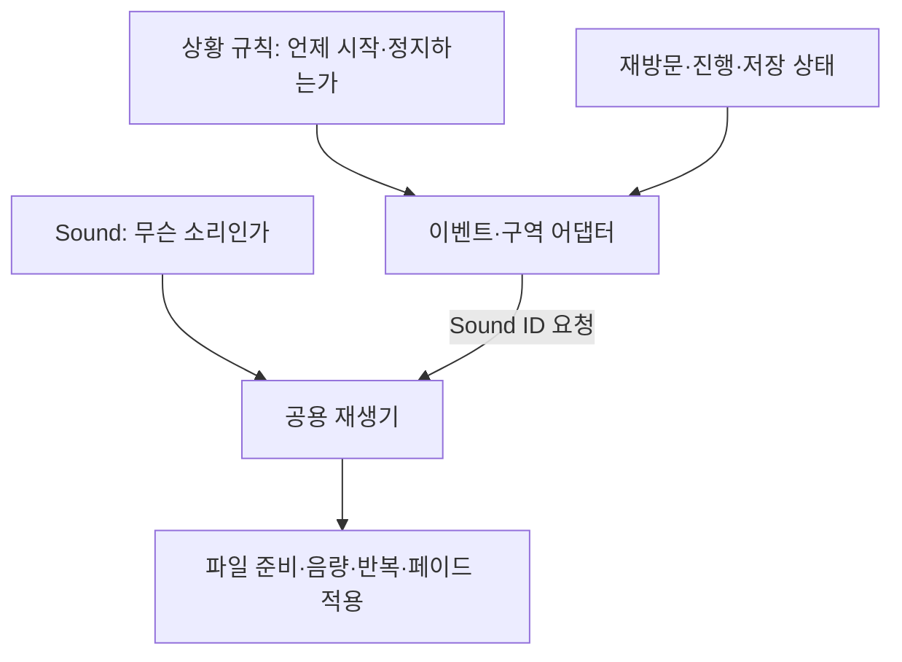

# 기획자용 사운드 상황별 재생 조건 요청서

> 2026-11-09 사용자 확정: 플레이어 동작 소리·Walk/Run 무작위 묶음·인게임 불 환경음은 [연결 안내](플레이어%20동작%20사운드%20연결%20안내.md) 범위로 반영했습니다. 아래 범용 질문 전체가 새로 확정되거나 모든 사운드가 연결됐다는 뜻은 아닙니다. HG_OJ_Fire는 보류입니다.

## 1. 이번에 정할 내용

Sound 표에는 소리 파일 주소·종류·기본 음량·반복·페이드를 작성합니다. 이 표만으로는 게임이 **어느 상황에서 어떤 소리를 재생할지** 알 수 없습니다. 이 문서는 그 연결에 필요한 기획 결정을 사례별로 정리한 요청서입니다. 아래 선택지는 검토용이며 확정값이 아닙니다. 기준일: 2026-11-05.

현재 구현은 Sound ID로 로딩·재생·정지하는 기반과 시험 창까지입니다. 상황별 자동 재생 표·구역 감지·아래 모든 규칙이 구현됐다는 뜻은 아닙니다. 조건을 확정하면 기존 데이터에 넣을 항목과 별도 재생 조건 표를 나눠 연결할 예정입니다. 이번 요청서에서 ID 대역이나 새 컬럼을 임의 확정하지 않습니다.

## 2. 먼저 이해할 네 가지

| 용어 | 쉬운 설명 | 예 |
| --- | --- | --- |
| 소리 정의 | 사용할 음원과 기본 재생 설정 | 쇠사슬 끊기는 소리 |
| 시작 조건 | 재생 요청을 보내는 순간 | 결박이 실제로 해제됐을 때 |
| 정지 조건 | 재생을 멈추는 순간 | 구역 이탈, 소유 몬스터 사망 |
| 재생 기록 범위 | 한 번 재생했다고 기억하는 기간 | 이번 방문만, 새 게임 전까지, 저장 기록에 유지 |

‘한 번만’과 ‘반복’도 다릅니다. 한 번의 요청으로 파일을 계속 돌리는 것은 Sound의 Loop입니다. 같은 장소에 다시 들어왔을 때 재생 요청을 다시 보내는지는 상황 조건입니다. 공격 소리를 매번 한 번 재생한다면 Loop=N이지만 공격할 때마다 다시 요청할 수 있습니다.

## 3. 모든 상황에 공통으로 필요한 답변

각 상황에서 아래 표를 채워 주세요. 아직 정해지지 않은 항목은 ‘미정’으로 적으면 됩니다. 없는 기능을 현재 구현돼 있다고 가정하지 않습니다.

| 질문 | 작성할 내용·선택 예 |
| --- | --- |
| 어떤 상황인가요? | 마을 종 구역 진입, 일반 공격 실제 명중 등 |
| 무엇이 대상인가요? | 특정 Stage·스킬·몬스터 종류·특정 배치 개체·구역 이름 |
| 어떤 소리인가요? | 확정된 Sound ID. 미확정이면 소리 용도와 담당자 |
| 정확히 언제 시작하나요? | 입력 직후, 모션 특정 순간, 실제 명중 확정, 구역 진입 완료 등 |
| 언제 끝나나요? | 파일 끝, 구역 이탈, 행동 취소, 대상 사망, 별도 종료 이벤트 |
| 반복과 재요청은 어떻게 하나요? | 파일 반복 Y/N, 같은 조건 재발생 시 재생 허용 여부 |
| 중첩되면 어떻게 하나요? | 겹쳐 재생, 기존 것 유지, 처음부터 다시, 이전 소리 종료 |
| 어느 대상끼리 중첩을 판단하나요? | 같은 Sound 전체, 같은 몬스터 한 마리, 같은 구역 한 곳 |
| 다른 음악·효과음과 겹쳐도 되나요? | 동시에 재생, 음악만 줄임, 우선순위 높은 소리만 재생 |
| 정지·교체는 어떻게 들리나요? | 즉시 정지, FadeOutMs 사용, 이전 곡과 교차 페이드 |
| 일시정지·로딩·컷씬에서는요? | 계속 재생, 작아짐, 일시정지, 완전 종료 중 선택 |
| 다시 방문하거나 죽었다 돌아오면요? | 다시 재생, 기록 유지, 조건을 다시 만족하면 재생 |
| 게임을 종료·이어하기하면요? | 다시 재생, 저장된 재생 기록 유지, 새 게임에서만 초기화 |
| 어디에서 들리나요? | 화면 전체에 같은 크기, 거리 따라 변화, 특정 화면/공간에서만 |
| 같은 조건이 짧게 연속 발생하면요? | 매번, 최소 간격, 최대 동시 개수. 시간은 ms로 명시 |

몬스터 종류 ID와 개별 몬스터는 다릅니다. 같은 종류가 여러 마리 있을 때 한 마리의 사망으로 모두의 소리를 정지할지, 그 한 마리 소리만 정지할지 구분해 주세요. 구역 이름도 맵이 다르면 구분할 수 있어야 합니다.

## 4. 이동·전투·상호작용 사례

| 상황 | 시작 시점에서 필요한 결정 | 끝·중첩·예외에서 필요한 결정 |
| --- | --- | --- |
| 발소리 | 걷기 상태 진입인가, 실제 발 접촉 프레임인가? 지면 재질마다 다른가? | 공중·구르기·피격 중에는 중지하는가? 걸음마다 겹쳐도 되는가? |
| 점프·착지 | 점프 입력인가, 실제 점프 수락인가? 착지 판정 순간인가? | 점프가 거부됐을 때 무음인가? 낮은 낙하와 큰 낙하를 구분하는가? |
| 일반 공격 휘두르기 | 입력 순간인가, 모션 특정 프레임인가? | 공격 취소·피격으로 끊기면 소리도 중지하는가? 연타별 다른 소리인가? |
| 일반 명중·헛치기 | 실제 피해 확정인가, 충돌만 해도 되는가? 헛치기는 언제 판정하는가? | 여러 적을 한 번에 맞히면 적마다인가, 공격 한 번에 한 소리인가? |
| 치명타·패링·반격 | 결과 확정 순간인가? 일반 명중음도 함께 내는가? | 치명타가 일반음을 대체하는가? 히트스톱 동안 소리는 계속되는가? |
| 플레이어 피격·사망 | 피해 수락 시점인가? 무적 상태에서 접촉해도 소리가 나는가? | 연속 피격음 제한과 사망음 우선순위, 사망 후 남은 루프 정지 여부 |
| 스킬 시작·결박 해제 | 스킬 입력, 사용 확정, 실제 적중, 결박 해제 중 어느 순간인가? | 재사용 대기·자원 부족으로 실패한 경우 별도 소리가 있는가? |
| 몬스터 대기·발견·공격 | 플레이어 인식 확정인가, 공격 예비동작인가? 종류별 다른가? | 여러 마리 동시 발견 시 제한, 대상 비활성화·사망 시 소리 종료 범위 |
| 몬스터 사망·처형 | HP0인가, 사망 모션 시작/특정 프레임인가? | 처형음과 사망음 동시 재생 여부, 시체·피격 후 재요청 방지 |
| 약초·저장·아이템 획득 | 입력인가, 사용/저장/획득 성공 확정인가? | 실패·취소에도 소리를 내는가? 같은 입력으로 중복 재생하지 않는 기준 |
| 문·장치·대화 | 상호작용 수락인가, 실제 문 개방/상태 변경인가? | 이미 열린 문·잠긴 문 구분, 대화 줄마다인가 시작/종료만인가? |

발 접촉이나 모션 특정 프레임은 해당 애니메이션 이벤트를 연결해야 합니다. 소리 재생기가 공격 입력과 명중 결과를 스스로 추측하지 않습니다. 게임 규칙의 결과·애니메이션·구역 관측 중 신호를 보낼 담당을 개발자가 연결해야 합니다.

## 5. 특정 장소·구역 사례

구역은 기획자가 눈으로 배치할 수 있는 범위가 필요합니다. 예를 들어 맵 프리팹 안의 Collider2D로 범위를 만들고 고유 구역 키를 데이터에서 참조하는 방식이 가능합니다. 이것은 제안이며 구역 데이터/컴포넌트는 아직 구현하지 않았습니다. 절대 좌표를 Sound 표에 추가하는 방식으로 확정하지 않습니다.

| 사례 | 꼭 정할 조건 |
| --- | --- |
| 종이 울리는 위치 | 최초 진입 한 번인지, 들어올 때마다인지. 경계에서 왔다 갔다 하면 다시 울리는지 |
| 바람·불·물 환경음 | 안에 있는 동안 반복인지. 이탈 즉시 정지인지 페이드인지. 다른 구역과 겹칠 때 둘 다 들리는지 |
| 숨어 있는 적의 단서 | 적이 살아 있고 발견 전일 때만인지. 발견·처치하면 소리가 영구히 멈추는지 |
| 보스방 문 앞 경고 | 문 앞 진입인지, 상호작용 수락인지. 보스 처치 후에도 재생하는지 |
| 상호작용 가능한 장치 근처 | 접근만으로 재생인지 조작 후인지. 장치가 꺼지면 어떤 신호로 종료하는지 |
| 서로 겹치는 구역 | 진입한 순서, 지정 우선순위, 플레이어와 가까운 구역 중 무엇을 우선하는지 |
| 맵 진입 시 이미 구역 안에 스폰 | 최초 진입으로 볼지. 이어하기·사망 복귀도 같은지 |
| 플레이어가 순간 이동하거나 씬 종료 | 이탈 이벤트가 안 와도 소유 구역 종료 시 정지할지 |

특히 ‘한 번만’을 아래 중 어디까지 기억할지 적어 주세요.

| 기억 범위 | 의미 |
| --- | --- |
| 이번 진입 | 구역을 나갔다 다시 들어오면 재생 가능 |
| 이번 맵 방문 | 다른 맵을 다녀오면 다시 가능 |
| 이번 플레이 | 게임을 종료하기 전까지 유지 |
| 저장 기록 | 이어하기해도 유지하고 새 게임에서 초기화 |

저장 기록을 사용하려면 어떤 진행 ID로 저장할지 저장 담당과 맞춰야 합니다. 기존 원칙대로 명시적인 저장 전의 기록은 임시 상태이며, 소리 재생 자체가 자동으로 영구 저장을 뜻하지 않습니다. 재생 기록 저장 여부는 아직 확정하지 않았습니다.

## 6. 배경음·연출·메뉴 사례

| 상황 | 필요한 결정 |
| --- | --- |
| 타이틀·맵 일반 배경음 | 시작 시점, 반복, 이전 음악 종료 방식. 같은 맵 재진입 시 처음부터인지 이어 듣기인지 |
| 전투 진입·종료 | 전투 시작 신호, 모든 적이 끝났다는 신호, 전투음 종료 지연 여부 |
| 보스 등장·페이즈 변경 | 일반 전투음보다 우선하는지, 페이즈 전환마다 새 곡인지 |
| 보스 사망·재도전 | 승리음과 음악 순서, 사망음 종료까지 기다리는지, 재도전 시 어떤 곡부터 시작하는지 |
| 로딩·암전·타이틀 복귀 | 이전 음악 페이드 시작점, 무음 구간, 다음 곡 시작점 |
| 컷씬·대화 | 기존 배경음 유지/감쇠/교체, 영상 자체 소리와 게임 소리 동시 재생 여부 |
| 일시정지·옵션 | 음악·효과음 각각 유지/감쇠/정지 여부. 설정 미리 듣기에 사용할 소리 |
| 메뉴 이동·확인·취소·오류 팝업 | 실제 선택 변경마다인지, 입력마다인지. 연속 입력 제한과 오류음 중복 여부 |

현재 기존 일시정지 음악50% 규칙과 로딩 기획은 별도로 존재합니다. 이 표에서 다른 규칙을 요청한다면 기존 기획과 충돌하는지도 함께 표시해 주세요. 미확정 규칙을 재생기 내부 상수로 먼저 넣지 않습니다.

## 7. 기획자가 작성할 요청 양식

아래 양식을 상황마다 복사해 작성해 주세요. 소리 정의는 Sound에 작성하고 여기에는 재생 조건을 적습니다.

| 항목 | 기획 답변 |
| --- | --- |
| 상황 이름·기획서 위치 | 미정 |
| 관련 Stage·스킬·몬스터·장치·구역 | 미정 |
| 사용할 Sound ID·음원 담당자 | 미정 |
| 시작 조건과 제외 조건 | 미정 |
| 정지·취소·대상 사망 시 조건 | 미정 |
| 파일 반복 여부와 재진입 재생 여부 | 미정 |
| 중첩 범위·최대 개수·최소 간격(ms) | 미정 |
| 다른 음악과 우선순위·전환 방식 | 미정 |
| 일시정지·로딩·컷씬 처리 | 미정 |
| 재방문·사망 복귀·이어하기·새 게임 처리 | 미정 |
| 저장할 재생 기록 유무 | 미정 |
| 거리감 유무·구역 배치 담당 | 미정 |
| 시험할 정상 사례·예외 사례 | 미정 |

### 작성 예시: 마을 종 구역

아래는 답안을 확정한 예가 아니라 어떤 식으로 답할지 보여 주는 설명입니다.

- 상황: 플레이어가 종 구역에 들어옴.
- 시작: 접근만으로 재생할지, E 상호작용 후 재생할지 중 선택 필요.
- 다시 들어옴: 매번인지, 이번 방문 한 번인지 선택 필요.
- 이탈: 끝까지 들려줄지, 즉시/페이드 종료할지 선택 필요.
- 저장: 종을 들었다는 사실을 이어하기에서도 기억할지 선택 필요.
- 예외: 구역 안에 바로 스폰, 경계 연속 진입, 컷씬 중 진입을 각각 어떻게 처리할지 필요.

## 8. 이번 기반과 이후 구현 구분

현재 시험 재생기는 최신 배경음 요청을 우선하고, 효과음은 중첩할 수 있으며, 같은 ID 정지는 그 ID의 재생들을 함께 종료합니다. 2D 전체 음량이고 소리별 거리 감쇠·구역 조건·랜덤 선택·우선순위·재생 기록 저장은 없습니다. 이는 시험 기반의 현재 동작이며 모든 상황의 기획 확정값이 아닙니다. 개체별 정지나 동시 재생 제한이 필요하면 이 요청서에 표시해 주세요.

기획자가 새 상황 이름을 표에 쓰는 것만으로 게임 이벤트가 자동 생성되지는 않습니다. 사용할 이벤트/구역 종류와 연결을 한 번 구현한 뒤에는 해당 데이터로 소리 ID와 규칙을 바꿀 수 있도록 만드는 방향입니다. 어떤 표에 어떤 컬럼을 추가할지는 답변을 검토한 뒤 데이터 담당·개발자가 함께 확정합니다.

실제 파일 등록·표 작성·시험 재생은 [사운드 테이블 작성과 배포 안내](기획자용%20사운드%20테이블%20작성과%20배포%20안내.md)를 참고합니다.
