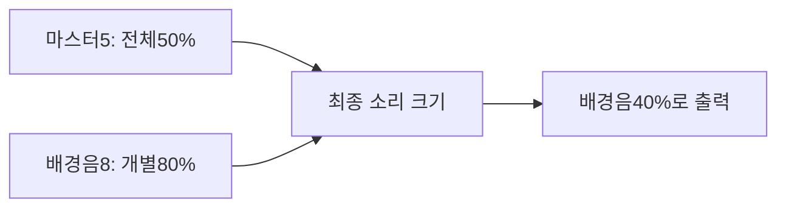
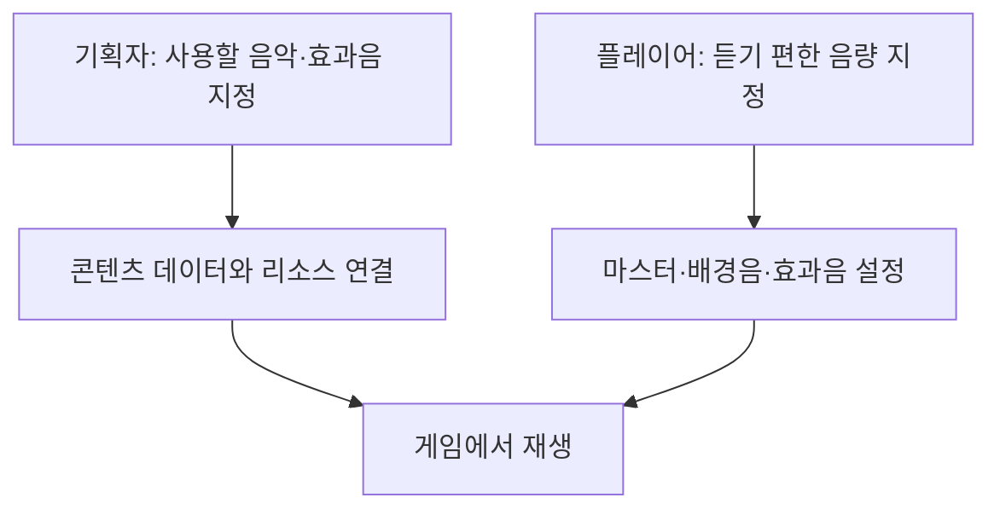
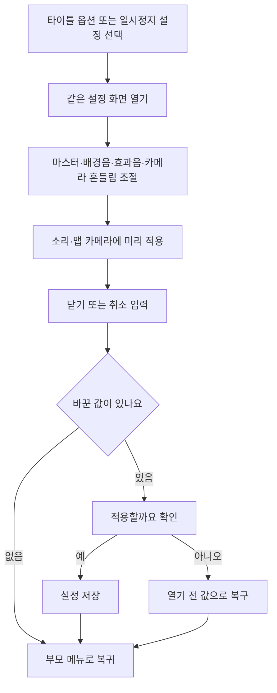

# 기획자용 사운드 설정 사용 안내

## 1. 이번에 준비된 기능

마스터는 모든 소리의 크기를 함께 줄이는 설정입니다. 배경음과 효과음의 개별 설정은 그대로 유지됩니다. 현재 타이틀과 일시정지는 같은 SettingsScreen 프리팹을 사용합니다. 마스터·배경음·효과음·카메라 흔들림을 조절하며 설정 저장·취소와 부모 화면 복귀를 연결했습니다. 실제 Unity 조작 확인은 아래 절차로 진행합니다.

| 항목 | 범위 | 기본값 | 역할 |
| --- | --- | --- | --- |
| 마스터 | 0~10 | 10 | 배경음·효과음을 함께 조절 |
| 배경음 | 0~10 | 8 | 음악 크기 조절 |
| 효과음 | 0~10 | 8 | 효과음 크기 조절 |

마스터를0으로 해도 배경음·효과음 값은 없어지지 않습니다. 마스터를 다시10으로 올리면 기존 개별 크기로 돌아옵니다. 설정은 게임 저장 슬롯이 아닌 별도 settings.json에 보관합니다. 예전 설정 파일에 마스터 항목이 없어도 기본10으로 읽도록 구성했습니다. 보통 이 파일을 직접 편집할 필요는 없습니다.

## 2. 소리 교체는 어디에서 하나요?

플레이어가 음량을 조절하는 것과 기획자가 어떤 소리를 쓸지 지정하는 것은 다른 작업입니다.

현재 맵의 일반·전투 배경음은 Stage의 BGM_Normal·BGM_Battle 키로 선택합니다. 실제 클립은 GameAudio의 Inspector 소리 목록에 연결돼 있어 키만 바꾼다고 새 파일이 자동으로 연결되지는 않습니다. 타이틀 배경음과 전투 효과음에도 기존 Inspector·코드 설정이 남아 있습니다.

앞으로 배경음과 효과음 모두 데이터에서 소리와 재생 설정을 지정하도록 확장합니다. Sound 표 기반의 주소 재생기와 시험 창을 준비했습니다. 실제 행·음원 주소를 등록해 시험할 수 있고 상황/구역 자동 재생 연결은 후속입니다. 새 컬럼·키는 개발자와 데이터 담당에게 연결을 요청해 주세요. 이번 작업이 모든 사운드의 데이터 전환 완료를 뜻하지는 않습니다.

## 3. Unity에서 설정 화면 확인하기

코드 반영이 끝난 뒤 Play를 실행해 확인합니다. 실제 소리 파일이 연결된 환경에서 음량을 확인해야 합니다. 등록된 소리가 없는 상태에서 무음인 것만으로 음량 기능의 실패를 판단하지 않습니다.

1. 마스터10에서 배경음·효과음이 기존과 같은 크기인지 확인합니다.
2. 마스터5로 낮췄을 때 두 종류가 함께 작아지는지 확인합니다.
3. 마스터0으로 무음 처리한 뒤 다시10으로 올려 개별 음량이 보존되는지 확인합니다.
4. 설정 변경을 취소하면 이전 크기로 돌아가는지 확인합니다.
5. 변경을 저장한 뒤 게임을 다시 실행해 유지되는지 확인합니다.
6. 일시정지 상태의 배경음 감쇠와 곡 전환이 마스터와 함께 적용되는지 확인합니다.

개발자 연결과 현재 미구현 범위는 [사운드 설정 설계](../개발자용%20설계문서/사운드%20설정%20설계.md)를 참고합니다.

## 4. 사운드 테이블 작성 안내

기획자가 소리 목록을 추가·수정·삭제하고 배포하는 순서는 별도의 [기획자용 사운드 테이블 작성과 배포 안내](기획자용%20사운드%20테이블%20작성과%20배포%20안내.md)를 따릅니다. 컬럼별 입력 예시·ID 빈칸 규칙·배포 오류 해결도 해당 문서에서 관리합니다.

## 5. 타이틀·일시정지 공용 화면 사용 순서

1. Title 씬에서 Play를 켜고 옵션을 선택합니다. 검은 빈 화면 대신 마스터·배경음·효과음·카메라 흔들림이 나타나야 합니다.
2. 위아래 입력으로 항목을 선택하고 좌우로 음량을 바꿉니다. 마우스는 항목의 좌우 화살표를 누릅니다. 카메라 흔들림은 항목 클릭·결정·좌우 입력으로 켜고 끕니다.
3. X 또는 취소 입력으로 나옵니다. 바꾼 값이 있으면 적용 확인창이 뜹니다. 예는 저장, 아니오 또는 확인창 취소는 열기 전 값으로 복구합니다.
4. 타이틀로 돌아왔을 때 옵션을 닫은 입력이 새 게임 실행으로 이어지지 않아야 합니다. 기존 타이틀 선택을 다시 조작할 수 있어야 합니다.
5. 맵의 일시정지 메뉴에서도 설정을 열어 같은 4항목을 확인합니다. 설정만 닫으면 일시정지 메뉴가 남아 있고, 계속하기를 해야 게임이 재개돼야 합니다.
6. 맵에서 카메라 흔들림을 바꿔 확인합니다. 타이틀에서는 카메라 연출이 없으므로 이 값은 저장하고 맵에서 적용합니다.
7. 설정을 연 상태에서 에러 팝업 시험을 합니다. 팝업 동안 설정 입력이 막히고 닫은 뒤 편집 상태가 유지돼야 합니다. 오류 팝업을 닫았다고 설정이 저장되거나 일시정지가 풀리면 안 됩니다.
8. Play를 중지하고 다시 시작해 저장한 값이 유지되는지 확인합니다. 설정 화면이 비활성화되거나 씬이 끝날 때 편집 중인 미확정 값은 취소합니다.

### 외형과 연결을 수정할 위치

| 대상 | 편집 위치·확인 사항 |
| --- | --- |
| 공통 화면 크기·색·글꼴·배치 | Assets/2.Model/Prefabs/UI/SettingsScreen.prefab |
| 마스터 조작부 | Master·MasterLeft·MasterRight 오브젝트. SettingsScreen의 대응 Text 참조 유지 |
| 마스터 문구 | Inspector의 마스터 임시 문구. 현재 기본은 마스터 음량 |
| Language 연결 | 마스터 문구 ID가0이면 임시 문구 사용. 기획자가 유효 ID를 공급한 뒤 해당 ID를 설정 |
| 타이틀 연결 | TitleScreen 프리팹의 TitleGameEntry에 SettingsScreen 프리팹·입력 에셋 연결 |
| 맵 연결 | PauseMenuHost에 씬의 SettingsScreen·입력 에셋 연결 |

프리팹의 루트는 비활성 상태로 유지합니다. 호출 기능이 데이터를 연결하고 열도록 구성돼 있습니다. 같은 화면을 두 번 복제해 타이틀용·맵용 코드를 따로 수정하지 않습니다. 외형을 공통으로 바꾸려면 원본 프리팹을 수정하고, 씬 인스턴스에 이미 덮어쓴 속성이 있다면 공통 변경이 가려지는지 확인합니다.

설정 화면의 문구는 현재 한국어 표시이며 전역 언어 선택 UI는 이번 작업에 포함하지 않습니다. Sound 표 기반 시험 재생은 가능하며 실제 게임 상황·구역 연결은 별도 작업입니다.
